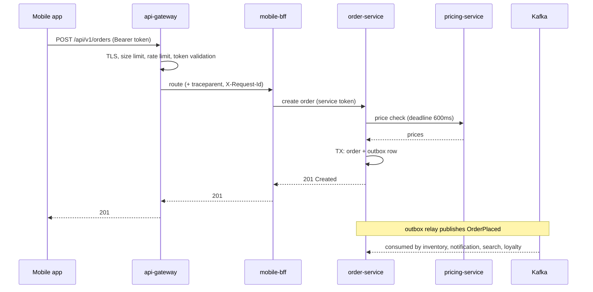
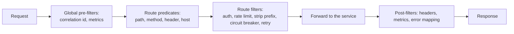
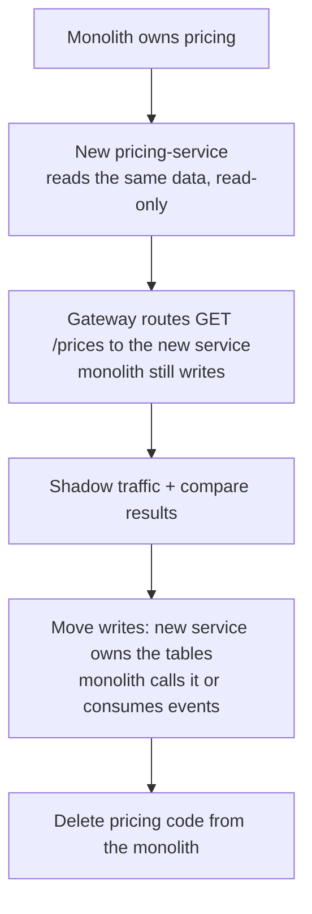
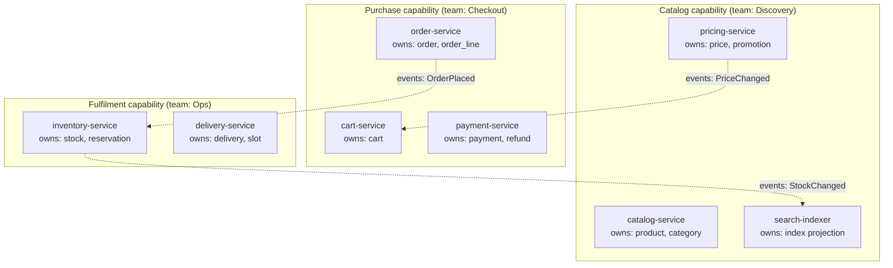
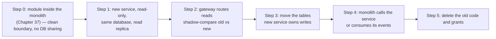
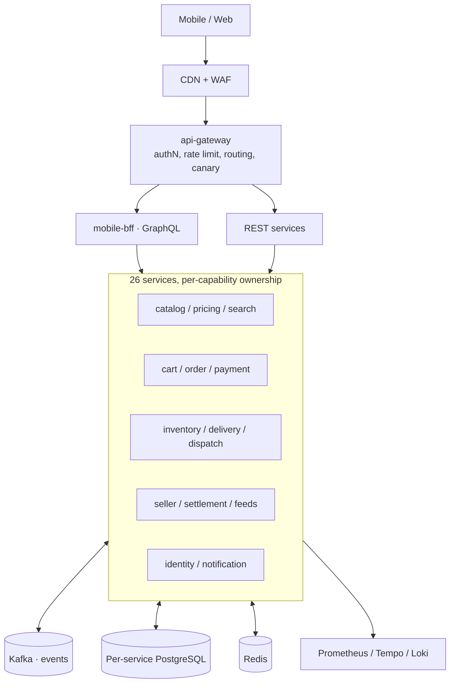

# 35 · Microservices & Spring Cloud

## 1. Introduction & Why It Matters

Part 2 made a single service production-grade. Part 3 asks the harder question: **how do twenty-six of them work together without becoming a distributed monolith?**

The grocery platform's services were not all created equal. Some were carved from a monolith along real business seams and can deploy independently. Others were split because "microservices" was the plan, and now a checkout change requires coordinated releases of four services, a shared library version bump and a schema migration nobody owns. The second group is the expensive one.

The difference is rarely technology. It is:

- **Boundaries** drawn along business capabilities rather than database tables.
- **Data ownership** — one service writes each piece of data; others get copies through events.
- **Independent deployability** — a service can ship without a synchronized release train.
- **A gateway** that centralizes cross-cutting edge concerns instead of duplicating them 26 times.
- **Operational maturity** — every service has an owner, SLOs, runbooks and on-call.

This chapter covers the platform layer: decomposition principles and the strangler-fig migration that produced these services, Spring Cloud Gateway as the edge (routing, authentication, rate limiting, resilience), service discovery in and out of Kubernetes, configuration strategy, inter-service communication patterns, shared-library governance, local development across many services, and the anti-patterns that turn microservices into a slower monolith with network calls.

### Who should read which section

| Band | Focus |
|---|---|
| B1 · 0–2 yrs | Parts 1, 2, 4 — what the pieces are, a gateway route |
| B2 · 2–5 yrs | Parts 2, 5 — gateway filters, discovery, config, client calls |
| B3 · 5–8 yrs | Parts 3, 5, 6 — boundaries, data ownership, extraction |
| B4 · 8–12 yrs | Parts 6, 8 — platform architecture, governance, migration |
| B5 · 12–15+ yrs | Parts 8, 9 — organizational design, when not to split |

---

## 2. Core Concepts

### 2.1 What actually justifies a separate service

| Good reason | Why |
|---|---|
| Independent **deployability** of a business capability | Different change rates and release risk |
| Independent **scaling** | Search scales with browsing; settlement with sellers |
| Clear **ownership** by one team | Conway's law works for you instead of against you |
| Different **technology or data** needs | Search needs OpenSearch, not PostgreSQL |
| **Failure isolation** | A broken recommender must not stop checkout |

| Bad reason | What happens |
|---|---|
| "Microservices are best practice" | Distributed monolith |
| One service per database table ("entity services") | Chatty chains, no real boundary |
| Reuse of a shared library | Coupling without independence |
| A layer per service (controller-service / data-service) | Network calls inside what should be one process |

!!! tip "Start with a modular monolith"
    Chapter 37 covers modules with enforced boundaries inside one deployable. Most teams should start there and extract services when a module's deployment, scaling or ownership genuinely diverges. Extraction from a well-modularized monolith is a refactor; extraction from a tangled one is a rewrite.

### 2.2 Data ownership

| Rule | Consequence |
|---|---|
| Each piece of data has exactly **one** writing service | No two services can disagree about the truth |
| Others hold **copies**, updated by events (Chapter 23) | Reads are local and fast; consistency is eventual |
| **No shared database** between services | The schema is an implementation detail, not an API |
| Cross-service queries are **compositions**, not joins | BFF or API composition (Chapter 32) |
| Cross-service writes are **sagas**, not transactions | Chapter 36 |

A shared database is the single most reliable way to build a distributed monolith: every schema change becomes a multi-team, lockstep release.

### 2.3 The grocery platform's services

| Domain | Services | Owns |
|---|---|---|
| Customer-facing | mobile-bff, api-gateway | Nothing (composition only) |
| Catalog | catalog, search-indexer, pricing | Products, prices, search index |
| Purchase | cart, order, payment | Carts, orders, payments |
| Fulfilment | inventory, delivery, dispatch, tracking | Stock, deliveries, assignments |
| Seller | seller, settlement, catalog-feed | Sellers, payouts, feeds |
| Platform | identity, notification, config/ops tools | Identity, message delivery |

Twenty-six in total, including smaller supporting services. The count isn't a target; it's the result of applying 2.1.

### 2.4 The edge: an API gateway

| Concern | Why it belongs at the edge |
|---|---|
| Routing to services | Clients see one host |
| TLS termination, request size limits | Once, not 26 times |
| Authentication (token validation) | Cheap rejection before fan-out (Chapter 18) |
| Rate limiting and quotas per client | Global view of a caller (Chapter 26) |
| CORS, compression, header hygiene | Uniform policy |
| Canary/traffic splitting | Chapter 30 |
| Observability at the boundary | One place to see all traffic |

What does **not** belong at the edge: business logic, response aggregation (use a BFF — Chapter 32), and per-service authorization (services re-validate tokens and enforce ownership themselves, Chapter 17).

### 2.5 Spring Cloud components, current status

| Component | Use in this platform |
|---|---|
| **Spring Cloud Gateway** | The edge (reactive, or the servlet "Gateway Server MVC" variant) |
| **Spring Cloud LoadBalancer** | Client-side load balancing where DNS isn't enough |
| Spring Cloud Config | Not used — ConfigMaps + GitOps (Chapters 06, 30) |
| Spring Cloud Netflix Eureka | Not used in Kubernetes; relevant for VM estates |
| Spring Cloud OpenFeign | Maintenance — replaced by HTTP interfaces (Chapter 19) |
| Spring Cloud Stream | Optional; direct clients preferred (Chapter 24) |
| Spring Cloud Contract | Alternative to Pact (Chapter 28) |
| Spring Cloud Circuit Breaker | Thin abstraction; Resilience4j used directly (Chapter 26) |
| Spring Cloud Bus / Task / Function | Situational |

Hystrix, Ribbon and Zuul are retired; their replacements are Resilience4j, Spring Cloud LoadBalancer and Spring Cloud Gateway. Pin the **release train** to your Boot version — it is the most common upgrade blocker.

### 2.6 Service discovery

| Environment | Mechanism |
|---|---|
| Kubernetes | **Service DNS** (`http://pricing-service:8080`) — nothing else needed |
| Kubernetes, client-side balancing needed | Headless service + Spring Cloud LoadBalancer, or a mesh |
| VMs / hybrid | Eureka (or Consul) with Spring Cloud Discovery |
| Across clusters/regions | Mesh, global load balancer, or explicit endpoints |

In Kubernetes, adding Eureka duplicates what the platform already provides — and adds a component that can fail.

### 2.7 Communication patterns

| Pattern | When |
|---|---|
| **Synchronous request/response** (REST/gRPC) | The caller needs the answer now |
| **Events** (Kafka) | Notify others of a fact; decouple availability (Chapter 23) |
| **Commands** (queue) | Ask one service to do work later (Chapter 24) |
| **Data replication via events** | Local reads of another service's data (Chapter 36) |
| **Composition** (BFF/gateway aggregation) | Client needs several services' data at once (Chapter 32) |

Rule of thumb: **prefer events**. Every synchronous hop adds latency, a failure mode and a coupling in availability.

### 2.8 The distributed monolith smell test

| Symptom | Verdict |
|---|---|
| Services must be deployed together in a specific order | Distributed monolith |
| One user action synchronously traverses 5+ services | Chatty chain |
| Services share a database schema | Not separate services |
| A shared library contains domain logic and must be upgraded everywhere at once | Coupled |
| A change to one service's API requires immediate changes in others | Contracts not versioned (Chapter 20) |
| Local development requires running 12 services | Boundaries or tooling problem |

---

## 3. How It Works Internally

### 3.1 A request through the platform



The synchronous path is deliberately **short**: gateway → BFF → order → pricing. Everything else happens through events after the response.

### 3.2 Gateway request pipeline



Predicates decide **which** route; filters decide **what happens** on the way in and out. Order matters: authenticate and rate-limit before forwarding, never after.

### 3.3 Extraction with the strangler fig



Each arrow is independently deployable and reversible. The dangerous version — build everything, cut over once — is how extractions become six-month incidents.

---

## 4. Hands-On Code — Level 1 (Beginner)

### 4.1 A gateway with routes

```kotlin title="build.gradle.kts (api-gateway)"
implementation("org.springframework.cloud:spring-cloud-starter-gateway")          // (1)!
implementation("org.springframework.boot:spring-boot-starter-oauth2-resource-server")
implementation("org.springframework.boot:spring-boot-starter-data-redis-reactive")
```

1. The reactive gateway (Chapter 31's stack). A servlet-based variant exists — **verify** the artifact name and capabilities for your Spring Cloud version.

```yaml title="application.yml"
spring:
  cloud:
    gateway:
      routes:
        - id: catalog
          uri: http://catalog-service:8080                       # (1)!
          predicates:
            - Path=/api/v1/products/**,/api/v1/categories/**
        - id: orders
          uri: http://order-service:8080
          predicates:
            - Path=/api/v1/orders/**
          filters:
            - name: CircuitBreaker                                # (2)!
              args:
                name: orders
                fallbackUri: forward:/fallback/orders
        - id: bff
          uri: http://mobile-bff:8080
          predicates:
            - Path=/graphql
      default-filters:
        - RemoveRequestHeader=Cookie                              # (3)!
        - AddResponseHeader=X-Content-Type-Options, nosniff
```

1. Kubernetes service DNS — no discovery client required (2.6).
2. Edge-level circuit breaking, complementing service-level resilience (Chapter 26).
3. Strip headers clients shouldn't be sending to a token-based API.

### 4.2 Authentication at the edge

```yaml title="application.yml"
spring:
  security:
    oauth2:
      resourceserver:
        jwt:
          issuer-uri: https://id.grocery.in
          audiences: grocery-api
```

```java title="in/grocery/gateway/config/GatewaySecurityConfig.java"
@Bean
SecurityWebFilterChain gatewaySecurity(ServerHttpSecurity http) {
    return http
            .authorizeExchange(exchanges -> exchanges
                    .pathMatchers("/api/v1/public/**", "/actuator/health/**").permitAll()
                    .pathMatchers("/webhooks/**").permitAll()                       // (1)!
                    .anyExchange().authenticated())
            .oauth2ResourceServer(o -> o.jwt(Customizer.withDefaults()))
            .csrf(ServerHttpSecurity.CsrfSpec::disable)
            .build();
}
```

1. Webhooks authenticate by signature inside the service (Chapter 18), so the gateway lets them through — but still applies rate limits and size caps.

!!! danger "The gateway is not the only guard"
    Services must validate tokens and enforce ownership themselves (Chapter 17). A gateway-only model means anything that reaches a pod — a misconfigured NetworkPolicy, a compromised sidecar, an internal caller — is fully trusted.

### 4.3 Calling another service

```java title="in/grocery/order/client/PricingClientConfig.java"
@Bean
PricingApi pricingApi(RestClient.Builder builder, PricingProperties props) {        // (1)!
    RestClient client = builder
            .baseUrl(props.baseUrl())            // http://pricing-service:8080
            .requestFactory(RequestFactories.pooled(Duration.ofSeconds(1), props.readTimeout()))
            .defaultStatusHandler(new InternalServiceErrorHandler("pricing-service"))
            .build();
    return HttpServiceProxyFactory.builderFor(RestClientAdapter.create(client))
            .build().createClient(PricingApi.class);
}
```

1. Plain DNS plus the HTTP interface from Chapter 19 — no Feign, no Eureka, no LoadBalancer bean. Simpler is a feature.

---

## 5. Hands-On Code — Level 2 (Intermediate) & Level 3 (Advanced)

### 5.1 Level 2 — Gateway rate limiting and quotas

```yaml title="Per-client rate limiting with Redis"
        - id: search
          uri: http://search-service:8080
          predicates:
            - Path=/api/v1/search/**
          filters:
            - name: RequestRateLimiter
              args:
                redis-rate-limiter.replenishRate: 20          # (1)!
                redis-rate-limiter.burstCapacity: 40
                redis-rate-limiter.requestedTokens: 1
                key-resolver: "#{@clientKeyResolver}"          # (2)!
```

```java title="in/grocery/gateway/ratelimit/ClientKeyResolver.java"
@Bean
KeyResolver clientKeyResolver() {
    return exchange -> ReactiveSecurityContextHolder.getContext()
            .map(ctx -> ctx.getAuthentication().getName())                        // (1)!
            .defaultIfEmpty(clientIp(exchange))                                   // (2)!
            .map(key -> "rl:" + key);
}
```

1. Authenticated callers are limited **per subject**, so one abusive account can't consume the quota of others.
2. Anonymous traffic falls back to IP (imperfect behind NAT, but better than a global bucket).

```java title="Returning a useful 429 (Chapter 20's headers)"
@Bean
GlobalFilter rateLimitHeaders() {
    return (exchange, chain) -> chain.filter(exchange).then(Mono.fromRunnable(() -> {
        if (exchange.getResponse().getStatusCode() == HttpStatus.TOO_MANY_REQUESTS) {
            exchange.getResponse().getHeaders().add("Retry-After", "2");           // (1)!
        }
    }));
}
```

1. Clients that receive `Retry-After` back off; clients that receive a bare 429 hammer harder.

### 5.2 Level 2 — Cross-cutting edge concerns

```java title="in/grocery/gateway/filter/CorrelationFilter.java"
@Component
public class CorrelationFilter implements GlobalFilter, Ordered {

    @Override
    public Mono<Void> filter(ServerWebExchange exchange, GatewayFilterChain chain) {
        String requestId = Optional.ofNullable(exchange.getRequest().getHeaders().getFirst("X-Request-Id"))
                .filter(StringUtils::hasText)
                .orElse(UUID.randomUUID().toString());                             // (1)!

        ServerHttpRequest mutated = exchange.getRequest().mutate()
                .header("X-Request-Id", requestId)
                .headers(headers -> headers.remove("X-Customer-Id"))               // (2)!
                .build();

        exchange.getResponse().getHeaders().add("X-Request-Id", requestId);
        return chain.filter(exchange.mutate().request(mutated).build());
    }

    @Override
    public int getOrder() {
        return Ordered.HIGHEST_PRECEDENCE;
    }
}
```

1. One correlation id for the whole fan-out (Chapter 07); `traceparent` is handled by tracing instrumentation.
2. **Strip client-supplied identity headers.** If any service still trusts `X-Customer-Id` (Chapter 18's migration), a client must not be able to set it.

```yaml title="Size limits and timeouts"
spring:
  cloud:
    gateway:
      httpclient:
        connect-timeout: 1000
        response-timeout: 8s                 # (1)!
      filter:
        request-size:
          max-size: 2MB                      # (2)!
```

1. Longer than any downstream budget (Chapter 19), shorter than the client's patience.
2. A cheap defence against large-body attacks; specific routes (file uploads) override it.

### 5.3 Level 3 — Drawing and enforcing boundaries



Boundary rules the platform enforces in review:

| Rule | Check |
|---|---|
| One writer per table | Database grants: only the owning service has write access |
| No cross-service joins | No service has credentials for another's schema |
| Synchronous calls only within a request's critical path | Architecture review; trace analysis |
| Events for everything else | Chapter 23 |
| Contracts versioned and tested | Chapter 28's broker gate |

```sql title="Ownership enforced by the database, not by goodwill"
grant select, insert, update, delete on order_line to order_service_app;
grant select on order_line to analytics_reader;                                     -- (1)
revoke all on order_line from inventory_service_app;                                -- (2)
```

1. Read-only access for analytics is fine and explicit.
2. The most effective boundary control available: another service **cannot** write your data even if someone writes the code.

### 5.4 Level 3 — Replicating data instead of calling

The cart needs product names and prices for display. Calling catalog and pricing on every cart read is 2 extra hops per request.

```java title="in/grocery/cart/projection/ProductProjectionUpdater.java"
@Component
class ProductProjectionUpdater {

    private final ProductProjectionRepository projections;

    @KafkaListener(topics = "grocery.catalog.product-changed.v1", groupId = "cart-service")
    @Transactional
    public void onProductChanged(ProductChanged event) {
        projections.upsert(new ProductProjection(                                    // (1)!
                event.sku(), event.name(), event.imageUrl(), event.brand(), event.updatedAt()));
    }

    @KafkaListener(topics = "grocery.pricing.price-changed.v1", groupId = "cart-service")
    @Transactional
    public void onPriceChanged(PriceChanged event) {
        projections.updatePrice(event.sku(), event.zone(), event.price(), event.updatedAt());   // (2)!
    }
}
```

1. A **local, read-only copy** of the fields cart needs — not the whole product model.
2. Prices are zone-scoped; the projection stores what cart displays, and checkout still calls pricing for the **authoritative** amount.

| Aspect | Consequence |
|---|---|
| Latency | Cart reads are local — no network hop |
| Availability | Cart works when catalog is down |
| Consistency | Eventually consistent (seconds); acceptable for display, **not** for charging |
| Storage | Duplicated data, owned by the consumer, rebuildable by replay |
| Rule | **Display from the projection, decide from the owner** |

### 5.5 Level 3 — Extracting a service from the monolith



```java title="Step 2: shadow comparison"
@Component
class PricingShadowComparator {

    @Async("shadowExecutor")                                                        // (1)!
    public void compare(String sku, String pincode, PriceView legacy) {
        try {
            PriceView candidate = newPricingClient.price(sku, pincode);
            if (!legacy.price().equals(candidate.price())) {
                meters.counter("grocery.shadow.mismatch", "endpoint", "price").increment();
                log.warn("Shadow mismatch for {}/{}: legacy={} new={}",                // (2)!
                        sku, pincode, legacy.price(), candidate.price());
            }
        } catch (Exception e) {
            meters.counter("grocery.shadow.error").increment();                       // (3)!
        }
    }
}
```

1. Shadow calls run **off the request path** — they must never add latency or failure to production traffic.
2. Mismatches are data, not alarms; investigate the pattern (rounding, timezone, stale cache) before cutting over.
3. Shadow failures are logged and counted, never propagated.

Cut over when the mismatch rate is zero for a sustained period, and keep the route switch a **configuration change** so rollback is instant.

### 5.6 Level 3 — Shared libraries without coupling

| Library | Contents | Coupling risk |
|---|---|---|
| `grocery-platform-web` | Error handling, problem format, correlation filter, common OpenAPI config | Low — cross-cutting only |
| `grocery-platform-security` | Token validation, authorities converter, entry points | Low |
| `grocery-platform-observability` | Common tags, meter filters, health conventions | Low |
| `grocery-platform-test` | Containers config, builders, ArchUnit rules | Low |
| `grocery-order-client` | HTTP interface + DTOs for order-service | **Medium** — owned by the order team, versioned |
| `grocery-domain-model` | Shared entities/business rules | **Don't** |

Rules: platform libraries contain **no business logic**; client libraries are owned by the **providing** team and versioned semantically; nothing forces a lockstep upgrade — services run N and N-1 (Chapter 41 covers building starters).

---

## 6. Hands-On Code — Level 4 (Expert / Production)

### 6.1 The platform topology



| Decision | Choice | Rationale |
|---|---|---|
| Discovery | Kubernetes DNS | One less component (2.6) |
| Configuration | ConfigMaps + GitOps | Chapters 06, 30 |
| Edge | Spring Cloud Gateway | Routing, authN, quotas, canary |
| Aggregation | mobile-bff (GraphQL) | Chapter 32 |
| Inter-service auth | Client credentials | Chapter 18 |
| Sync calls | RestClient + HTTP interfaces; gRPC for hot paths | Chapters 19, 32 |
| Async | Kafka with outbox/inbox | Chapters 23, 36 |
| Resilience | Resilience4j in services; mesh for transport | Chapters 26, 30 |
| Contracts | Pact + broker gate | Chapter 28 |

### 6.2 Service ownership records

```yaml title="platform/catalog/service.yaml (the service catalog entry)"
name: order-service
team: checkout
slack: "#team-checkout"
oncall: checkout-primary
tier: 1                                                # (1)!
description: Owns orders and order lines; orchestrates checkout.
owns_data: [customer_order, order_line, order_outbox]
depends_on:
  sync: [pricing-service, inventory-service, payment-service]
  async: [grocery.payment.captured.v1]
publishes: [grocery.order.placed.v1, grocery.order.status-changed.v1]
slos:
  - name: checkout-availability
    objective: 99.5%
  - name: checkout-latency-p99
    objective: 2s
runbooks:
  - https://runbooks.grocery.in/order-service
```

1. Tier drives on-call expectations, review requirements and capacity headroom. A machine-readable catalog powers dependency graphs, ownership lookups during incidents and automated compliance checks ("every tier-1 service has SLOs and a runbook").

### 6.3 Gateway in production

```yaml title="api-gateway/application-prod.yml (excerpt)"
spring:
  cloud:
    gateway:
      metrics:
        enabled: true                                   # (1)!
      default-filters:
        - RemoveRequestHeader=Cookie
        - RemoveRequestHeader=X-Customer-Id
        - name: Retry
          args:
            retries: 1
            methods: GET                                # (2)!
            statuses: BAD_GATEWAY,SERVICE_UNAVAILABLE
            backoff:
              firstBackoff: 50ms
              maxBackoff: 200ms
              basedOnPreviousValue: false
      routes:
        - id: orders
          uri: http://order-service:8080
          predicates: [ "Path=/api/v1/orders/**" ]
          filters:
            - name: CircuitBreaker
              args: { name: orders, fallbackUri: "forward:/fallback/orders" }
            - name: RequestRateLimiter
              args:
                redis-rate-limiter.replenishRate: 50
                redis-rate-limiter.burstCapacity: 100
                key-resolver: "#{@clientKeyResolver}"
```

1. `spring.cloud.gateway.requests` metrics per route feed the edge dashboard (Chapter 27).
2. **Idempotent methods only**, one retry — the gateway is one retry layer; services must not retry the same call again (Chapter 26).

```java title="Fallbacks that say something useful"
@RestController
class FallbackController {

    @RequestMapping("/fallback/orders")
    ResponseEntity<ProblemDetail> orders() {
        ProblemDetail problem = ProblemDetail.forStatus(HttpStatus.SERVICE_UNAVAILABLE);
        problem.setTitle("Orders temporarily unavailable");
        problem.setProperty("code", "ORDERS_UNAVAILABLE");                           // (1)!
        problem.setProperty("retryable", true);
        return ResponseEntity.status(503).header("Retry-After", "5").body(problem);
    }
}
```

1. Same error contract as everywhere else (Chapter 10) — clients handle an edge failure with the code they already know.

### 6.4 Local development across 26 services

| Approach | Use |
|---|---|
| **Run one service + Testcontainers** | The default: real PostgreSQL/Kafka/Redis, stubs for peers (Chapter 28) |
| **Stub libraries from providers** | WireMock stubs published by each team (Chapter 28) |
| **`bootTestRun` with containers** | Local app against local infrastructure (Chapter 15) |
| Shared development cluster + port-forward | When you truly need a real peer |
| Telepresence/Tilt-style tooling | Occasional deep integration work |
| Running 12 services locally | ❌ a symptom to fix, not a workflow |

```bash title="What a developer actually runs"
./gradlew :order-service:bootTestRun          # app + PostgreSQL + Kafka + WireMock stubs
```

If a task genuinely requires four real services, that's a signal about coupling (2.8) worth raising in review.

### 6.5 Anti-patterns, with their cures

| Anti-pattern | Cure |
|---|---|
| Shared database | Split schemas, grants per service, events for copies |
| Synchronous chain of 5 services | Move work to events; compose at the BFF; cache projections |
| Lockstep releases | Versioned contracts (Chapter 20), consumer-driven tests (Chapter 28) |
| Shared domain library | Platform libraries only; DTOs per client library |
| Entity services (`user-service`, `address-service`) | Merge into a capability |
| Distributed transactions attempted | Sagas and idempotency (Chapter 36) |
| Nobody owns service X | Service catalog with an owning team, or delete it |
| "We'll fix boundaries later" | Boundaries are the product; later never comes cheaply |

### 6.6 When to merge services back

Splitting is reversible, and sometimes correct to reverse:

| Signal | Action |
|---|---|
| Two services always change together | Merge them |
| A service has no independent scaling or deployment need | Merge |
| The network hop exists only for a layer boundary | Merge |
| One team owns six tiny services with identical lifecycles | Consolidate into a modular monolith (Chapter 37) |

Merging is unglamorous and frequently the highest-value architectural work available.

---

## 7. Spring Boot 3 vs 4 & Migration

| Topic | Boot 3.5 / Spring Cloud 2024.x–2025.x | Boot 4.x / matching train |
|---|---|---|
| Release train alignment | Pinned per Boot minor | **Must** match — verify before upgrading |
| Spring Cloud Gateway | Reactive + Gateway Server MVC variant | Same (verify artifact names) |
| OpenFeign | Maintenance | Maintenance — migrate to HTTP interfaces (Chapter 19) |
| Eureka / Config Server | Available | Available (verify) |
| Spring Cloud LoadBalancer | ✅ | ✅ |
| Spring Cloud Stream | 4.x | Aligned train (verify) |

!!! danger "The release train is the upgrade gate"
    Spring Cloud lags Boot releases. Plan platform upgrades around the train's availability, upgrade the gateway and shared libraries first, and never mix trains across services that share a client library.

### Migration checklist

- [ ] Confirm the Spring Cloud train supporting your target Boot version exists and is stable.
- [ ] Upgrade the gateway in isolation first; re-test routes, filters, rate limiting and auth.
- [ ] Migrate remaining Feign clients to HTTP interfaces before the upgrade, not during.
- [ ] Re-run contract tests across services while versions are mixed.
- [ ] Verify metric names used by edge dashboards.

---

## 8. Production Playbook

### Best practices

1. **Boundaries by business capability**, one owning team per service.
2. **One writer per dataset**, enforced by database grants; copies via events.
3. **Short synchronous paths**; everything else asynchronous.
4. **Gateway owns edge concerns**; services still authenticate and authorize.
5. **Service DNS in Kubernetes** — skip discovery servers you don't need.
6. **Contracts versioned and tested**, with a deployment gate (Chapters 20, 28).
7. **Platform libraries without business logic**; client libraries owned by providers.
8. **A service catalog** with owners, SLOs, dependencies and runbooks.
9. **Extract with the strangler fig**, shadow-compare, switch by configuration.
10. **Merge services back** when they don't earn their separation.

### Anti-patterns

❌ A shared database between services.

❌ Long synchronous chains for a single user action.

❌ Coordinated, ordered deployments.

❌ Shared domain libraries that force lockstep upgrades.

❌ Entity services and layer services.

❌ Running Eureka/Config Server inside Kubernetes for no reason.

❌ Trusting gateway-injected identity headers inside services.

❌ Retrying at both the gateway and the service.

❌ Services without an owner, SLOs or a runbook.

❌ Splitting before the boundary is understood — start modular (Chapter 37).

### Troubleshooting

| Symptom | Cause | Fix |
|---|---|---|
| One service's deploy breaks others | Unversioned contract changes | Additive evolution, contract gate |
| Latency grows with each release | Longer synchronous chains | Move to events, cache projections |
| A schema change needs four teams | Shared database | Split ownership, grants, events |
| Gateway becomes a bottleneck | CPU limits, heavy filters, no scaling | Profile filters, scale out, move aggregation to the BFF |
| Duplicate retries during incidents | Retry at gateway and service | One layer only |
| Trace stops at the gateway | Propagation headers stripped | Allow `traceparent`, keep instrumentation |
| Nobody knows who owns a failing service | No catalog | Service catalog with on-call |
| Local dev requires 12 services | Coupling / missing stubs | Stub libraries, Testcontainers, boundary review |
| Data inconsistent between services | Two writers, or missed events | Enforce single writer; inbox/outbox (Chapters 23, 36) |

### Production checklist

- [ ] Every service has an owning team, SLOs, runbooks and a catalog entry
- [ ] One writer per dataset; grants enforce it
- [ ] Contracts versioned with consumer-driven tests and a deploy gate
- [ ] Gateway: authN, rate limits, size limits, single retry layer, fallbacks with the platform error format
- [ ] Services validate tokens and enforce ownership independently
- [ ] Event-first communication; synchronous chains reviewed and bounded
- [ ] Platform libraries free of business logic; client libraries versioned
- [ ] Local development runs one service with stubs and containers
- [ ] Extraction plan (or merge plan) recorded for services under change

---

## 9. Interview Questions & Answers

### B1 · 0–2 years

??? question "B1 · What is an API gateway for?"
    **Short answer:** A single entry point handling routing, TLS, authentication, rate limiting, size limits and edge observability, so services don't each implement them.

??? question "B1 · How do services find each other in Kubernetes?"
    **Short answer:** Through Service DNS (`http://pricing-service:8080`); no separate discovery server is needed.

??? question "B1 · Why shouldn't microservices share a database?"
    **Short answer:** It couples their schemas and releases — a change requires coordinating every service that touches those tables, which defeats independent deployability.

??? question "B1 · What is a distributed monolith?"
    **Short answer:** Services that must be deployed together, share a database or call each other synchronously for every action — all the costs of distribution with none of the independence.

??? question "B1 · Name a good reason to split a service."
    **Short answer:** A business capability that needs to deploy, scale or be owned independently — not "one service per table".

### B2 · 2–5 years

??? question "B2 · Which Spring Cloud components are still current?"
    **Short answer:** Gateway, LoadBalancer, Config (where needed), Stream, Contract, Circuit Breaker, Eureka for non-Kubernetes estates. Hystrix, Ribbon and Zuul are retired; OpenFeign is in maintenance in favour of HTTP interfaces.

??? question "B2 · How do you rate-limit per client at the gateway?"
    **Short answer:** `RequestRateLimiter` with a Redis limiter and a `KeyResolver` that keys on the authenticated subject (falling back to IP), returning 429 with `Retry-After` and `RateLimit-*` headers.

??? question "B2 · Should the gateway aggregate responses?"
    **Short answer:** No — aggregation belongs in a BFF, which can own client-specific shaping, partial failure and batching. Keeping the gateway thin keeps it fast and operable.

??? question "B2 · How does one service get another's data for display?"
    **Short answer:** Preferably a local projection maintained from events; call the owner synchronously only when the value must be authoritative at that instant.

??? question "B2 · Why must services authenticate even behind a gateway?"
    **Short answer:** Defence in depth — network controls fail, internal callers exist, and trusting an injected header makes any pod-level access a full compromise.

??? question "B2 · How do you avoid lockstep releases?"
    **Short answer:** Additive, versioned contracts; consumer-driven contract tests with a `can-i-deploy` gate; tolerant readers; feature flags for behaviour changes.

### B3 · 5–8 years

??? question "B3 · How do you decide service boundaries?"
    **Short answer:** By business capability and bounded context (Chapter 37), aligned with team ownership and differing change/scaling profiles; validated by asking whether the service can deploy alone, owns its data, and doesn't need synchronous chatter with its neighbours.

??? question "B3 · Describe extracting a service from a monolith."
    **Short answer:** Modularize inside the monolith first; stand up the new service read-only against the same data; route reads through the gateway with shadow comparison; move table ownership and writes; have the monolith call or consume events; delete the old code and revoke grants — each step deployable and reversible.

??? question "B3 · What are the costs of replicating data between services?"
    **Short answer:** Storage duplication, eventual consistency, projection-rebuild machinery and event-schema coupling. The benefits are local reads, availability isolation and no synchronous hop. Use it for display data; read from the owner for decisions.

??? question "B3 · Gateway resilience vs service resilience?"
    **Short answer:** The gateway provides coarse protection (rate limits, circuit breaking, one retry for idempotent calls); services provide semantic resilience (idempotency-aware retries, fallbacks, degradation). Retries must exist at exactly one layer.

??? question "B3 · How do you govern shared libraries?"
    **Short answer:** Platform libraries carry cross-cutting concerns only and are backward compatible; client libraries are owned by the providing team and versioned; no shared domain model; services must be able to run N-1 without breaking.

### B4 · 8–12 years

??? question "B4 · How would you assess whether a platform is truly microservices or a distributed monolith?"
    **Short answer:** Check deployment independence (can one service ship alone?), data ownership (shared schemas?), synchronous depth per user action, release coordination, shared-library coupling, and whether local development needs many services. Fix the worst offender first — usually the shared database.

??? question "B4 · Kubernetes DNS, Eureka, or a service mesh?"
    **Short answer:** DNS in Kubernetes by default; Eureka only for non-Kubernetes estates; a mesh when you need mTLS, uniform transport policy and traffic shifting across many languages — accepting its operational cost and being careful not to duplicate application-level retries.

??? question "B4 · How do you keep 26 services operationally consistent?"
    **Short answer:** Platform libraries (error format, security, observability, testing), a Helm library chart (Chapter 30), a service catalog with tiers and SLOs, CI conformance checks, shared runbook templates, and periodic architecture reviews with the dependency graph in hand.

### B5 · 12–15+ years

??? question "B5 · When would you advise against microservices?"
    **Short answer:** Small teams, unclear domains, modest scale, or organizations without the operational capability (CI/CD, observability, on-call). A well-modularized monolith delivers most benefits at far lower cost and preserves the option to split later.

??? question "B5 · How does organizational design shape service architecture?"
    **Short answer:** Conway's law: systems mirror communication structures. Aligning services with long-lived, capability-owning teams produces clean boundaries; splitting services across teams — or giving one team many unrelated services — produces coupling and unowned code regardless of technology choices.

### Scenario questions

??? example "Scenario · Every checkout release requires deploying four services in order"
    Shared DTO library with business logic, a shared `order` schema read by inventory, and synchronous calls without versioning. Fixes: split schemas with per-service grants, replace the shared model with per-client DTO libraries, version APIs additively with consumer-driven contract tests and a deploy gate, and move notification/loyalty to events.

??? example "Scenario · Checkout latency grew from 400 ms to 1.4 s over a year"
    Each new feature added a synchronous call; the chain reached six services. Fixes: trace analysis to list synchronous hops, move non-critical work to events (loyalty, notifications, analytics), replace display lookups with local projections, set a latency budget per endpoint (Chapter 34), and add a review rule requiring justification for any new synchronous dependency.

### Coding exercise

!!! example "Exercise · Route and protect a new service"
    A new `recommendation-service` exposes `GET /api/v1/recommendations`. Add it to the gateway with: authentication required, 10 req/s per user with burst 20, a circuit breaker with a fallback returning best sellers, one retry for GET only, and edge metrics. Then show the client configuration in `mobile-bff` with timeout, breaker and degradation.

??? success "Solution"
    ```yaml title="api-gateway/application.yml"
        - id: recommendations
          uri: http://recommendation-service:8080
          predicates:
            - Path=/api/v1/recommendations/**
            - Method=GET                                                # (1)!
          filters:
            - name: RequestRateLimiter
              args:
                redis-rate-limiter.replenishRate: 10
                redis-rate-limiter.burstCapacity: 20
                key-resolver: "#{@clientKeyResolver}"
            - name: CircuitBreaker
              args:
                name: recommendations
                fallbackUri: forward:/fallback/recommendations
            - name: Retry
              args:
                retries: 1
                methods: GET
                statuses: BAD_GATEWAY,SERVICE_UNAVAILABLE
    ```

    1. Constrain the route to what the service actually exposes — predicates are a security control as much as a routing one.

    ```java title="FallbackController (best sellers, not an error)"
    @RequestMapping("/fallback/recommendations")
    ResponseEntity<Map<String, Object>> recommendations() {
        return ResponseEntity.ok()
                .header("X-Degraded", "true")                                          // (1)!
                .cacheControl(CacheControl.maxAge(Duration.ofMinutes(5)))
                .body(Map.of("items", bestSellersCache.top(10), "source", "fallback"));
    }
    ```

    1. Degrade visibly: the client still renders a carousel, and the header plus a metric tell us how often it happens (Chapter 26).

    ```java title="mobile-bff client"
    @Bean
    RecommendationApi recommendationApi(RestClient.Builder builder, RecommendationProperties props) {
        RestClient client = builder
                .baseUrl(props.baseUrl())
                .requestFactory(RequestFactories.pooled(Duration.ofMillis(500), Duration.ofMillis(400)))  // (1)!
                .defaultStatusHandler(new InternalServiceErrorHandler("recommendation-service"))
                .build();
        return HttpServiceProxyFactory.builderFor(RestClientAdapter.create(client))
                .build().createClient(RecommendationApi.class);
    }

    @CircuitBreaker(name = "recommendations", fallbackMethod = "bestSellers")            // (2)!
    @Bulkhead(name = "recommendations")
    public List<ProductView> forCustomer(String customerId, String pincode) {
        return api.recommendations(customerId, pincode);
    }

    private List<ProductView> bestSellers(String customerId, String pincode, Throwable cause) {
        meters.counter("grocery.degraded", "dependency", "recommendations").increment();
        return bestSellersCache.top(10);                                                  // (3)!
    }
    ```

    1. A 400 ms read timeout — recommendations are decoration; they may never delay the home screen.
    2. Breaker and bulkhead at the service level too (Chapter 26): the gateway protects the edge, the BFF protects the screen.
    3. The same degradation in both layers, measured in both — so "how often do customers see fallback recommendations?" has an answer.

---

## Key Takeaways

- **Boundaries by capability, one owner, one writer per dataset** — technology choices matter far less.
- **Prefer events**; keep synchronous chains short and budgeted.
- **The gateway owns edge concerns**; services still authenticate, authorize and degrade.
- **Kubernetes DNS beats a discovery server** you don't need; ConfigMaps beat a config server.
- **Contracts versioned and gated** are what make independent deployment real.
- **Platform libraries yes, shared domain libraries no.**
- **Extract with the strangler fig**, shadow-compare, switch by configuration — and **merge back** when a split doesn't pay.
- A **service catalog** with owners, SLOs and runbooks is infrastructure, not paperwork.

## Further Reading

- Spring Cloud Gateway Reference — routes, predicates, filters, rate limiting, circuit breaker
- Spring Cloud documentation — release trains, LoadBalancer, Config, Discovery
- *Building Microservices* (Sam Newman) — boundaries, extraction, organizational aspects
- *Monolith to Microservices* (Sam Newman) — strangler fig and data decomposition patterns

---

[:material-arrow-left: 34 Performance Engineering](../part-2-production/34-performance-engineering.md) · [36 Distributed Data & Consistency :material-arrow-right:](36-distributed-data-consistency.md)
