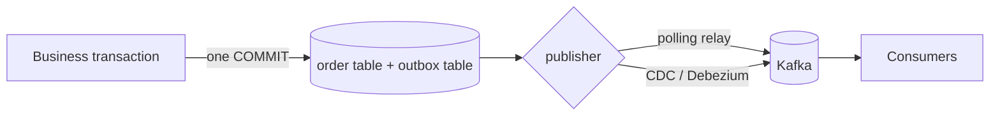
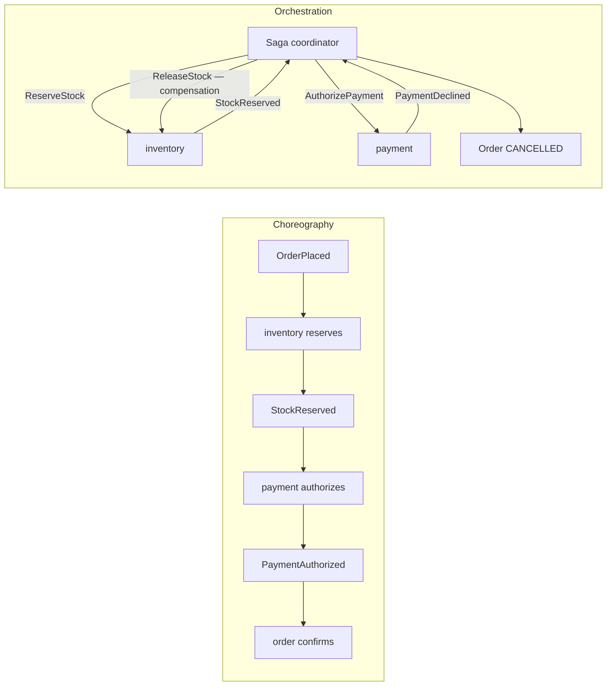
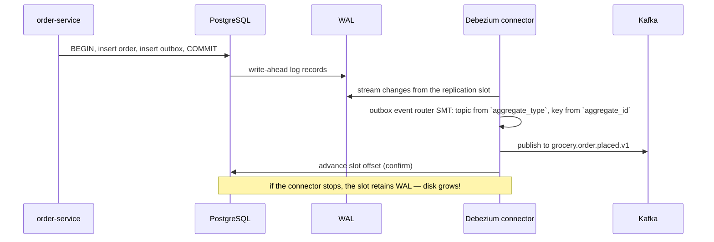
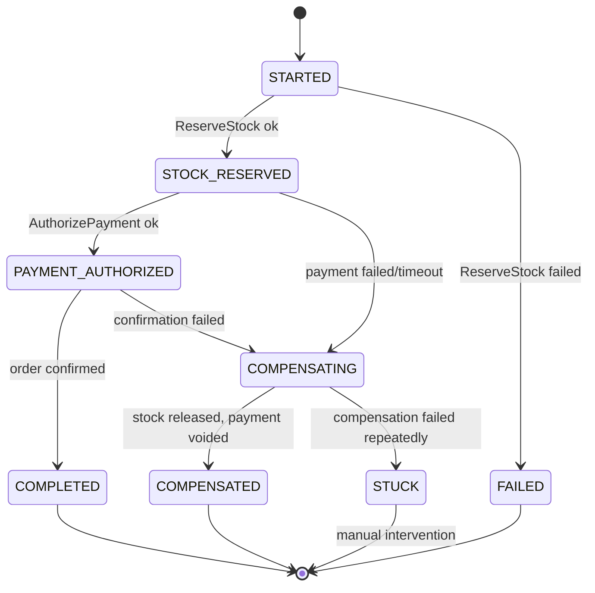
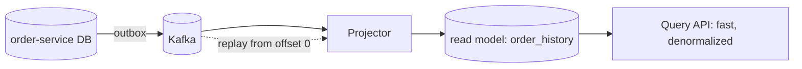
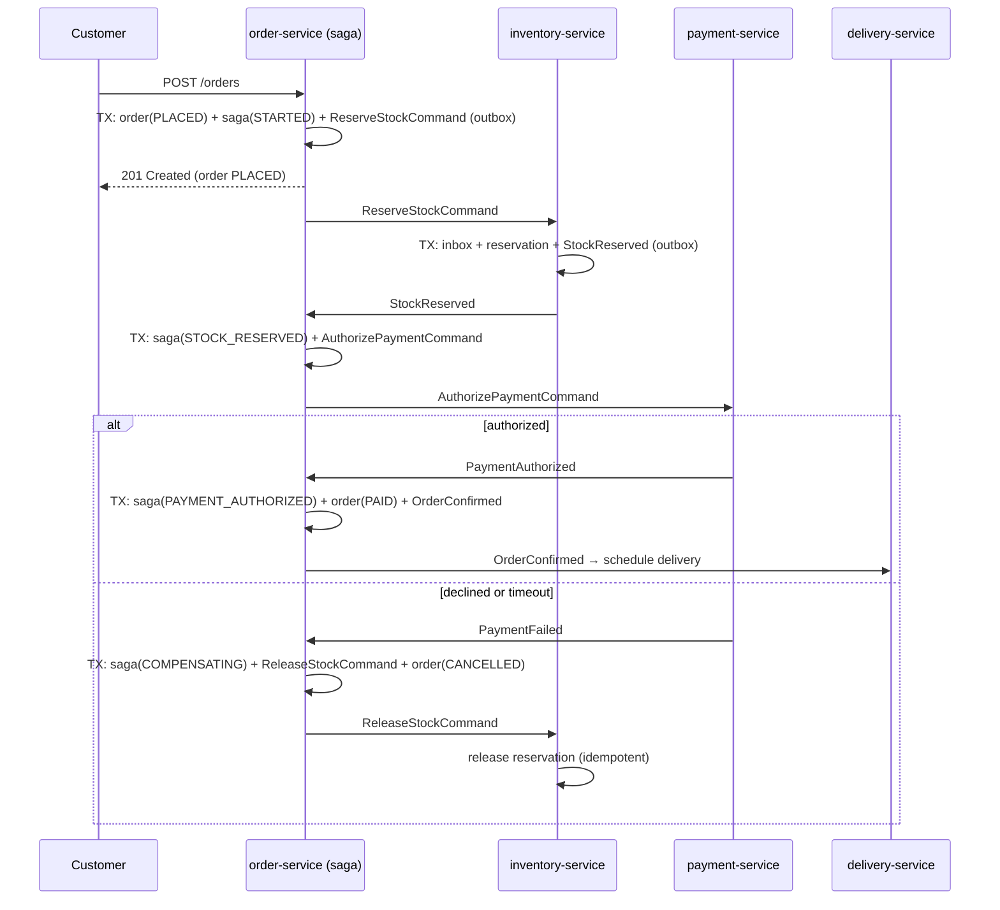
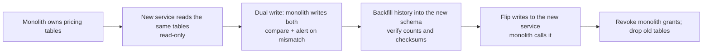
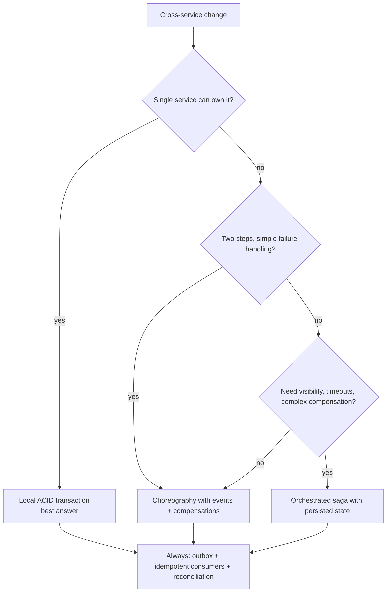

# 36 · Distributed Data & Consistency

## 1. Introduction & Why It Matters

Chapter 16 gave one service ACID transactions. Chapter 35 then split the platform into twenty-six services, each with its own database — and took those transactions away.

Placing an order now means: create the order (order-service), reserve stock (inventory-service), authorize payment (payment-service), award points (loyalty-service), notify the customer (notification-service). Five databases, five failure points, no `BEGIN`/`COMMIT` spanning them. The naïve implementations fail in specific, expensive ways:

- **Dual write**: the order commits, the Kafka publish fails, inventory never reserves stock. The customer waits for groceries that were never picked.
- **Two-phase commit**: technically possible, practically a coordinator that blocks everything when it fails, and few modern datastores support it well.
- **"We'll just retry"**: retries without idempotency produce double charges and double stock deductions.
- **Half-completed workflows**: payment authorized, stock reservation failed, nobody compensates, money is held on a customer's card for a week.

The patterns that actually work are the subject of this chapter: the **outbox** (with polling and CDC), **idempotent consumers**, **sagas** with compensations (choreography and orchestration), **CQRS read models**, an honest look at **event sourcing**, handling eventual consistency in the **user interface**, migrating data during service extraction, and **reconciliation** — because in a distributed system, drift is not a possibility but a certainty you must detect.

### Who should read which section

| Band | Focus |
|---|---|
| B1 · 0–2 yrs | Parts 1, 2, 4 — dual writes, outbox, idempotency |
| B2 · 2–5 yrs | Parts 2, 5 — sagas, compensations, read models |
| B3 · 5–8 yrs | Parts 3, 5, 6 — CDC, orchestration, stuck sagas |
| B4 · 8–12 yrs | Parts 6, 8 — consistency strategy, reconciliation, migrations |
| B5 · 12–15+ yrs | Parts 8, 9 — trade-offs and organizational consequences |

---

## 2. Core Concepts

### 2.1 What you give up, precisely

| Within one service | Across services |
|---|---|
| ACID transaction | Saga with compensations |
| Foreign keys | Eventual reference validity |
| Joins | Composition or local projections |
| Unique constraints across entities | Per-service constraints + reconciliation |
| Read-your-writes | Requires deliberate design (2.7) |
| Rollback | Compensating actions (semantically, not physically) |

**PACELC** in one line: when the network partitions you choose availability or consistency; **else** (normal operation) you choose latency or consistency. Most e-commerce choices trade consistency for latency and availability — deliberately, per use case, not by accident.

### 2.2 The dual-write problem

```java title="The dual-write problem (snippet)"
@Transactional
public Order place(...) {
    Order saved = orders.save(order);      // (1) commits
    kafka.send("order.placed", event);     // (2) may fail, may duplicate, may be slow
    return saved;
}
```

Four bad outcomes: the publish fails after commit (event lost); the publish succeeds and the transaction rolls back (phantom event); the publish is slow and holds the transaction open (Chapter 16); the publish duplicates on retry.

**No amount of ordering fixes this.** Two systems, one atomic intent — you need a pattern.

### 2.3 The outbox

Write the event into the **same database, same transaction** as the business change; a separate process publishes it.



| Property | Result |
|---|---|
| Atomicity | Business data and event commit together |
| Delivery | At-least-once (consumers must be idempotent) |
| Ordering | Per aggregate, if relayed in order and keyed correctly |
| Failure mode | Event stays pending; nothing is lost |

### 2.4 Polling relay vs CDC

| | Polling relay (Chapter 23) | CDC (Debezium) |
|---|---|---|
| Mechanism | `SELECT ... FOR UPDATE SKIP LOCKED`, publish, mark sent | Reads the write-ahead log, publishes changes |
| Latency | Poll interval (100–500 ms) | Near-real-time |
| Load | Extra queries + updates on the hot database | Log reading, minimal query load |
| Operations | Just your application | Kafka Connect, replication slots, monitoring |
| Failure risk | Simple, well understood | **Replication slot growth** if the connector stops — can fill the disk |
| Good for | Most services | High-volume services, and capturing changes without code |

Start with polling; move to CDC when volume or latency justifies the operational cost.

### 2.5 Idempotent consumers

At-least-once delivery means every consumer must tolerate repeats (Chapter 23):

| Technique | Example |
|---|---|
| Inbox table | `insert into processed_event(consumer, event_id)` with a unique key |
| Conditional update | `update order set status='PAID' where ref=? and status='PLACED'` |
| Upsert | `insert ... on conflict do update` |
| Version check | Ignore events with `version <= current` |
| Natural key | `unique (order_ref, run_date)` (Chapter 33) |

### 2.6 Sagas

A saga is a sequence of local transactions, each with a **compensating** action for rollback.

| Style | How | Good for |
|---|---|---|
| **Choreography** | Each service reacts to events and emits the next | Short flows (2–3 steps), loose coupling |
| **Orchestration** | A coordinator issues commands and tracks state | Longer flows, visibility, timeouts, complex compensation |



Compensation is **semantic**, not a rollback: you can't un-charge a card, you issue a refund; you can't un-send an SMS, you send a correction.

### 2.7 Eventual consistency and the user

| Problem | Fix |
|---|---|
| "I placed an order but the list is empty" | Return the created resource; the client renders from the response |
| "My cart badge is stale" | Read-your-writes: read from the writing service, or pass a version token |
| "Stock said available, checkout failed" | Reserve at checkout; display is advisory |
| "Points didn't appear" | Show a pending state with an expected time |
| Seller edits a product, search doesn't show it | Read the seller's own view from the owner; search is eventually consistent |

The rule: **display may be eventually consistent; decisions must read from the owner.**

### 2.8 CQRS and event sourcing — proportionate use

| Pattern | Use when | Cost |
|---|---|---|
| **Read models** (projections from events) | Read/write asymmetry, cross-service views | Rebuild machinery, staleness |
| **CQRS** (separate write and read models) | Complex domain writes, very different read shapes | Two models, sync logic |
| **Event sourcing** (events are the source of truth) | Audit is the product; temporal queries; complex invariants over history | Large commitment: schema evolution, snapshots, replay, tooling, team skill |

The platform uses read models widely, CQRS in one service, and event sourcing nowhere — the outbox gives integration-level event benefits without making events the system of record.

---

## 3. How It Works Internally

### 3.1 Outbox with CDC



Two operational facts: the connector's **offset advance** is what frees WAL, and the outbox table can be pruned once rows are captured (or written as insert-then-delete in the same transaction, if your connector supports it).

### 3.2 Saga state machine



Every state is **persisted**, every transition is **idempotent**, and `STUCK` exists because compensation can fail too — pretending otherwise produces silent money leaks.

### 3.3 Read-model projection



The read model is **disposable**: if it's wrong, truncate and replay. That property is what makes projections safe; if a projection can't be rebuilt, it has become a system of record by accident (Chapter 22's warning).

---

## 4. Hands-On Code — Level 1 (Beginner)

### 4.1 The outbox table and write

```sql title="V90__outbox.sql"
create table outbox (
    id             bigserial primary key,
    aggregate_type varchar(40)  not null,      -- (1)
    aggregate_id   varchar(64)  not null,
    event_type     varchar(60)  not null,
    payload        jsonb        not null,
    headers        jsonb        not null default '{}'::jsonb,
    created_at     timestamptz  not null default now(),
    sent_at        timestamptz,
    attempts       int          not null default 0,
    last_error     text
);
create index outbox_pending_idx on outbox (created_at) where sent_at is null;   -- (2)
```

1. `aggregate_type` maps to a topic, `aggregate_id` becomes the Kafka key (ordering per order).
2. A **partial index** on pending rows only — the relay's query stays fast even with millions of sent rows.

```java title="in/grocery/platform/outbox/OutboxWriter.java"
@Component
public class OutboxWriter {

    private final JdbcClient jdbc;
    private final ObjectMapper mapper;

    @Transactional(propagation = Propagation.MANDATORY)                          // (1)!
    public void append(String aggregateType, String aggregateId, String eventType, Object payload) {
        jdbc.sql("""
                insert into outbox (aggregate_type, aggregate_id, event_type, payload, headers)
                values (:type, :id, :eventType, :payload::jsonb, :headers::jsonb)
                """)
            .param("type", aggregateType)
            .param("id", aggregateId)
            .param("eventType", eventType)
            .param("payload", writeJson(payload))
            .param("headers", writeJson(Map.of(
                    "eventId", UUID.randomUUID().toString(),                      // (2)!
                    "traceparent", currentTraceParent(),
                    "occurredAt", Instant.now().toString())))
            .update();
    }
}
```

1. `MANDATORY` — writing to the outbox **outside** a transaction is the bug this pattern exists to prevent, so fail loudly.
2. A stable `eventId` is what consumers deduplicate on (Chapter 23).

### 4.2 Using it

```java title="in/grocery/order/service/OrderService.java"
@Transactional
public Order place(PlaceOrderCommand command) {
    Order order = Order.place(command);
    orders.save(order);
    outbox.append("order", order.getOrderRef(), "OrderPlaced",                    // (1)!
            new OrderPlacedEvent(order.getOrderRef(), order.getCustomerId(), lines(order)));
    return order;
}
```

1. One transaction, two inserts. Either both happen or neither — the dual-write problem is gone.

### 4.3 The relay (recap from Chapter 23)

```java title="The relay (recap from Chapter 23) (snippet)"
@Scheduled(fixedDelay = 300)
@Transactional
public void relay() {
    List<OutboxRow> batch = outbox.claimBatch(200);                               // SKIP LOCKED
    for (OutboxRow row : batch) {
        kafka.send(topicFor(row), row.aggregateId(), row.payload())
             .get(5, TimeUnit.SECONDS);                                           // (1)!
        outbox.markSent(row.id());
    }
}
```

1. Wait for the broker acknowledgement before marking sent; a crash in between simply re-sends (at-least-once).

### 4.4 Proving it works

```java title="OutboxIntegrationTest.java"
@Test
void eventIsWrittenAtomicallyWithTheOrder() {
    assertThatThrownBy(() -> orderService.placeAndFail(command()))                 // (1)!
            .isInstanceOf(RuntimeException.class);

    assertThat(orders.count()).isZero();
    assertThat(outbox.countPending()).isZero();                                    // (2)!
}

@Test
void relayPublishesPendingEvents() {
    orderService.place(command());
    assertThat(outbox.countPending()).isEqualTo(1);

    relay.relay();

    await().untilAsserted(() -> assertThat(consumedEvents()).hasSize(1));
    assertThat(outbox.countPending()).isZero();
}
```

1. Force a failure after both inserts.
2. **Neither** the order nor the event survives — the property the whole pattern buys.

---

## 5. Hands-On Code — Level 2 (Intermediate) & Level 3 (Advanced)

### 5.1 Level 2 — Choreographed saga

The simplest saga: services react to each other's events.

```java title="inventory-service: reacts to OrderPlaced"
@KafkaListener(topics = "grocery.order.placed.v1", groupId = "inventory-service")
@Transactional
public void onOrderPlaced(OrderPlacedEvent event) {
    if (inbox.alreadyProcessed(CONSUMER, event.eventId())) return;                 // (1)!
    inbox.markProcessed(CONSUMER, event.eventId());

    try {
        reservations.reserve(event.orderRef(), event.lines(), event.pincode());
        outbox.append("inventory", event.orderRef(), "StockReserved",
                new StockReserved(event.orderRef()));                               // (2)!
    } catch (InsufficientStockException e) {
        outbox.append("inventory", event.orderRef(), "StockReservationFailed",
                new StockReservationFailed(event.orderRef(), e.getSku()));           // (3)!
    }
}
```

1. Idempotency first (Chapter 23).
2. Success continues the saga.
3. **Failure is an event, not an exception.** Throwing here would retry forever; the saga needs to know the step failed so it can compensate.

```java title="order-service: reacts to the outcomes"
@KafkaListener(topics = "grocery.inventory.stock-reservation-failed.v1", groupId = "order-service")
@Transactional
public void onReservationFailed(StockReservationFailed event) {
    orders.findByOrderRef(event.orderRef()).ifPresent(order -> {
        order.cancel("out-of-stock");                                               // (1)!
        outbox.append("order", order.getOrderRef(), "OrderCancelled",
                new OrderCancelled(order.getOrderRef(), "out-of-stock"));
    });
}
```

1. Compensation for this flow is simply cancelling — nothing else has happened yet.

| Choreography | |
|---|---|
| ✅ | No coordinator; services stay decoupled; easy for 2–3 steps |
| ❌ | The flow exists nowhere explicitly; adding a step means touching several services; timeouts and stuck states are nobody's job; debugging means reading five services' logs |

### 5.2 Level 2 — When choreography stops scaling

Checkout's real flow: reserve stock → authorize payment → confirm order → schedule delivery → award points, with timeouts and compensations at each step. In choreography that logic is scattered across five services and **cannot be answered** in one place:

> "Where is order ORD-7F3A91C2 in the checkout flow, and why has it been 4 minutes?"

That question is what orchestration answers.

### 5.3 Level 3 — Saga orchestration

```sql title="V91__saga.sql"
create table order_saga (
    order_ref      varchar(40) primary key,
    state          varchar(30) not null,
    step_attempts  int         not null default 0,
    payment_id     varchar(64),
    reservation_id varchar(64),
    started_at     timestamptz not null default now(),
    updated_at     timestamptz not null default now(),
    deadline_at    timestamptz not null,                     -- (1)
    last_error     text,
    version        bigint      not null default 0            -- (2)
);
create index order_saga_open_idx on order_saga (deadline_at)
    where state not in ('COMPLETED', 'COMPENSATED', 'FAILED');
```

1. Every saga has a **deadline**; a saga without one becomes a permanently stuck record nobody notices.
2. Optimistic locking (Chapter 16): concurrent events for the same saga must not interleave destructively.

```java title="in/grocery/order/saga/CheckoutSaga.java"
package in.grocery.order.saga;

import org.springframework.stereotype.Component;
import org.springframework.transaction.annotation.Transactional;

@Component
public class CheckoutSaga {

    public enum State { STARTED, STOCK_RESERVED, PAYMENT_AUTHORIZED, COMPLETED,
                        COMPENSATING, COMPENSATED, FAILED, STUCK }

    private final SagaRepository sagas;
    private final OutboxWriter outbox;
    private final MeterRegistry meters;
    private final Clock clock;

    @Transactional
    public void start(String orderRef, PlaceOrderCommand command) {
        sagas.insert(orderRef, State.STARTED, clock.instant().plus(Duration.ofMinutes(10)));   // (1)!
        outbox.append("order", orderRef, "ReserveStockCommand",
                new ReserveStockCommand(orderRef, command.lines(), command.pincode()));
    }

    @Transactional
    public void onStockReserved(StockReserved event) {
        transition(event.orderRef(), State.STARTED, State.STOCK_RESERVED, saga -> {            // (2)!
            saga.setReservationId(event.reservationId());
            outbox.append("order", event.orderRef(), "AuthorizePaymentCommand",
                    new AuthorizePaymentCommand(event.orderRef(), saga.amount()));
        });
    }

    @Transactional
    public void onPaymentAuthorized(PaymentAuthorized event) {
        transition(event.orderRef(), State.STOCK_RESERVED, State.PAYMENT_AUTHORIZED, saga -> {
            saga.setPaymentId(event.paymentId());
            orders.confirm(event.orderRef());
            outbox.append("order", event.orderRef(), "OrderConfirmed",
                    new OrderConfirmed(event.orderRef()));
            complete(saga);
        });
    }

    @Transactional
    public void onPaymentFailed(PaymentFailed event) {
        compensate(event.orderRef(), "payment-failed: " + event.reason());                      // (3)!
    }

    private void compensate(String orderRef, String reason) {
        var saga = sagas.lockByRef(orderRef);
        if (saga.state() == State.COMPENSATED || saga.state() == State.COMPLETED) return;        // (4)!
        saga.setState(State.COMPENSATING);
        saga.setLastError(reason);

        if (saga.reservationId() != null) {
            outbox.append("order", orderRef, "ReleaseStockCommand",
                    new ReleaseStockCommand(orderRef, saga.reservationId()));
        }
        if (saga.paymentId() != null) {
            outbox.append("order", orderRef, "VoidPaymentCommand",
                    new VoidPaymentCommand(orderRef, saga.paymentId()));                         // (5)!
        }
        orders.cancel(orderRef, reason);
        outbox.append("order", orderRef, "OrderCancelled", new OrderCancelled(orderRef, reason));
        meters.counter("grocery.saga.compensated", "reason", shortReason(reason)).increment();
        sagas.save(saga);
    }

    private void transition(String orderRef, State expected, State next, Consumer<SagaRow> work) {
        var saga = sagas.lockByRef(orderRef);
        if (saga.state() != expected) {                                                          // (6)!
            meters.counter("grocery.saga.out-of-order", "state", saga.state().name()).increment();
            return;
        }
        saga.setState(next);
        saga.setUpdatedAt(clock.instant());
        work.accept(saga);
        sagas.save(saga);
    }
}
```

1. The saga row and the first command's outbox entry commit together — the saga itself uses the outbox pattern.
2. **Guarded transitions**: an event arriving in the wrong state is counted and ignored, not applied.
3. Failure of any step routes to one compensation path.
4. **Idempotent compensation** — a duplicate failure event must not double-refund.
5. Only compensate steps that actually happened (`paymentId != null`).
6. Out-of-order events are normal (retries, redelivery). Silently ignoring them with a metric is the correct behaviour.

```java title="Timeouts: the step nobody writes until it hurts"
@Scheduled(fixedDelay = 30_000)
@SchedulerLock(name = "saga-timeout-sweeper")                                                    // (1)!
public void sweepTimedOutSagas() {
    for (SagaRow saga : sagas.findOpenPastDeadline(clock.instant(), 100)) {
        if (saga.state() == State.COMPENSATING && saga.stepAttempts() > 5) {
            saga.setState(State.STUCK);                                                          // (2)!
            sagas.save(saga);
            alerts.page("saga-stuck", saga.orderRef());
            continue;
        }
        compensate(saga.orderRef(), "timeout in state " + saga.state());
    }
    meters.gauge("grocery.saga.open", sagas.countOpen());                                         // (3)!
}
```

1. One pod sweeps (Chapter 25).
2. `STUCK` means compensation itself is failing — a human must look, and money may be at stake.
3. **Open sagas** is the health metric: a rising count means the flow is failing somewhere.

### 5.4 Level 3 — CDC with Debezium

```json title="Kafka Connect: outbox connector"
{
  "name": "order-outbox-connector",
  "config": {
    "connector.class": "io.debezium.connector.postgresql.PostgresConnector",
    "database.hostname": "orders-db", "database.dbname": "orders",
    "plugin.name": "pgoutput",
    "slot.name": "order_outbox_slot",                                                             
    "publication.autocreate.mode": "filtered",
    "table.include.list": "public.outbox",
    "transforms": "outbox",
    "transforms.outbox.type": "io.debezium.transforms.outbox.EventRouter",
    "transforms.outbox.route.by.field": "aggregate_type",
    "transforms.outbox.route.topic.replacement": "grocery.${routedByValue}.events.v1",
    "transforms.outbox.table.field.event.key": "aggregate_id",
    "transforms.outbox.table.field.event.payload": "payload",
    "heartbeat.interval.ms": "10000"
  }
}
```

```sql title="Prerequisites"
alter system set wal_level = logical;             -- restart required
alter table outbox replica identity full;         -- (1)
```

1. Needed for the connector to see all column values on change events.

!!! danger "Replication slots retain WAL"
    If the connector stops (crash, misconfiguration, Kafka down), PostgreSQL **keeps every WAL segment** the slot hasn't confirmed. On a busy database that fills the disk in hours and takes the database down — a far worse outage than the one you were avoiding. Non-negotiable safeguards:

    - Alert on `pg_replication_slots.confirmed_flush_lsn` lag and on WAL directory size.
    - Configure `max_slot_wal_keep_size` so the database sacrifices the slot rather than itself.
    - Have a runbook: restart the connector, or drop the slot and re-snapshot.
    - Test connector downtime in staging.

| Choose polling when | Choose CDC when |
|---|---|
| Volume is moderate (< a few thousand events/s) | High volume, or latency below ~200 ms matters |
| You want zero extra infrastructure | You already run Kafka Connect |
| The team is small | You have operational capacity for slots and connectors |

### 5.5 Level 3 — Read models

```java title="in/grocery/orderhistory/projection/OrderHistoryProjector.java"
@Component
class OrderHistoryProjector {

    @KafkaListener(topics = {"grocery.order.placed.v1", "grocery.order.status-changed.v1"},
                   groupId = "order-history-projector")
    @Transactional
    public void project(ConsumerRecord<String, OrderEvent> record) {
        OrderEvent event = record.value();
        readModel.upsert(OrderHistoryRow.builder()                                                // (1)!
                .orderRef(event.orderRef())
                .customerId(event.customerId())
                .status(event.status())
                .total(event.total())
                .placedAt(event.placedAt())
                .lastEventOffset(record.offset())                                                 // (2)!
                .build());
    }
}
```

1. Denormalized: everything the history screen needs, no joins, one index on `(customer_id, placed_at desc)`.
2. Recording the offset makes "is this projection current?" answerable and supports replay bookkeeping.

```java title="Rebuilding — the property that makes projections safe"
public void rebuild() {
    readModel.truncate();                                                                         // (1)!
    kafkaAdmin.resetConsumerGroupOffsets("order-history-projector", OffsetSpec.earliest());
    // consumers restart and replay the full topic
}
```

1. Only safe because the read model **owns no truth**. Verify rebuild time as part of capacity planning (a topic with 90 days of retention takes as long as it takes).

### 5.6 Level 3 — Eventual consistency in the interface

```java title="Return the result instead of making the client re-read"
@PostMapping("/api/v1/orders")
ResponseEntity<OrderView> place(@Valid @RequestBody PlaceOrderRequest request) {
    Order order = delegate.place(request);
    return ResponseEntity.created(location(order))
            .body(OrderView.from(order));                                                          // (1)!
}
```

1. The client renders from the response and never hits the eventually-consistent read model for the order it just created.

```java title="When a read model must be used: version tokens"
@GetMapping("/api/v1/orders")
ResponseEntity<Page<OrderHistoryView>> history(@CurrentCustomer CustomerContext customer,
                                               @RequestHeader(value = "X-Min-Version", required = false) Long minVersion) {
    var page = history.forCustomer(customer.customerId());
    if (minVersion != null && page.version() < minVersion) {                                       // (2)!
        return ResponseEntity.status(HttpStatus.ACCEPTED)
                .header("Retry-After", "1")
                .build();
    }
    return ResponseEntity.ok(page);
}
```

2. The client passes the version it knows about; a not-yet-caught-up read model answers `202` and the client retries — honest rather than showing stale data as if it were current.

| UX pattern | Use |
|---|---|
| Render from the write response | Creates and updates |
| Optimistic UI with a pending badge | Loyalty points, recommendations |
| Poll with `Retry-After` | Order status after payment |
| Push via SSE (Chapter 31) | Live tracking |
| "Updated a moment ago" timestamps | Dashboards, seller analytics |

---

## 6. Hands-On Code — Level 4 (Expert / Production)

### 6.1 The checkout saga, end to end



Note what the customer sees: `201 Created` immediately with status `PLACED`, then a push or poll to `PAID`. The alternative — holding the HTTP request open through five services — trades a 300 ms response for a 4-second one that fails whenever any service is slow.

### 6.2 Saga observability

| Signal | Meaning | Alert |
|---|---|---|
| `grocery.saga.open` | Sagas in flight | Sustained growth |
| Saga duration histogram | End-to-end checkout time | p99 above budget |
| `grocery.saga.compensated{reason}` | Compensation rate by cause | Spike in any reason |
| `grocery.saga.stuck` | Compensation failing | **Any** — page immediately |
| `grocery.saga.out-of-order` | Guarded transitions | Spike indicates a flow bug |
| Per-state age | Where sagas linger | "STOCK_RESERVED > 5 min" |

```sql title="The query the on-call engineer actually runs"
select state, count(*), min(started_at), max(now() - started_at) as oldest
from order_saga
where state not in ('COMPLETED','COMPENSATED','FAILED')
group by state order by count(*) desc;                                                -- (1)
```

1. One query answers "what's stuck and where?" — the whole point of orchestration over choreography.

### 6.3 Reconciliation: assume drift

Even with outbox, inbox and sagas, distributed state drifts: a missed event during a Kafka outage, a manual database fix, a bug in a compensation path. Detection is a scheduled job (Chapter 33), not hope.

```java title="in/grocery/reconciliation/OrderPaymentReconciler.java"
@Component
class OrderPaymentReconciler {

    @Scheduled(cron = "0 15 * * * *", zone = "Asia/Kolkata")                              // (1)!
    @SchedulerLock(name = "order-payment-reconciliation")
    public void reconcileLastHour() {
        var window = Window.lastHour(clock);

        var paidOrdersWithoutPayment = jdbc.sql("""
                select o.order_ref from customer_order o
                left join payment_projection p on p.order_ref = o.order_ref
                where o.status = 'PAID' and o.updated_at between :from and :to
                  and (p.order_ref is null or p.status <> 'CAPTURED')
                """).params(window.asParams()).query(String.class).list();               // (2)!

        var paymentsWithoutPaidOrder = paymentClient.capturedBetween(window)
                .stream().filter(p -> !orders.isPaid(p.orderRef())).toList();            // (3)!

        meters.gauge("grocery.reconciliation.drift", 
                paidOrdersWithoutPayment.size() + paymentsWithoutPaidOrder.size());
        if (!paidOrdersWithoutPayment.isEmpty() || !paymentsWithoutPaidOrder.isEmpty()) {
            tickets.raise("order-payment-drift", report(paidOrdersWithoutPayment, paymentsWithoutPaidOrder));  // (4)!
        }
    }
}
```

1. Hourly, over a window with a lag so in-flight sagas aren't flagged as drift.
2. Orders marked paid with no captured payment — **money we didn't collect**.
3. Payments captured with no paid order — **money we took without fulfilling**. Both directions matter.
4. Tickets, not automatic repair: auto-fixing financial drift without understanding the cause turns one bug into two.

| Reconciliation pair | Frequency |
|---|---|
| Orders ↔ payments | Hourly |
| Orders ↔ stock reservations | Hourly |
| Payments ↔ gateway settlement file | Daily (Chapter 33) |
| Settlements ↔ bank transfers | Weekly |
| Catalog ↔ search index | Continuous (index lag, Chapter 22) |

### 6.4 Moving data during service extraction



```java title="Dual-write verification during step C"
@Transactional
public void updatePrice(String sku, String zone, BigDecimal price) {
    legacyPrices.update(sku, zone, price);                                                // (1)!
    try {
        newPricingClient.update(sku, zone, price);                                        // (2)!
    } catch (Exception e) {
        meters.counter("grocery.dualwrite.failure", "target", "pricing-service").increment();
        log.warn("Dual write to pricing-service failed for {}/{}", sku, zone, e);          // (3)!
    }
}
```

1. The legacy write remains authoritative during the transition.
2. The new system is written best-effort.
3. **Never fail the request** because the shadow target failed; alert instead, and reconcile with a comparison job before flipping authority.

The flip itself should be a configuration change so rollback is instant (Chapter 35).

### 6.5 Testing distributed consistency

```java title="SagaIntegrationTest.java"
@SpringBootTest
@Import({ContainersConfig.class, KafkaTestConfig.class})
class CheckoutSagaIntegrationTest {

    @Test
    void completesWhenAllStepsSucceed() { /* PLACED → PAID, saga COMPLETED */ }

    @Test
    void compensatesWhenPaymentFails() {
        String ref = placeOrder();
        publish(new StockReserved(ref, "RSV-1"));
        publish(new PaymentFailed(ref, "insufficient_funds"));

        await().untilAsserted(() -> {
            assertThat(sagas.byRef(ref).state()).isEqualTo(State.COMPENSATED);
            assertThat(orders.byRef(ref).getStatus()).isEqualTo(OrderStatus.CANCELLED);
            assertThat(publishedCommands()).contains("ReleaseStockCommand");                // (1)!
        });
    }

    @Test
    void duplicateEventsDoNotDoubleCompensate() {
        String ref = placeOrder();
        publish(new StockReserved(ref, "RSV-1"));
        var failure = new PaymentFailed(ref, "declined");
        publish(failure);
        publish(failure);                                                                    // (2)!

        await().untilAsserted(() ->
                assertThat(commandsOfType("ReleaseStockCommand")).hasSize(1));
    }

    @Test
    void outOfOrderEventsAreIgnoredNotApplied() {
        String ref = placeOrder();
        publish(new PaymentAuthorized(ref, "pay_1"));                                        // (3)!

        assertThat(sagas.byRef(ref).state()).isEqualTo(State.STARTED);
    }

    @Test
    void timeoutTriggersCompensation() {
        String ref = placeOrder();
        publish(new StockReserved(ref, "RSV-1"));
        advanceClock(Duration.ofMinutes(11));
        saga.sweepTimedOutSagas();                                                           // (4)!

        assertThat(sagas.byRef(ref).state()).isIn(State.COMPENSATING, State.COMPENSATED);
    }
}
```

1. Compensation is asserted by the **commands produced**, which is the observable contract.
2. The duplicate test — at-least-once delivery makes this a certainty, not an edge case.
3. Payment authorization arriving before stock reservation must not skip a step.
4. Timeout behaviour, tested with a controllable clock (Chapter 15).

### 6.6 Choosing the pattern



The first branch is the one to fight for. Many "distributed transactions" exist only because the boundary was drawn in the wrong place (Chapters 35, 37) — moving the data into one service is cheaper than any saga.

---

## 7. Spring Boot 3 vs 4 & Migration

| Topic | Boot 3.5 | Boot 4.x |
|---|---|---|
| Outbox / inbox | Application patterns, unchanged | Unchanged |
| Transactional event listeners | `@TransactionalEventListener` | Same |
| Spring Modulith event publication registry | Available (Chapter 37) | Available (verify) |
| Debezium / Kafka Connect | External, version-independent | Same |
| Saga frameworks (Temporal, Camunda) | External clients | Verify client compatibility |
| JSON payload format | Jackson 2 | Jackson 3 — event payload compatibility during rollout (Chapter 23) |

### Migration checklist

- [ ] Verify stored outbox payloads remain readable across the Jackson change (test explicitly).
- [ ] Drain in-flight sagas before upgrading services that share a saga flow, or ensure both versions handle the same events.
- [ ] Re-test compensation and timeout paths after upgrade — they run rarely and break silently.
- [ ] Re-check CDC connector compatibility with any database upgrade.
- [ ] Re-run reconciliation immediately after the rollout to catch events lost in the window.

---

## 8. Production Playbook

### Best practices

1. **Never dual-write**: business change and event commit in one transaction via the outbox.
2. **Every consumer idempotent** — inbox, conditional updates or natural keys.
3. **Sagas persist state, guard transitions, and have deadlines**; `STUCK` is a real state with an alert.
4. **Compensate only steps that happened**, idempotently.
5. **Read models are disposable** and rebuildable; verify rebuild time.
6. **Display from projections, decide from the owner.**
7. **Design the UX for eventual consistency** — return the write result, show pending states.
8. **Reconcile continuously** in both directions; raise tickets rather than auto-repairing money.
9. **Prefer moving the boundary** over adding a saga.
10. **Test compensation, duplicates, out-of-order events and timeouts** — they are the whole risk.

### Anti-patterns

❌ Publishing inside (or right after) a transaction without the outbox.

❌ Consumers that assume exactly-once delivery.

❌ Sagas without persisted state — "the flow is in the events somewhere".

❌ Sagas without timeouts: orders stuck forever with reserved stock.

❌ Compensation that isn't idempotent (double refunds).

❌ Throwing exceptions for business failures in a saga step (infinite retry instead of compensation).

❌ Distributed locks used for correctness across services (Chapter 22).

❌ Two-phase commit across microservices.

❌ Event sourcing adopted for integration when the outbox would do.

❌ No reconciliation — drift accumulates silently until finance finds it.

❌ A read model nobody can rebuild.

### Troubleshooting

| Symptom | Cause | Fix |
|---|---|---|
| Orders exist, downstream never reacts | Dual write lost the event; relay stopped | Outbox pending gauge, relay alerting |
| Stock reserved but order cancelled | Compensation missing/failed | Saga state audit, compensation retries, reconciliation |
| Double charges | Non-idempotent consumer or retry | Inbox + idempotency keys (Chapters 04, 23) |
| Sagas accumulate in one state | Missing event, consumer down, no timeout | Per-state age dashboard, timeout sweeper |
| PostgreSQL disk filling | Stalled CDC replication slot | Slot lag alerts, `max_slot_wal_keep_size`, connector runbook |
| Read model wrong | Projector bug or missed events | Replay from the beginning; verify rebuild time |
| "Order not in my list" complaints | Reading an eventually-consistent projection after a write | Return the write result; version tokens |
| Drift found by finance | No reconciliation | Hourly two-directional jobs (6.3) |
| Compensations spike | Upstream failing (payments, stock) | Check `grocery.saga.compensated{reason}` and the dependency |

### Production checklist

- [ ] Outbox in every service that publishes events; `MANDATORY` propagation enforced
- [ ] Pending-outbox gauge and relay/connector alerts
- [ ] CDC slot lag and WAL size alerts, with a documented runbook
- [ ] Inbox or equivalent idempotency in every consumer
- [ ] Saga state persisted with deadlines, guarded transitions and a STUCK alert
- [ ] Compensation paths tested, including duplicates and out-of-order events
- [ ] Read models rebuildable, rebuild time measured
- [ ] Reconciliation jobs in both directions, with drift metrics and tickets
- [ ] UX designed for eventual consistency on every write path

---

## 9. Interview Questions & Answers

### B1 · 0–2 years

??? question "B1 · What is the dual-write problem?"
    **Short answer:** Writing to two systems (database and broker) without atomicity — one can succeed while the other fails, leaving them inconsistent with no way to detect it.

??? question "B1 · What is the outbox pattern?"
    **Short answer:** Write the event into a table in the same transaction as the business change; a separate relay or CDC connector publishes it. Atomic, at-least-once, nothing lost.

??? question "B1 · Why must consumers be idempotent?"
    **Short answer:** Delivery is at-least-once — retries, rebalances and replays redeliver messages. Without idempotency you get duplicate side effects.

??? question "B1 · What is a saga?"
    **Short answer:** A sequence of local transactions across services, each with a compensating action, used instead of a distributed transaction.

??? question "B1 · What does "eventually consistent" mean for a user?"
    **Short answer:** Different parts of the system briefly show different states — a placed order may not appear in search or history for a second or two.

### B2 · 2–5 years

??? question "B2 · Choreography or orchestration?"
    **Short answer:** Choreography for short flows where services simply react to events; orchestration when you need visibility, timeouts, ordering guarantees and complex compensation — checkout usually qualifies.

??? question "B2 · How do you compensate a payment?"
    **Short answer:** Semantically: void the authorization if not captured, refund if captured. You never undo it physically; you perform an offsetting business action, idempotently.

??? question "B2 · Polling relay or CDC for the outbox?"
    **Short answer:** Polling is simpler with no extra infrastructure and adequate for most services; CDC gives lower latency and less database load but adds Kafka Connect and replication-slot operations — including the risk of WAL growth when it stalls.

??? question "B2 · What makes a read model safe?"
    **Short answer:** It owns no truth and can be rebuilt by replaying events. If it can't be rebuilt, it has silently become a system of record.

??? question "B2 · How do you handle "I placed an order but don't see it"?"
    **Short answer:** Return the created resource so the client renders from the response; where a projection must be read, use version tokens or a pending state rather than showing stale data as current.

??? question "B2 · Why not use two-phase commit?"
    **Short answer:** It requires participant support, blocks resources during the protocol, and makes the coordinator a critical failure point — availability suffers badly. Sagas trade atomicity for availability, which is usually the right trade.

### B3 · 5–8 years

??? question "B3 · Walk through an orchestrated saga's failure handling."
    **Short answer:** State is persisted with an expected-state guard on each transition; step failures arrive as events and move the saga to COMPENSATING; compensations are emitted only for completed steps and are idempotent; a sweeper enforces deadlines; repeated compensation failure moves the saga to STUCK with an alert.

??? question "B3 · What are the operational risks of CDC?"
    **Short answer:** A stalled replication slot retains WAL and can fill the database disk; connector lag delays all events; schema changes can break the connector; snapshots on large tables are heavy. Mitigate with slot-lag alerts, `max_slot_wal_keep_size`, runbooks and staging tests of connector downtime.

??? question "B3 · How do you prevent duplicate compensation?"
    **Short answer:** Guarded state transitions plus idempotent compensating commands (release by reservation id, refund keyed by payment id), and consumers that deduplicate by event id.

??? question "B3 · When is event sourcing justified?"
    **Short answer:** When history is the product (audit, temporal queries, regulatory replay) or invariants genuinely require the full event history. It's a large commitment — schema evolution, snapshots, replay tooling, team skill. For integration alone, the outbox achieves the same without making events the source of truth.

??? question "B3 · How do you migrate data when extracting a service?"
    **Short answer:** Read-only phase, then dual write with mismatch alerting, backfill with verification (counts, checksums), flip authority via configuration, verify with reconciliation, then revoke old access and drop the tables.

### B4 · 8–12 years

??? question "B4 · Design consistency for checkout across five services."
    **Short answer:** Outbox in each service; inbox idempotency in each consumer; an orchestrated saga in order-service with persisted state, deadlines and compensations; immediate 201 with PLACED and asynchronous progression; read models for history; hourly two-directional reconciliation between orders, payments and reservations; dashboards for open/stuck sagas.

??? question "B4 · How do you decide between fixing the boundary and building a saga?"
    **Short answer:** If two services must change together for a single business invariant, the boundary is probably wrong — merging the data into one service gives a local transaction and removes an entire class of failure. Build a saga only when the steps genuinely belong to different capabilities with independent lifecycles.

??? question "B4 · What does a mature reconciliation strategy look like?"
    **Short answer:** Pairs of systems reconciled on a cadence matched to risk, checks in both directions, windows that exclude in-flight work, drift metrics with alerts, tickets rather than silent auto-repair for financial data, and periodic review of drift causes as defects.

### B5 · 12–15+ years

??? question "B5 · What's the real cost of eventual consistency?"
    **Short answer:** It spreads beyond engineering: product must design pending states, support must explain delays, finance must accept reconciliation windows, and operations must monitor drift. The technical patterns are the easy part; the organizational agreement about acceptable inconsistency windows is the hard part.

??? question "B5 · How do you keep distributed-data complexity from compounding?"
    **Short answer:** Prefer boundaries that keep invariants local; standardize the few patterns (outbox, inbox, saga) in platform libraries; forbid ad-hoc variants; require reconciliation for every cross-service invariant; and review saga count and complexity as an architectural health metric.

### Scenario questions

??? example "Scenario · 300 orders paid, stock never reserved"
    A Kafka outage coincided with a deploy; the service published directly after commit, so events during the window were lost. Fixes: outbox with a pending gauge and relay alerting, a backfill job replaying affected orders through the saga, reconciliation between orders and reservations, and a test that kills the broker mid-flow.

??? example "Scenario · Customers charged for cancelled orders"
    Payment authorization succeeded after the saga had timed out and compensated; the late `PaymentAuthorized` event was applied unguarded and marked the order paid, while stock had been released. Fixes: guarded transitions (ignore events for terminal states), void/refund on late authorization, longer deadline than the payment provider's own timeout, and an out-of-order metric with alerting.

### Coding exercise

!!! example "Exercise · Refund saga"
    A customer requests a refund for a delivered order. Steps: validate eligibility (order-service), initiate gateway refund (payment-service), adjust seller settlement (settlement-service), notify the customer. Compensations: if settlement adjustment fails after a successful refund, the refund cannot be undone — record an adjustment task instead. Implement the saga with state, deadlines and idempotency, and list the tests.

??? success "Solution"
    ```sql title="refund_saga"
    create table refund_saga (
        refund_ref    varchar(40) primary key,
        order_ref     varchar(40) not null,
        amount_paise  bigint      not null,
        state         varchar(30) not null,
        gateway_refund_id varchar(64),
        settlement_adjustment_id varchar(64),
        deadline_at   timestamptz not null,
        last_error    text,
        version       bigint not null default 0,
        unique (order_ref, amount_paise, requested_at)                                    -- (1)
    );
    ```

    1. A natural key preventing accidental duplicate refund requests for the same order and amount.

    ```java title="RefundSaga.java (core)"
    @Transactional
    public void start(String orderRef, long amountPaise, String reason) {
        Order order = orders.require(orderRef);
        if (!order.isRefundable(amountPaise)) {                                            // (1)!
            throw new RefundNotAllowedException(orderRef);
        }
        String refundRef = RefundRef.next();
        sagas.insert(refundRef, orderRef, amountPaise, State.STARTED,
                clock.instant().plus(Duration.ofHours(24)));                               // (2)!
        outbox.append("refund", refundRef, "InitiateRefundCommand",
                new InitiateRefundCommand(refundRef, orderRef, amountPaise, reason));
    }

    @Transactional
    public void onRefundSucceeded(RefundSucceeded event) {
        transition(event.refundRef(), State.STARTED, State.REFUND_ISSUED, saga -> {
            saga.setGatewayRefundId(event.gatewayRefundId());
            outbox.append("refund", saga.refundRef(), "AdjustSettlementCommand",
                    new AdjustSettlementCommand(saga.refundRef(), saga.orderRef(), saga.amountPaise()));
        });
    }

    @Transactional
    public void onRefundFailed(RefundFailed event) {
        transition(event.refundRef(), State.STARTED, State.FAILED, saga -> {               // (3)!
            saga.setLastError(event.reason());
            outbox.append("refund", saga.refundRef(), "RefundRejected",
                    new RefundRejected(saga.orderRef(), event.reason()));
        });
    }

    @Transactional
    public void onSettlementAdjusted(SettlementAdjusted event) {
        transition(event.refundRef(), State.REFUND_ISSUED, State.COMPLETED, saga -> {
            saga.setSettlementAdjustmentId(event.adjustmentId());
            outbox.append("refund", saga.refundRef(), "RefundCompleted",
                    new RefundCompleted(saga.orderRef(), saga.amountPaise()));
        });
    }

    @Transactional
    public void onSettlementAdjustmentFailed(SettlementAdjustmentFailed event) {
        transition(event.refundRef(), State.REFUND_ISSUED, State.MANUAL_ADJUSTMENT_REQUIRED, saga -> {
            saga.setLastError(event.reason());
            financeTasks.create("settlement-adjustment", saga.orderRef(), saga.amountPaise());   // (4)!
            meters.counter("grocery.refund.manual-adjustment").increment();
            alerts.raise("refund-settlement-failed", saga.refundRef());
        });
    }
    ```

    1. Eligibility is checked **before** any external step — the cheapest failure is the one that never starts.
    2. A 24-hour deadline: gateway refunds can legitimately take hours, so the timeout must reflect the real-world SLA, not a technical guess.
    3. Failure before money moved is clean: no compensation needed.
    4. **The interesting case**: the refund succeeded, the settlement adjustment failed, and the refund cannot be reversed. The compensation is a **finance task**, not a technical rollback — the saga records reality instead of pretending it can undo it.

    ```java title="Tests"
    @Test void happyPathCompletesAndNotifies() { }
    @Test void ineligibleOrderIsRejectedBeforeAnyExternalCall() { }
    @Test void gatewayFailureEndsSagaWithoutCompensation() { }
    @Test void settlementFailureCreatesFinanceTaskAndAlerts() { }                          // (1)!
    @Test void duplicateRefundSucceededEventsAdjustSettlementOnce() { }
    @Test void lateEventsForCompletedSagaAreIgnored() { }
    @Test void deadlinePassedWithoutGatewayResponseRaisesStuck() { }
    ```

    1. The test that protects real money: a refund issued without a settlement adjustment means the platform absorbs the cost silently unless someone is told.

---

## Key Takeaways

- **The outbox eliminates dual writes**; polling first, CDC when volume justifies the operational cost (and its WAL risk).
- **At-least-once + idempotent consumers = effectively once.** There is no other exactly-once.
- **Sagas need persisted state, guarded transitions, deadlines and a STUCK alert** — compensation can fail too.
- **Compensation is semantic**, idempotent, and applied only to steps that happened.
- **Read models are disposable**; display from projections, decide from the owner.
- **Design the interface for eventual consistency**, don't hide it.
- **Reconcile in both directions** on a schedule; drift is certain, silence is the danger.
- **Fixing the boundary beats building a saga** whenever it's possible.

## Further Reading

- *Designing Data-Intensive Applications* (Kleppmann) — consistency, replication, distributed transactions
- Chris Richardson, *Microservices Patterns* — saga, outbox, CQRS with worked examples
- Debezium documentation — outbox event router, PostgreSQL connector, replication slot operations
- Spring Modulith Reference — event publication registry (Chapter 37)

---

[:material-arrow-left: 35 Microservices & Spring Cloud](35-microservices-spring-cloud.md) · [37 DDD, Hexagonal & Modular Monolith :material-arrow-right:](37-architecture-styles.md)
