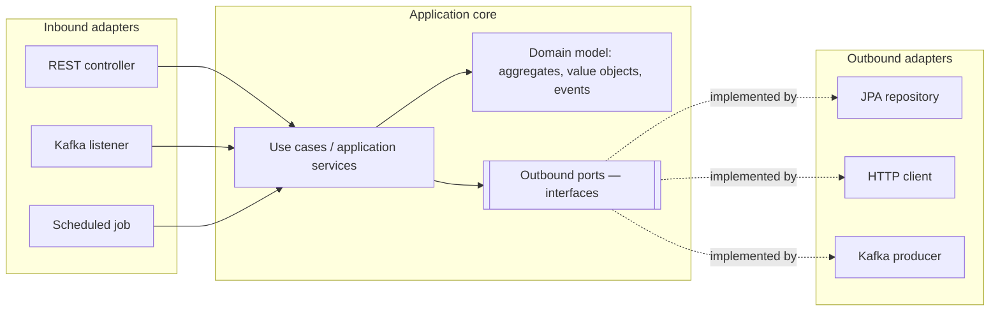
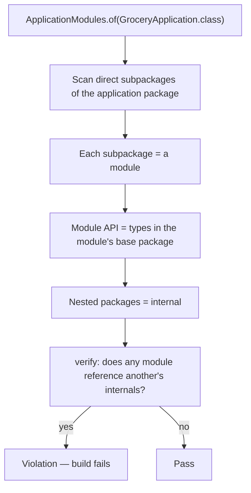
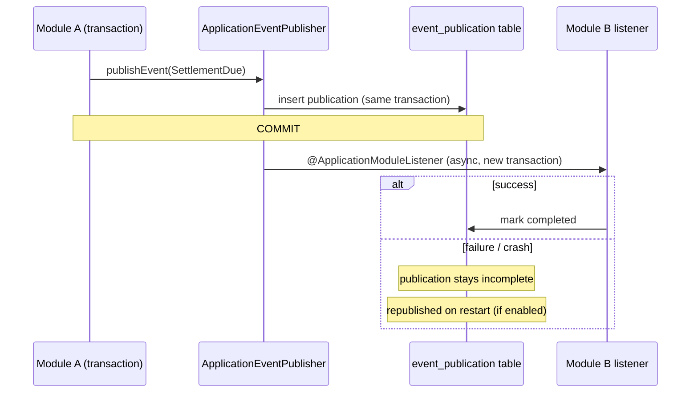
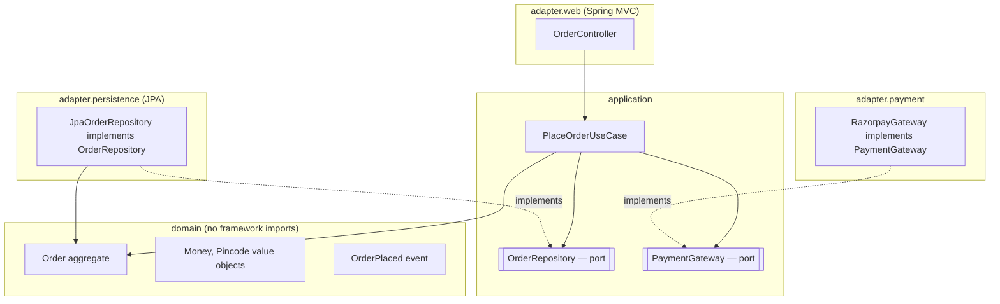
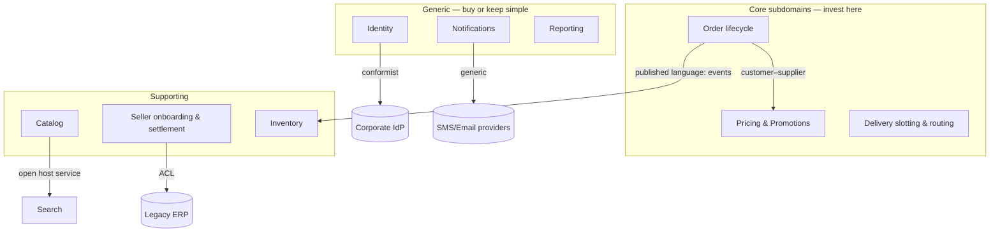
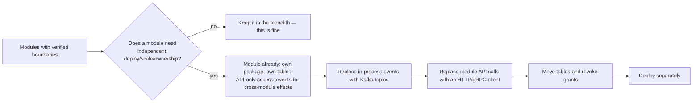
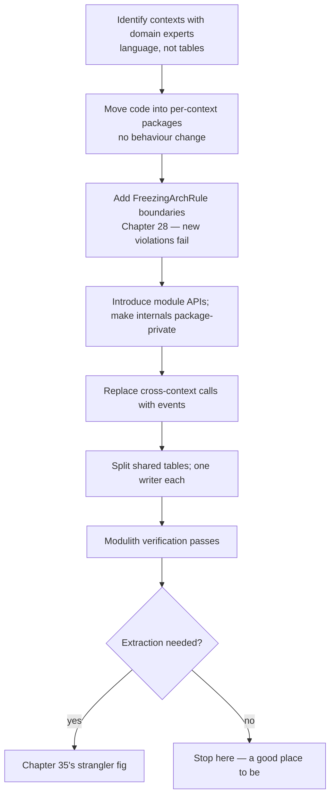

# 37 · DDD, Hexagonal Architecture & the Modular Monolith

## 1. Introduction & Why It Matters

Chapter 35 said boundaries matter more than technology. This chapter is about **how to find them**, and how to structure code so they hold.

Two failure modes bracket most enterprise Java:

- **The big ball of mud**: a 400,000-line monolith where `OrderService` calls `InventoryService` calls `PricingService` calls back into `OrderRepository`, every class can reach every other, and a change to delivery fees breaks seller payouts. Nobody can extract anything because everything touches everything.
- **The distributed ball of mud**: the same graph, now with HTTP between the nodes. Every previous problem, plus network failures, serialization, and deployment coordination.

The cure for both is the same and it isn't microservices. It's **boundaries with meaning** — drawn along the business's own divisions — and **dependency direction** that keeps the domain independent of frameworks and infrastructure.

This chapter covers: strategic DDD (bounded contexts, ubiquitous language, context mapping) as the method for finding boundaries; tactical DDD (aggregates, value objects, domain events) as the method for enforcing invariants; hexagonal architecture (ports and adapters) for dependency direction; and the **modular monolith** with Spring Modulith — a structure that gives you module boundaries, verified at build time, inside one deployable, so extraction later is a refactor rather than a rewrite.

### Who should read which section

| Band | Focus |
|---|---|
| B1 · 0–2 yrs | Parts 1, 2, 4 — entities, value objects, package structure |
| B2 · 2–5 yrs | Parts 2, 5 — aggregates, ports and adapters, domain events |
| B3 · 5–8 yrs | Parts 3, 5, 6 — aggregate design, module boundaries, Modulith |
| B4 · 8–12 yrs | Parts 6, 8 — context mapping, extraction strategy, governance |
| B5 · 12–15+ yrs | Parts 8, 9 — architecture as an organizational instrument |

---

## 2. Core Concepts

### 2.1 Strategic DDD: finding boundaries

| Concept | Meaning in the grocery platform |
|---|---|
| **Ubiquitous language** | "Order" means the same thing in code, conversation and the database — within a context |
| **Bounded context** | The scope in which a model and its language are consistent |
| **Subdomain** | Core (what differentiates: pricing, delivery slotting), supporting (seller onboarding), generic (notifications, auth) |
| **Context map** | How contexts relate, and who depends on whom |

The single most useful DDD insight: **the same word means different things in different contexts.**

| "Product" in… | Means |
|---|---|
| Catalog | Title, images, attributes, category, brand |
| Pricing | SKU, zone prices, GST rate, promotions |
| Inventory | SKU, hub, quantity, reservation state |
| Search | Indexed document with analyzers and boosts |
| Settlement | SKU, commission rate, seller |

Forcing one `Product` class across all five is what produces the god object with 80 fields and five teams editing it. Five models, each small and complete for its context, is the correct answer — with events carrying what's shared (Chapter 36).

### 2.2 Context mapping patterns

| Pattern | Use |
|---|---|
| **Partnership** | Two teams succeed or fail together; coordinate closely |
| **Customer–Supplier** | Downstream needs influence upstream planning |
| **Conformist** | Downstream accepts the upstream model as-is (a legacy ERP) |
| **Anticorruption layer (ACL)** | Translate an external model into yours at the boundary |
| **Shared kernel** | A small shared model, jointly owned — expensive; use sparingly |
| **Published language** | A documented contract (our REST/event schemas — Chapters 20, 23) |
| **Open host service** | One upstream API serving many downstreams |

The platform's ERP integration is a classic **ACL**: the ERP's `PartnerAccount` and `LedgerEntry` never appear in our domain; an adapter translates them into `Seller` and `Settlement`.

### 2.3 Tactical DDD

| Building block | Rule |
|---|---|
| **Value object** | Immutable, no identity, equality by value (`Money`, `Pincode`, `Gstin`) |
| **Entity** | Identity that persists through change (`Order`, `Seller`) |
| **Aggregate** | A cluster with one root; the **consistency and transaction boundary** |
| **Aggregate root** | The only entry point; enforces invariants |
| **Domain event** | Something that happened, named in past tense (`OrderPlaced`) |
| **Repository** | Persistence per **aggregate**, not per table |
| **Domain service** | Logic that belongs to no single aggregate (`CommissionCalculator`) |
| **Application service** | Orchestrates use cases: transaction, repositories, events — no business rules |

### 2.4 Aggregate design rules

1. **Protect true invariants** inside the aggregate ("an order's total equals the sum of its lines"; "a cart may not exceed 50 items").
2. **Keep aggregates small.** A `Seller` aggregate containing all their orders is unusable.
3. **One aggregate per transaction.** Changing two aggregates atomically is a design smell — use a domain event and eventual consistency (Chapter 36).
4. **Reference other aggregates by id**, never by object reference (Chapter 13's rule, with a reason behind it).
5. **Eventual consistency between aggregates** is normal and expected.

```text title="Example"
Order (root)
 ├── OrderLine (part of the aggregate — no independent life)
 ├── customerId  → reference to another aggregate
 └── sellerId    → reference
```

### 2.5 Hexagonal architecture (ports and adapters)



The one rule: **dependencies point inward.** The domain knows nothing about HTTP, JPA, Kafka or Spring. Adapters depend on the core; the core defines interfaces (ports) that adapters implement.

| Benefit | Cost |
|---|---|
| Domain testable without any framework | Mapping between domain and persistence models |
| Infrastructure swappable (JPA → JDBC, REST → gRPC) | More types, more files |
| Business rules readable without framework noise | Team discipline to keep the direction |

**Proportionality**: apply it fully to **core** subdomains (pricing, order lifecycle, settlement); for generic CRUD (a banner-management screen), the pragmatic layering from Chapter 08 is fine. Hexagonal everywhere is as wrong as hexagonal nowhere.

### 2.6 How this maps to the handbook's layering

| Handbook layer (Chapters 01, 08) | Hexagonal role |
|---|---|
| Controller | Inbound adapter |
| Delegate | Inbound port implementation / use-case entry |
| Service | Application service (+ domain services) |
| Domain model | The core |
| Repository interface | Outbound port |
| Repository implementation (JPA) | Outbound adapter |
| HTTP client interface | Outbound port |
| `RestClient` implementation | Outbound adapter |

The familiar four-layer structure **is** hexagonal when the dependency direction is respected and the domain doesn't import `jakarta.persistence` or `org.springframework.web`.

### 2.7 The modular monolith

One deployable, several modules with enforced boundaries:

| Property | Monolith | Modular monolith | Microservices |
|---|---|---|---|
| Deployment | One | One | Many |
| Boundaries | None enforced | **Compile/test-time enforced** | Network-enforced |
| Transactions | Local ACID | Local ACID | Sagas |
| Refactoring across boundaries | Trivial | Moderate | Expensive |
| Team autonomy | Low | Medium | High |
| Operational cost | Low | Low | High |
| Extraction later | Rewrite | **Refactor** | — |

For most teams, the modular monolith is the right starting point and often the right ending point.

### 2.8 Spring Modulith

| Feature | What it gives |
|---|---|
| `ApplicationModules.of(App.class).verify()` | **Fails the build** on boundary violations |
| Package conventions | Top-level package per module; nested packages are internal |
| `@ApplicationModule(allowedDependencies = …)` | Explicit allowed dependencies |
| Named interfaces | Expose more than one public package deliberately |
| `@ApplicationModuleListener` | Async, transactional module-to-module events |
| Event publication registry | Persists publications, completes them, **republishes incomplete ones on restart** |
| `Documenter` | Generates module diagrams and a component canvas |
| Scenario API | Tests that publish an event and await its effects |

The event publication registry is the detail that matters most: it makes in-process module events **reliable**, which is exactly the property you need if those modules might later become services (Chapter 36's outbox, at module scale).

---

## 3. How It Works Internally

### 3.1 Module detection and verification



```text title="Example"
in.grocery.seller                      ← the application package
├── catalog/                           ← module "catalog"
│   ├── CatalogService.java            ← module API (public)
│   └── internal/                      ← internal, unreachable from other modules
│       ├── ProductEntity.java
│       └── ProductRepository.java
├── settlement/                        ← module "settlement"
└── onboarding/                        ← module "onboarding"
```

### 3.2 Module events with the publication registry



This is the outbox pattern (Chapter 36) applied **within** a process — and the reason a Modulith module can be extracted into a service later without changing the sender's code.

### 3.3 Dependency direction in practice



An ArchUnit rule (Chapter 28) makes the arrows real: `domain` may not depend on `application`, `adapter.*`, Spring or JPA.

---

## 4. Hands-On Code — Level 1 (Beginner)

### 4.1 Value objects

```java title="in/grocery/order/domain/Money.java"
package in.grocery.order.domain;

import java.math.BigDecimal;
import java.math.RoundingMode;
import java.util.Currency;

public record Money(BigDecimal amount, Currency currency) {                      // (1)!

    private static final Currency INR = Currency.getInstance("INR");

    public Money {
        if (amount.scale() > 2) {
            amount = amount.setScale(2, RoundingMode.HALF_UP);                    // (2)!
        }
        if (amount.signum() < 0) {
            throw new IllegalArgumentException("Money cannot be negative: " + amount);
        }
    }

    public static Money rupees(String amount) {
        return new Money(new BigDecimal(amount), INR);
    }

    public Money plus(Money other) {
        requireSameCurrency(other);
        return new Money(amount.add(other.amount), currency);                     // (3)!
    }

    public Money times(int quantity) {
        return new Money(amount.multiply(BigDecimal.valueOf(quantity)), currency);
    }

    public boolean isGreaterThan(Money other) {
        requireSameCurrency(other);
        return amount.compareTo(other.amount) > 0;                                // (4)!
    }
}
```

1. A record: immutable, equality by value — exactly what a value object needs.
2. Invariants enforced in the **compact constructor**; an invalid `Money` cannot exist.
3. Operations return **new** instances.
4. `compareTo`, not `equals` — `BigDecimal.equals` treats `1.0` and `1.00` as different (Chapter 11).

```java title="in/grocery/order/domain/Pincode.java"
public record Pincode(String value) {
    private static final Pattern VALID = Pattern.compile("[1-9][0-9]{5}");

    public Pincode {
        if (value == null || !VALID.matcher(value).matches()) {
            throw new IllegalArgumentException("Invalid Indian pincode: " + value);   // (1)!
        }
    }
}
```

1. Validation once, at construction. Every method receiving a `Pincode` knows it's valid — no defensive checks scattered through the codebase (contrast with passing `String` everywhere, Chapter 09).

### 4.2 An aggregate

```java title="in/grocery/order/domain/Order.java"
package in.grocery.order.domain;

import java.time.Instant;
import java.util.ArrayList;
import java.util.Collections;
import java.util.List;

public class Order {                                                              // (1)!

    private static final int MAX_LINES = 50;

    private final OrderRef ref;
    private final CustomerId customerId;
    private final Pincode pincode;
    private final List<OrderLine> lines = new ArrayList<>();
    private OrderStatus status;
    private Money deliveryFee;
    private Instant placedAt;
    private final List<DomainEvent> events = new ArrayList<>();                    // (2)!

    private Order(OrderRef ref, CustomerId customerId, Pincode pincode) { ... }

    public static Order place(OrderRef ref, CustomerId customerId, Pincode pincode,
                              List<OrderLine> lines, Money deliveryFee) {
        if (lines.isEmpty()) {
            throw new EmptyOrderException(ref);                                    // (3)!
        }
        if (lines.size() > MAX_LINES) {
            throw new TooManyLinesException(lines.size(), MAX_LINES);
        }
        Order order = new Order(ref, customerId, pincode);
        lines.forEach(order.lines::add);
        order.deliveryFee = deliveryFee;
        order.status = OrderStatus.PLACED;
        order.placedAt = Instant.now();
        order.events.add(new OrderPlaced(ref, customerId, order.total()));         // (4)!
        return order;
    }

    public void markPaid(PaymentId paymentId) {
        if (status != OrderStatus.PLACED) {
            throw new IllegalOrderTransitionException(ref, status, OrderStatus.PAID);   // (5)!
        }
        status = OrderStatus.PAID;
        events.add(new OrderPaid(ref, paymentId, total()));
    }

    public void cancel(String reason) {
        if (!status.isCancellable()) {
            throw new IllegalOrderTransitionException(ref, status, OrderStatus.CANCELLED);
        }
        status = OrderStatus.CANCELLED;
        events.add(new OrderCancelled(ref, reason));
    }

    public Money subtotal() {
        return lines.stream().map(OrderLine::lineTotal)
                .reduce(Money.rupees("0.00"), Money::plus);                        // (6)!
    }

    public Money total() {
        return subtotal().plus(deliveryFee);
    }

    public List<OrderLine> lines() {
        return Collections.unmodifiableList(lines);                                // (7)!
    }

    public List<DomainEvent> pullEvents() {
        List<DomainEvent> pulled = List.copyOf(events);
        events.clear();
        return pulled;
    }
}
```

1. **No Spring, no JPA annotations, no framework imports** — this class is pure business rules and can be unit-tested in microseconds.
2. Events are collected in the aggregate and published by the application service after save.
3. Invariants are enforced at construction — you cannot build an invalid order.
4. Placing an order **is** an event; the aggregate records it.
5. State transitions are guarded by the domain, not by a service remembering to check.
6. Totals are **derived**, never stored inconsistently.
7. Callers can read lines but cannot mutate them behind the root's back.

### 4.3 Testing the domain

```java title="OrderTest.java"
class OrderTest {                                                                  // (1)!

    @Test
    void totalIsSubtotalPlusDeliveryFee() {
        Order order = anOrder().withLine("MILK-1L", 2, "66.00")
                               .withLine("ATTA-5KG", 1, "289.00")
                               .withDeliveryFee("35.00").build();

        assertThat(order.total()).isEqualTo(Money.rupees("456.00"));
    }

    @Test
    void cannotPlaceAnEmptyOrder() {
        assertThatThrownBy(() -> Order.place(ref(), customer(), pincode(), List.of(), fee()))
                .isInstanceOf(EmptyOrderException.class);
    }

    @Test
    void deliveredOrderCannotBeCancelled() {
        Order order = aDeliveredOrder();
        assertThatThrownBy(() -> order.cancel("changed mind"))
                .isInstanceOf(IllegalOrderTransitionException.class);
    }

    @Test
    void placingAnOrderRecordsAnEvent() {
        Order order = anOrder().build();
        assertThat(order.pullEvents()).hasExactlyElementsOfTypes(OrderPlaced.class);
    }
}
```

1. **No `@SpringBootTest`, no database, no mocks.** These tests run in milliseconds and cover the rules that matter most — the payoff of a framework-free domain.

---

## 5. Hands-On Code — Level 2 (Intermediate) & Level 3 (Advanced)

### 5.1 Level 2 — Ports and adapters

```text title="Package structure for a core subdomain"
in.grocery.order
├── domain/                      ← no framework imports
│   ├── Order.java, OrderLine.java, Money.java, Pincode.java
│   └── events/OrderPlaced.java
├── application/
│   ├── PlaceOrderUseCase.java          ← inbound port (interface)
│   ├── PlaceOrderService.java          ← implementation (application service)
│   └── port/
│       ├── OrderRepository.java        ← outbound port
│       ├── PricingPort.java
│       └── EventPublisher.java
└── adapter/
    ├── web/OrderController.java
    ├── persistence/JpaOrderRepository.java, OrderEntity.java
    ├── pricing/PricingHttpAdapter.java
    └── messaging/OutboxEventPublisher.java
```

```java title="in/grocery/order/application/port/OrderRepository.java"
package in.grocery.order.application.port;

public interface OrderRepository {                                                 // (1)!
    void save(Order order);
    Optional<Order> findByRef(OrderRef ref);
    boolean existsForCustomer(OrderRef ref, CustomerId customerId);
}
```

1. Defined by the **core**, in the core's language (`OrderRef`, not `String`); the JPA adapter implements it. This is dependency inversion: the core doesn't depend on persistence, persistence depends on the core.

```java title="in/grocery/order/application/PlaceOrderService.java"
@Service
class PlaceOrderService implements PlaceOrderUseCase {

    private final OrderRepository orders;
    private final PricingPort pricing;
    private final EventPublisher events;

    @Override
    @Transactional                                                                 // (1)!
    public OrderRef place(PlaceOrderCommand command) {
        List<OrderLine> lines = command.items().stream()
                .map(item -> new OrderLine(item.sku(), item.quantity(),
                        pricing.priceFor(item.sku(), command.pincode())))          // (2)!
                .toList();

        Order order = Order.place(OrderRef.next(), command.customerId(),
                command.pincode(), lines, pricing.deliveryFee(command.pincode()));  // (3)!

        orders.save(order);
        events.publishAll(order.pullEvents());                                      // (4)!
        return order.ref();
    }
}
```

1. **Transaction boundary in the application service** (Chapter 16), never in the domain.
2. Outbound ports fetch what the domain needs; the domain itself never calls a port.
3. Business rules live in `Order.place` — this service only orchestrates.
4. Domain events collected by the aggregate go out via the publisher port (which writes the outbox, Chapter 36).

```java title="in/grocery/order/adapter/persistence/JpaOrderRepository.java"
@Repository
class JpaOrderRepository implements OrderRepository {                              // (1)!

    private final OrderJpaRepository jpa;
    private final OrderMapper mapper;

    @Override
    public void save(Order order) {
        jpa.save(mapper.toEntity(order));                                          // (2)!
    }

    @Override
    public Optional<Order> findByRef(OrderRef ref) {
        return jpa.findByOrderRef(ref.value()).map(mapper::toDomain);
    }
}
```

1. The adapter implements the core's port; the core never sees Spring Data.
2. **Mapping between the domain model and the entity model** — the main cost of hexagonal architecture. For a core subdomain it buys a clean, testable domain; for a CRUD screen it's overhead, which is why 2.5's proportionality matters.

### 5.2 Level 2 — Anticorruption layer

```java title="in/grocery/settlement/adapter/erp/ErpAntiCorruptionLayer.java"
@Component
class ErpAntiCorruptionLayer implements SellerLedgerPort {                          // (1)!

    private final ErpClient erp;

    @Override
    public void recordSettlement(SellerId sellerId, Money amount, SettlementPeriod period) {
        ErpPartnerAccount account = erp.findPartnerAccount(sellerId.value());        // (2)!
        erp.postLedgerEntry(new ErpLedgerEntry(
                account.getPartnerCode(),
                account.getSubLedgerId(),
                amount.amount().movePointRight(2).longValueExact(),                  // (3)!
                "SETT",
                period.toErpPeriodCode(),
                erpNarration(sellerId, period)));
    }
}
```

1. The port speaks **our** language; the ERP's concepts stop here.
2. `ErpPartnerAccount`, `ErpLedgerEntry` and their quirks never leak into the domain.
3. Unit conversions, code translations and their peculiarities are the ACL's job — exactly where you want them when the ERP changes.

### 5.3 Level 3 — Aggregate boundaries in practice

**The wrong aggregate** (a very common mistake):

```java title="Seller.java"
public class Seller {                                                             // ❌
    private List<Product> products;        // 40,000 products
    private List<Order> orders;            // 2.8 million orders
    private List<Settlement> settlements;
}
```

Loading a seller loads a gigabyte; every product edit locks the seller row; nothing scales.

**The right decomposition:**

| Aggregate | Contains | Invariant it protects |
|---|---|---|
| `Seller` | Profile, status, commission rate | "An inactive seller cannot receive new orders" |
| `Product` | SKU, attributes, seller **id** | "Selling price ≤ MRP" |
| `Order` | Lines, status, totals | "Total = subtotal + fee"; valid transitions |
| `Settlement` | Period, lines, payout | "Payout = Σ lines − commission − TDS" |

Cross-aggregate rules ("a seller's outstanding payout must not exceed X") are handled by a **domain service plus eventual consistency**, not by fusing aggregates.

```java title="One aggregate per transaction"
@Transactional
public void confirmOrder(OrderRef ref, PaymentId paymentId) {
    Order order = orders.findByRef(ref).orElseThrow();
    order.markPaid(paymentId);                                                     // (1)!
    orders.save(order);
    events.publishAll(order.pullEvents());                                         // (2)!
}
```

1. Exactly one aggregate changes.
2. Effects on other aggregates (stock, loyalty, settlement) happen via events — eventually consistent by design (Chapter 36).

!!! tip "A practical test for aggregate boundaries"
    Ask: *must these two things always be consistent at the same instant, or is "within a few seconds" acceptable?* Only the first case justifies one aggregate. In practice, that's rarer than teams assume — and the assumption is what produces god aggregates.

### 5.4 Level 3 — The modular monolith with Spring Modulith

The **seller portal** is one deployable with four modules — a good fit because the modules share a database, change together, and are owned by one team.

```kotlin title="build.gradle.kts"
implementation(platform("org.springframework.modulith:spring-modulith-bom:1.x"))   // (1)!
implementation("org.springframework.modulith:spring-modulith-starter-core")
implementation("org.springframework.modulith:spring-modulith-starter-jpa")
testImplementation("org.springframework.modulith:spring-modulith-starter-test")
```

1. **Verify** the version matching your Boot release.

```text title="Module structure"
in.grocery.sellerportal
├── SellerPortalApplication.java
├── catalog/
│   ├── CatalogService.java              ← public API of the module
│   ├── ProductView.java                 ← published types
│   └── internal/                        ← everything else
├── onboarding/
│   ├── OnboardingService.java
│   └── internal/
├── settlement/
│   ├── SettlementService.java
│   └── internal/
└── shared/                              ← minimal: ids, Money (a small shared kernel)
```

```java title="src/test/java/in/grocery/sellerportal/ModularityTest.java"
class ModularityTest {

    static final ApplicationModules modules = ApplicationModules.of(SellerPortalApplication.class);

    @Test
    void modulesRespectTheirBoundaries() {
        modules.verify();                                                          // (1)!
    }

    @Test
    void writeDocumentation() {
        new Documenter(modules)
                .writeModulesAsPlantUml()
                .writeIndividualModulesAsPlantUml()
                .writeModuleCanvases();                                            // (2)!
    }
}
```

1. **The build fails** if `settlement` imports `catalog.internal.ProductEntity`. Boundaries stop being a convention and become a compile-time property.
2. Generated diagrams and a canvas per module (its API, events published and consumed, dependencies) — documentation that cannot drift.

```java title="Explicit dependencies"
@ApplicationModule(allowedDependencies = {"catalog", "shared"})                     // (1)!
package in.grocery.sellerportal.settlement;
```

1. Declared in `package-info.java`: settlement may use catalog and shared, nothing else. Any other dependency fails verification — including one added accidentally by an IDE import.

### 5.5 Level 3 — Module events

```java title="in/grocery/sellerportal/settlement/SettlementService.java"
@Service
public class SettlementService {

    private final ApplicationEventPublisher events;

    @Transactional
    public void closePeriod(SellerId sellerId, SettlementPeriod period) {
        var settlement = settlements.close(sellerId, period);
        events.publishEvent(new SettlementClosed(sellerId, period, settlement.payout()));   // (1)!
    }
}
```

```java title="in/grocery/sellerportal/onboarding/SettlementNotifier.java"
@Component
class SettlementNotifier {

    @ApplicationModuleListener                                                      // (2)!
    void onSettlementClosed(SettlementClosed event) {
        notifications.sendPayoutNotice(event.sellerId(), event.payout());
    }
}
```

1. The publishing module doesn't know who listens — the same decoupling as Kafka, without the network.
2. `@ApplicationModuleListener` = `@Async` + `@Transactional(REQUIRES_NEW)` + `@TransactionalEventListener` (Chapter 03), and with the **event publication registry** enabled, the publication is persisted and completed — surviving a crash between publish and handling.

```sql title="The registry table (created by Modulith's schema, run via Flyway)"
select * from event_publication where completion_date is null;                      -- (1)
```

1. **Incomplete publications** are the in-process equivalent of a pending outbox row (Chapter 36) — monitor this table and alert on growth.

```java title="Testing module interactions"
@ApplicationModuleTest                                                              // (1)!
class SettlementModuleTest {

    @Test
    void closingAPeriodNotifiesTheSeller(Scenario scenario) {
        scenario.stimulate(() -> settlementService.closePeriod(sellerId(), period()))
                .andWaitForEventOfType(SettlementClosed.class)                       // (2)!
                .toArriveAndVerify(event -> assertThat(event.payout()).isEqualTo(Money.rupees("12450.00")));
    }
}
```

1. Bootstraps **only this module** (plus declared dependencies) — faster than a full context and it proves the module is genuinely independent.
2. The Scenario API handles the asynchronous wait without `Thread.sleep` (Chapter 15).

### 5.6 Level 3 — Enforcing architecture with ArchUnit

```java title="in/grocery/archtests/HexagonalRules.java"
public static final ArchRule DOMAIN_IS_FRAMEWORK_FREE = noClasses()
        .that().resideInAPackage("..domain..")
        .should().dependOnClassesThat().resideInAnyPackage(                         // (1)!
                "org.springframework..", "jakarta.persistence..", "com.fasterxml.jackson..",
                "..adapter..", "..application..")
        .because("the domain must not depend on frameworks or outer layers");

public static final ArchRule ADAPTERS_DO_NOT_CALL_EACH_OTHER = slices()
        .matching("..adapter.(*)..")
        .should().notDependOnEachOther()                                            // (2)!
        .because("adapters communicate through the application core");

public static final ArchRule PORTS_ARE_INTERFACES = classes()
        .that().resideInAPackage("..application.port..")
        .should().beInterfaces();
```

1. The rule that keeps hexagonal architecture real. Without it, someone adds `@Entity` to the aggregate "just for now" and the boundary is gone.
2. A web adapter calling a persistence adapter directly bypasses the core — the most common erosion.

---

## 6. Hands-On Code — Level 4 (Expert / Production)

### 6.1 The platform's context map



| Classification | Implication |
|---|---|
| **Core** | Rich domain model, hexagonal, best engineers, heavy test coverage |
| **Supporting** | Pragmatic layering, straightforward models |
| **Generic** | Buy, or keep deliberately simple; never gold-plate |

Recognizing that notifications are generic — and refusing to build an elaborate domain model for them — is as much a DDD decision as modelling pricing carefully.

### 6.2 From modular monolith to services



Because Modulith already forbade internal access and encouraged events, each step is mechanical. The extraction cost is proportional to how well the boundary was maintained — which is the entire argument for starting modular.

```java title="What changes when a module becomes a service"
// before (in-process)
@ApplicationModuleListener
void onSettlementClosed(SettlementClosed event) { ... }

// after (across services) — Chapter 23
@KafkaListener(topics = "grocery.settlement.closed.v1", groupId = "notification-service")
@Transactional
public void onSettlementClosed(SettlementClosed event) {
    if (inbox.alreadyProcessed(CONSUMER, event.eventId())) return;                  // (1)!
    inbox.markProcessed(CONSUMER, event.eventId());
    notifications.sendPayoutNotice(event.sellerId(), event.payout());
}
```

1. The one genuinely new concern: at-least-once delivery now requires explicit idempotency (the publication registry provided equivalent guarantees in-process).

### 6.3 Where the platform applies which style

| Component | Style | Why |
|---|---|---|
| order-service | Full hexagonal, rich domain | Core: complex invariants, high change rate |
| pricing-service | Full hexagonal, rich domain | Core: the platform's differentiator |
| settlement-service | Hexagonal with an ACL to the ERP | Money and an external model |
| catalog-service | Pragmatic layering (Chapter 08) | Mostly CRUD with validation |
| notification-service | Pragmatic layering | Generic subdomain |
| seller-portal | **Modular monolith** (Modulith) | Four cohesive modules, one team, shared database |
| mobile-bff | Thin composition layer | No domain at all (Chapter 32) |

Uniformity is not a goal. **Match the structure to the subdomain**, and write the reason in an ADR so the next team knows it was a decision.

### 6.4 Governance

```java title="Architecture tests that run on every build"
@AnalyzeClasses(packages = "in.grocery.order", importOptions = DoNotIncludeTests.class)
class OrderArchitectureTest {

    @ArchTest static final ArchRule domainIsFrameworkFree = HexagonalRules.DOMAIN_IS_FRAMEWORK_FREE;
    @ArchTest static final ArchRule adaptersAreIsolated = HexagonalRules.ADAPTERS_DO_NOT_CALL_EACH_OTHER;
    @ArchTest static final ArchRule portsAreInterfaces = HexagonalRules.PORTS_ARE_INTERFACES;

    @ArchTest
    static final ArchRule aggregatesAreNotExposedOverHttp = noClasses()
            .that().resideInAPackage("..adapter.web..")
            .should().dependOnClassesThat().resideInAPackage("..domain..")           // (1)!
            .because("controllers map to DTOs; the domain model is not an API contract");
}
```

1. A strict variant: even the domain model stays out of the web layer, so an internal refactor can never break the public API (Chapters 11, 20). Some teams relax this; either way, decide once and enforce it.

| Governance instrument | Purpose |
|---|---|
| ArchUnit rules in a shared library | Boundaries enforced identically everywhere |
| `ApplicationModules.verify()` | Module boundaries in modular services |
| Generated module canvases | Living documentation |
| ADRs per context/style decision | Why this service is structured this way |
| Context map reviewed quarterly | Boundaries drift as the business changes |
| Ubiquitous-language glossary per context | Prevents the same word meaning three things |

### 6.5 When to relax the rules

| Situation | Pragmatic choice |
|---|---|
| Generic CRUD subdomain | Layered structure, entities as the model |
| Short-lived service (campaign microsite) | Simplest thing that works |
| Read-only reporting service | Query objects straight to DTOs (Chapter 12) |
| Prototype/spike | No architecture; delete it afterwards |
| Core domain under active change | **Full discipline** — this is where it pays |

The failure mode of architecture enthusiasm is mapping layers for a table with four columns. The failure mode of pragmatism is a 3,000-line `OrderService` that nobody can change safely. Both are real; the judgement is which subdomain you're in.

### 6.6 Refactoring toward boundaries

A practical sequence for an existing tangled codebase:



Steps B and C deliver most of the value for a fraction of the cost, and — importantly — can be done incrementally without a rewrite.

---

## 7. Spring Boot 3 vs 4 & Migration

| Topic | Boot 3.5 | Boot 4.x |
|---|---|---|
| Spring Modulith | 1.2/1.3 | Version aligned with Boot 4 (verify) |
| Event publication registry | JPA/JDBC/MongoDB stores | Same (verify schema/property names) |
| `@ApplicationModuleListener` | ✅ | ✅ |
| Documenter output | PlantUML/Mermaid, canvases | Same (verify) |
| ArchUnit | 1.x | Same |
| Domain code | Framework-free by design | **Unaffected by the upgrade** |

!!! tip "The clearest benefit of a framework-free domain"
    A Boot 3 → 4 upgrade touches adapters — web, persistence, messaging, configuration — and leaves the domain untouched. On a hexagonal core service, that's the difference between reviewing a few adapter classes and auditing the whole codebase.

### Migration checklist

- [ ] Check Spring Modulith's version compatibility before upgrading Boot.
- [ ] Verify the event publication registry schema (it is a database migration — Chapter 14).
- [ ] Re-run `ApplicationModules.verify()` after package moves in the upgrade.
- [ ] Re-generate module documentation.
- [ ] Confirm ArchUnit rules still match new framework package names (Jackson 3, moved Boot packages).

---

## 8. Production Playbook

### Best practices

1. **Find boundaries in the language**, with domain experts — not in the database schema.
2. **Let the same word mean different things** in different contexts; connect them with events.
3. **Small aggregates, one per transaction, referenced by id**; eventual consistency between them.
4. **Value objects for domain concepts** (`Money`, `Pincode`) — validation once, at construction.
5. **Dependencies point inward**; the domain imports no framework.
6. **Enforce boundaries mechanically** with ArchUnit and `ApplicationModules.verify()`.
7. **Start with a modular monolith**; extract only when deployment, scaling or ownership diverge.
8. **Use module events** with the publication registry, so extraction is mechanical later.
9. **Match structure to subdomain**: rich models for core, simple layering for generic.
10. **Record decisions in ADRs** and review the context map as the business changes.

### Anti-patterns

❌ A god aggregate (`Seller` containing orders and products).

❌ One canonical model shared across all contexts.

❌ Anemic domain with all logic in services, for a **core** subdomain.

❌ Framework annotations in the domain model, then claiming it's hexagonal.

❌ Mapping layers for a CRUD table with four columns.

❌ Two aggregates modified in one transaction because "it's easier".

❌ Package structure by technical layer (`controllers/`, `services/`, `entities/`) in a large codebase — it hides feature boundaries.

❌ Boundaries documented in a wiki and enforced nowhere.

❌ Extracting services before the modules are clean.

❌ Applying maximum ceremony uniformly to every subdomain.

### Troubleshooting

| Symptom | Cause | Fix |
|---|---|---|
| A change ripples through many classes | Boundaries don't match the business | Re-derive contexts from the language; re-package |
| Aggregate loads are slow | Aggregate too large | Split; reference by id; separate read models |
| Deadlocks on a shared row | God aggregate as a lock point | Smaller aggregates; eventual consistency |
| "Hexagonal" but the domain imports JPA | No enforcement | ArchUnit rule; separate entity and domain models |
| Modulith verification fails after refactoring | Package moved into another module's space | Fix the package, or declare the dependency |
| Module events lost on crash | Publication registry not enabled | Enable it; monitor incomplete publications |
| Every feature touches every module | Wrong module split | Merge or re-split around real cohesion |
| Extraction takes months | Boundary was never real | Modularize in place first (6.6) |
| Team resists the structure | Ceremony applied to generic subdomains | Relax it there; keep discipline in core |

### Production checklist

- [ ] Contexts identified with domain experts; a glossary per context
- [ ] Subdomains classified core/supporting/generic, with matching investment
- [ ] Aggregates small, one per transaction, referenced by id
- [ ] Value objects for money, identifiers and domain constraints
- [ ] ArchUnit rules enforcing dependency direction in core services
- [ ] `ApplicationModules.verify()` in modular applications
- [ ] Module events use the publication registry; incomplete publications monitored
- [ ] Module documentation generated in CI
- [ ] ADRs recording style decisions per service
- [ ] Context map reviewed quarterly

---

## 9. Interview Questions & Answers

### B1 · 0–2 years

??? question "B1 · What is a value object?"
    **Short answer:** An immutable object with no identity, compared by value — `Money`, `Pincode`, `Gstin`. Validation happens at construction, so invalid instances can't exist.

??? question "B1 · What is an aggregate?"
    **Short answer:** A cluster of objects with one root that enforces the group's invariants and is the transaction boundary. External code interacts only through the root.

??? question "B1 · What is a bounded context?"
    **Short answer:** The scope in which a model and its terms mean one thing. "Product" in catalog and "product" in pricing are different models in different contexts.

??? question "B1 · What does hexagonal architecture mean?"
    **Short answer:** The domain sits in the middle with no framework dependencies; inbound adapters (web, messaging) call it, and it calls outbound ports implemented by adapters (database, HTTP). Dependencies point inward.

??? question "B1 · What is a modular monolith?"
    **Short answer:** One deployable application split into modules with enforced boundaries — the organizational benefits of separation without the operational cost of distribution.

### B2 · 2–5 years

??? question "B2 · Why reference other aggregates by id?"
    **Short answer:** It keeps aggregates small, prevents accidental loading of huge object graphs, and makes the transaction boundary explicit — you can't modify two aggregates in one transaction by accident.

??? question "B2 · Is an anemic domain model always wrong?"
    **Short answer:** No. For generic or CRUD subdomains it's perfectly reasonable. It's a problem in core subdomains, where scattering rules across services makes them inconsistent and hard to test.

??? question "B2 · What does Spring Modulith add over package conventions?"
    **Short answer:** Verification that fails the build on boundary violations, declared module dependencies, module-scoped tests, generated documentation, and reliable module events through the publication registry.

??? question "B2 · What is an anticorruption layer?"
    **Short answer:** An adapter that translates an external system's model into yours, so its concepts and quirks never leak into your domain — essential when integrating with legacy or third-party systems.

??? question "B2 · What's the cost of hexagonal architecture?"
    **Short answer:** Mapping between domain and persistence models, more types and files, and the discipline to maintain direction. Worth it for core domains, overhead for simple CRUD.

??? question "B2 · How do you enforce that the domain stays framework-free?"
    **Short answer:** An ArchUnit rule forbidding dependencies from `..domain..` on Spring, JPA, Jackson and outer packages, running in every build.

### B3 · 5–8 years

??? question "B3 · How do you decide aggregate boundaries?"
    **Short answer:** By invariants that must hold **at the same instant**. If eventual consistency (seconds) is acceptable, they're separate aggregates connected by domain events. Keep aggregates small enough to load and lock cheaply.

??? question "B3 · Why does the same concept get different models in different contexts?"
    **Short answer:** Because each context cares about different attributes and rules. One canonical model becomes a god object owned by everyone and no one; separate models stay small and are connected by published contracts.

??? question "B3 · How does the Modulith event publication registry work, and why does it matter?"
    **Short answer:** Publications are persisted in the same transaction as the business change and marked complete when the listener succeeds; incomplete ones can be republished after a restart. It's the outbox pattern in-process — which means module-to-module events have the same reliability they'd have as Kafka events after extraction.

??? question "B3 · How would you refactor a tangled monolith toward boundaries?"
    **Short answer:** Identify contexts from the language with domain experts; re-package by context without behaviour change; add frozen architecture rules so new violations fail; introduce module APIs and make internals package-private; replace cross-context calls with events; split shared tables. Extraction, if ever, comes last.

??? question "B3 · How does hexagonal architecture help with framework upgrades?"
    **Short answer:** Framework changes are confined to adapters. A Boot major upgrade touches web, persistence and messaging code; the domain model — where the business rules and the hardest tests live — compiles unchanged.

### B4 · 8–12 years

??? question "B4 · How do you classify subdomains and what follows from it?"
    **Short answer:** Core (differentiating — invest: rich models, hexagonal, best people), supporting (necessary but not differentiating — pragmatic), generic (buy or keep simple). It directs effort where it creates value and prevents gold-plating notifications while pricing rots.

??? question "B4 · Modular monolith or microservices for a new platform?"
    **Short answer:** Modular monolith unless there's a concrete need for independent deployment, scaling or ownership. It preserves local transactions and cheap refactoring while the domain is still being learned — and with verified boundaries, extraction later is a refactor rather than a rewrite.

??? question "B4 · How do you keep architecture from eroding across many teams?"
    **Short answer:** Mechanical enforcement (ArchUnit, Modulith verification) in a shared library, generated documentation, ADRs, boundaries owned by teams, and periodic context-map reviews. Anything enforced only by review erodes with the first deadline.

### B5 · 12–15+ years

??? question "B5 · What does DDD actually buy an organization?"
    **Short answer:** A shared language between business and engineering, boundaries that match how the business changes, and therefore changes that stay local. The tactical patterns are secondary; the strategic work — contexts, language, ownership — is where the value is.

??? question "B5 · When is DDD the wrong investment?"
    **Short answer:** Simple CRUD systems, short-lived projects, generic subdomains, or organizations without access to domain experts. Applying tactical patterns without strategic understanding produces ceremony with no benefit — the common failure mode.

### Scenario questions

??? example "Scenario · Every pricing change breaks the seller portal"
    A single shared `Product` entity served catalog, pricing and settlement, with logic spread across services that all mutated it. Fixes: split into per-context models with events carrying what's shared, define the catalog's published language, enforce boundaries with ArchUnit, and move settlement's view of a product behind an ACL-style projection.

??? example "Scenario · Extraction of the settlement module was estimated at two weeks and took five months"
    The module shared tables with the monolith, accessed internal classes freely, and had no event-based decoupling. Fixes (applied to the next extraction): modularize in place first with verified boundaries, split tables with one writer each, replace direct calls with module events, and only then extract — which took nine days.

### Coding exercise

!!! example "Exercise · Model the cart"
    Model `Cart` as an aggregate with: at most 50 distinct SKUs, quantity 1–20 per line, a total, the ability to add/update/remove lines, a version for optimistic locking, and domain events for `ItemAdded` and `CartCleared`. Then define the ports for persistence and pricing, and write domain tests with no Spring.

??? success "Solution"
    ```java title="Cart.java (domain — no framework imports)"
    public class Cart {

        private static final int MAX_LINES = 50;
        private static final int MAX_QUANTITY_PER_LINE = 20;

        private final CartId id;
        private final CustomerId customerId;
        private final Map<Sku, CartLine> lines = new LinkedHashMap<>();             // (1)!
        private long version;
        private final List<DomainEvent> events = new ArrayList<>();

        public void addItem(Sku sku, int quantity, Money unitPrice) {
            if (quantity < 1 || quantity > MAX_QUANTITY_PER_LINE) {
                throw new InvalidQuantityException(sku, quantity, MAX_QUANTITY_PER_LINE);
            }
            CartLine existing = lines.get(sku);
            int newQuantity = existing == null ? quantity : existing.quantity() + quantity;
            if (newQuantity > MAX_QUANTITY_PER_LINE) {
                throw new InvalidQuantityException(sku, newQuantity, MAX_QUANTITY_PER_LINE);   // (2)!
            }
            if (existing == null && lines.size() >= MAX_LINES) {
                throw new CartLineLimitExceededException(MAX_LINES);
            }
            lines.put(sku, new CartLine(sku, newQuantity, unitPrice));
            events.add(new ItemAdded(id, sku, newQuantity));
        }

        public void removeItem(Sku sku) {
            if (lines.remove(sku) == null) {
                throw new LineNotInCartException(id, sku);                            // (3)!
            }
            events.add(new ItemRemoved(id, sku));
        }

        public void clear() {
            if (lines.isEmpty()) return;                                              // (4)!
            lines.clear();
            events.add(new CartCleared(id));
        }

        public Money subtotal() {
            return lines.values().stream().map(CartLine::lineTotal)
                    .reduce(Money.rupees("0.00"), Money::plus);
        }

        public List<CartLine> lines() {
            return List.copyOf(lines.values());
        }
    }
    ```

    1. A map keyed by SKU makes "adding an existing SKU increases its quantity" natural and keeps insertion order for display.
    2. The limit applies to the **resulting** quantity, not the increment — the subtle rule an anemic service usually gets wrong.
    3. Removing a missing line is an error the domain names, not a silent no-op.
    4. Clearing an empty cart is idempotent and emits no event — events describe things that actually happened.

    ```java title="Ports"
    public interface CartRepository {
        Optional<Cart> findFor(CustomerId customerId);
        void save(Cart cart);                       // optimistic locking on version
    }

    public interface PricingPort {
        Money priceFor(Sku sku, Pincode pincode);   // in the core's language, not the HTTP client's
    }
    ```

    ```java title="CartTest.java — no Spring, milliseconds"
    @Test void addingSameSkuIncreasesQuantity() { }
    @Test void quantityAboveTwentyIsRejectedEvenWhenAddedIncrementally() { }          // (1)!
    @Test void fiftyFirstDistinctSkuIsRejected() { }
    @Test void updatingAnExistingSkuDoesNotCountAgainstTheLineLimit() { }
    @Test void subtotalSumsLineTotals() { }
    @Test void clearingAnEmptyCartEmitsNoEvent() { }
    @Test void removingAMissingLineThrows() { }
    ```

    1. The test that catches the incremental-addition loophole — exactly the kind of rule that belongs in the aggregate rather than in a controller's validation.

    The application service then becomes trivial: load, call a domain method, save, publish events. All the business complexity lives in one small, fast-testable class.

---

## Key Takeaways

- **Boundaries come from the business language**, not the database schema; the same word legitimately means different things in different contexts.
- **Aggregates are consistency boundaries**: small, one per transaction, referenced by id.
- **Value objects** move validation to construction, eliminating scattered defensive checks.
- **Hexagonal architecture is dependency direction** — enforce it with ArchUnit or it erodes.
- **Match structure to subdomain**: rich models for core, pragmatic layering for generic.
- **The modular monolith is a first-class destination**, not just a waypoint; Spring Modulith makes its boundaries verifiable.
- **Module events with the publication registry** make later extraction mechanical.
- A framework-free domain **survives framework upgrades untouched**.

## Further Reading

- Eric Evans, *Domain-Driven Design*; Vaughn Vernon, *Implementing Domain-Driven Design* — strategic and tactical patterns
- Vaughn Vernon, *Effective Aggregate Design* (three-part paper) — the clearest guidance on aggregate boundaries
- Alistair Cockburn on Ports and Adapters; Tom Hombergs, *Get Your Hands Dirty on Clean Architecture*
- Spring Modulith Reference — module verification, events, documentation, testing

---

[:material-arrow-left: 36 Distributed Data & Consistency](36-distributed-data-consistency.md) · [38 Multi-Tenancy :material-arrow-right:](38-multi-tenancy.md)
