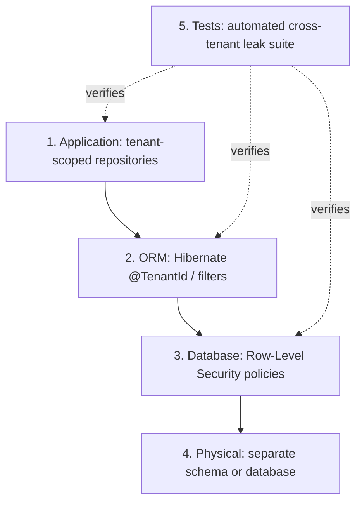
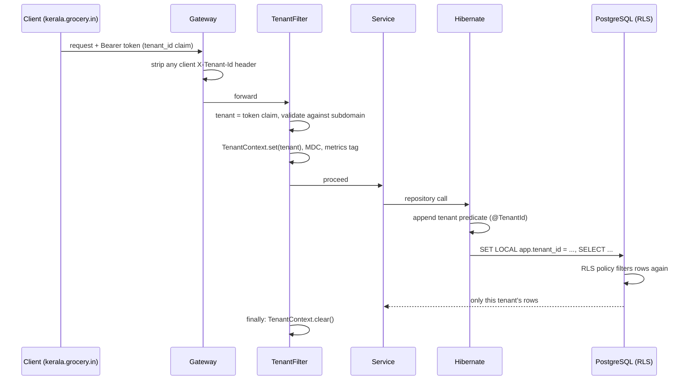
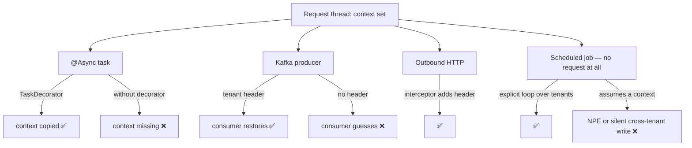
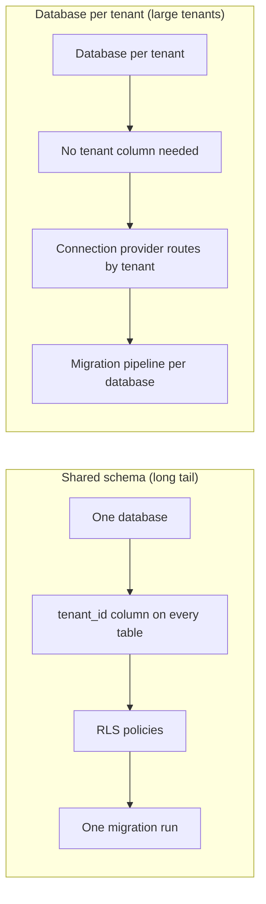
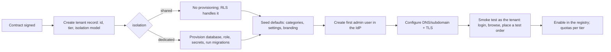
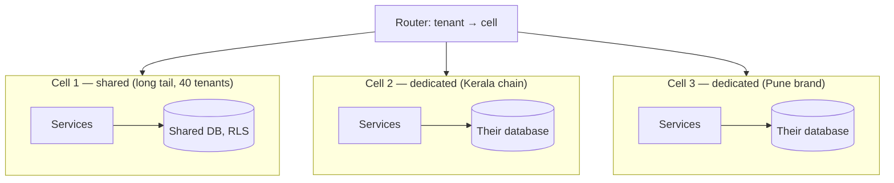
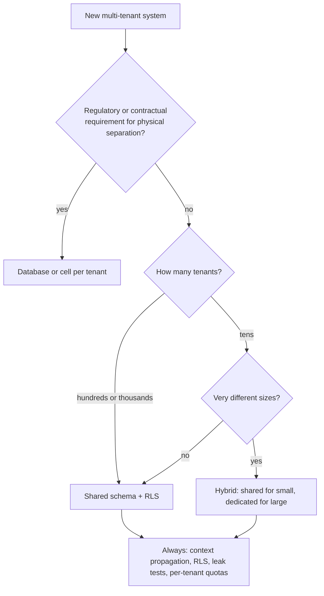

# 38 · Multi-Tenancy

## 1. Introduction & Why It Matters

The grocery platform now has a second business model: **white-label**. Regional chains — a 40-store chain in Kerala, a premium organic brand in Pune, a cooperative in Punjab — run their own storefront on our platform. Each is a **tenant** with its own catalog, pricing, sellers, branding and customers. They share our code, our clusters and (mostly) our databases.

The engineering question is simple to state and expensive to get wrong: **how do we guarantee that tenant A can never see tenant B's data?**

Every multi-tenant incident has the same shape. A developer writes `orderRepository.findAll()` for an admin screen, or forgets the tenant in a cache key (Chapter 21), or a scheduled job runs without a tenant context and processes everything, or an async task loses the tenant and writes rows under the wrong id. None of these looks dangerous in review; all of them are a data breach, a contract violation and — under India's DPDP Act — a reportable incident.

This chapter covers the isolation models and how to choose between them, tenant resolution and context propagation (including the async and messaging paths where it usually breaks), Hibernate's multi-tenancy support, PostgreSQL row-level security as a defence in depth, migrations across tenants, per-tenant quotas and the noisy-neighbour problem, onboarding and offboarding with data export and deletion, cell-based isolation for large tenants, and — most importantly — the **automated cross-tenant leak tests** that turn "we're careful" into "the build proves it".

### Who should read which section

| Band | Focus |
|---|---|
| B1 · 0–2 yrs | Parts 1, 2, 4 — models, tenant context, filtering |
| B2 · 2–5 yrs | Parts 2, 5 — Hibernate support, caching, migrations |
| B3 · 5–8 yrs | Parts 3, 5, 6 — RLS, propagation, leak testing |
| B4 · 8–12 yrs | Parts 6, 8 — model selection, quotas, cells, lifecycle |
| B5 · 12–15+ yrs | Parts 8, 9 — economics and compliance of tenancy |

---

## 2. Core Concepts

### 2.1 Isolation models

| Model | Isolation | Cost per tenant | Migrations | Best for |
|---|---|---|---|---|
| **Shared schema** (tenant column) | Logical only — code and RLS enforce it | Lowest | One run | Many small tenants |
| **Schema per tenant** | Strong-ish (separate namespaces) | Medium | Loop over schemas | Tens to low hundreds |
| **Database per tenant** | Strongest | Highest | Per database | Few large or regulated tenants |
| **Cell / stack per tenant** | Physical, including compute | Very high | Per cell | Enterprise tiers, blast-radius control |

The platform runs a **hybrid**: shared schema for the long tail of small chains, database per tenant for the three largest (who pay for it and demand it contractually).

### 2.2 The three questions any model must answer

1. **Resolution** — which tenant is this request for?
2. **Propagation** — does that tenant identity follow the work through async tasks, messages and scheduled jobs?
3. **Enforcement** — what stops a query from crossing tenants, even when a developer forgets?

Most implementations answer 1 well, 2 partially, and 3 with "code review". Question 3 is the one that requires machinery.

### 2.3 Tenant resolution

| Source | Use | Risk |
|---|---|---|
| **JWT claim** (`tenant_id`) | Authenticated API calls — **the default** | None; it's signed (Chapter 18) |
| Subdomain (`kerala.grocery.in`) | Browser entry, branding | Must be validated against the token |
| Path prefix (`/t/{tenantId}/...`) | Admin tooling | Easy to forge — never alone |
| Header (`X-Tenant-Id`) | Internal service calls only | **Must be stripped at the gateway** (Chapter 35) |

Rule: **the tenant comes from the token.** Anything else is a hint to be cross-checked, never a source of authority.

### 2.4 Tenant context

```java title="Tenant context (snippet)"
TenantContext.set(tenantId);   // per request/task/message
try { ... } finally { TenantContext.clear(); }   // always
```

The context must reach: repositories (filtering), caches (key prefix), outbound calls (header), messages (header), logs and metrics, scheduled jobs (explicit loop), and async tasks (decorator). **Forgetting `clear()` on a pooled thread leaks the previous request's tenant into the next one** — the worst bug in this chapter.

### 2.5 Enforcement layers



Defence in depth matters because each layer fails differently: application filters are forgotten, ORM filters are bypassed by native queries, RLS is bypassed by a superuser connection. Layers 1–3 together plus layer 5 is the practical minimum for a shared schema.

### 2.6 Hibernate multi-tenancy

| Strategy | Configuration | Notes |
|---|---|---|
| `DATABASE` | `MultiTenantConnectionProvider` returns a connection per tenant | For database-per-tenant |
| `SCHEMA` | Provider sets the schema (`SET search_path`) | For schema-per-tenant |
| **Discriminator** | `@TenantId` field + `CurrentTenantIdentifierResolver` | For shared schema (Hibernate 6+) |

With `@TenantId`, Hibernate adds the tenant predicate to queries and sets the value on insert automatically — removing the most common source of mistakes.

!!! warning "What Hibernate does not cover"
    Native queries, JDBC/`JdbcClient` access (Chapter 12), bulk operations and anything outside the persistence context. Those need RLS or explicit filtering — which is exactly why layer 3 exists.

### 2.7 Row-level security

```sql title="SQL"
alter table customer_order enable row level security;
alter table customer_order force row level security;                 -- (1)
create policy tenant_isolation on customer_order
    using (tenant_id = current_setting('app.tenant_id')::uuid);
```

1. `force` applies the policy to the table owner too — without it the application's own user may bypass the policy.

The application sets `app.tenant_id` per transaction; the database then filters **everything**, including native queries and hand-written SQL. It is the only layer that protects against code you haven't reviewed.

### 2.8 Noisy neighbours

| Problem | Control |
|---|---|
| One tenant floods the API | Per-tenant rate limits and quotas (Chapters 26, 35) |
| One tenant's query saturates the database | Statement timeouts, per-tenant connection budgets, read replicas |
| One tenant's batch job blocks others | Separate executors/queues, fair scheduling (Chapters 25, 33) |
| One tenant's data dwarfs the rest | Partitioning, or promote them to their own database/cell |
| One tenant's incident affects all | **Cells** — blast-radius isolation |

### 2.9 Lifecycle obligations

| Event | Requirement |
|---|---|
| Onboarding | Provision schema/database, run migrations, seed defaults, configure branding, create the first admin |
| Suspension | Block access without deleting data; make the state visible |
| **Export** | Machine-readable data export across every service that holds their data |
| **Deletion** | Verified removal within the contractual/regulatory window, with evidence |
| Audit | Who accessed tenant data, when, from where (Chapter 39) |

Under the DPDP Act, export and deletion aren't nice-to-haves; they are obligations with deadlines, and they must work across **all 26 services**.

---

## 3. How It Works Internally

### 3.1 A request's tenant journey



Two filters run on the same data — the ORM's and the database's. That redundancy is the design, not waste.

### 3.2 Where the context is lost



Every ❌ branch has happened to someone. The fixes are mechanical (5.3) and must be part of the platform library, not each service's memory.

### 3.3 Shared schema vs database per tenant



The same application code serves both when tenant routing is abstracted behind a connection provider and the tenant column is populated automatically.

---

## 4. Hands-On Code — Level 1 (Beginner)

### 4.1 Tenant context

```java title="in/grocery/platform/tenancy/TenantContext.java"
package in.grocery.platform.tenancy;

public final class TenantContext {

    private static final ThreadLocal<String> CURRENT = new ThreadLocal<>();          // (1)!

    public static void set(String tenantId) {
        CURRENT.set(tenantId);
    }

    public static String require() {
        String tenantId = CURRENT.get();
        if (tenantId == null) {
            throw new MissingTenantException();                                       // (2)!
        }
        return tenantId;
    }

    public static Optional<String> current() {
        return Optional.ofNullable(CURRENT.get());
    }

    public static void clear() {
        CURRENT.remove();                                                             // (3)!
    }

    public static <T> T runAs(String tenantId, Supplier<T> work) {                    // (4)!
        String previous = CURRENT.get();
        CURRENT.set(tenantId);
        try {
            return work.get();
        } finally {
            if (previous == null) CURRENT.remove(); else CURRENT.set(previous);
        }
    }
}
```

1. On Java 25, a `ScopedValue` is a better fit (Chapter 25) — immutable, automatically scoped, no leak risk. **Verify** API details for your JDK.
2. **Fail loudly.** A missing tenant must never default to "all" or "the first one".
3. `remove()`, not `set(null)` — on pooled threads a stale entry is a cross-tenant leak.
4. For jobs and admin operations that legitimately act for a specific tenant.

### 4.2 Resolving the tenant

```java title="in/grocery/platform/tenancy/TenantFilter.java"
@Component
@Order(Ordered.HIGHEST_PRECEDENCE + 10)                                               // (1)!
public class TenantFilter extends OncePerRequestFilter {

    @Override
    protected void doFilterInternal(HttpServletRequest request, HttpServletResponse response,
                                    FilterChain chain) throws ServletException, IOException {
        try {
            resolveTenant(request).ifPresent(tenantId -> {
                TenantContext.set(tenantId);
                MDC.put("tenantId", tenantId);                                        // (2)!
            });
            chain.doFilter(request, response);
        } finally {
            TenantContext.clear();                                                     // (3)!
            MDC.remove("tenantId");
        }
    }

    private Optional<String> resolveTenant(HttpServletRequest request) {
        var auth = SecurityContextHolder.getContext().getAuthentication();
        if (auth instanceof JwtAuthenticationToken jwt) {
            String fromToken = jwt.getToken().getClaimAsString("tenant_id");           // (4)!
            String fromHost = tenantFromHost(request.getServerName());
            if (fromHost != null && !fromHost.equals(fromToken)) {
                throw new TenantMismatchException(fromHost, fromToken);                // (5)!
            }
            return Optional.ofNullable(fromToken);
        }
        return Optional.empty();
    }
}
```

1. After security (so the token is available), before anything that touches data.
2. Every log line carries the tenant (Chapter 07) — indispensable during an incident.
3. **The `finally` block is the whole point.**
4. The token is the authority.
5. A token for tenant A arriving on tenant B's subdomain is an attack or a serious bug — reject it either way.

### 4.3 Tenant-scoped data, the simple way

```java title="in/grocery/order/domain/OrderEntity.java"
@Entity
@Table(name = "customer_order")
class OrderEntity {

    @Id private Long id;

    @TenantId                                                                          // (1)!
    @Column(name = "tenant_id", nullable = false, updatable = false)
    private String tenantId;

    private String orderRef;
    // ...
}
```

```java title="in/grocery/platform/tenancy/HibernateTenantConfig.java"
@Bean
CurrentTenantIdentifierResolver<String> tenantResolver() {
    return new CurrentTenantIdentifierResolver<>() {
        @Override public String resolveCurrentTenantIdentifier() {
            return TenantContext.current().orElse(SYSTEM_TENANT);                      // (2)!
        }
        @Override public boolean validateExistingCurrentSessions() { return true; }
    };
}
```

1. Hibernate adds `tenant_id = ?` to every query on this entity and sets it on insert — no repository method needs to remember.
2. A dedicated system tenant for genuine platform-wide work, so "no tenant" never silently means "every tenant".

### 4.4 The test that matters most

```java title="CrossTenantIsolationTest.java"
@SpringBootTest
@Import(ContainersConfig.class)
class CrossTenantIsolationTest {

    @Test
    void tenantCannotReadAnotherTenantsOrders() {
        String refA = TenantContext.runAs("tenant-a", () -> seedOrder("ORD-A1"));
        TenantContext.runAs("tenant-b", () -> seedOrder("ORD-B1"));

        TenantContext.runAs("tenant-b", () -> {
            assertThat(orders.findByOrderRef(refA)).isEmpty();                          // (1)!
            assertThat(orders.findAll()).extracting("orderRef").containsExactly("ORD-B1");
            return null;
        });
    }

    @Test
    void writesAreTaggedWithTheCurrentTenant() {
        TenantContext.runAs("tenant-a", () -> seedOrder("ORD-A2"));
        assertThat(jdbc.sql("select tenant_id from customer_order where order_ref = 'ORD-A2'")
                .query(String.class).single()).isEqualTo("tenant-a");
    }
}
```

1. Even `findAll()` — the method most likely to leak — returns only the current tenant's rows. Level 4 generalizes this into a suite that runs against **every** repository method.

---

## 5. Hands-On Code — Level 2 (Intermediate) & Level 3 (Advanced)

### 5.1 Level 2 — Row-level security

```sql title="V100__row_level_security.sql"
-- for each tenant-scoped table
alter table customer_order enable row level security;
alter table customer_order force row level security;                                   -- (1)

create policy tenant_isolation on customer_order
    using (tenant_id = current_setting('app.tenant_id', true))                          -- (2)
    with check (tenant_id = current_setting('app.tenant_id', true));                     -- (3)

-- a role that may bypass policies, for migrations and support tooling only
create role grocery_platform_admin bypassrls;                                            -- (4)
```

1. Applies to the owning role as well; without it the application user ignores the policy.
2. `true` as the second argument means "missing setting returns null" rather than an error — combined with the `MissingTenantException` in the application, a missing tenant yields **zero rows**, not all rows.
3. `with check` blocks **writes** for the wrong tenant, not just reads.
4. Deliberately separate, audited, and never used by the application (Chapter 39).

```java title="in/grocery/platform/tenancy/RlsConnectionPreparer.java"
@Component
class RlsConnectionPreparer {

    @EventListener
    @Order(Ordered.HIGHEST_PRECEDENCE)
    void onTransactionBegin(TransactionBeginEvent event) { /* see below */ }
}
```

Practically, the setting must be applied per transaction on the connection actually used. A reliable approach is an `AbstractDataSource` wrapper or a Hibernate `StatementInspector`/connection callback:

```java title="in/grocery/platform/tenancy/TenantAwareDataSource.java"
public class TenantAwareDataSource extends DelegatingDataSource {

    @Override
    public Connection getConnection() throws SQLException {
        Connection connection = super.getConnection();
        TenantContext.current().ifPresent(tenantId -> setTenant(connection, tenantId));   // (1)!
        return new ResettingConnection(connection);                                       // (2)!
    }

    private void setTenant(Connection connection, String tenantId) {
        try (var statement = connection.prepareStatement("select set_config('app.tenant_id', ?, false)")) {
            statement.setString(1, tenantId);
            statement.execute();
        } catch (SQLException e) {
            throw new IllegalStateException("Could not set tenant on connection", e);
        }
    }
}
```

1. Set the tenant when the connection is handed out.
2. **Reset on close** before the connection returns to the pool — otherwise the next borrower inherits this tenant. (Using `set_config(..., true)` scopes it to the transaction instead, which is safer where every access is transactional; **verify** which fits your access patterns and test both paths.)

!!! danger "Pooled connections carry state"
    Session-level settings survive `close()` because the physical connection is reused. Every tenant-related connection setting must be either transaction-local (`SET LOCAL` / `set_config(..., true)`) or explicitly reset. Test it: borrow as tenant A, return, borrow as tenant B, assert the setting.

### 5.2 Level 2 — Caching, keys and quotas

```java title="Cache keys must carry the tenant (Chapter 21)"
@Cacheable(cacheNames = "price", key = "T(in.grocery.platform.tenancy.TenantContext).require() + '|' + #sku + '|' + #pincode")
public PriceView priceFor(String sku, String pincode) { ... }                           // (1)!
```

Better, because it can't be forgotten:

```java title="in/grocery/platform/tenancy/TenantAwareKeyGenerator.java"
@Component("tenantKeyGenerator")
public class TenantAwareKeyGenerator implements KeyGenerator {

    @Override
    public Object generate(Object target, Method method, Object... params) {
        return TenantContext.require() + "|" + method.getName() + "|" + SimpleKeyGenerator.generateKey(params);
    }
}
```

```java title="PricingService.java"
@CacheConfig(keyGenerator = "tenantKeyGenerator")                                        // (2)!
@Service
public class PricingService { ... }
```

1. Works, but relies on every developer remembering.
2. **Platform default**: the tenant is in every key automatically, and `require()` throws if there's no tenant rather than silently sharing a cache entry across tenants.

```java title="Per-tenant rate limiting (Chapter 35's gateway)"
@Bean
KeyResolver tenantKeyResolver() {
    return exchange -> ReactiveSecurityContextHolder.getContext()
            .map(ctx -> tenantOf(ctx.getAuthentication()))
            .map(tenant -> "rl:tenant:" + tenant);                                        // (1)!
}
```

1. Quotas per tenant, sized by their plan — the primary noisy-neighbour control.

### 5.3 Level 3 — Propagation everywhere

```java title="Async (Chapter 25)"
public class TenantPropagatingTaskDecorator implements TaskDecorator {

    @Override
    public Runnable decorate(Runnable runnable) {
        String tenantId = TenantContext.current().orElse(null);                           // (1)!
        Map<String, String> mdc = MDC.getCopyOfContextMap();
        return () -> {
            if (tenantId != null) TenantContext.set(tenantId);
            if (mdc != null) MDC.setContextMap(mdc);
            try {
                runnable.run();
            } finally {
                TenantContext.clear();                                                     // (2)!
                MDC.clear();
            }
        };
    }
}
```

1. Captured on the **submitting** thread.
2. Cleared on the **executing** thread — both halves are required.

```java title="Messaging (Chapter 23)"
// producer
ProducerRecord<String, Object> record = new ProducerRecord<>(topic, key, payload);
record.headers().add("X-Tenant-Id", TenantContext.require().getBytes(UTF_8));             // (1)!

// consumer
@KafkaListener(topics = "grocery.order.placed.v1", groupId = "inventory-service")
public void onOrderPlaced(OrderPlacedEvent event,
                          @Header("X-Tenant-Id") String tenantId) {
    TenantContext.runAs(tenantId, () -> {                                                  // (2)!
        reservations.reserve(event);
        return null;
    });
}
```

1. The tenant travels with the event; a topic is shared across tenants, the data is not.
2. Restored for the whole handler, cleared afterwards by `runAs`.

```java title="Outbound HTTP (Chapter 19)"
public class TenantHeaderInterceptor implements ClientHttpRequestInterceptor {
    @Override
    public ClientHttpResponse intercept(HttpRequest request, byte[] body, ClientHttpRequestExecution execution)
            throws IOException {
        TenantContext.current().ifPresent(t -> request.getHeaders().add("X-Tenant-Id", t));  // (1)!
        return execution.execute(request, body);
    }
}
```

1. Internal only — the gateway strips this header from external traffic (Chapter 35), so it can never be forged from outside.

```java title="Scheduled jobs (Chapter 25) — the most dangerous case"
@Scheduled(cron = "0 */5 * * * *")
@SchedulerLock(name = "expire-carts")
public void expireStaleCarts() {
    for (String tenantId : tenants.activeTenantIds()) {                                     // (1)!
        TenantContext.runAs(tenantId, () -> {
            carts.expireOlderThan(Duration.ofHours(24));
            return null;
        });
    }
}
```

1. **Explicit loop.** A job that runs without a tenant either fails (good, thanks to `require()`) or — with RLS misconfigured — touches everything (catastrophic).

### 5.4 Level 3 — Database per tenant

```java title="in/grocery/platform/tenancy/TenantConnectionProvider.java"
@Component
class TenantConnectionProvider implements MultiTenantConnectionProvider<String> {

    private final Map<String, DataSource> dataSources = new ConcurrentHashMap<>();
    private final DataSource sharedDataSource;
    private final TenantRegistry registry;

    @Override
    public Connection getConnection(String tenantId) throws SQLException {
        TenantRecord tenant = registry.require(tenantId);
        return switch (tenant.isolation()) {
            case DEDICATED_DATABASE -> dataSources
                    .computeIfAbsent(tenantId, id -> buildDataSource(tenant))               // (1)!
                    .getConnection();
            case SHARED_SCHEMA -> sharedDataSource.getConnection();                          // (2)!
        };
    }

    private DataSource buildDataSource(TenantRecord tenant) {
        HikariConfig config = new HikariConfig();
        config.setJdbcUrl(tenant.jdbcUrl());
        config.setUsername(tenant.dbUser());
        config.setPassword(secrets.password(tenant.id()));
        config.setMaximumPoolSize(tenant.tier().poolSize());                                 // (3)!
        config.setPoolName("tenant-" + tenant.id());
        return new HikariDataSource(config);
    }
}
```

1. Lazily created, cached per tenant.
2. The same application code serves both models — the difference is confined here.
3. **Pool sizing is the scaling limit**: 50 dedicated tenants × 10 connections = 500 connections per pod (Chapter 12). Dedicated databases are for a **small number** of large tenants; use a shared pool or a proxy (PgBouncer) beyond that.

### 5.5 Level 3 — Migrations across tenants

```java title="in/grocery/platform/tenancy/TenantMigrationRunner.java"
@Component
class TenantMigrationRunner {

    /** Runs at startup for shared schema; on demand for dedicated tenants. */
    public void migrateAll() {
        flyway(sharedDataSource, "public").migrate();                                        // (1)!

        for (TenantRecord tenant : registry.dedicatedTenants()) {
            Flyway.configure()
                    .dataSource(tenant.jdbcUrl(), tenant.dbUser(), secrets.password(tenant.id()))
                    .locations("classpath:db/migration")
                    .load()
                    .migrate();                                                               // (2)!
        }
    }

    public void migrateTenant(String tenantId) { ... }                                        // (3)!
}
```

1. One run covers every shared-schema tenant — the main operational advantage of that model.
2. One run **per dedicated database**: N times the duration, N times the failure modes, and a partial failure leaves tenants on different versions.
3. Onboarding a tenant runs migrations for just that tenant.

| Concern | Shared schema | Database per tenant |
|---|---|---|
| Duration | One migration | N migrations (parallelize carefully) |
| Partial failure | All or nothing | **Mixed versions** — code must tolerate both |
| Backward compatibility | Required (Chapter 14) | Required, and for longer |
| Large-table locks | Affects every tenant at once | Affects one tenant |
| Rollback | One | Per tenant |

With dedicated databases, expand/contract migrations (Chapter 14) stop being a best practice and become mandatory: during the rollout, code must work against both old and new schemas simultaneously.

### 5.6 Level 3 — Per-tenant configuration

```java title="in/grocery/platform/tenancy/TenantSettings.java"
public record TenantSettings(
        String tenantId,
        String displayName,
        String primaryColour,
        String logoUrl,
        Locale defaultLocale,
        ZoneId timeZone,                                                                      // (1)!
        Money minimumOrderValue,
        Set<String> enabledFeatures,                                                          // (2)!
        TenantTier tier) {}
```

```java title="Feature checks"
if (!settings.current().enabledFeatures().contains("express-delivery")) {
    throw new FeatureNotEnabledException("express-delivery");                                 // (3)!
}
```

1. Tenants span time zones even within India's single zone once you consider reporting boundaries and cut-offs — store it, don't assume.
2. Feature flags per tenant enable staged rollouts (a new checkout flow for one chain first).
3. Explicit, testable, and visible in logs — better than a silently different code path.

Settings are cached (tenant-keyed, Chapter 21) with a short TTL and invalidated by a `TenantSettingsChanged` event.

---

## 6. Hands-On Code — Level 4 (Expert / Production)

### 6.1 The automated leak suite

This is the single highest-value artifact in a multi-tenant system.

```java title="src/integrationTest/java/in/grocery/tenancy/TenantLeakTest.java"
@SpringBootTest
@Import(ContainersConfig.class)
class TenantLeakTest {

    private static final String A = "tenant-a";
    private static final String B = "tenant-b";

    @Autowired ApplicationContext context;

    @BeforeAll
    void seedBothTenants() {
        TenantContext.runAs(A, () -> seedFullDataset("A"));
        TenantContext.runAs(B, () -> seedFullDataset("B"));
    }

    @TestFactory
    Stream<DynamicTest> everyRepositoryFindMethodIsTenantScoped() {                            // (1)!
        return context.getBeansOfType(CrudRepository.class).entrySet().stream()
                .flatMap(entry -> Arrays.stream(entry.getValue().getClass().getMethods())
                        .filter(m -> m.getName().startsWith("find") && m.getParameterCount() == 0)
                        .map(m -> DynamicTest.dynamicTest(
                                entry.getKey() + "." + m.getName(),
                                () -> assertNoCrossTenantRows(entry.getValue(), m))));
    }

    private void assertNoCrossTenantRows(Object repository, Method method) throws Exception {
        Object result = TenantContext.runAs(B, () -> invoke(repository, method));
        assertThat(rowsOf(result))
                .as("%s returned rows belonging to another tenant", method.getName())
                .allMatch(row -> tenantOf(row).equals(B));                                     // (2)!
    }

    @Test
    void nativeQueriesAreProtectedByRls() {                                                    // (3)!
        TenantContext.runAs(B, () -> {
            var rows = jdbc.sql("select order_ref from customer_order").query(String.class).list();
            assertThat(rows).allMatch(ref -> ref.endsWith("-B"));
            return null;
        });
    }

    @Test
    void missingTenantYieldsNoRowsRatherThanAll() {                                            // (4)!
        TenantContext.clear();
        assertThatThrownBy(() -> orders.findAll()).isInstanceOf(MissingTenantException.class);
    }

    @Test
    void connectionReturnedToPoolDoesNotLeakTenantSetting() {                                  // (5)!
        TenantContext.runAs(A, () -> orders.findAll());
        TenantContext.runAs(B, () -> {
            assertThat(jdbc.sql("select current_setting('app.tenant_id', true)")
                    .query(String.class).single()).isEqualTo(B);
            return null;
        });
    }

    @Test
    void asyncWorkKeepsTheTenant() { /* submit via the platform executor, assert rows written under A */ }

    @Test
    void kafkaConsumersRestoreTheTenantFromHeaders() { /* publish as A, assert consumer wrote as A */ }
}
```

1. **Reflection over every repository bean**: new repositories are covered automatically, which is what makes this durable rather than a snapshot of today's code.
2. The core assertion, repeated across the entire data layer.
3. RLS is what protects the paths Hibernate doesn't see.
4. Fail-closed behaviour, asserted.
5. The pooled-connection leak from 5.1, tested explicitly.

Run it on **every build**. A failure is a security incident in the making, not a flaky test.

### 6.2 Tenant onboarding



```java title="in/grocery/platform/tenancy/TenantProvisioningService.java"
@Transactional
public TenantRecord onboard(OnboardTenantCommand command) {
    TenantRecord tenant = registry.create(command.tenantId(), command.tier(), command.isolation());

    if (tenant.isolation() == DEDICATED_DATABASE) {
        provisioner.createDatabase(tenant);                                                    // (1)!
        migrations.migrateTenant(tenant.id());
    }
    TenantContext.runAs(tenant.id(), () -> {
        seeder.seedDefaults(command.locale());                                                 // (2)!
        return null;
    });
    outbox.append("tenant", tenant.id(), "TenantOnboarded", new TenantOnboarded(tenant.id()));  // (3)!
    return tenant;
}
```

1. Database creation and migration are **not** transactional with the registry insert — provisioning is a saga (Chapter 36) with its own retry and compensation.
2. Seeding runs inside the tenant's context so every row is tagged correctly.
3. Other services (search, notification, analytics) react and create their own tenant-scoped structures.

### 6.3 Offboarding: export and deletion

```java title="in/grocery/platform/tenancy/TenantDataRequestService.java"
public ExportManifest exportAll(String tenantId, ExportRequest request) {
    var manifest = ExportManifest.start(tenantId, request.requestId());

    for (ServiceDescriptor service : serviceCatalog.servicesHoldingTenantData()) {             // (1)!
        var result = dataPortabilityClient.export(service, tenantId, request);
        manifest.record(service.name(), result.objectKey(), result.recordCount(), result.checksum());
    }
    manifest.complete();
    return manifest;                                                                            // (2)!
}

public DeletionReport deleteAll(String tenantId, DeletionRequest request) {
    var report = DeletionReport.start(tenantId, request.requestId());

    for (ServiceDescriptor service : serviceCatalog.servicesHoldingTenantData()) {
        var result = dataPortabilityClient.delete(service, tenantId, request);
        report.record(service.name(), result.deletedCount(), result.retainedCount(),
                result.retentionReason());                                                      // (3)!
    }
    report.verify(verifier::confirmNoRemainingRows);                                            // (4)!
    return report;
}
```

1. The **service catalog** (Chapter 35) is the authoritative list — otherwise a forgotten service keeps data after "deletion", which is exactly the finding a regulator or auditor reports.
2. The manifest with checksums is the evidence that the export was complete.
3. Some data must be retained (financial records under tax law); the report records **what and why**, which is defensible; silent retention is not.
4. Verification queries each service for remaining rows — "we ran the delete" is not the same as "the data is gone".

| Obligation | Implementation |
|---|---|
| Export in a machine-readable format | Per-service export endpoint, standard envelope, checksums |
| Deletion within the agreed window | Orchestrated deletion with per-service confirmation |
| Retention exceptions | Recorded with the legal basis |
| Backups | Documented retention; deletion propagates as backups age out |
| Evidence | Manifests and reports retained as audit records (Chapter 39) |

### 6.4 Cells for large tenants



| Benefit | Cost |
|---|---|
| Blast radius limited to one cell | N× infrastructure and deploy surface |
| Per-cell capacity and scaling | Routing layer to build and operate |
| Staged rollouts (deploy to cell 1 first) | Config drift between cells |
| Contractual isolation for enterprise tiers | More monitoring, more runbooks |

Move a tenant to its own cell when they justify the cost — by revenue, contract, regulation, or the volume at which they would otherwise destabilize the shared cell.

### 6.5 Observability with tenants

| Signal | Tenant dimension? |
|---|---|
| Logs | ✅ always (`tenantId` in MDC) |
| Traces | ✅ as a span attribute (high cardinality is fine here) |
| Metrics | ⚠️ **only if the tenant count is small and bounded** (Chapter 27) |
| Per-tenant dashboards | ✅ for large/dedicated tenants |
| SLOs | Per tier, and per tenant for enterprise contracts |

```java title="Bounded tenant tagging"
@Bean
MeterFilter tenantTagFilter(TenantRegistry registry) {
    return MeterFilter.replaceTagValues("tenant",
            tenant -> registry.isLargeTenant(tenant) ? tenant : "shared");                      // (1)!
}
```

1. Large tenants get their own series; the long tail collapses into one bucket — per-tenant visibility where it matters without a cardinality explosion.

### 6.6 Choosing the model



Start shared unless a requirement forces otherwise: it's cheaper to promote a tenant to a dedicated database later than to consolidate hundreds of databases into one schema.

---

## 7. Spring Boot 3 vs 4 & Migration

| Topic | Boot 3.5 | Boot 4.x |
|---|---|---|
| Hibernate multi-tenancy | Hibernate 6 (`@TenantId`, connection/schema providers) | Hibernate 7 (verify API and property names) |
| `AbstractRoutingDataSource` | ✅ | ✅ |
| Flyway multi-schema/database | ✅ | ✅ |
| Tenant context | `ThreadLocal` + `TaskDecorator` | `ScopedValue` on Java 25 (verify) |
| Cache key generators | ✅ | ✅ |
| Test slices | ✅ | Module moves (verify) |

### Migration checklist

- [ ] Verify Hibernate multi-tenancy interfaces and property names after the upgrade (they have changed between major versions).
- [ ] Re-run the full leak suite immediately after upgrading — this is the one suite that must be green before release.
- [ ] Re-test pooled-connection tenant reset behaviour.
- [ ] Re-check that async and messaging propagation still work (executor and listener changes can drop decorators).
- [ ] If moving to `ScopedValue`, migrate one service first and keep `ThreadLocal` compatibility for libraries that need it.

---

## 8. Production Playbook

### Best practices

1. **The tenant comes from the token**; other sources are hints to validate.
2. **Fail closed**: no tenant means an exception and zero rows, never "all tenants".
3. **Defence in depth**: application scoping, ORM `@TenantId`, database RLS.
4. **Propagate everywhere** — async, messaging, outbound HTTP, scheduled jobs — via platform-provided decorators.
5. **Tenant in every cache key**, enforced by a default key generator.
6. **Always clear the context** in a `finally`; reset connection state before returning to the pool.
7. **Per-tenant quotas and rate limits**; promote noisy or large tenants to dedicated resources.
8. **Automated leak suite** covering every repository, native queries, pooling, async and messaging.
9. **Onboarding and offboarding as engineered workflows**, with export manifests and deletion reports.
10. **Tenant in logs and traces always; in metrics only when bounded.**

### Anti-patterns

❌ Trusting a client-supplied `X-Tenant-Id` header.

❌ Defaulting to "all tenants" when the context is missing.

❌ Tenant filtering only in application code ("we always remember").

❌ Cache keys without the tenant.

❌ `ThreadLocal` without `remove()` on pooled threads.

❌ Session-level database settings not reset before pool return.

❌ Scheduled jobs that assume a tenant context exists.

❌ Database per tenant for hundreds of tenants (connection and migration explosion).

❌ Tenant id as an unbounded metric tag.

❌ Deletion that skips a service nobody remembered held tenant data.

### Troubleshooting

| Symptom | Cause | Fix |
|---|---|---|
| Tenant sees another tenant's data | Missing filter, forgotten cache key, context leak | Leak suite, RLS, key generator |
| Empty results for a valid tenant | Context not propagated (async/message/job) | Decorators, headers, explicit `runAs` |
| `MissingTenantException` in a job | Job assumes a context | Loop over tenants explicitly |
| Intermittent wrong-tenant rows | Pooled connection retains the setting | Transaction-local settings or explicit reset |
| Connection exhaustion | Pool per dedicated tenant × pods | Fewer dedicated tenants, shared pool, PgBouncer |
| Migrations leave tenants on mixed versions | Per-database failures | Expand/contract, per-tenant status tracking, retries |
| One tenant slows everyone | No quotas | Per-tenant limits; promote to a dedicated cell |
| Prometheus cardinality explosion | Tenant tag on every metric | Bounded tagging (6.5) |
| Deletion audit fails | A service was missed | Service catalog as the source of truth |

### Production checklist

- [ ] Isolation model documented per tenant, with the reason
- [ ] Tenant resolved from the token; gateway strips client tenant headers
- [ ] `@TenantId` (or equivalent) on every tenant-scoped entity
- [ ] RLS enabled and **forced** on every tenant-scoped table
- [ ] Context propagation in async, messaging, HTTP and jobs — platform-provided
- [ ] Tenant-aware cache key generator as the default
- [ ] Leak suite green in every build
- [ ] Per-tenant quotas and rate limits by tier
- [ ] Onboarding/offboarding runbooks with export and deletion evidence
- [ ] Per-tenant dashboards for dedicated tenants; bounded metric tags elsewhere

---

## 9. Interview Questions & Answers

### B1 · 0–2 years

??? question "B1 · What are the main multi-tenancy isolation models?"
    **Short answer:** Shared schema with a tenant column, schema per tenant, database per tenant, and full cell/stack per tenant — increasing isolation and cost in that order.

??? question "B1 · Where should the tenant identifier come from?"
    **Short answer:** A signed token claim. Subdomains and headers can be hints, but a client-supplied header must never be authoritative.

??? question "B1 · Why must the tenant be part of cache keys?"
    **Short answer:** Otherwise one tenant's cached value is served to another — a data leak through the cache rather than the database.

??? question "B1 · What is row-level security?"
    **Short answer:** A PostgreSQL feature that applies a filter policy to every query on a table, so even hand-written SQL only sees the current tenant's rows.

??? question "B1 · Why clear the tenant context in a `finally` block?"
    **Short answer:** Threads are pooled; a leftover value is inherited by the next request, which then reads or writes the wrong tenant's data.

### B2 · 2–5 years

??? question "B2 · How does Hibernate support multi-tenancy?"
    **Short answer:** `DATABASE` and `SCHEMA` strategies via a `MultiTenantConnectionProvider` and `CurrentTenantIdentifierResolver`, and discriminator-based tenancy with `@TenantId`, which adds the predicate to queries and sets the value on insert.

??? question "B2 · What does Hibernate's tenant filtering not cover?"
    **Short answer:** Native queries, plain JDBC access, bulk operations and anything outside the persistence context — which is why database-level RLS is needed as a second layer.

??? question "B2 · How do you keep the tenant through async work and messaging?"
    **Short answer:** A `TaskDecorator` that captures the context on submission and restores/clears it on execution; a tenant header on messages that the consumer restores; an interceptor adding the header to internal HTTP calls.

??? question "B2 · How do scheduled jobs handle tenancy?"
    **Short answer:** Explicitly — enumerate active tenants and run the work inside each tenant's context. A job with no context must fail rather than operate across tenants.

??? question "B2 · Shared schema or database per tenant?"
    **Short answer:** Shared schema for many tenants (cheap, one migration, RLS for safety); dedicated databases for a few large or regulated tenants. Hybrids are common and supported by abstracting connection routing.

??? question "B2 · What's the noisy-neighbour problem?"
    **Short answer:** One tenant consuming shared capacity — API quota, database, queues — and degrading others. Controls: per-tenant rate limits, statement timeouts, separate executors, and promotion to dedicated resources.

### B3 · 5–8 years

??? question "B3 · How do you prove tenant isolation?"
    **Short answer:** An automated suite that seeds two tenants and, reflectively over every repository, asserts that queries executed as tenant B never return tenant A's rows — plus explicit tests for native queries, pooled-connection state, async propagation and message-driven paths. It runs on every build.

??? question "B3 · What are the pitfalls of RLS with connection pooling?"
    **Short answer:** Session-level settings survive connection reuse, so a returned connection can carry a previous tenant's identifier. Use transaction-local settings or reset explicitly on release, and test borrow-as-A-then-borrow-as-B.

??? question "B3 · How do migrations differ across tenancy models?"
    **Short answer:** Shared schema is a single migration; schema or database per tenant means N runs with partial-failure handling and mixed versions in flight, which makes backward-compatible expand/contract migrations mandatory rather than advisable.

??? question "B3 · How do you handle tenant deletion across many services?"
    **Short answer:** Drive it from the service catalog so no service is missed; each service exposes delete and export operations; record deleted and retained counts with legal bases; verify afterwards that no rows remain; keep the report as audit evidence.

??? question "B3 · When would you move a tenant to a dedicated database or cell?"
    **Short answer:** Contractual or regulatory separation, data volume that destabilizes the shared store, a need for independent maintenance windows, or blast-radius requirements — weighed against the per-tenant operational cost.

### B4 · 8–12 years

??? question "B4 · Design multi-tenancy for a platform expecting 500 tenants with a long tail."
    **Short answer:** Shared schema with `@TenantId` plus forced RLS; tenant from the token, propagated by platform decorators; tenant-aware cache keys by default; per-tier quotas; a leak suite in CI; hybrid promotion to dedicated databases for the few largest; cells for enterprise contracts; catalog-driven export/deletion; bounded metric tagging with full logs and traces.

??? question "B4 · What are the operational costs of database-per-tenant at scale?"
    **Short answer:** Connection multiplication across pods, N migration runs with partial failures and version skew, N backup/restore procedures, N monitoring targets, slower incident response and higher cloud spend. It's justified for a handful of tenants, not for hundreds.

??? question "B4 · How do you handle a suspected cross-tenant leak?"
    **Short answer:** Treat it as a security incident: preserve evidence, identify affected tenants and records from logs with tenant tags, contain (disable the path, revoke sessions), notify per contract and the DPDP Act timeline, fix with a test that reproduces the leak, then review every layer that should have caught it.

### B5 · 12–15+ years

??? question "B5 · How does tenancy affect business economics?"
    **Short answer:** Isolation is a pricing tier. Shared schema keeps marginal cost near zero for small tenants; dedicated databases and cells carry real cost and should be sold accordingly. Architecture and commercial model must agree, or engineering absorbs costs the contract never covered.

??? question "B5 · What's the hardest part of multi-tenancy?"
    **Short answer:** Not the first implementation — the ongoing discipline. Every new feature, query, cache, job and integration can leak. Sustaining it requires platform-level defaults, database-level enforcement and automated leak tests, so correctness doesn't depend on each developer remembering.

### Scenario questions

??? example "Scenario · A tenant sees another chain's orders in an export"
    An admin export used a native query for performance, bypassing Hibernate's tenant filter, and RLS was enabled but not **forced**, so the application's owning role bypassed the policy. Fixes: `force row level security`, a leak test for native queries, review of every native query, incident notification, and a rule that exports go through tenant-scoped repositories.

??? example "Scenario · Nightly job wrote data under the wrong tenant"
    An `@Async` cleanup task submitted from a request inherited no context on the executing thread; a fallback defaulted to the first active tenant. Fixes: remove the fallback (fail closed), install the tenant-propagating `TaskDecorator` platform-wide, add async propagation tests, and repair the affected rows using audit logs.

### Coding exercise

!!! example "Exercise · Tenant-aware pricing cache and job"
    Implement: (1) a cache for prices that is safe across tenants without relying on developers writing keys, (2) a scheduled job that refreshes the top 100 SKUs for **every** active tenant, (3) tests proving no cross-tenant cache hits and that the job writes under the correct tenant.

??? success "Solution"
    ```java title="TenantAwareKeyGenerator (platform default)"
    @Component("tenantKeyGenerator")
    public class TenantAwareKeyGenerator implements KeyGenerator {
        @Override
        public Object generate(Object target, Method method, Object... params) {
            return TenantContext.require() + "|"                                    // (1)!
                    + target.getClass().getSimpleName() + "." + method.getName() + "|"
                    + SimpleKeyGenerator.generateKey(params);
        }
    }
    ```

    1. `require()` throws when there is no tenant, so a cacheable method can never silently share an entry.

    ```java title="PricingService"
    @Service
    @CacheConfig(cacheNames = "price", keyGenerator = "tenantKeyGenerator")
    public class PricingService {

        @Cacheable
        public PriceView priceFor(String sku, String pincode) {
            return prices.lookup(TenantContext.require(), sku, pincode);            // (1)!
        }

        @CachePut
        public PriceView refresh(String sku, String pincode) {
            return prices.lookup(TenantContext.require(), sku, pincode);
        }
    }
    ```

    1. Belt and braces: the query is tenant-scoped even though RLS would also filter it.

    ```java title="PriceWarmupJob"
    @Component
    public class PriceWarmupJob {

        @Scheduled(cron = "0 */10 * * * *")
        @SchedulerLock(name = "price-warmup", lockAtMostFor = "PT9M")                // (1)!
        public void warmAllTenants() {
            for (String tenantId : tenants.activeTenantIds()) {
                TenantContext.runAs(tenantId, () -> {
                    var skus = analytics.topSkus(100);
                    var pincodes = analytics.topPincodes(10);
                    skus.forEach(sku -> pincodes.forEach(p -> pricing.refresh(sku, p)));
                    meters.counter("grocery.price.warmed",
                            "tenant", tenants.isLargeTenant(tenantId) ? tenantId : "shared")   // (2)!
                          .increment(skus.size() * pincodes.size());
                    return null;
                });
            }
        }
    }
    ```

    1. One pod runs it (Chapter 25); the lock duration exceeds the worst case across all tenants.
    2. Bounded tenant tagging (6.5).

    ```java title="Tests"
    @Test
    void cacheEntriesAreNotSharedAcrossTenants() {
        TenantContext.runAs("tenant-a", () -> pricing.priceFor("MILK-1L", "560102"));
        TenantContext.runAs("tenant-b", () -> pricing.priceFor("MILK-1L", "560102"));

        then(prices).should(times(2)).lookup(any(), eq("MILK-1L"), eq("560102"));    // (1)!
    }

    @Test
    void cachingWithoutATenantFails() {
        TenantContext.clear();
        assertThatThrownBy(() -> pricing.priceFor("MILK-1L", "560102"))
                .isInstanceOf(MissingTenantException.class);                          // (2)!
    }

    @Test
    void warmupCoversEveryActiveTenantUnderItsOwnContext() {
        given(tenants.activeTenantIds()).willReturn(List.of("tenant-a", "tenant-b"));
        job.warmAllTenants();

        assertThat(cacheKeys()).anyMatch(k -> k.startsWith("tenant-a|"))
                               .anyMatch(k -> k.startsWith("tenant-b|"));             // (3)!
    }
    ```

    1. Two lookups, not one — proof that the cache did not serve tenant A's price to tenant B.
    2. Fail-closed behaviour verified.
    3. The job's per-tenant context verified through the resulting cache keys.

---

## Key Takeaways

- **Choose isolation per tenant**, hybrid is normal: shared schema for the long tail, dedicated databases or cells for the few who need (and pay for) them.
- **Tenant from the token; fail closed** when it's absent.
- **Three enforcement layers**: application scoping, ORM `@TenantId`, database RLS — because each fails differently.
- **Propagation is where it breaks**: async, messaging, outbound calls and scheduled jobs need platform-provided plumbing.
- **Tenant in every cache key**, by default rather than by memory.
- **Clear contexts and reset connection state**; pooled resources carry state.
- **Per-tenant quotas** control noisy neighbours; cells control blast radius.
- **The automated leak suite is the deliverable** that keeps all of this true as the codebase grows.

## Further Reading

- Hibernate User Guide — *Multitenancy* (`@TenantId`, connection and schema providers)
- PostgreSQL documentation — *Row Security Policies*
- Spring Framework Reference — `AbstractRoutingDataSource`, `TaskDecorator`
- AWS Well-Architected SaaS Lens — tenant isolation, noisy neighbours, cell-based architecture

---

[:material-arrow-left: 37 DDD, Hexagonal & Modular Monolith](37-architecture-styles.md) · [39 Enterprise Security Architecture :material-arrow-right:](39-enterprise-security-architecture.md)
