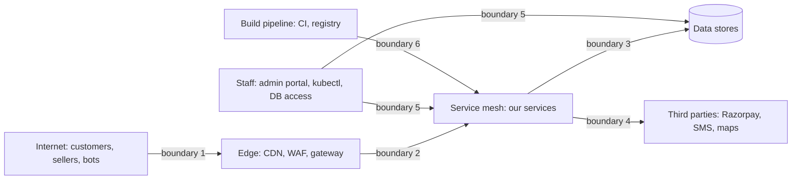
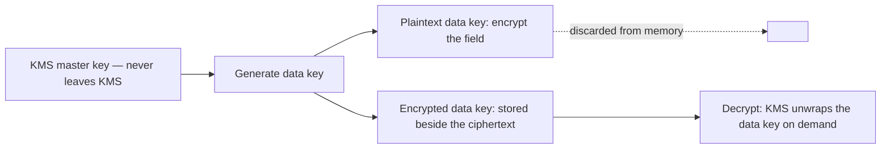
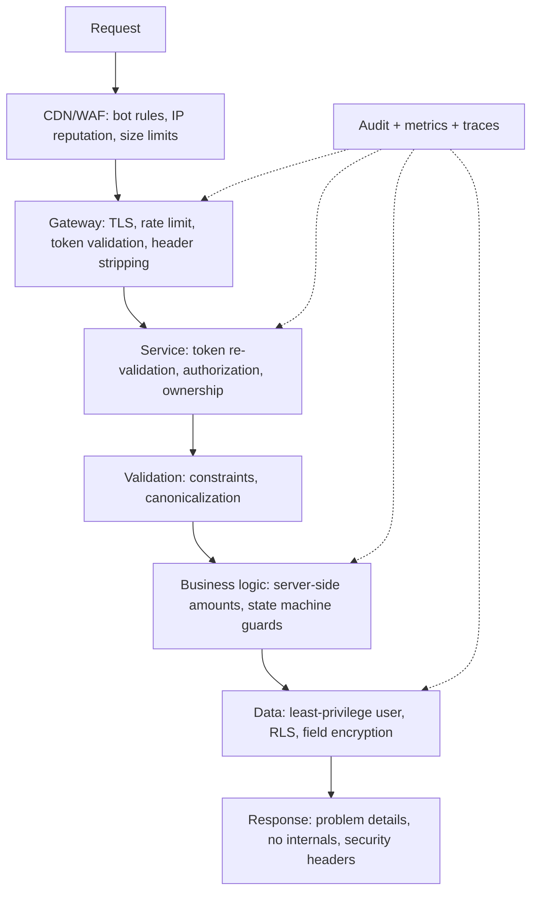
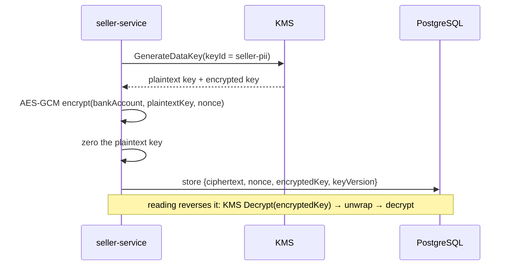
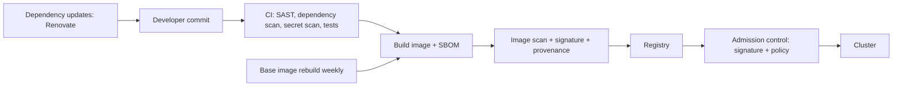
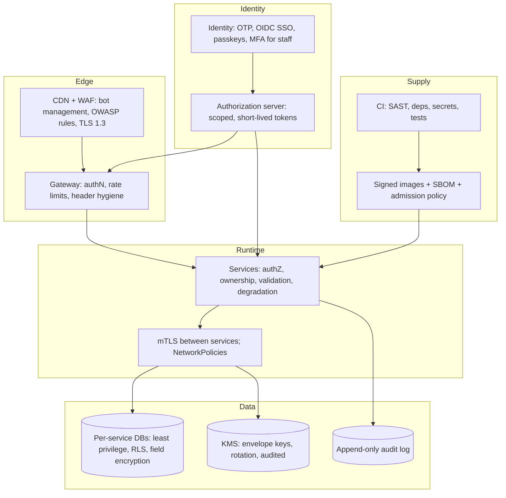
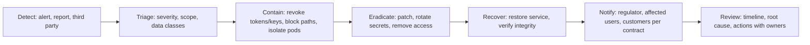

# 39 · Enterprise Security Architecture

## 1. Introduction & Why It Matters

Chapters 17 and 18 secured a service: filter chains, tokens, ownership checks, webhook signatures. This chapter steps back to the platform: **what an attacker could do, what data we hold, who may see it, how we would know, and what we are legally required to do about it.**

The grocery platform holds, at any moment: 4 million customers' names, mobile numbers and delivery addresses; order histories that reveal household composition and habits; seller bank accounts and PAN/GSTIN; payment tokens; staff credentials with production access. The relevant threats are not hypothetical:

- **Credential stuffing** against OTP login using leaked mobile numbers.
- **Seller account takeover** to redirect payouts to a different bank account.
- **An insider** exporting a customer table for a competitor.
- **A supply-chain compromise** — a transitive dependency, a build plugin, a base image.
- **SSRF** through a seller-supplied image URL reaching the cloud metadata endpoint.
- **A regulator's question**: under India's DPDP Act, can you delete one customer's data across 26 services and prove it?

Security architecture is the set of decisions that make these bounded rather than existential: trust boundaries, data classification, encryption and key management, PCI scope reduction, secrets handling, least privilege, audit logging, supply-chain controls, security gates in CI, and an incident process that has been rehearsed.

### Who should read which section

| Band | Focus |
|---|---|
| B1 · 0–2 yrs | Parts 1, 2, 4 — OWASP mapping, secrets, safe defaults |
| B2 · 2–5 yrs | Parts 2, 5 — threat modelling, encryption, SSRF, uploads |
| B3 · 5–8 yrs | Parts 3, 5, 6 — key management, audit, PII handling |
| B4 · 8–12 yrs | Parts 6, 8 — architecture, compliance, incident response |
| B5 · 12–15+ yrs | Parts 8, 9 — risk, governance, security culture |

---

## 2. Core Concepts

### 2.1 Threat modelling with STRIDE

| Threat | Grocery example | Primary control |
|---|---|---|
| **S**poofing | Fake webhook claiming payment succeeded | Signature verification (Chapter 18) |
| **T**ampering | Modified price in a client request | Server-side pricing; never trust client amounts |
| **R**epudiation | "I never changed that bank account" | Immutable audit log with actor and source |
| **I**nformation disclosure | Customer data in logs or error bodies | PII redaction (Chapter 07), problem details (Chapter 10) |
| **D**enial of service | OTP flooding to exhaust SMS budget | Rate limits, quotas (Chapters 17, 26) |
| **E**levation of privilege | Seller reaching admin endpoints | Authorization + ownership (Chapter 17) |

Model per **flow**, not per service: checkout, seller payout changes, customer login, catalog import, admin access. One page per flow, reviewed when the flow changes.

### 2.2 Trust boundaries



Every boundary needs: authentication, authorization, input validation, rate limiting, logging. **Boundaries 5 and 6 are the ones organizations under-invest in** — staff access and the build pipeline are how most serious breaches actually happen.

### 2.3 Data classification

| Class | Examples | Controls |
|---|---|---|
| **Public** | Product catalog, prices | None beyond integrity |
| **Internal** | Aggregate metrics, non-personal config | Access control |
| **Confidential** | Order history, seller performance | Access control + audit |
| **Sensitive personal** | Name, mobile, address, PAN, GSTIN, bank account | Encryption, masking, audit, minimization |
| **Regulated** | Payment credentials | **Never stored** — tokenize (2.6) |

Classification drives everything else: what's encrypted, what's logged, what's exported, what's deleted, who may query it.

### 2.4 Encryption

| Layer | Control |
|---|---|
| In transit, external | TLS 1.3, HSTS, certificate management |
| In transit, internal | mTLS via the mesh (Chapter 30) |
| At rest, storage | Disk/volume encryption (cloud-managed keys) |
| At rest, **field-level** | Application encryption for bank accounts, PAN/GSTIN |
| Backups | Encrypted with separate key access |
| Keys | KMS with envelope encryption, rotation, audited use |

Disk encryption protects against a stolen disk. It does **not** protect against a compromised application, a leaked database dump, or an over-privileged query — which is why sensitive fields get application-level encryption.

### 2.5 Envelope encryption



Why not encrypt directly with the KMS key: payload size limits, a KMS call per operation, and no way to rotate without re-encrypting everything. Envelope encryption stores the wrapped data key with the record, so **key rotation re-wraps keys rather than re-encrypting data**.

### 2.6 PCI scope reduction

The cheapest way to secure card data is to never possess it.

| Approach | Scope |
|---|---|
| Card fields on our page, posted to our server | Full PCI DSS scope — avoid |
| Gateway-hosted checkout / SDK collects the card | Drastically reduced scope |
| **Network tokens / gateway tokens** for repeat payments | We store a token, never a PAN |

India specifics: RBI's card-on-file tokenization rules mean merchants generally must not store actual card numbers; tokens issued by the network or gateway are used for repeat payments. The platform stores `razorpay_token_id` and the last four digits (Chapter 18's never-store rule for full numbers), and nothing else.

### 2.7 Secrets

| Rule | Why |
|---|---|
| Never in Git, images or environment dumps | They persist in history and layers (Chapters 06, 29) |
| Mounted as files, read as a config tree | No accidental logging of the environment |
| From a secret manager (Vault / cloud KMS) via an operator | Central rotation and audit |
| Rotated on a schedule, and immediately on suspicion | Limits exposure windows |
| Two values valid during rotation | Zero-downtime rollover (Chapter 18) |
| Access audited | Who read which secret, when |

### 2.8 Least privilege

| Principal | Privilege |
|---|---|
| Application DB user | DML on its own tables only; **no DDL**, no access to other services' schemas (Chapters 14, 35) |
| Migration user | DDL, used only by the migration job |
| Support/analytics | Read-only on masked views, time-boxed, audited |
| Service accounts | Scoped tokens (Chapter 18), short-lived |
| Staff | SSO + MFA/passkeys, role-based, break-glass with approval |
| CI | Push to registry, deploy to staging; production deploys require a gated approval |

### 2.9 Audit logging

| Log | Don't log |
|---|---|
| Who (actor), what (action), which resource, when, from where, outcome | Passwords, tokens, OTPs, card data |
| Authorization denials and privilege changes | Full request/response bodies with PII |
| Bank account/payout changes, refunds, price overrides | Anything you'd be embarrassed to see in a dump |
| Data exports and bulk reads | — |
| Break-glass access | — |

Audit logs are **append-only**, retained per policy, stored separately from application logs, and access to them is itself audited.

### 2.10 Indian regulatory context

| Requirement | Practical impact |
|---|---|
| **DPDP Act 2023** | Consent records, purpose limitation, data-principal rights (access, correction, erasure), breach notification, a grievance officer |
| **RBI payment data storage** | Payment data storage restrictions and tokenization for cards; data localization requirements for payment system data |
| GST e-invoicing / records | Retention of invoices and financial records (conflicts with deletion — record the legal basis, Chapter 38) |
| Sectoral/state rules | Vary; legal counsel decides, engineering implements |

!!! warning "Verify with counsel"
    Regulation changes, and its interpretation is a legal question. This chapter describes **engineering patterns** for meeting such requirements — consent records, deletion workflows, audit trails, localization-aware deployment. Confirm the current obligations with your legal team; don't take a technical handbook's word for compliance.

---

## 3. How It Works Internally

### 3.1 Defence in depth for one request



Each layer assumes the ones before it may have failed. The service re-validates the token even though the gateway did; the database filters by tenant even though the ORM did (Chapter 38).

### 3.2 Envelope encryption in the write path



`keyVersion` stored with the row is what makes rotation possible without downtime: new writes use the new key, old rows decrypt with their own.

### 3.3 The supply chain



Every arrow is an attack surface: a malicious dependency, a compromised plugin, a poisoned base image, a registry without signature verification. The controls are the boring ones in Chapter 29 — SBOM, scan, sign, verify at admission.

---

## 4. Hands-On Code — Level 1 (Beginner)

### 4.1 OWASP Top 10, mapped to what you already built

| Risk | Platform control | Chapter |
|---|---|---|
| Broken access control | Ownership checks, method security, RLS | 17, 38 |
| Cryptographic failures | TLS, field encryption, KMS | this chapter |
| Injection | Parameterized queries, validation, output encoding | 09, 12 |
| Insecure design | Threat modelling per flow, rate limits | this chapter |
| Security misconfiguration | Hardened defaults, config review, headers | 06, 17, 29 |
| Vulnerable components | SBOM, scanning, Renovate, weekly rebuilds | 29 |
| Auth failures | OTP rate limits, token validation, passkeys | 17, 18 |
| Integrity failures | Signed images, verified webhooks, no unsafe deserialization | 11, 18, 29 |
| Logging/monitoring failures | Structured logs, audit trail, alerting | 07, 27 |
| SSRF | URL allow-lists, no redirects to internal ranges | 5.4 |

### 4.2 Safe defaults in one configuration

```yaml title="application-prod.yml (security-relevant excerpt)"
server:
  error:
    include-stacktrace: never          # (1)!
    include-message: never
    include-binding-errors: never
  tomcat:
    max-http-form-post-size: 256KB
    max-swallow-size: 2MB
spring:
  servlet:
    multipart:
      max-file-size: 5MB               # (2)!
      max-request-size: 10MB
  jackson:
    deserialization:
      fail-on-unknown-properties: false
management:
  server:
    port: 9090                          # (3)!
  endpoints:
    web:
      exposure:
        include: health,info,prometheus
springdoc:
  swagger-ui:
    enabled: false                      # (4)!
```

1. Never leak internals in error responses (Chapter 10 supplies the problem body instead).
2. Bounded uploads — an unbounded multipart endpoint is a trivial denial of service.
3. Actuator off the public ingress (Chapter 17).
4. No interactive API explorer in production.

### 4.3 Security headers

```java title="in/grocery/platform/security/SecurityHeadersConfig.java"
http.headers(headers -> headers
        .contentSecurityPolicy(csp -> csp.policyDirectives(
                "default-src 'self'; frame-ancestors 'none'; object-src 'none'; base-uri 'self'"))   // (1)!
        .httpStrictTransportSecurity(hsts -> hsts.includeSubDomains(true).maxAgeInSeconds(31_536_000))
        .referrerPolicy(r -> r.policy(ReferrerPolicy.STRICT_ORIGIN_WHEN_CROSS_ORIGIN))
        .permissionsPolicyHeader(p -> p.policy("geolocation=(self), camera=(), microphone=()"))      // (2)!
        .frameOptions(FrameOptionsConfig::deny));
```

1. CSP is the highest-value header for a browser application; `frame-ancestors 'none'` stops clickjacking.
2. Restricts browser capabilities available to the page — the delivery-tracking page needs geolocation, nothing needs the microphone.

### 4.4 Never trust client-supplied amounts

```java title="in/grocery/order/web/CheckoutController.java"
record PlaceOrderRequest(
        @NotBlank String cartId,
        @Pincode String pincode,
        @NotNull PaymentMethod paymentMethod) {}                                                     // (1)!
```

1. **No `total`, no `price`, no `discount` fields.** The server computes every amount from the cart and pricing service. A client-supplied amount is the oldest e-commerce vulnerability and it still appears in code review every year.

---

## 5. Hands-On Code — Level 2 (Intermediate) & Level 3 (Advanced)

### 5.1 Level 2 — A threat model you'll actually maintain

```markdown title="docs/threat-models/seller-payout-change.md"
# Flow: seller changes their payout bank account

## Assets
Seller bank account, payout schedule, seller identity

## Actors
Seller (authenticated), ops staff (elevated), attacker with stolen seller credentials

## Threats and controls
| Threat | Control | Verified by |
|---|---|---|
| Account takeover → payout redirect | Re-authentication for this action; OTP to registered mobile; 24h payout hold after change; email+SMS notification to the old and new contact | SellerPayoutChangeTest |
| Ops insider changes an account | Four-eyes approval for ops-initiated changes; immutable audit entry | AuditTrailTest |
| Replay of the change request | Idempotency key; nonce; short-lived token | ChangeRequestReplayTest |
| Enumeration of seller ids | Authorization by ownership; generic errors | SellerAccessTest |
| Notification suppression | Notifications sent via a separate path; failures alert ops | NotificationFailureTest |

## Residual risk
SIM-swap attacks on the registered mobile. Mitigation: 24h hold + email notification + anomaly detection on payout changes.
```

One page, in the repository, next to the code, with **tests named in the table**. A threat model that lives in a slide deck is a document; one that names tests is a control.

### 5.2 Level 2 — Field-level encryption

```java title="in/grocery/platform/crypto/EnvelopeEncryptionService.java"
@Component
public class EnvelopeEncryptionService {

    private final KmsClient kms;
    private final String keyId;

    public EncryptedValue encrypt(String plaintext, String purpose) {
        var dataKey = kms.generateDataKey(keyId, purpose);                                   // (1)!
        byte[] nonce = randomNonce();
        try {
            byte[] ciphertext = aesGcmEncrypt(plaintext.getBytes(UTF_8), dataKey.plaintext(), nonce,
                    purpose.getBytes(UTF_8));                                                 // (2)!
            return new EncryptedValue(ciphertext, nonce, dataKey.encrypted(), dataKey.keyVersion());
        } finally {
            Arrays.fill(dataKey.plaintext(), (byte) 0);                                       // (3)!
        }
    }

    public String decrypt(EncryptedValue value, String purpose) {
        byte[] plaintextKey = kms.decrypt(value.encryptedKey());
        try {
            return new String(aesGcmDecrypt(value.ciphertext(), plaintextKey, value.nonce(),
                    purpose.getBytes(UTF_8)), UTF_8);
        } finally {
            Arrays.fill(plaintextKey, (byte) 0);
        }
    }
}
```

1. A fresh data key per value (or per small batch) — compromise of one key exposes one value.
2. **AES-GCM with associated data**: the `purpose` is authenticated but not encrypted, so a ciphertext for `bank-account` cannot be pasted into a `pan` column and decrypt successfully.
3. Zero key material as soon as possible. (Java's garbage collector may still have copies; this reduces, not eliminates, exposure.)

```java title="in/grocery/seller/domain/SellerBankAccount.java (JPA converter)"
@Converter
public class EncryptedStringConverter implements AttributeConverter<String, String> {

    @Override
    public String convertToDatabaseColumn(String attribute) {
        return attribute == null ? null : encryption.encrypt(attribute, "seller-pii").serialize();   // (1)!
    }

    @Override
    public String convertToEntityAttribute(String dbData) {
        return dbData == null ? null : encryption.decrypt(EncryptedValue.parse(dbData), "seller-pii");
    }
}
```

1. Transparent to the domain — but note the trade-off: **encrypted columns cannot be searched or indexed**. For lookup (e.g. "find the seller with this account number"), store a separate keyed **HMAC** of the value as a blind index, which allows equality search without revealing the plaintext.

### 5.3 Level 2 — Key rotation

```java title="in/grocery/platform/crypto/KeyRotationJob.java"
@Scheduled(cron = "0 0 3 1 * *", zone = "Asia/Kolkata")                                        // (1)!
@SchedulerLock(name = "pii-key-rotation", lockAtMostFor = "PT4H")
public void rotateDataKeys() {
    int rotated = 0;
    for (var batch : encryptedRows.olderThanVersion(kms.currentKeyVersion(), 500)) {           // (2)!
        for (var row : batch) {
            String plaintext = encryption.decrypt(row.value(), row.purpose());
            encryptedRows.update(row.id(), encryption.encrypt(plaintext, row.purpose()));       // (3)!
            rotated++;
        }
    }
    meters.counter("grocery.crypto.rotated").increment(rotated);
}
```

1. Monthly, off-peak. The master key rotation itself happens in KMS on its own schedule.
2. Rows carry their key version, so rotation is incremental and resumable (Chapter 33's discipline).
3. Re-encrypt with the current key version. Old rows keep working throughout — no downtime, no big-bang migration.

### 5.4 Level 3 — SSRF, uploads and untrusted content

Sellers supply product image URLs and CSV feeds. Both are attacker-controlled input that our servers fetch or parse.

```java title="in/grocery/catalog/media/SafeUrlFetcher.java"
@Component
public class SafeUrlFetcher {

    private static final Set<String> ALLOWED_SCHEMES = Set.of("https");
    private static final Set<String> ALLOWED_HOSTS = Set.of("cdn.partner.com", "images.seller.in");   // (1)!

    public byte[] fetch(URI uri) {
        validateScheme(uri);
        InetAddress address = resolve(uri.getHost());
        if (isInternal(address)) {                                                                      // (2)!
            throw new BlockedUrlException(uri);
        }
        if (!ALLOWED_HOSTS.contains(uri.getHost())) {
            throw new BlockedUrlException(uri);
        }
        return restClient.get().uri(uri)
                .header("Accept", "image/*")
                .retrieve()
                .body(byte[].class);                                                                    // (3)!
    }

    private boolean isInternal(InetAddress address) {
        return address.isLoopbackAddress() || address.isLinkLocalAddress()                               // (4)!
                || address.isSiteLocalAddress() || address.isAnyLocalAddress()
                || address.getHostAddress().startsWith("169.254.");
    }
}
```

1. **Allow-list, not deny-list.** Deny-lists lose to DNS rebinding, IPv6 forms, decimal IP encodings and open redirects.
2. Resolve first and check the address — a hostname can point anywhere, including `169.254.169.254` (cloud metadata) or `10.x` internal services.
3. Redirects must be disabled or re-validated; a permitted host redirecting to an internal address defeats the check.
4. Link-local covers the metadata endpoint — the single most valuable SSRF target in any cloud environment.

```java title="in/grocery/catalog/feed/UploadValidator.java"
public void validate(MultipartFile file) {
    if (file.getSize() > MAX_SIZE) throw new FileTooLargeException(file.getSize());
    String contentType = tika.detect(file.getInputStream());                                            // (1)!
    if (!ALLOWED_TYPES.contains(contentType)) {
        throw new UnsupportedFileTypeException(contentType);
    }
    String safeName = UUID.randomUUID() + extensionFor(contentType);                                    // (2)!
    storage.store(safeName, file.getInputStream());                                                     // (3)!
}
```

1. Detect the **actual** content, never trust the declared `Content-Type` or the extension.
2. Generate the stored name — user-supplied names bring path traversal, null bytes and overwrites.
3. Store outside the application directory, serve from a separate domain with `Content-Disposition: attachment` and a restrictive CSP so an uploaded HTML file can't run as our origin.

CSV parsing adds its own trap: a cell beginning with `=`, `+`, `-` or `@` becomes a formula when the file is opened in a spreadsheet (**CSV injection**). Prefix such cells when exporting.

### 5.5 Level 3 — Audit logging that holds up

```java title="in/grocery/platform/audit/AuditService.java"
@Component
public class AuditService {

    @Transactional(propagation = Propagation.REQUIRES_NEW)                                              // (1)!
    public void record(AuditEvent event) {
        jdbc.sql("""
                insert into audit_log
                  (event_id, occurred_at, actor_type, actor_id, action, resource_type, resource_id,
                   tenant_id, outcome, source_ip, user_agent, request_id, details)
                values (:eventId, :occurredAt, :actorType, :actorId, :action, :resourceType, :resourceId,
                        :tenantId, :outcome, :sourceIp, :userAgent, :requestId, :details::jsonb)
                """)
            .params(event.asParams())
            .update();
    }
}
```

1. Its own transaction: an audit record of a **denied** or **failed** action must survive the rollback of that action.

```sql title="Append-only enforcement"
revoke update, delete on audit_log from grocery_app;                                                     -- (1)
create rule audit_log_no_update as on update to audit_log do instead nothing;
create rule audit_log_no_delete as on delete to audit_log do instead nothing;
```

1. The application can insert and select, nothing more. Retention is handled by a separate, audited process.

```java title="Auditing sensitive operations declaratively"
@Audited(action = "SELLER_BANK_ACCOUNT_CHANGED", resourceType = "seller")                                // (1)!
@Transactional
public void changeBankAccount(SellerId sellerId, BankAccount newAccount) { ... }
```

1. An aspect (Chapter 04) records actor, resource, outcome, source IP and request id — consistently, without each method remembering. Failures are audited too, with the outcome.

**What belongs in `details`**: the fields that changed and *that* they changed — `{"field":"accountNumber","oldValueHash":"…","newValueHash":"…"}` — never the values themselves.

### 5.6 Level 3 — DPDP-style data subject requests

```java title="in/grocery/privacy/DataSubjectRequestService.java"
public DataSubjectExport export(String customerId, RequestContext context) {
    audit.record(AuditEvent.of("DSR_EXPORT_STARTED", "customer", customerId, context));                   // (1)!

    var bundle = new DataSubjectExport(customerId);
    for (ServiceDescriptor service : catalog.servicesHoldingPersonalData()) {                             // (2)!
        bundle.add(service.name(), privacyClient.export(service, customerId));
    }
    return bundle.sealed();                                                                               // (3)!
}

public ErasureReport erase(String customerId, RequestContext context) {
    audit.record(AuditEvent.of("DSR_ERASURE_STARTED", "customer", customerId, context));

    var report = new ErasureReport(customerId);
    for (ServiceDescriptor service : catalog.servicesHoldingPersonalData()) {
        var result = privacyClient.erase(service, customerId);
        report.add(service.name(), result.erasedCount(), result.retainedCount(), result.legalBasis());    // (4)!
    }
    report.verify(verifier::assertNoPersonalDataRemains);
    audit.record(AuditEvent.of("DSR_ERASURE_COMPLETED", "customer", customerId, context));
    return report;
}
```

1. The request itself is audited — who asked, when, on whose behalf.
2. Driven by the **service catalog** (Chapter 35), so a new service cannot be silently omitted.
3. Sealed with a checksum and delivered through a time-limited, authenticated download.
4. Retention with a recorded legal basis (tax invoices, fraud records) — the defensible position; silent retention is not.

```java title="Erasure in a service: anonymize, don't orphan"
@Transactional
public ErasureResult erase(String customerId) {
    int anonymized = jdbc.sql("""
            update customer_order
               set customer_name = 'REDACTED',
                   contact_mobile = null,
                   delivery_address = null,
                   customer_id_hash = :hash,                                                               -- (1)
                   erased_at = now()
             where customer_id = :customerId
            """).params(...).update();

    profiles.delete(customerId);                                                                           // (2)!
    return new ErasureResult(anonymized, invoicesRetained(customerId), "Income Tax Act retention");
}
```

1. Orders remain for financial records with personal fields removed and a **salted hash** retained for fraud correlation — the data is no longer personal but aggregates still reconcile.
2. The profile itself goes entirely.

---

## 6. Hands-On Code — Level 4 (Expert / Production)

### 6.1 The platform security architecture



| Boundary | Primary control | Verified by |
|---|---|---|
| Internet → edge | WAF, TLS, rate limits | Load and abuse tests |
| Edge → services | Token validation, header stripping | Gateway tests (Chapter 35) |
| Service → service | mTLS, scoped tokens, NetworkPolicy | Chapter 30 tests |
| Service → data | Least-privilege users, RLS, field encryption | Leak suite (Chapter 38) |
| Staff → production | SSO + MFA, RBAC, break-glass with approval | Access reviews |
| CI → production | Signed artifacts, admission policy, gated deploys | Pipeline policy tests |

### 6.2 Security gates in CI

```yaml title=".github/workflows/security.yml (excerpt)"
      - name: Secret scan
        run: gitleaks detect --no-banner --redact --exit-code 1                                   # (1)!

      - name: Dependency vulnerabilities
        run: ./gradlew dependencyCheckAnalyze -DfailBuildOnCVSS=7                                 # (2)!

      - name: Static analysis
        run: ./gradlew spotbugsMain               # with the security plugin ruleset

      - name: Build, SBOM, image scan, sign
        run: ./scripts/build-and-attest.sh                                                        # (3)!

      - name: Policy check — no new security suppressions
        run: ./scripts/check-suppressions.sh                                                      # (4)!
```

1. Secrets in history are the most common own-goal; scan every commit and the full history periodically.
2. Fail on high-severity, fixable vulnerabilities; track the rest with owners and expiry dates.
3. Chapter 29's pipeline: SBOM, scan, sign, provenance.
4. Suppressions are how security gates die. Every suppression needs a ticket, an owner and an expiry, checked mechanically.

| Control | Frequency |
|---|---|
| Secret, dependency and static scans | Every commit |
| Image scan and signature | Every build |
| Registry re-scan (new CVEs appear later) | Daily |
| Dependency updates (Renovate) | Weekly, automated PRs |
| Base image rebuild | Weekly (Chapter 29) |
| Penetration test | Annually and before major launches |
| Access review | Quarterly |
| Threat model review | When the flow changes |

### 6.3 Insider risk and staff access

| Control | Implementation |
|---|---|
| SSO with MFA/passkeys | Chapter 18 |
| Role-based admin access, least privilege | Chapter 17 |
| **No standing production database access** | Break-glass with approval and time limit |
| Masked views for support | `phone_masked`, `address_partial` |
| Bulk export requires approval | Two-person rule for large exports |
| Everything audited, reviewed | Alerts on unusual volume or off-hours access |
| Offboarding within hours | Automated from the HR system |

```sql title="Support sees masked data by default"
create view support_customer_view as
select id,
       name,
       '******' || right(mobile, 4)                as mobile_masked,                             -- (1)
       city, pincode,
       left(address_line1, 12) || '…'              as address_partial
from customer;

grant select on support_customer_view to grocery_support;
revoke all on customer from grocery_support;                                                      -- (2)
```

1. Enough to verify a caller's identity, not enough to export a customer list.
2. The underlying table is unreachable for the support role — the view is the only path, and access to it is logged.

### 6.4 Incident response



```java title="Containment primitives worth having ready"
public void revokeAllSessionsFor(String customerId) { ... }        // deny-list jti + refresh families (Chapter 18)
public void rotateSecret(String secretName) { ... }                // two-value rollover
public void disableRoute(String routeId) { ... }                   // gateway kill switch (Chapter 35)
public void freezePayouts(String reason) { ... }                   // business-level containment
```

The last one matters: many incidents are best contained **at the business level** — stop payouts, disable a feature, require re-authentication — not by taking the platform down. Build these switches before you need them, and test them in game days (Chapter 30).

**Breach notification** under the DPDP Act has timelines and required content. Have a template, a decision tree for "is this reportable?", and a named accountable person — decided in advance, not at 2 a.m.

### 6.5 Security testing beyond scanners

| Test | What it catches |
|---|---|
| Authorization matrix tests (Chapter 17) | Missing ownership checks, role gaps |
| Cross-tenant leak suite (Chapter 38) | Isolation failures |
| Contract tests for error responses | Internal details leaking in errors |
| SSRF tests with internal addresses | Allow-list bypasses |
| Upload tests with polyglot files | Content-type confusion |
| Rate-limit tests | Missing or ineffective limits |
| Secret-scanning in tests | Test fixtures containing real credentials |
| Chaos + abuse simulation | Behaviour under credential stuffing or scraping |

```java title="An authorization matrix test"
@ParameterizedTest
@MethodSource("accessMatrix")
void enforcesTheAccessMatrix(String role, String endpoint, HttpMethod method, HttpStatus expected) {
    assertThat(callAs(role, method, endpoint).getStatusCode()).isEqualTo(expected);                 // (1)!
}

static Stream<Arguments> accessMatrix() {
    return Stream.of(
        arguments("CUSTOMER", "/api/v1/admin/orders", GET, FORBIDDEN),
        arguments("SELLER",   "/api/v1/admin/orders", GET, FORBIDDEN),
        arguments("OPS",      "/api/v1/admin/orders", GET, OK),
        arguments("ANONYMOUS","/api/v1/orders/ORD-1", GET, UNAUTHORIZED),
        arguments("SELLER",   "/api/v1/sellers/S-2/products", GET, FORBIDDEN)                       // (2)!
    );
}
```

1. The matrix **is** the policy, executable and reviewable — far more reliable than prose in a wiki.
2. Cross-tenant/cross-seller access, asserted explicitly.

### 6.6 Governance

| Artifact | Purpose | Cadence |
|---|---|---|
| Data classification register | What we hold, where, who may see it | Quarterly |
| Threat models per critical flow | Known threats and their controls | On change |
| Access matrix (executable) | Authorization policy | Every build |
| Key inventory | Keys, purposes, rotation schedule, owners | Quarterly |
| Vulnerability register | Open findings with owners and dates | Weekly |
| Incident log and post-mortems | Learning and evidence | Per incident |
| Compliance mapping | Requirement → control → evidence | Annually, and on regulation change |
| Security champions per team | Local expertise; reviews | Ongoing |

Security that depends on a central team reviewing every change doesn't scale. Security **defaults in platform libraries** (error handling, token validation, tenant scoping, audit aspects) plus **automated gates** plus **champions** does.

---

## 7. Spring Boot 3 vs 4 & Migration

| Topic | Boot 3.5 / Security 6.5 | Boot 4.x / Security 7 |
|---|---|---|
| Filter chain DSL | Lambda DSL | **Lambda only** (Chapter 17) |
| Passkeys / one-time tokens | 6.4+ | Available |
| Header configuration | `headers(...)` DSL | Same (verify method names) |
| Actuator security | `EndpointRequest` matchers | Package moves — verify |
| Cryptography (`spring-security-crypto`) | ✅ | ✅ |
| Jackson | 2 | 3 — re-check deserialization hardening (Chapter 11) |

### Migration checklist

- [ ] Re-run the authorization matrix and leak suites immediately after upgrading — they are the highest-value regression tests.
- [ ] Re-verify security headers are still emitted (DSL changes can silently drop them).
- [ ] Re-check trusted-package and deserialization settings after the Jackson move.
- [ ] Re-scan images and dependencies after the upgrade; new versions bring new CVEs and fix others.
- [ ] Re-test webhook signature verification and token validation end to end.

---

## 8. Production Playbook

### Best practices

1. **Threat model per flow**, one page, with named tests — reviewed when the flow changes.
2. **Classify data**; let the classification drive encryption, logging, export and deletion.
3. **Defence in depth**: assume every preceding layer may have failed.
4. **Never store what you can tokenize** — cards especially.
5. **Envelope encryption with KMS** for sensitive fields; rotate incrementally by key version.
6. **Least privilege everywhere**: database users, service tokens, staff roles, CI credentials.
7. **Append-only audit log** for sensitive actions, with actor, source and outcome.
8. **Security gates in CI**, with suppressions that expire.
9. **No standing production access**; break-glass with approval, time limits and review.
10. **Rehearse incidents**, including containment switches and breach notification.

### Anti-patterns

❌ Trusting client-supplied amounts, identifiers or tenant headers.

❌ Deny-lists for SSRF; trusting `Content-Type` for uploads.

❌ Secrets in Git, images, environment dumps or logs.

❌ Disk encryption treated as sufficient for sensitive fields.

❌ Audit logs that are mutable, or stored with (and deletable alongside) application logs.

❌ PII in logs, error responses, metrics tags or traces.

❌ Standing production database access for engineers.

❌ Security suppressions with no owner or expiry.

❌ Annual penetration tests as the only security testing.

❌ A compliance programme with no evidence trail.

### Troubleshooting

| Symptom | Cause | Action |
|---|---|---|
| Credential-stuffing spike on OTP login | No per-mobile/IP limits | Rate limits, device signals, CAPTCHA after N, alerting (Chapter 17) |
| Payout redirected to an unknown account | Account takeover | Freeze payouts, re-authenticate, notify, audit review, add holds |
| PII appears in logs | Missing masking | PII masker (Chapter 07), log scan, rotate exposure, review retention |
| Vulnerability scan noise | No triage policy | Fail only on fixable high/critical; owners and expiry for the rest |
| SSRF found in testing | Deny-list approach | Allow-list, resolve-then-check, disable redirects |
| Uploaded file executes | Served from the app origin | Separate domain, `Content-Disposition`, restrictive CSP |
| Cannot answer "who accessed this customer?" | Missing audit coverage | Audit aspect on sensitive reads, access logging on masked views |
| Deletion request incomplete | Service missed | Catalog-driven DSR workflow, verification step |
| Key rotation stalls | Big-bang re-encryption | Incremental rotation by key version |

### Production checklist

- [ ] Threat models for critical flows, with tests named
- [ ] Data classification register current; sensitive fields encrypted with KMS
- [ ] Card data never stored; tokenization in place
- [ ] Secrets from a manager, mounted as files, rotated, audited
- [ ] Least-privilege database users; migrations use a separate role
- [ ] Append-only audit log with alerting on sensitive actions
- [ ] Security gates in CI; suppressions with owners and expiry
- [ ] Staff access: SSO + MFA, masked views, break-glass with approval
- [ ] Authorization matrix and leak suites green in every build
- [ ] DSR export/erasure workflows tested end to end with evidence
- [ ] Incident runbook with containment switches, rehearsed

---

## 9. Interview Questions & Answers

### B1 · 0–2 years

??? question "B1 · What is defence in depth?"
    **Short answer:** Multiple independent controls so that a failure in one doesn't cause a breach — edge filtering, service authorization, validation, database-level restrictions, and monitoring.

??? question "B1 · Why should the server compute order totals?"
    **Short answer:** Any amount supplied by a client is attacker-controlled. Prices, discounts and totals must be computed server-side from authoritative data.

??? question "B1 · Where should secrets live?"
    **Short answer:** In a secret manager, delivered as mounted files read as a config tree — never in Git, images, or environment variables that get dumped into logs.

??? question "B1 · What is SSRF?"
    **Short answer:** Server-side request forgery — tricking the server into fetching an attacker-chosen URL, typically an internal service or the cloud metadata endpoint. Mitigate with allow-lists and by resolving and checking the address.

??? question "B1 · Why not store card numbers?"
    **Short answer:** It puts you in full PCI DSS scope and creates catastrophic breach potential. Use a gateway-hosted flow and tokens; store a token reference and the last four digits at most.

### B2 · 2–5 years

??? question "B2 · How do you threat model a feature?"
    **Short answer:** Identify assets and actors for the flow, walk STRIDE categories, list controls for each credible threat, note residual risk, and name the tests that verify the controls. Keep it to a page beside the code.

??? question "B2 · What does field-level encryption add over disk encryption?"
    **Short answer:** Disk encryption protects a stolen disk. Field encryption protects against database dumps, over-privileged queries and many application compromises, because the plaintext only exists when the application decrypts it via KMS.

??? question "B2 · How does envelope encryption support rotation?"
    **Short answer:** Each value is encrypted with a data key that is itself encrypted by a master key and stored beside the ciphertext, with a key version. Rotation re-wraps or re-encrypts incrementally by version, without downtime or a big-bang migration.

??? question "B2 · How do you handle untrusted file uploads?"
    **Short answer:** Size limits, content detection rather than declared type, generated storage names, storage outside the web root, serving from a separate domain with `Content-Disposition: attachment` and a restrictive CSP.

??? question "B2 · What belongs in an audit log?"
    **Short answer:** Actor, action, resource, timestamp, source, outcome, request id — append-only, separate from application logs, with no secrets or raw PII, and with access to the log itself audited.

??? question "B2 · How do you keep dependency vulnerabilities manageable?"
    **Short answer:** Fail builds on fixable high/critical issues, automate updates with Renovate, rebuild base images weekly, re-scan the registry daily for new CVEs, and track unfixable findings with owners and expiry dates.

### B3 · 5–8 years

??? question "B3 · How would you implement a data-erasure request across many services?"
    **Short answer:** Drive it from the service catalog so nothing is missed; each service exposes erase/export operations; anonymize where records must be retained for financial or legal reasons and record the basis; verify afterwards that no personal data remains; audit the whole request and keep the report as evidence.

??? question "B3 · Why is an allow-list required for SSRF protection?"
    **Short answer:** Deny-lists are defeated by DNS rebinding, alternate IP encodings, IPv6 forms, and redirects. An allow-list of hosts plus resolve-then-check of the resulting address, with redirects disabled, is the only robust approach.

??? question "B3 · How do you protect against insider data exfiltration?"
    **Short answer:** No standing production data access; masked views for support; break-glass with approval and time limits; two-person rules for bulk exports; comprehensive audit with alerting on unusual volume or timing; quarterly access reviews; fast offboarding.

??? question "B3 · What makes an audit log trustworthy?"
    **Short answer:** Append-only enforcement at the database level, written in its own transaction so failures are recorded, stored separately with its own access controls and retention, containing actor and source, and monitored — a log the application can rewrite proves nothing.

??? question "B3 · How do you reduce PCI scope in practice?"
    **Short answer:** Never let card data touch your servers: gateway-hosted or SDK-collected card entry, tokens for repeat payments, webhooks verified by signature, and network segmentation so no system that processes payments handles PANs.

### B4 · 8–12 years

??? question "B4 · Design the security architecture for a consumer platform."
    **Short answer:** Layered trust boundaries (CDN/WAF, gateway, services, data), identity with OTP for consumers and SSO+MFA/passkeys for staff, scoped short-lived service tokens, mTLS and NetworkPolicies internally, least-privilege database users with RLS and field encryption via KMS, append-only audit, supply-chain controls (SBOM, signing, admission), CI security gates, DSR workflows driven by a service catalog, and a rehearsed incident process.

??? question "B4 · How do you make security scale across many teams?"
    **Short answer:** Secure defaults in platform libraries (so the easy path is the safe path), automated gates in CI and admission control, executable policies (authorization matrix, leak suites), security champions per team, and central review reserved for genuinely novel risk.

??? question "B4 · What's your approach to compliance?"
    **Short answer:** Map each requirement to a concrete control and an evidence source (test, log, report); automate evidence collection; treat compliance as a by-product of engineering practice rather than an annual scramble; and keep legal counsel in the loop on interpretation.

### B5 · 12–15+ years

??? question "B5 · How do you prioritize security investment?"
    **Short answer:** By risk — likelihood × impact across the trust boundaries, informed by threat models, incident history and industry patterns. In practice the highest-return investments are usually supply chain, staff access and authorization correctness, not the exotic attacks that get conference talks.

??? question "B5 · What does a healthy security culture look like?"
    **Short answer:** Engineers threat model as part of design, security defaults are the easiest path, findings are treated as defects with owners, incidents produce blameless reviews with tracked actions, and raising a concern is rewarded rather than punished. Culture, not tooling, determines whether controls survive deadlines.

### Scenario questions

??? example "Scenario · A seller's payouts were redirected to an attacker's account"
    Credentials were phished; the bank-account change required only a session, took effect immediately, and notified only the new contact. Fixes: re-authentication for sensitive changes, OTP to the registered mobile, a 24-hour payout hold, notification to **old and new** contacts through independent channels, anomaly detection on payout changes, and an audit review to find other affected sellers.

??? example "Scenario · A dependency with a critical CVE is in production"
    Fixes: use the SBOM to identify every affected image within minutes, patch and rebuild, promote by digest, verify with a registry re-scan, then review why it wasn't caught — was the scanner failing silently, was a suppression expired, was the base image stale? The detection gap is the real finding.

### Coding exercise

!!! example "Exercise · Protect the seller bank-account change flow"
    Implement: re-authentication, OTP confirmation to the registered mobile, encrypted storage of the account number with a searchable blind index, an audit entry recording old and new values as hashes, notifications to both old and new contacts, and a 24-hour payout hold. List the tests.

??? success "Solution"
    ```java title="SellerBankAccountService.java"
    @Service
    public class SellerBankAccountService {

        @Transactional
        @Audited(action = "SELLER_BANK_ACCOUNT_CHANGE_REQUESTED", resourceType = "seller")          // (1)!
        public ChangeRequestId requestChange(SellerId sellerId, BankAccount newAccount,
                                             ReauthToken reauth, RequestContext context) {
            reauthentication.verify(sellerId, reauth);                                               // (2)!
            var seller = sellers.require(sellerId);

            String otp = otps.issue(seller.registeredMobile(), Purpose.BANK_ACCOUNT_CHANGE);         // (3)!
            var request = changeRequests.create(sellerId, encryption.encrypt(newAccount.number(), "seller-pii"),
                    blindIndex.of(newAccount.number()), newAccount.ifsc(), context);
            notifications.send(seller.registeredMobile(), "A bank account change was requested…");
            return request.id();
        }

        @Transactional
        @Audited(action = "SELLER_BANK_ACCOUNT_CHANGED", resourceType = "seller")
        public void confirmChange(ChangeRequestId requestId, String otp, RequestContext context) {
            var request = changeRequests.require(requestId);
            if (!otps.consume(request.sellerId(), otp, Purpose.BANK_ACCOUNT_CHANGE)) {
                audit.record(AuditEvent.failure("SELLER_BANK_ACCOUNT_CHANGE_OTP_FAILED", request, context));   // (4)!
                throw new InvalidOtpException();
            }
            var seller = sellers.require(request.sellerId());
            BankAccount old = seller.bankAccount();

            seller.changeBankAccount(request.encryptedAccountNumber(), request.blindIndex(), request.ifsc());
            payouts.hold(seller.id(), Duration.ofHours(24), "bank-account-changed");                  // (5)!

            notifications.send(seller.registeredMobile(), "Your bank account was changed…");
            notifications.sendEmail(seller.registeredEmail(), "Your bank account was changed…");
            notifications.send(old.notificationContact(), "Your bank account was changed…");          // (6)!

            audit.record(AuditEvent.of("SELLER_BANK_ACCOUNT_CHANGED", "seller", seller.id().value(), context)
                    .withDetail("oldAccountHash", hash(old.number()))
                    .withDetail("newAccountHash", request.blindIndex()));                             // (7)!
        }
    }
    ```

    1. The **request** is audited as well as the confirmation — attempts matter during an investigation.
    2. Session alone is insufficient for a money-moving change.
    3. Out-of-band confirmation to the **registered** contact, not one supplied in the request.
    4. Failed attempts are audited; a burst of them is an attack signal.
    5. The hold is what turns a successful takeover into a recoverable incident.
    6. Notify the **old** contact too — the legitimate owner's only chance to notice.
    7. Hashes, never account numbers, in the audit trail.

    ```java title="Tests"
    @Test void requiresReauthentication() { }
    @Test void requiresOtpSentToTheRegisteredMobileOnly() { }
    @Test void failedOtpIsAudited() { }
    @Test void accountNumberIsStoredEncryptedAndNotReadableInTheDatabase() { }                        // (1)!
    @Test void blindIndexAllowsLookupWithoutExposingTheNumber() { }
    @Test void payoutsAreHeldForTwentyFourHours() { }
    @Test void bothOldAndNewContactsAreNotified() { }
    @Test void auditContainsHashesNotAccountNumbers() { }                                             // (2)!
    @Test void anotherSellerCannotRequestTheChange() { }
    ```

    1. Query the column directly and assert it doesn't contain the plaintext — the test that catches a converter silently not applied.
    2. Assert the **absence** of sensitive values in the audit record, which is as important as asserting presence.

---

## Key Takeaways

- **Threat model per flow**, keep it beside the code, and name the tests that verify each control.
- **Classification drives everything**: encryption, logging, export, deletion, access.
- **Don't store what you can tokenize**; envelope-encrypt what you must store.
- **Least privilege at every boundary** — especially staff access and CI, where real breaches start.
- **Append-only audit** for sensitive actions, with actor, source and outcome; hashes, not values.
- **Automate security gates** and make suppressions expire.
- **Executable policy** (authorization matrix, leak suites) beats written policy.
- **Rehearse incidents**, including business-level containment switches and notification decisions.

## Further Reading

- OWASP — Top 10, ASVS, Cheat Sheet Series (SSRF, file upload, logging)
- NIST SP 800-53 / CIS Benchmarks — control catalogues for mapping requirements
- Spring Security Reference — *Protection Against Exploits*; Spring Security Crypto
- PCI DSS guidance on scope reduction and tokenization; DPDP Act 2023 text and RBI circulars (with counsel)

---

[:material-arrow-left: 38 Multi-Tenancy](38-multi-tenancy.md) · [40 Spring AI :material-arrow-right:](40-spring-ai.md)
