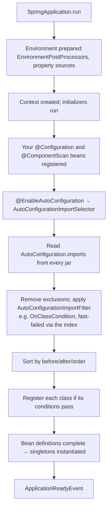
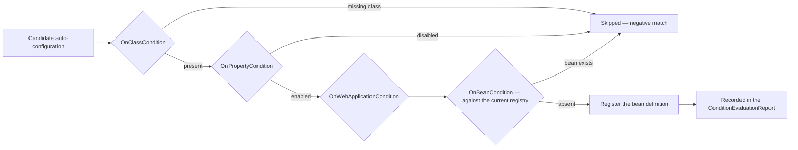
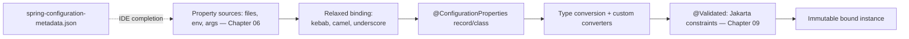
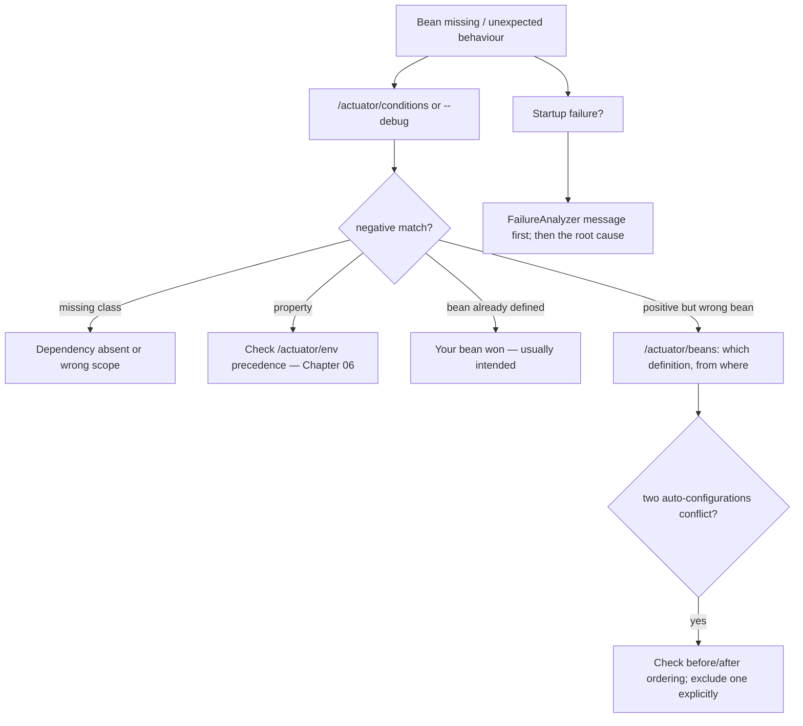

# 41 · Spring Internals & Custom Starters

## 1. Introduction & Why It Matters

Across forty chapters, one pattern recurs: **the platform library**. Error handling (Chapter 10), correlation filters (Chapter 07), token validation (Chapter 18), outbox and inbox (Chapters 23, 36), tenant propagation (Chapter 38), observability conventions (Chapter 27), test support (Chapter 28). Twenty-six services each need them, and none should implement them.

The question is how to ship them. The three common answers, in increasing order of quality:

1. **Copy-paste.** Fast, then permanently divergent: eleven versions of the error handler, each subtly different, none upgradeable.
2. **A shared library everyone imports and wires manually.** Better, but every service repeats twenty lines of `@Bean` declarations and forgets one.
3. **A starter.** Add one dependency; the behaviour appears, correctly configured, overridable where the service needs something different.

Building a good starter requires understanding how Boot's auto-configuration actually works — the imports file, the conditions, the ordering, the properties binding and metadata, the failure analyzers, and how to test it all with `ApplicationContextRunner`. That knowledge also pays off daily: when a bean isn't created, when two auto-configurations fight, or when a Boot upgrade changes behaviour, the condition evaluation report tells you exactly why.

This chapter covers Boot's internals from the perspective of someone extending it, then builds a real platform starter end to end — including the things teams usually skip: property metadata, failure analyzers, native hints, versioning policy and documentation.

### Who should read which section

| Band | Focus |
|---|---|
| B1 · 0–2 yrs | Parts 1, 2, 4 — how auto-configuration works, reading the report |
| B2 · 2–5 yrs | Parts 2, 5 — conditions, properties, writing a first starter |
| B3 · 5–8 yrs | Parts 3, 5, 6 — ordering, testing, failure analyzers, AOT |
| B4 · 8–12 yrs | Parts 6, 8 — platform library strategy, versioning, governance |
| B5 · 12–15+ yrs | Parts 8, 9 — build-vs-buy and the cost of abstraction |

---

## 2. Core Concepts

### 2.1 What auto-configuration is

A list of `@AutoConfiguration` classes, discovered from a file on the classpath, each guarded by conditions, applied **after** your own configuration.

```text title="Example"
META-INF/spring/org.springframework.boot.autoconfigure.AutoConfiguration.imports
```

Each line is a fully-qualified class name. That is the entire discovery mechanism — no scanning, no magic, just a file read at startup (and indexed for speed).

### 2.2 The pieces

| Piece | Role |
|---|---|
| `@AutoConfiguration` | Marks the class; supports `before`/`after` ordering attributes |
| `AutoConfiguration.imports` | Registers it |
| `@Conditional*` | Decides whether it applies |
| `@ConfigurationProperties` | Typed configuration (Chapter 06) |
| `spring-boot-configuration-processor` | Generates metadata for IDE completion |
| `FailureAnalyzer` | Turns a startup exception into an actionable message |
| `EnvironmentPostProcessor` | Contributes property sources very early |
| `ApplicationContextInitializer` / listeners | Hook into the startup lifecycle (Chapter 03) |
| `RuntimeHintsRegistrar` | Reflection/resource hints for native images (Chapter 29) |
| `ApplicationContextRunner` | Test auto-configuration in isolation |

### 2.3 The conditions that matter

| Condition | Use |
|---|---|
| `@ConditionalOnClass` / `@ConditionalOnMissingClass` | Only when a library is present |
| **`@ConditionalOnMissingBean`** | **The override mechanism** — the user's bean wins |
| `@ConditionalOnBean` | Requires another bean (ordering-sensitive) |
| `@ConditionalOnProperty` | Feature toggles, opt-in/opt-out |
| `@ConditionalOnWebApplication(type = SERVLET)` | Servlet vs reactive vs none |
| `@ConditionalOnResource` | A file must exist |
| `@ConditionalOnSingleCandidate` | Exactly one candidate, or a primary |
| Custom `SpringBootCondition` | Anything else, with a readable message |

!!! danger "`@ConditionalOnMissingBean` is a contract, not a detail"
    Every bean a starter defines should be `@ConditionalOnMissingBean`. Without it, a service that needs a different implementation cannot override yours and must exclude the whole auto-configuration — which throws out twelve good defaults to change one.

### 2.4 Ordering

| Mechanism | Effect |
|---|---|
| `@AutoConfiguration(after = …)` | This runs after that auto-configuration |
| `@AutoConfiguration(before = …)` | This runs before it |
| `@AutoConfigureOrder` | Coarse ordering |
| Bean method order within a class | Sequential, but conditions evaluate against the state at that moment |

Ordering matters because `@ConditionalOnBean` and `@ConditionalOnMissingBean` are evaluated **as the registry is built**. A condition asking about a bean defined later sees nothing — the most common subtle bug in hand-written auto-configuration.

### 2.5 Starter conventions

A "starter" is conventionally **two artifacts**:

| Artifact | Contents |
|---|---|
| `grocery-platform-web-autoconfigure` | The code: auto-configuration classes, properties, the imports file |
| `grocery-platform-web-spring-boot-starter` | **Dependencies only** — the autoconfigure module plus what it needs |

Naming: third-party starters use `xxx-spring-boot-starter` (the `spring-boot-starter-xxx` form is reserved for official ones). Keep the autoconfigure module's dependencies **optional** so classes can be absent and conditions can do their job.

### 2.6 What belongs in a platform starter

| Yes | No |
|---|---|
| Error handling and the problem format | Business logic (Chapter 35) |
| Correlation and tenant filters | Domain models |
| Security defaults, token conversion | Anything that forces a lockstep upgrade |
| Observability conventions, meter filters | Opinionated choices a service can't override |
| Outbox/inbox plumbing | Configuration that can't be turned off |
| Test fixtures (a separate test starter) | Beans without `@ConditionalOnMissingBean` |

### 2.7 Diagnostics you should reach for first

| Tool | Answers |
|---|---|
| `--debug` or `/actuator/conditions` | Why a bean was or wasn't created |
| `/actuator/beans` | What's actually in the context |
| `/actuator/configprops` | Effective, sanitized configuration |
| `/actuator/env` | Property sources and precedence (Chapter 06) |
| `/actuator/startup` | Slow startup steps (Chapter 03) |
| `FailureAnalyzer` output | Startup failures explained in plain language |

---

## 3. How It Works Internally

### 3.1 Startup and auto-configuration



The crucial detail: **user configuration is registered before auto-configuration**, which is what makes `@ConditionalOnMissingBean` work — your bean already exists when the starter's condition is evaluated.

### 3.2 Condition evaluation



Everything — matches and non-matches, with reasons — lands in the `ConditionEvaluationReport`, which is what `/actuator/conditions` renders.

### 3.3 Properties binding



Constructor binding with records gives immutability, and `@Validated` turns a misconfiguration into a clear startup failure rather than a `NullPointerException` at 3 a.m.

---

## 4. Hands-On Code — Level 1 (Beginner)

### 4.1 Reading the condition report

```bash title="Terminal"
java -jar order-service.jar --debug | less                       # (1)!
curl -s localhost:9090/actuator/conditions | jq '.contexts.application.negativeMatches' | head -40
```

```text title="Example"
Positive matches:
-----------------
DataSourceAutoConfiguration matched:
      - @ConditionalOnClass found required classes 'javax.sql.DataSource' (OnClassCondition)

Negative matches:
-----------------
RedisAutoConfiguration:
      Did not match:
         - @ConditionalOnClass did not find required class
           'org.springframework.data.redis.core.RedisOperations' (OnClassCondition)     # (2)!
```

1. `--debug` prints the report at startup; the Actuator endpoint exposes it at runtime.
2. **This is the answer to "why isn't my bean there?"** — nearly always a missing class, a disabled property, or a bean that already exists.

### 4.2 A minimal auto-configuration

```java title="in/grocery/platform/web/autoconfigure/GroceryWebAutoConfiguration.java"
package in.grocery.platform.web.autoconfigure;

import org.springframework.boot.autoconfigure.AutoConfiguration;
import org.springframework.boot.autoconfigure.condition.ConditionalOnMissingBean;
import org.springframework.boot.autoconfigure.condition.ConditionalOnWebApplication;
import org.springframework.boot.context.properties.EnableConfigurationProperties;
import org.springframework.context.annotation.Bean;

@AutoConfiguration                                                                      // (1)!
@ConditionalOnWebApplication(type = ConditionalOnWebApplication.Type.SERVLET)
@EnableConfigurationProperties(GroceryWebProperties.class)                              // (2)!
public class GroceryWebAutoConfiguration {

    @Bean
    @ConditionalOnMissingBean                                                           // (3)!
    CorrelationIdFilter correlationIdFilter(GroceryWebProperties properties) {
        return new CorrelationIdFilter(properties.correlationHeader());
    }
}
```

1. `@AutoConfiguration` is `@Configuration(proxyBeanMethods = false)` plus ordering support — never use plain `@Configuration` for auto-configuration.
2. Properties enabled here, not with `@Component` scanning (a library must not rely on the consumer's component scan reaching it).
3. Every bean overridable.

```text title="src/main/resources/META-INF/spring/org.springframework.boot.autoconfigure.AutoConfiguration.imports"
in.grocery.platform.web.autoconfigure.GroceryWebAutoConfiguration
```

One line per class. Forgetting this file is the single most common reason a new starter "does nothing".

### 4.3 Typed properties

```java title="in/grocery/platform/web/autoconfigure/GroceryWebProperties.java"
@ConfigurationProperties(prefix = "grocery.web")
@Validated                                                                              // (1)!
public record GroceryWebProperties(

        @DefaultValue("X-Request-Id") @NotBlank String correlationHeader,               // (2)!

        @DefaultValue("true") boolean problemDetailsEnabled,

        @DefaultValue("https://errors.grocery.in/") @NotBlank String errorTypeBaseUri,

        @DefaultValue("1000") @Min(1) @Max(10_000) int maxErrorDetailLength) {}
```

1. Invalid configuration fails at **startup**, with a message naming the property (Chapter 06).
2. `@DefaultValue` with constructor binding keeps the record immutable and the defaults visible in one place.

```kotlin title="build.gradle.kts (metadata for IDE completion)"
annotationProcessor("org.springframework.boot:spring-boot-configuration-processor")     // (1)!
```

1. Generates `spring-configuration-metadata.json` so `grocery.web.` autocompletes with descriptions and defaults in every IDE — a small addition that makes a library feel finished.

### 4.4 Testing it

```java title="GroceryWebAutoConfigurationTest.java"
class GroceryWebAutoConfigurationTest {

    private final WebApplicationContextRunner runner = new WebApplicationContextRunner()   // (1)!
            .withConfiguration(AutoConfigurations.of(GroceryWebAutoConfiguration.class));

    @Test
    void registersTheFilterByDefault() {
        runner.run(context -> assertThat(context).hasSingleBean(CorrelationIdFilter.class));
    }

    @Test
    void usesTheConfiguredHeaderName() {
        runner.withPropertyValues("grocery.web.correlation-header=X-Trace-Key")
              .run(context -> assertThat(context.getBean(CorrelationIdFilter.class).headerName())
                      .isEqualTo("X-Trace-Key"));
    }

    @Test
    void backsOffWhenTheUserDefinesTheirOwn() {                                            // (2)!
        runner.withUserConfiguration(CustomFilterConfig.class)
              .run(context -> assertThat(context).hasSingleBean(CorrelationIdFilter.class)
                      .getBean(CorrelationIdFilter.class).isSameAs(CustomFilterConfig.CUSTOM));
    }

    @Test
    void rejectsInvalidConfiguration() {
        runner.withPropertyValues("grocery.web.max-error-detail-length=0")
              .run(context -> assertThat(context).hasFailed()                               // (3)!
                      .getFailure().hasMessageContaining("maxErrorDetailLength"));
    }
}
```

1. `ApplicationContextRunner` creates a context per test in milliseconds — no `@SpringBootTest`, no server, no database.
2. **The back-off test is mandatory**: it proves consumers can override, which is the difference between a starter and a straitjacket.
3. Misconfiguration fails fast and says which property.

---

## 5. Hands-On Code — Level 2 (Intermediate) & Level 3 (Advanced)

### 5.1 Level 2 — Module layout

```text title="Example"
platform-libraries/
├── grocery-platform-bom/                       ← versions for all platform artifacts
├── grocery-platform-web-autoconfigure/         ← code
│   ├── src/main/java/…/autoconfigure/
│   └── src/main/resources/META-INF/spring/…AutoConfiguration.imports
├── grocery-platform-web-spring-boot-starter/   ← dependencies only
└── grocery-platform-test-starter/
```

```kotlin title="grocery-platform-web-autoconfigure/build.gradle.kts"
dependencies {
    api(project(":grocery-platform-core"))
    compileOnly("org.springframework.boot:spring-boot-starter-web")                     // (1)!
    compileOnly("io.micrometer:micrometer-core")
    annotationProcessor("org.springframework.boot:spring-boot-configuration-processor")

    testImplementation("org.springframework.boot:spring-boot-starter-web")              // (2)!
    testImplementation("org.springframework.boot:spring-boot-starter-test")
}
```

1. **`compileOnly`** — the autoconfigure module must compile against these but not force them on consumers, so `@ConditionalOnClass` can genuinely be false.
2. Tests need them at runtime to exercise both branches.

```kotlin title="grocery-platform-web-spring-boot-starter/build.gradle.kts"
dependencies {
    api(project(":grocery-platform-web-autoconfigure"))
    api("org.springframework.boot:spring-boot-starter-web")                             // (1)!
}
```

1. The starter is **pure dependency management**: no code, no resources. A service adds this one line and gets everything.

### 5.2 Level 2 — Conditions in practice

```java title="in/grocery/platform/observability/autoconfigure/GroceryObservabilityAutoConfiguration.java"
@AutoConfiguration(after = {MetricsAutoConfiguration.class, CompositeMeterRegistryAutoConfiguration.class})   // (1)!
@ConditionalOnClass(MeterRegistry.class)
@ConditionalOnProperty(prefix = "grocery.observability", name = "enabled",
        havingValue = "true", matchIfMissing = true)                                    // (2)!
@EnableConfigurationProperties(GroceryObservabilityProperties.class)
public class GroceryObservabilityAutoConfiguration {

    @Bean
    @ConditionalOnMissingBean(name = "groceryCommonTags")
    MeterRegistryCustomizer<MeterRegistry> groceryCommonTags(
            Environment environment, ObjectProvider<BuildProperties> build) {            // (3)!
        return registry -> registry.config().commonTags(
                "application", environment.getProperty("spring.application.name", "unknown"),
                "env", environment.getProperty("grocery.env", "local"),
                "version", build.getIfAvailable() == null ? "unknown" : build.getObject().getVersion());
    }

    @Bean
    @ConditionalOnMissingBean
    MeterFilter groceryCardinalityGuard(GroceryObservabilityProperties properties) {
        return MeterFilter.maximumAllowableTags("http.server.requests", "uri",
                properties.maxUriTagValues(), MeterFilter.deny());                       // (4)!
    }
}
```

1. **After** Boot's metrics auto-configuration, so the registry exists when our customizer is registered.
2. Opt-out with a sensible default: on unless explicitly disabled.
3. `ObjectProvider` for optional dependencies — `build-info` may not exist locally, and a hard dependency would break every developer's machine.
4. Chapter 27's cardinality guard, now a platform default rather than something each team must remember.

```java title="A custom condition with a readable message"
public class OnKubernetesCondition extends SpringBootCondition {

    @Override
    public ConditionOutcome getMatchOutcome(ConditionContext context, AnnotatedTypeMetadata metadata) {
        boolean inCluster = context.getEnvironment().containsProperty("KUBERNETES_SERVICE_HOST");
        return inCluster
                ? ConditionOutcome.match("KUBERNETES_SERVICE_HOST is set")                // (1)!
                : ConditionOutcome.noMatch("KUBERNETES_SERVICE_HOST is not set");
    }
}
```

1. The message appears in the condition report. A condition whose outcome can't be explained is a condition someone will spend an afternoon debugging.

### 5.3 Level 2 — Failure analyzers

```java title="in/grocery/platform/web/autoconfigure/MissingTenantConfigFailureAnalyzer.java"
public class MissingTenantConfigFailureAnalyzer
        extends AbstractFailureAnalyzer<MissingTenantConfigurationException> {

    @Override
    protected FailureAnalysis analyze(Throwable rootFailure, MissingTenantConfigurationException cause) {
        return new FailureAnalysis(
                "The application is configured as multi-tenant but no tenant resolver is available.",   // (1)!
                """
                Either:
                  * set grocery.tenancy.enabled=false for a single-tenant deployment, or
                  * add the grocery-platform-tenancy-spring-boot-starter dependency, or
                  * define your own TenantResolver bean.
                See https://platform.grocery.in/docs/tenancy
                """,                                                                     // (2)!
                cause);
    }
}
```

```text title="META-INF/spring.factories"
org.springframework.boot.diagnostics.FailureAnalyzer=\
in.grocery.platform.web.autoconfigure.MissingTenantConfigFailureAnalyzer
```

1. What went wrong, in one sentence.
2. **What to do about it**, with concrete options and a link. This turns a 200-line stack trace into a 20-second fix, and is the highest-value polish a platform library can add.

### 5.3b Level 2 — Early configuration with an `EnvironmentPostProcessor`

```java title="in/grocery/platform/config/GroceryConfigTreePostProcessor.java"
public class GroceryConfigTreePostProcessor implements EnvironmentPostProcessor, Ordered {

    @Override
    public void postProcessEnvironment(ConfigurableEnvironment environment, SpringApplication application) {
        Path secrets = Path.of("/var/run/secrets/grocery");
        if (Files.isDirectory(secrets)) {                                                 // (1)!
            environment.getPropertySources().addLast(
                    new ConfigTreePropertySource("grocery-secrets", secrets));            // (2)!
        }
    }

    @Override
    public int getOrder() {
        return Ordered.LOWEST_PRECEDENCE - 10;                                            // (3)!
    }
}
```

1. Only when the mount exists — local development is unaffected.
2. The config tree from Chapter 06, contributed automatically so no service repeats the import.
3. Ordering relative to Boot's own processors decides precedence; `addLast` keeps explicit configuration winning.

Registered in `spring.factories` under `org.springframework.boot.env.EnvironmentPostProcessor`.

### 5.4 Level 3 — A complete platform starter

The web starter contributes everything Chapters 07, 10 and 20 defined:

```java title="in/grocery/platform/web/autoconfigure/GroceryWebAutoConfiguration.java (full)"
@AutoConfiguration(after = {JacksonAutoConfiguration.class, WebMvcAutoConfiguration.class})
@ConditionalOnWebApplication(type = SERVLET)
@ConditionalOnProperty(prefix = "grocery.web", name = "enabled", havingValue = "true", matchIfMissing = true)
@EnableConfigurationProperties(GroceryWebProperties.class)
@ImportRuntimeHints(GroceryWebRuntimeHints.class)                                        // (1)!
public class GroceryWebAutoConfiguration {

    @Bean
    @ConditionalOnMissingBean
    CorrelationIdFilter correlationIdFilter(GroceryWebProperties properties) { ... }

    @Bean
    @ConditionalOnMissingBean
    FilterRegistrationBean<CorrelationIdFilter> correlationIdFilterRegistration(
            CorrelationIdFilter filter) {
        var registration = new FilterRegistrationBean<>(filter);
        registration.setOrder(Ordered.HIGHEST_PRECEDENCE + 5);                            // (2)!
        return registration;
    }

    @Bean
    @ConditionalOnMissingBean(GroceryExceptionHandler.class)
    @ConditionalOnProperty(prefix = "grocery.web", name = "problem-details-enabled",
            havingValue = "true", matchIfMissing = true)
    GroceryExceptionHandler groceryExceptionHandler(GroceryWebProperties properties,
                                                    MessageSource messageSource,
                                                    ObjectProvider<Tracer> tracer) {      // (3)!
        return new GroceryExceptionHandler(properties, messageSource, tracer.getIfAvailable());
    }

    @Bean
    @ConditionalOnMissingBean
    ErrorCodeCatalog errorCodeCatalog(MessageSource messageSource) { ... }

    @Configuration(proxyBeanMethods = false)
    @ConditionalOnClass(OpenAPI.class)                                                    // (4)!
    static class OpenApiConfiguration {

        @Bean
        @ConditionalOnMissingBean
        OpenApiCustomizer groceryProblemSchemaCustomizer() { ... }
    }
}
```

1. Native-image hints travel with the library (Chapter 29) — a starter that breaks native builds is a starter teams stop using.
2. Explicit filter ordering: correlation must run before almost everything (Chapter 07).
3. Tracing is optional; degrade to no `traceId` rather than failing.
4. **Nested configuration guarded by class presence** — springdoc support activates only if springdoc is on the classpath, without the outer class needing it.

### 5.5 Level 3 — Testing conditions thoroughly

```java title="GroceryWebAutoConfigurationConditionsTest.java"
class GroceryWebAutoConfigurationConditionsTest {

    private final WebApplicationContextRunner runner = new WebApplicationContextRunner()
            .withConfiguration(AutoConfigurations.of(
                    JacksonAutoConfiguration.class, GroceryWebAutoConfiguration.class));   // (1)!

    @Test
    void doesNothingInANonWebApplication() {
        new ApplicationContextRunner()                                                     // (2)!
                .withConfiguration(AutoConfigurations.of(GroceryWebAutoConfiguration.class))
                .run(context -> assertThat(context).doesNotHaveBean(CorrelationIdFilter.class));
    }

    @Test
    void canBeDisabledEntirely() {
        runner.withPropertyValues("grocery.web.enabled=false")
              .run(context -> assertThat(context).doesNotHaveBean(GroceryExceptionHandler.class));
    }

    @Test
    void openApiSupportActivatesOnlyWithSpringdoc() {
        runner.withClassLoader(new FilteredClassLoader(OpenAPI.class))                     // (3)!
              .run(context -> assertThat(context).doesNotHaveBean(OpenApiCustomizer.class));

        runner.run(context -> assertThat(context).hasSingleBean(OpenApiCustomizer.class));
    }

    @Test
    void worksWithoutTracingOnTheClasspath() {
        runner.withClassLoader(new FilteredClassLoader(Tracer.class))                      // (4)!
              .run(context -> assertThat(context).hasSingleBean(GroceryExceptionHandler.class));
    }

    @Test
    void filterOrderPlacesCorrelationEarly() {
        runner.run(context -> assertThat(context.getBean(FilterRegistrationBean.class).getOrder())
                .isLessThan(Ordered.HIGHEST_PRECEDENCE + 100));                            // (5)!
    }
}
```

1. Include the Boot auto-configurations yours depends on, so ordering is exercised realistically.
2. Non-web contexts must be unaffected — batch applications (Chapter 33) import the same platform BOM.
3. **`FilteredClassLoader` simulates a missing library** — the only way to test `@ConditionalOnClass` honestly.
4. Optional dependencies verified absent as well as present.
5. Ordering is behaviour; assert it, because a reordering regression is invisible until correlation ids go missing.

### 5.6 Level 3 — A custom Actuator endpoint

```java title="in/grocery/platform/web/autoconfigure/PlatformInfoEndpoint.java"
@Endpoint(id = "platform")                                                                 // (1)!
public class PlatformInfoEndpoint {

    private final GroceryWebProperties properties;
    private final ErrorCodeCatalog catalog;

    @ReadOperation
    public PlatformInfo info() {
        return new PlatformInfo(
                platformLibraryVersion(),                                                  // (2)!
                properties.problemDetailsEnabled(),
                catalog.codes().size(),
                TenantContext.current().orElse(null));
    }

    @ReadOperation
    public ErrorCodeDetail errorCode(@Selector String code) {                              // (3)!
        return catalog.describe(code);
    }
}
```

1. Exposed at `/actuator/platform` when included in `management.endpoints.web.exposure.include`.
2. **Which platform library version is this service running?** Across 26 services, that question is asked in every upgrade and every incident.
3. `@Selector` gives `/actuator/platform/PINCODE_NOT_SERVICEABLE` — the error catalog (Chapter 20) queryable at runtime.

---

## 6. Hands-On Code — Level 4 (Expert / Production)

### 6.1 The platform library suite

| Starter | Contributes | Chapters |
|---|---|---|
| `grocery-platform-web-spring-boot-starter` | Problem details, error catalog, correlation filter, OpenAPI conventions | 07, 10, 20 |
| `grocery-platform-security-spring-boot-starter` | Token conversion, authority mapping, entry points, security headers | 17, 18, 39 |
| `grocery-platform-observability-spring-boot-starter` | Common tags, cardinality guards, SLO histograms, health conventions | 27 |
| `grocery-platform-messaging-spring-boot-starter` | Outbox writer and relay, inbox, error handlers, DLT monitor | 23, 36 |
| `grocery-platform-tenancy-spring-boot-starter` | Tenant filter, context propagation, cache key generator, RLS datasource | 38 |
| `grocery-platform-client-spring-boot-starter` | Configured `RestClient` builders, error translation, service tokens | 19 |
| `grocery-platform-test-starter` | Containers config, builders, ArchUnit rules, leak-suite base | 15, 28, 38 |
| `grocery-platform-bom` | Versions for all of the above | 01 |

```kotlin title="A service's build file, after"
dependencies {
    implementation(platform("in.grocery:grocery-platform-bom:3.4.0"))                      // (1)!
    implementation("in.grocery:grocery-platform-web-spring-boot-starter")
    implementation("in.grocery:grocery-platform-security-spring-boot-starter")
    implementation("in.grocery:grocery-platform-observability-spring-boot-starter")
    implementation("in.grocery:grocery-platform-messaging-spring-boot-starter")
    testImplementation("in.grocery:grocery-platform-test-starter")
}
```

1. One BOM, five lines, and a new service starts with correct error handling, security defaults, observability conventions, outbox plumbing and test fixtures — about 900 lines of configuration nobody writes again.

### 6.2 Versioning and compatibility policy

| Rule | Detail |
|---|---|
| Semantic versioning | Major = breaking, minor = additive, patch = fixes |
| **N-1 support** | Services may run one major version behind; the platform team maintains it |
| Never force lockstep | A platform release must not require simultaneous service upgrades (Chapter 35) |
| Deprecate before removing | One minor version with `@Deprecated` and a documented replacement |
| Boot compatibility matrix | Which platform version supports which Boot version |
| Changelog per release | What changed, what to do, what breaks |

```java title="Deprecating a property gracefully"
@ConfigurationProperties(prefix = "grocery.web")
public record GroceryWebProperties(
        @DefaultValue("X-Request-Id") String correlationHeader,

        @Deprecated(since = "3.3", forRemoval = true)
        @DeprecatedConfigurationProperty(replacement = "grocery.web.correlation-header")    // (1)!
        String requestIdHeader) {

    public String effectiveCorrelationHeader() {
        return requestIdHeader != null ? requestIdHeader : correlationHeader;                // (2)!
    }
}
```

1. The IDE and metadata warn users, pointing at the replacement.
2. The old property keeps working for one major version — deprecation is a message, not a breakage.

### 6.3 A release checklist for platform libraries

| Check | Why |
|---|---|
| All beans `@ConditionalOnMissingBean` | Consumers can override |
| Back-off tests for every bean | The override actually works |
| `FilteredClassLoader` tests for optional dependencies | Conditions are honest |
| Property metadata generated and reviewed | IDE completion and documentation |
| Native hints present, `nativeTest` green | Doesn't break native consumers (Chapter 29) |
| Works on the N-1 Boot version | No forced upgrades |
| Changelog and migration notes | Adoption without support tickets |
| Sample service upgraded as a smoke test | Real-world verification before release |
| No business logic | Chapter 35's rule |
| Startup cost measured | A slow starter taxes every service (Chapter 29) |

```java title="Guarding startup cost"
@Test
void autoConfigurationIsCheap() {
    long start = System.nanoTime();
    runner.run(context -> assertThat(context).hasNotFailed());
    assertThat(Duration.ofNanos(System.nanoTime() - start))
            .isLessThan(Duration.ofMillis(300));                                             // (1)!
}
```

1. A starter that eagerly connects to something, or scans a large classpath, adds that cost to twenty-six services × every pod × every deploy.

### 6.4 Debugging auto-configuration in anger



```yaml title="Explicit exclusion, when needed"
spring:
  autoconfigure:
    exclude:
      - in.grocery.platform.web.autoconfigure.GroceryWebAutoConfiguration                   # (1)!
```

1. The blunt instrument. If a service needs this, the starter is missing a property toggle or a `@ConditionalOnMissingBean` — treat it as a bug report against the platform library.

### 6.5 Native-image support in a starter

```java title="in/grocery/platform/web/autoconfigure/GroceryWebRuntimeHints.java"
class GroceryWebRuntimeHints implements RuntimeHintsRegistrar {

    @Override
    public void registerHints(RuntimeHints hints, ClassLoader classLoader) {
        hints.resources().registerPattern("grocery-errors*.properties");                     // (1)!
        hints.reflection().registerType(GroceryProblemDetail.class,
                MemberCategory.INVOKE_DECLARED_CONSTRUCTORS,
                MemberCategory.INVOKE_DECLARED_METHODS);                                     // (2)!
        hints.serialization().registerType(ErrorCode.class);
    }
}
```

1. Message bundles loaded by pattern vanish from a native image unless declared (Chapter 29).
2. Types serialized reflectively need reflection hints. Shipping these **with the library** means consumers don't debug missing-hint failures at runtime.

### 6.6 When *not* to build a starter

| Situation | Better choice |
|---|---|
| One service needs it | A `@Configuration` class in that service |
| The abstraction isn't settled | Copy it twice; extract on the third |
| It wraps a library thinly | Use the library directly |
| It would force lockstep upgrades | Keep it a plain library with explicit wiring |
| It encodes business rules | A domain library or a service (Chapters 35, 37) |
| Nobody will maintain it | Don't create it — an unmaintained starter blocks Boot upgrades for everyone |

The last row is the real constraint. A platform library is a **product** with users, a support burden, a release cadence and an owner. Two well-maintained starters beat eight abandoned ones.

---

## 7. Spring Boot 3 vs 4 & Migration

| Topic | Boot 3.5 | Boot 4.x |
|---|---|---|
| `AutoConfiguration.imports` | ✅ | ✅ (verify path stability) |
| `@AutoConfiguration` with before/after | ✅ | ✅ |
| Auto-configuration packaging | Largely in `spring-boot-autoconfigure` | **Modularized** into per-technology artifacts — imports may move (verify) |
| `spring.factories` | Only for non-auto-configuration hooks | Same (verify supported keys) |
| Configuration processor | ✅ | ✅ |
| `ApplicationContextRunner` | ✅ | ✅ |
| Runtime hints | ✅ | ✅ |

!!! danger "Boot 4's modularization affects starters"
    If your auto-configuration references Boot's auto-configuration classes in `before`/`after` attributes or `@ConditionalOnBean`, those class names and packages may move. Compile against the target Boot version early, run the full condition test suite, and publish a compatibility matrix before your services upgrade.

### Migration checklist

- [ ] Compile each autoconfigure module against the target Boot version first; fix moved imports.
- [ ] Re-run all `ApplicationContextRunner` tests, including `FilteredClassLoader` cases.
- [ ] Verify `before`/`after` references still resolve after modularization.
- [ ] Re-generate and review configuration metadata.
- [ ] Re-run `nativeTest` for native-supporting consumers.
- [ ] Publish the compatibility matrix and changelog **before** services upgrade.

---

## 8. Production Playbook

### Best practices

1. **Two artifacts**: autoconfigure (code) and starter (dependencies only).
2. **Every bean `@ConditionalOnMissingBean`**, with a back-off test proving it.
3. **Typed, validated properties** with generated metadata and sensible defaults.
4. **Conditions that explain themselves**; custom conditions return readable outcomes.
5. **Failure analyzers** for every configuration mistake your library can cause.
6. **Test with `ApplicationContextRunner`**, including `FilteredClassLoader` for optional dependencies.
7. **Ship native hints** so the library never breaks a native build.
8. **Semantic versioning with N-1 support**; deprecate before removing; never force lockstep upgrades.
9. **Measure startup cost** — it multiplies across services and pods.
10. **No business logic**; platform concerns only.

### Anti-patterns

❌ Missing the `AutoConfiguration.imports` file (the starter silently does nothing).

❌ Plain `@Configuration` instead of `@AutoConfiguration` (ordering and back-off break).

❌ Beans without `@ConditionalOnMissingBean` (consumers must exclude everything to change one thing).

❌ Mandatory dependencies in the autoconfigure module (conditions can never be false).

❌ Business logic in a platform library (Chapter 35).

❌ Breaking changes in a minor version.

❌ No property metadata (no IDE support, no discoverability).

❌ Eager work at startup — connections, scans, warm-ups — inside a starter.

❌ A starter nobody owns, blocking every Boot upgrade.

❌ Relying on the consumer's `@ComponentScan` reaching your package.

### Troubleshooting

| Symptom | Cause | Fix |
|---|---|---|
| Starter does nothing | Missing or misspelled imports file | Check `META-INF/spring/…AutoConfiguration.imports` |
| Bean missing | Condition not met | `/actuator/conditions` or `--debug` |
| Two beans of the same type | Missing `@ConditionalOnMissingBean` | Add it; add a back-off test |
| Consumer's bean ignored | Auto-configuration ran first (wrong annotation) | Use `@AutoConfiguration` |
| `NoSuchBeanDefinitionException` at startup | `@ConditionalOnBean` evaluated too early | Fix `after` ordering; use `ObjectProvider` |
| Works in tests, not in the app | Test adds a dependency the app lacks | `FilteredClassLoader` tests |
| Native image fails at runtime | Missing hints | Ship `RuntimeHintsRegistrar` |
| Startup slower after adding the starter | Eager initialization | `/actuator/startup`; make it lazy or conditional |
| Every service breaks on upgrade | Breaking change without N-1 support | Versioning policy; deprecation cycle |
| Property typo silently ignored | No metadata, no validation | Configuration processor + `@Validated` |

### Production checklist

- [ ] Autoconfigure/starter split with `compileOnly` dependencies
- [ ] Imports file present and verified by a test
- [ ] All beans overridable, with back-off tests
- [ ] Properties typed, validated, documented, with generated metadata
- [ ] Failure analyzers for common misconfigurations
- [ ] `FilteredClassLoader` tests for every optional dependency
- [ ] Native hints shipped; `nativeTest` green
- [ ] Startup cost measured and budgeted
- [ ] Versioning policy, changelog, compatibility matrix published
- [ ] A named owning team for every platform library

---

## 9. Interview Questions & Answers

### B1 · 0–2 years

??? question "B1 · How does Spring Boot know which auto-configurations to apply?"
    **Short answer:** It reads `META-INF/spring/org.springframework.boot.autoconfigure.AutoConfiguration.imports` from every jar, filters by conditions and exclusions, sorts by ordering hints, and registers the ones that match.

??? question "B1 · Why is `@ConditionalOnMissingBean` important?"
    **Short answer:** It lets the application override a starter's bean. User configuration is registered before auto-configuration, so if the user defined a bean, the starter backs off.

??? question "B1 · How do you find out why a bean wasn't created?"
    **Short answer:** Run with `--debug` or call `/actuator/conditions` — the condition evaluation report lists every match and non-match with the reason.

??? question "B1 · What's the difference between a starter and an autoconfigure module?"
    **Short answer:** The autoconfigure module contains the code and conditions; the starter contains only dependencies, so adding one line brings in everything needed.

??? question "B1 · What does the configuration processor do?"
    **Short answer:** Generates `spring-configuration-metadata.json` from `@ConfigurationProperties`, giving IDE autocompletion, documentation and deprecation warnings for your properties.

### B2 · 2–5 years

??? question "B2 · Why must an autoconfigure module use `compileOnly` dependencies?"
    **Short answer:** So consumers aren't forced to pull libraries they don't use, and so `@ConditionalOnClass` can actually evaluate false. With mandatory dependencies, every condition is always true.

??? question "B2 · How do you test auto-configuration?"
    **Short answer:** `ApplicationContextRunner` (or its web/reactive variants): assert beans exist, honour properties, back off when the user defines their own, fail on invalid configuration, and — with `FilteredClassLoader` — behave correctly when an optional library is absent.

??? question "B2 · How do you control the order of auto-configurations?"
    **Short answer:** `@AutoConfiguration(before = …, after = …)` or `@AutoConfigureOrder`. It matters because `@ConditionalOnBean` and `@ConditionalOnMissingBean` are evaluated against the registry as it exists at that moment.

??? question "B2 · What's a failure analyzer for?"
    **Short answer:** Converting a startup exception into a clear description and concrete remediation steps, registered via `spring.factories` — turning a stack trace into an actionable message.

??? question "B2 · How do you make a starter's behaviour optional?"
    **Short answer:** `@ConditionalOnProperty` with `matchIfMissing` for opt-out defaults, `@ConditionalOnClass` for library-dependent features, and `@ConditionalOnMissingBean` so consumers can substitute their own implementations.

??? question "B2 · What shouldn't go in a platform starter?"
    **Short answer:** Business logic, domain models, anything forcing a lockstep upgrade, and beans that can't be overridden.

### B3 · 5–8 years

??? question "B3 · Why does user configuration take precedence over auto-configuration?"
    **Short answer:** Auto-configurations are imported by `@EnableAutoConfiguration` and processed **after** the application's own configuration classes, so by the time `@ConditionalOnMissingBean` is evaluated, user beans are already registered.

??? question "B3 · How do you design a starter for overridability?"
    **Short answer:** Every bean `@ConditionalOnMissingBean`; feature toggles via properties; small focused beans rather than one monolith; interfaces so users can decorate; nested configurations guarded by class presence; back-off tests for each.

??? question "B3 · What are the pitfalls of `@ConditionalOnBean`?"
    **Short answer:** It depends on registration order, so a bean defined later isn't seen. Use `after` ordering, prefer `@ConditionalOnMissingBean` or `ObjectProvider` for optional collaborators, and avoid `@ConditionalOnBean` in regular `@Configuration` classes, where ordering isn't guaranteed at all.

??? question "B3 · How do you support native images from a library?"
    **Short answer:** Ship a `RuntimeHintsRegistrar` via `@ImportRuntimeHints` declaring reflection, resource and serialization needs, and run `nativeTest` in the library's own CI so consumers never debug missing hints.

??? question "B3 · How would you evolve a starter without breaking 26 services?"
    **Short answer:** Semantic versioning with N-1 support, additive changes in minors, deprecation with `@DeprecatedConfigurationProperty` and a working fallback for at least one major, a published compatibility matrix, changelogs with migration notes, and a sample service upgraded before release.

### B4 · 8–12 years

??? question "B4 · How do you decide what becomes a platform library?"
    **Short answer:** Cross-cutting concerns needed by most services, stable enough to standardize, with no business logic and a team willing to own them. If it's needed once, or still changing shape, keep it in the service; extract when the third copy appears.

??? question "B4 · What's the governance model for platform libraries?"
    **Short answer:** A named owning team, a versioning and support policy, a public changelog and compatibility matrix, contribution guidelines, release checklists, and adoption metrics — the `/actuator/platform` endpoint reporting library versions across the fleet makes upgrades measurable.

??? question "B4 · How do platform libraries interact with Boot upgrades?"
    **Short answer:** They're the gate. Compile and test them against the new Boot version first, publish a compatible release with a matrix, then upgrade services. Libraries that lag block the entire platform, which is why unowned starters are a serious risk.

### B5 · 12–15+ years

??? question "B5 · What's the cost of a platform abstraction?"
    **Short answer:** A support burden, a release cadence, an upgrade dependency and a learning curve for newcomers who must understand both Spring and your layer. Worth it when it removes real duplication and enforces correctness; harmful when it wraps a library thinly or encodes decisions teams should make themselves.

??? question "B5 · How do you avoid a platform library becoming a bottleneck?"
    **Short answer:** Keep it small and focused, make everything overridable, never force lockstep upgrades, support N-1, accept contributions from service teams, and periodically delete what nobody uses. A platform team that says "wait for our release" too often gets routed around.

### Scenario questions

??? example "Scenario · A new starter had no effect in any service"
    The `AutoConfiguration.imports` file was under `src/main/resources/META-INF/spring/` in the **starter** module, which contained no resources on the consumer's classpath order, and the class name had a typo from a package rename. Fixes: put the file in the autoconfigure module, add a test asserting the file lists the class and that the class loads, and add a smoke-test service to the release checklist.

??? example "Scenario · A platform release broke twelve services at once"
    A minor version changed a bean type and removed a property with no fallback. Fixes: revert, republish as a major with deprecation shims, adopt the N-1 policy, add back-off and property-compatibility tests, and upgrade a sample service in CI before any release.

### Coding exercise

!!! example "Exercise · Build the tenancy starter"
    Create `grocery-platform-tenancy-spring-boot-starter` contributing: a tenant resolution filter, a task decorator for async propagation, a tenant-aware cache key generator, and an RLS-setting datasource wrapper. Requirements: all beans overridable, disabled by a property, works without Spring Cache or Spring Security present, has property metadata and a failure analyzer, and is fully tested with `ApplicationContextRunner`.

??? success "Solution"
    ```java title="GroceryTenancyAutoConfiguration.java"
    @AutoConfiguration(after = {DataSourceAutoConfiguration.class, CacheAutoConfiguration.class,
                                SecurityAutoConfiguration.class})                            // (1)!
    @ConditionalOnProperty(prefix = "grocery.tenancy", name = "enabled",
            havingValue = "true", matchIfMissing = true)
    @EnableConfigurationProperties(GroceryTenancyProperties.class)
    public class GroceryTenancyAutoConfiguration {

        @Bean
        @ConditionalOnMissingBean
        TenantResolver tenantResolver(GroceryTenancyProperties properties) {
            return new TokenClaimTenantResolver(properties.claimName(), properties.hostPattern());
        }

        @Bean
        @ConditionalOnMissingBean
        @ConditionalOnWebApplication(type = SERVLET)
        FilterRegistrationBean<TenantFilter> tenantFilter(TenantResolver resolver) {
            var registration = new FilterRegistrationBean<>(new TenantFilter(resolver));
            registration.setOrder(Ordered.HIGHEST_PRECEDENCE + 20);                          // (2)!
            return registration;
        }

        @Bean
        @ConditionalOnMissingBean(name = "tenantTaskDecorator")
        TaskDecorator tenantTaskDecorator() {
            return new TenantPropagatingTaskDecorator();                                     // (3)!
        }

        @Configuration(proxyBeanMethods = false)
        @ConditionalOnClass(CacheManager.class)                                              // (4)!
        static class CacheConfiguration {

            @Bean("tenantKeyGenerator")
            @ConditionalOnMissingBean(name = "tenantKeyGenerator")
            KeyGenerator tenantKeyGenerator() {
                return new TenantAwareKeyGenerator();
            }
        }

        @Configuration(proxyBeanMethods = false)
        @ConditionalOnClass(DataSource.class)
        @ConditionalOnProperty(prefix = "grocery.tenancy", name = "row-level-security",
                havingValue = "true")                                                        // (5)!
        static class RlsConfiguration {

            @Bean
            static BeanPostProcessor tenantAwareDataSourcePostProcessor() {
                return new TenantAwareDataSourcePostProcessor();                             // (6)!
            }
        }
    }
    ```

    1. After the infrastructure it decorates.
    2. Tenant resolution runs after security (the token must be parsed) but before anything touching data (Chapter 38).
    3. Async propagation available for any executor the service builds.
    4. Cache support only if Spring Cache is present — services without caching pull nothing extra.
    5. RLS is opt-in: it requires database policies, so enabling it by default would break services that haven't created them.
    6. A `static` `BeanPostProcessor` (so it isn't subject to premature initialization) wrapping the `DataSource`.

    ```java title="Failure analyzer"
    public class MissingTenantClaimFailureAnalyzer extends AbstractFailureAnalyzer<MissingTenantClaimException> {
        @Override
        protected FailureAnalysis analyze(Throwable rootFailure, MissingTenantClaimException cause) {
            return new FailureAnalysis(
                    "Tenancy is enabled but tokens do not contain the claim '%s'.".formatted(cause.claim()),
                    """
                    Either:
                      * set grocery.tenancy.claim-name to the claim your tokens use, or
                      * set grocery.tenancy.enabled=false for single-tenant deployments.
                    """, cause);                                                             // (1)!
        }
    }
    ```

    1. A misconfiguration that would otherwise present as every request failing with a confusing error at runtime.

    ```java title="Tests"
    @Test void registersFilterAndResolverByDefault() { }
    @Test void disabledByPropertyRegistersNothing() { }
    @Test void backsOffWhenTheUserDefinesATenantResolver() { }                               // (1)!
    @Test void cacheKeyGeneratorAbsentWithoutSpringCache() { /* FilteredClassLoader(CacheManager.class) */ }
    @Test void rlsDataSourceOnlyWhenExplicitlyEnabled() { }
    @Test void nonWebApplicationGetsNoFilter() { }                                           // (2)!
    @Test void invalidClaimNameFailsFastWithAMessage() { }
    @Test void importsFileListsTheAutoConfigurationClass() { }                               // (3)!
    ```

    1. The override test, once per bean.
    2. Batch services (Chapter 33) use the decorator and key generator but have no filter.
    3. Reads the imports file and asserts the class name resolves — catching the silent-typo failure from the first scenario.

---

## Key Takeaways

- Auto-configuration is **a file of class names plus conditions**, applied after user configuration — no magic.
- **`@ConditionalOnMissingBean` on every bean** is what makes a starter usable rather than imposing.
- **Two artifacts**: autoconfigure (code, `compileOnly` dependencies) and starter (dependencies only).
- **`ApplicationContextRunner` with `FilteredClassLoader`** is how you test conditions honestly.
- **Property metadata and failure analyzers** are the difference between a library and a good library.
- **Ship native hints** and measure startup cost — both multiply across the fleet.
- **Version with N-1 support**; never force lockstep upgrades.
- A platform library is a **product with an owner**; unowned starters block everyone's Boot upgrade.

## Further Reading

- Spring Boot Reference — *Creating Your Own Auto-configuration and Starters*, *Condition Annotations*, *Testing Auto-configurations*
- Spring Boot source — `AutoConfigurationImportSelector`, `OnBeanCondition`, `ConditionEvaluationReport`
- Spring Boot Reference — *Configuration Metadata*, *Failure Analyzer*, *Runtime Hints*
- The Boot codebase itself: reading `WebMvcAutoConfiguration` teaches more about conditions than any tutorial

---

[:material-arrow-left: 40 Spring AI](40-spring-ai.md) · [42 Migration & Upgrade Engineering :material-arrow-right:](42-migration-upgrade.md)
