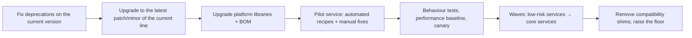
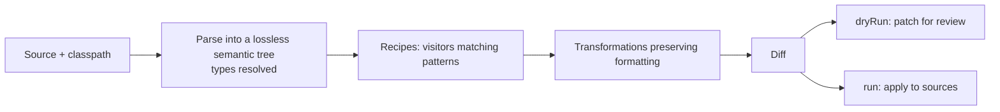
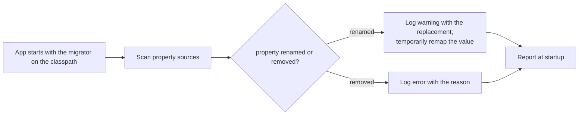
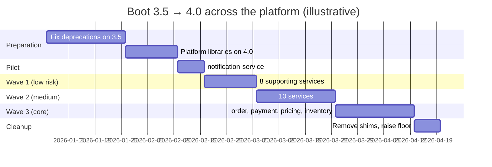
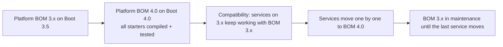
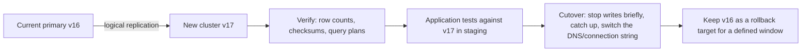

# 42 · Migration & Upgrade Engineering

## 1. Introduction & Why It Matters

Every chapter in this handbook ended with a "Boot 3 vs 4" section. This chapter is about doing it — across 26 services, eight platform libraries, three JDK versions in flight, and a team that also has features to ship.

Upgrades fail in predictable ways:

- **The big bang**: one team spends a quarter on a branch that upgrades everything, merges it, and spends the next quarter fixing production incidents from twenty simultaneous changes.
- **The indefinite deferral**: "we'll upgrade after Diwali" — repeated until the Boot minor is out of open-source support, a CVE lands, and the upgrade becomes an emergency spanning three major versions.
- **The silent behaviour change**: the code compiles, the tests pass, and a changed default (trailing-slash matching, a Jackson date format, a transaction propagation nuance) breaks a client in production.
- **The mixed-version trap**: during a rolling deploy, old and new pods read each other's cache entries, Kafka messages and sessions — and disagree about the format (Chapters 21, 23).

Upgrade engineering is the discipline that makes this routine: a cadence that keeps upgrades small, automation (OpenRewrite, the properties migrator) that removes the mechanical work, tests that catch behaviour change rather than just compilation, wave-based rollout with platform libraries first, explicit handling of cross-version data, and dashboards that show where the fleet stands.

This chapter covers Java, Spring Boot, framework-replacement and database migrations, with the Boot 2 → 3 and 3 → 4 migrations as worked examples.

### Who should read which section

| Band | Focus |
|---|---|
| B1 · 0–2 yrs | Parts 1, 2, 4 — what changes, running the tools |
| B2 · 2–5 yrs | Parts 2, 5 — OpenRewrite, fixing breakages, testing |
| B3 · 5–8 yrs | Parts 3, 5, 6 — behaviour changes, mixed versions, libraries |
| B4 · 8–12 yrs | Parts 6, 8 — fleet programmes, waves, risk |
| B5 · 12–15+ yrs | Parts 8, 9 — cadence, funding and upgrade culture |

---

## 2. Core Concepts

### 2.1 Why upgrade at all

| Reason | Cost of not doing it |
|---|---|
| Security fixes | Unsupported versions stop receiving CVE patches |
| Support window | Open-source support for a Boot minor is limited (roughly a year); commercial support costs money |
| Ecosystem | Libraries drop support for old versions, blocking unrelated upgrades |
| Performance | JDK and framework improvements (virtual threads, CDS/AOT, GC) |
| Hiring and morale | Engineers don't want to work on 2019's stack |
| Compounding | Each skipped version makes the next jump larger and riskier |

!!! warning "Verify support windows"
    Spring's support policy defines open-source and commercial support periods per release line. Check the current dates on the Spring support page — they drive the upgrade calendar, not the other way round.

### 2.2 The cadence that keeps upgrades cheap

| Policy | Effect |
|---|---|
| Stay within **N-1 Boot minors** | Each upgrade is a small step |
| Patch releases within 2 weeks | Security fixes land quickly |
| JDK: stay on an LTS, move to the next LTS within a year | Predictable, well-supported runtime |
| Dependency updates via Renovate weekly | No drift, small PRs (Chapter 39) |
| Platform libraries released first | Services are never blocked by the platform |
| Upgrade work budgeted every quarter | Not competing with features for permission |

Six-monthly minor upgrades take days. A four-year jump takes quarters. The engineering difference is entirely cadence.

### 2.3 What changes in a major upgrade

| Category | Examples (Boot 2 → 3) | Examples (Boot 3 → 4) |
|---|---|---|
| Baseline | Java 17, Jakarta EE 9/10 | Jakarta EE 11, Java 25 recommended |
| Namespaces | `javax.*` → `jakarta.*` | Jackson 2 → 3 packages (Chapter 11) |
| Removed APIs | `WebSecurityConfigurerAdapter`, Sleuth | Deprecated 3.x APIs, non-lambda Security DSL |
| Changed defaults | Trailing-slash matching off, observation-based tracing | Varies — read the migration guide |
| Library majors | Hibernate 6, Security 6 | Hibernate 7, Security 7, Framework 7 |
| Structure | `spring.factories` → imports file for auto-configuration | Modularized auto-configuration artifacts |
| New capabilities | Observation API, native images | API versioning, HTTP service clients, core resilience |

!!! danger "Behaviour changes are the real risk"
    Compilation errors are loud and cheap. Changed defaults are silent and expensive. Every major upgrade must be tested for **behaviour**: API responses (contract and golden-file tests), serialization (Chapter 11), security rules (Chapter 17), transaction behaviour (Chapter 16), and performance (Chapter 34).

### 2.4 The toolbox

| Tool | What it does |
|---|---|
| **Migration guides** | The authoritative list of changes per release |
| **OpenRewrite** | Automated, reviewable source transformations (recipes for Boot, Jakarta, JUnit, Jackson…) |
| `spring-boot-properties-migrator` | Reports renamed/removed properties at runtime, temporarily remaps them |
| Deprecation warnings | Fix them on the old version before upgrading |
| BOM | One place to change versions (Chapter 01) |
| Contract/golden-file tests | Detect behaviour change at API boundaries (Chapters 11, 20, 28) |
| Performance baselines | Detect regressions (Chapter 34) |
| Fleet version dashboard | Where every service stands |

### 2.5 The upgrade sequence



The first two steps are the most skipped and the most valuable: **every deprecation fixed on the old version is a breakage that never happens on the new one**.

### 2.6 Mixed-version compatibility

During a rolling deploy, old and new versions coexist. Anything shared must work in both directions:

| Shared state | Risk | Mitigation |
|---|---|---|
| Cache entries (Redis) | Serialization format change | Versioned key prefixes (Chapter 21) |
| Kafka/Rabbit messages | JSON/type-header differences | Golden-file tests, cross-version produce/consume tests (Chapter 23) |
| HTTP sessions | Serialized session objects | Session namespace per version, or stateless |
| Database schema | Migrations incompatible with old code | Expand/contract (Chapter 14) |
| Outbox payloads | Old rows read by new relay | Tolerant readers (Chapter 36) |
| Batch job repository | Schema changes between Batch majors | Drain jobs first (Chapter 33) |

---

## 3. How It Works Internally

### 3.1 OpenRewrite



Because recipes operate on **type-resolved** trees, not text, they can distinguish `javax.persistence.Entity` from a string that happens to contain it — which is why they're safe to run across a large codebase and why their output is reviewable.

### 3.2 The properties migrator



It's a **diagnostic**, not a permanent shim: fix the properties, then remove the dependency.

### 3.3 A fleet upgrade over time



---

## 4. Hands-On Code — Level 1 (Beginner)

### 4.1 Before upgrading: clean the current version

```bash title="Terminal"
./gradlew compileJava -Xlint:deprecation 2>&1 | grep -i deprecat | sort | uniq -c | sort -rn   # (1)!
```

1. Every deprecation warning on the current version is a future compilation error. Fixing them now is cheap and can ship independently.

```kotlin title="build.gradle.kts — fail on new deprecations"
tasks.withType<JavaCompile>().configureEach {
    options.compilerArgs.addAll(listOf("-Xlint:deprecation", "-Werror"))                  // (1)!
}
```

1. Once the count reaches zero, keep it there. (Use a suppression file for unavoidable third-party cases.)

### 4.2 The properties migrator

```kotlin title="build.gradle.kts (temporarily)"
runtimeOnly("org.springframework.boot:spring-boot-properties-migrator")                  // (1)!
```

```text title="Example"
The use of configuration keys that have been renamed was found in the environment:

Property source 'Config resource 'class path resource [application.yml]'':
    Key: spring.redis.host
        Line: 14
        Replacement: spring.data.redis.host                                              # (2)!
```

1. Add for the upgrade, remove afterwards.
2. Exact file, line and replacement — fix them all, including in Kubernetes ConfigMaps (Chapter 30), which the migrator only sees if they're loaded in the environment you run it in.

### 4.3 OpenRewrite

```kotlin title="build.gradle.kts"
plugins { id("org.openrewrite.rewrite") version "7.x" }                                  // (1)!

rewrite {
    activeRecipe("org.openrewrite.java.spring.boot3.UpgradeSpringBoot_3_5")               // (2)!
}

dependencies {
    rewrite("org.openrewrite.recipe:rewrite-spring:latest.release")
}
```

1. **Verify** plugin and recipe versions — recipes for new Boot versions appear shortly after release.
2. Composite recipes bundle dozens of transformations: dependency versions, `javax` → `jakarta`, Security DSL changes, property renames, JUnit updates.

```bash title="Terminal"
./gradlew rewriteDryRun          # produces build/reports/rewrite/rewrite.patch      # (1)!
./gradlew rewriteRun             # applies the changes
git diff --stat                  # review like any other PR                            # (2)!
```

1. Always dry-run first and read the patch.
2. Recipe output is code — it gets reviewed, tested and merged like a human's change.

### 4.4 A minimal upgrade PR, done properly

```text title="Example"
PR: Upgrade catalog-service to Spring Boot 3.5.x

1. rewriteRun (UpgradeSpringBoot_3_5)                     — automated, reviewed
2. Property renames from the migrator                     — application.yml + ConfigMap
3. Manual fixes: 2 deprecated APIs recipes didn't cover   — listed below
4. Tests: unit, slice, integration, contract — all green
5. Golden-file JSON tests unchanged                       — no serialization drift  (1)
6. Performance: p95 within 3% of baseline                 — nightly run attached
7. Removed properties-migrator
```

1. The line reviewers should look for first: **no behaviour change at the API boundary**.

---

## 5. Hands-On Code — Level 2 (Intermediate) & Level 3 (Advanced)

### 5.1 Level 2 — Boot 2 → 3 in practice

| Change | Automated? | Manual attention |
|---|---|---|
| Java 17 baseline | Build config | Remove `--illegal-access`, check reflective libraries |
| `javax.*` → `jakarta.*` | ✅ OpenRewrite | Third-party libraries must have Jakarta versions |
| `WebSecurityConfigurerAdapter` removed | Partly | Rewrite as `SecurityFilterChain` beans (Chapter 17) |
| Sleuth removed | Dependencies ✅ | Micrometer Tracing configuration (Chapter 27) |
| Hibernate 6 | Versions ✅ | Query semantics, ID generation, type mappings (Chapter 13) |
| Trailing-slash matching disabled | ❌ | Clients calling `/orders/` start getting 404s |
| `spring.factories` auto-configuration registration | ✅ | Platform starters (Chapter 41) |
| Property renames | Migrator | ConfigMaps |
| `RestTemplate` still works | — | Plan the move to `RestClient` (Chapter 19) |

```java title="The trailing-slash change, handled deliberately"
@Configuration
class TrailingSlashCompatibility implements WebMvcConfigurer {

    @Override
    public void configurePathMatch(PathMatchConfigurer configurer) {
        // Temporarily re-enable during migration if clients depend on it,       (1)
        // with telemetry to find them, then remove.
    }
}
```

1. The better fix is a gateway rewrite or a redirect **plus** a metric counting trailing-slash requests per client, so the compatibility can be removed with evidence rather than hope. (**Verify** the exact API; the option was deprecated when the default changed.)

### 5.2 Level 2 — Boot 3 → 4 in practice

| Change | Chapter | Main risk |
|---|---|---|
| Modularized auto-configuration | 05, 41 | Moved imports in platform libraries and tests |
| Jackson 3 | 11 | Package names, defaults, **cross-version payloads** |
| Security 7: lambda DSL only, matcher changes | 17 | Rules that silently change meaning |
| Framework 7: API versioning, HTTP service clients, `@Retryable` | 19, 20, 26 | Adoption is optional — don't bundle it with the upgrade |
| Hibernate 7 | 13 | Query and mapping edge cases |
| Test slice packages | 15 | Mechanical, noisy |
| JSpecify nullness annotations | — | New compiler warnings in strict builds |
| Removed deprecations | all | Fixed in advance (4.1) |

!!! tip "Separate the upgrade from the modernization"
    Upgrade to Boot 4 **without** adopting API versioning, HTTP service clients or core `@Retryable` in the same change. Get to a green, behaviour-identical state first; adopt new features in later, independent PRs. Mixing them makes every regression ambiguous.

### 5.3 Level 2 — Tests that catch behaviour change

```java title="Golden-file API contract (Chapters 11, 20)"
@Test
void orderResponseShapeIsUnchanged() throws Exception {
    String json = mvc.get().uri("/api/v1/orders/ORD-1").exchange().getResponse().getContentAsString();
    assertThatJson(json).isEqualTo(resource("golden/order-v1.json"));                     // (1)!
}
```

1. The single most effective upgrade test: if Jackson or Spring changed a date format, null handling, enum casing or number representation, this fails with an exact diff.

```java title="Security rules unchanged (Chapter 17)"
@ParameterizedTest
@MethodSource("accessMatrix")
void accessMatrixIsUnchanged(String role, String path, HttpMethod method, HttpStatus expected) {
    assertThat(callAs(role, method, path).getStatusCode()).isEqualTo(expected);            // (1)!
}
```

1. The access matrix from Chapter 39 — matcher semantics changing silently is the classic Security major-version risk.

| Behaviour | Test that catches it |
|---|---|
| JSON shape and formats | Golden files |
| Security rules | Access matrix |
| Error responses | Problem-detail contract tests (Chapter 10) |
| Transaction behaviour | Rollback/propagation tests (Chapter 16) |
| Query results | Repository integration tests on real PostgreSQL (Chapter 28) |
| Event payloads | Event golden files + consumer contracts (Chapter 23) |
| Performance | Nightly baseline comparison (Chapter 34) |
| Startup and image size | Budgets (Chapter 29) |

### 5.4 Level 3 — Cross-version compatibility testing

```java title="Kafka payloads across versions"
@Test
void newProducerPayloadIsReadableByOldConsumerModel() throws Exception {
    byte[] produced = newVersionMapper.writeValueAsBytes(sampleOrderPlaced());            // (1)!
    var parsed = oldVersionMapper.readValue(produced, LegacyOrderPlacedEvent.class);       // (2)!
    assertThat(parsed.orderRef()).isEqualTo("ORD-1");
    assertThat(parsed.total()).isEqualByComparingTo("578.00");
}

@Test
void oldProducerPayloadIsReadableByNewConsumer() throws Exception {
    byte[] legacy = Files.readAllBytes(Path.of("src/test/resources/payloads/order-placed-3.5.json"));  // (3)!
    var parsed = newVersionMapper.readValue(legacy, OrderPlacedEvent.class);
    assertThat(parsed.orderRef()).isEqualTo("ORD-1");
}
```

1. Serialize with the new stack's configured mapper.
2. Deserialize with a mapper configured like the old one — both directions matter during a rolling deploy.
3. **Real payloads captured from the old version**, checked into the repository — the most reliable fixture you can have.

```yaml title="Cache namespace per major version (Chapter 21)"
spring:
  cache:
    redis:
      key-prefix: "grocery:v4:"                                                            # (1)!
```

1. Old and new pods use separate namespaces during the rollout; the old namespace expires naturally afterwards. A cold cache for the new version is a known, planned cost (Chapter 34) — corrupted cache reads are not.

### 5.5 Level 3 — Upgrading platform libraries first



Rules from Chapter 41 that make this work: N-1 support, no lockstep upgrades, a compatibility matrix published before services start. **The platform team upgrades first so service teams are never blocked.**

### 5.6 Level 3 — Replacing frameworks, not just versions

| Replacement | Strategy |
|---|---|
| `RestTemplate` → `RestClient` | Same request factories and interceptors; convert per client (Chapter 19) |
| Feign → HTTP interfaces | Interface-by-interface, contract tests comparing behaviour |
| Sleuth → Micrometer Tracing | Configuration change; verify propagation end to end (Chapter 27) |
| Hystrix → Resilience4j | Map each command's thresholds explicitly; chaos-test (Chapter 26) |
| Ribbon/Eureka → Kubernetes DNS | Per client; remove discovery last (Chapter 35) |
| Spring Cloud Config → ConfigMaps | Service by service; config hash rollouts (Chapter 30) |
| JPA → JDBC for a hot path | Behind a repository port (Chapter 37) |

```java title="Strangling a framework with a port (Chapter 37)"
public interface PricingPort { PriceView priceFor(Sku sku, Pincode pincode); }

@Component
@ConditionalOnProperty(name = "grocery.pricing.client", havingValue = "feign", matchIfMissing = true)
class FeignPricingAdapter implements PricingPort { ... }                                  // (1)!

@Component
@ConditionalOnProperty(name = "grocery.pricing.client", havingValue = "http-interface")
class HttpInterfacePricingAdapter implements PricingPort { ... }                           // (2)!
```

1. Old implementation, still the default.
2. New implementation, switched by configuration per environment — canary it, compare metrics, then flip the default and delete the old adapter. The port is what makes the swap a configuration change rather than a rewrite.

### 5.7 Level 3 — JDK upgrades

| Step | Detail |
|---|---|
| Run the test suite on the new JDK in CI **before** switching | A second CI job with the new toolchain |
| Check `--add-opens` and reflective libraries | Strong encapsulation breaks old libraries |
| Re-baseline GC and memory | Defaults and ergonomics change (Chapter 34) |
| Regenerate CDS/AOT caches | JDK-specific (Chapter 29) |
| Revisit virtual-thread pinning | JDK 24+ removed `synchronized` pinning (Chapter 25) |
| Update base images | Chapter 29's policy |

```kotlin title="Testing on the next JDK early"
java {
    toolchain { languageVersion = JavaLanguageVersion.of(25) }                             // (1)!
}

tasks.register<Test>("testOnNextJdk") {
    javaLauncher = javaToolchains.launcherFor { languageVersion = JavaLanguageVersion.of(26) }   // (2)!
}
```

1. The production toolchain.
2. An early-warning job on the next release — breakages are found months before the upgrade, when they're cheap.

---

## 6. Hands-On Code — Level 4 (Expert / Production)

### 6.1 A fleet upgrade programme

| Phase | Owner | Exit criterion |
|---|---|---|
| **0. Readiness** | Platform | Deprecations at zero on the current version; migration guide read; risks listed |
| **1. Platform libraries** | Platform | All starters on the new version, tests + native tests green, matrix published |
| **2. Pilot** | Platform + one team | One low-risk service in production for a week with no regressions |
| **3. Waves** | Service teams | Each wave in production, contracts green, performance within budget |
| **4. Core services** | Service teams + platform | Canary with SLO analysis (Chapter 30), extra review |
| **5. Cleanup** | Platform | Shims removed, old BOM retired, floor raised |

```yaml title="upgrade/boot-4.yaml — the programme as data"
target: spring-boot-4.0
waves:
  - name: pilot
    services: [notification-service]
  - name: wave-1
    services: [seller-onboarding, catalog-feed, search-indexer, tracking-stream, reporting]
  - name: wave-2
    services: [catalog, delivery, dispatch, cart, loyalty, settlement]
  - name: wave-3-core
    services: [order, payment, pricing, inventory]
    requires: [canary-with-slo-analysis, cross-version-payload-tests, on-call-aware]
freeze_windows:
  - 2026-10-15..2026-11-10   # Diwali — no core upgrades                         # (1)
```

1. The upgrade calendar respects the business calendar. Core services never upgrade during peak season.

### 6.2 Readiness scorecard per service

```java title="in/grocery/platform/upgrade/UpgradeReadinessCheck.java"
public record UpgradeReadiness(
        String service,
        int deprecationWarnings,
        boolean onLatestCurrentMinor,
        boolean onPlatformBomLatest,
        boolean goldenFileTestsPresent,
        boolean contractTestsPresent,
        boolean accessMatrixPresent,
        boolean perfBaselinePresent,
        List<String> blockingDependencies) {                                              // (1)!

    public boolean ready() {
        return deprecationWarnings == 0 && onLatestCurrentMinor && onPlatformBomLatest
                && goldenFileTestsPresent && contractTestsPresent && blockingDependencies.isEmpty();
    }
}
```

1. Third-party libraries without a compatible release — the items that turn a two-day upgrade into a two-month one. Identify them in phase 0.

The scorecard is computed in CI for every service and rendered on the fleet dashboard. **A service without golden-file and contract tests isn't ready to upgrade** — the scorecard makes the prerequisite visible instead of discovering it in production.

### 6.3 Fleet version dashboard

```java title="Reporting versions from every service (Chapter 41's platform endpoint)"
@ReadOperation
public PlatformVersions versions() {
    return new PlatformVersions(
            SpringBootVersion.getVersion(),
            SpringVersion.getVersion(),
            Runtime.version().toString(),
            platformBomVersion(),
            hibernateVersion(),
            jacksonVersion());                                                             // (1)!
}
```

1. Scraped into a dashboard: Boot version by service, JDK by service, platform BOM by service, days behind the latest patch. "Where are we?" becomes a glance, not a spreadsheet chase.

| Dashboard panel | Question |
|---|---|
| Services by Boot minor | How much of the fleet is on the target? |
| Days since last patch per service | Who is falling behind on security fixes? |
| Services on unsupported versions | Where is the risk today? |
| Wave progress | Is the programme on schedule? |
| Regressions attributed to the upgrade | Is the process working? |

### 6.4 Rollback and safety

| Mechanism | Detail |
|---|---|
| Deploy by digest (Chapter 29) | Rollback is exact |
| Expand/contract migrations (Chapter 14) | Old code works against the new schema |
| Versioned cache namespaces | Old pods keep their own cache |
| Tolerant readers on messages | Both versions consume each other's events |
| Canary with SLO analysis (Chapter 30) | Automatic rollback on regression |
| Feature flags for new behaviour | New framework features adopted separately, toggled independently |

```markdown title="Upgrade runbook — order-service (core)"
## Before
- [ ] Readiness scorecard green
- [ ] Cross-version payload tests green (Kafka, cache, outbox)
- [ ] Canary analysis template references the new version label
- [ ] On-call informed; no freeze window active

## During
- [ ] Canary 5% → 25% → 50% → 100% with SLO analysis between steps
- [ ] Watch: error rate, p99, DLT rate, outbox pending, cache hit ratio

## Rollback
- Revert to digest sha256:… (recorded in release notes)
- Cache namespace v3 still warm; no data migration to undo

## After
- [ ] Remove properties migrator and temporary shims
- [ ] Update the readiness dashboard
```

### 6.5 Database major upgrades

PostgreSQL major versions follow the same logic with higher stakes:



| Concern | Practice |
|---|---|
| Downtime | Logical replication or managed blue/green reduces it to seconds |
| Query plan changes | Compare `EXPLAIN` for the top queries from `pg_stat_statements` (Chapter 34) |
| Extensions | Verify versions (pgvector, PostGIS) exist for the new major |
| CDC connectors | Replication slots don't survive the move — re-create and re-snapshot (Chapter 36) |
| Rollback | Reverse replication or a defined window with the old cluster intact |

### 6.6 Modernizing a legacy application

A decade-old Spring MVC 4 / Java 8 application is a different problem from a version bump:

| Step | Goal |
|---|---|
| 1. Characterize | Golden-file and approval tests around current behaviour, before touching anything |
| 2. Build | Move to Gradle/Maven with a BOM; reproducible builds (Chapter 01) |
| 3. Runtime | Java 8 → 11 → 17 (each step deployed), then Boot 2.7 as a bridge |
| 4. Boot 3 | `jakarta` migration with OpenRewrite |
| 5. Structure | Modularize in place (Chapter 37); extract only where justified (Chapter 35) |
| 6. Operations | Containers, probes, observability (Chapters 27, 29, 30) |

**Step 1 is non-negotiable.** Without characterization tests, you can't distinguish "the upgrade changed behaviour" from "it always did that".

---

## 7. Spring Boot 3 vs 4 & Migration

This whole chapter is the migration section. The consolidated checklist, drawn from every chapter:

| Area | Check | Chapter |
|---|---|---|
| Build | BOM, toolchain, reproducibility | 01 |
| Configuration | Properties migrator clean; ConfigMaps updated | 06 |
| Logging | Structured logging and MDC propagation intact | 07 |
| Web | Error format, validation, API versioning adoption deferred | 08–10, 20 |
| JSON | Jackson 3 packages, golden files green | 11 |
| Data | Hibernate 7 queries, transaction tests, migrations | 12–16 |
| Security | Lambda DSL, matcher semantics, access matrix | 17, 18, 39 |
| Clients | Request factory APIs, timeouts intact | 19 |
| Caching | Versioned namespaces, serializer classes | 21 |
| Messaging | Cross-version payloads, trusted packages | 23, 24 |
| Async | Executors, virtual threads, pinning | 25 |
| Resilience | Aspect ordering, one retry implementation | 26 |
| Observability | Metric names unchanged, tracing propagation | 27 |
| Testing | Slice packages, `@MockitoBean` | 15, 28 |
| Packaging | `jarmode=tools`, CDS/AOT regenerated, native tests | 29 |
| Platform libraries | Compiled and tested first, matrix published | 41 |

---

## 8. Production Playbook

### Best practices

1. **Cadence over heroics**: stay within N-1 minors; patch within two weeks.
2. **Fix deprecations on the current version** before upgrading.
3. **Automate the mechanical work** (OpenRewrite, properties migrator) and review it like code.
4. **Test behaviour, not compilation**: golden files, access matrix, contracts, performance.
5. **Platform libraries first**, with N-1 compatibility.
6. **Pilot, then waves**, core services last and outside freeze windows.
7. **Plan for mixed versions**: cache namespaces, tolerant payloads, expand/contract schemas.
8. **Separate upgrading from modernizing**; adopt new features in later PRs.
9. **Measure the fleet**: versions, patch age and readiness on a dashboard.
10. **Budget upgrade work every quarter** so it never competes for permission.

### Anti-patterns

❌ Big-bang upgrades of everything at once.

❌ Deferring until a version is unsupported and a CVE forces an emergency.

❌ Upgrading and adopting new features in the same change.

❌ Trusting a green build without behaviour tests.

❌ Leaving the properties migrator in permanently.

❌ Services upgrading before the platform libraries they depend on.

❌ Ignoring cross-version data during rolling deploys.

❌ Upgrading core services during peak season.

❌ Applying OpenRewrite output without reading it.

❌ No record of which service runs which version.

### Troubleshooting

| Symptom | Cause | Fix |
|---|---|---|
| 404s for some clients after Boot 3 | Trailing-slash matching disabled | Gateway rewrite + telemetry, then remove |
| JSON fields changed format | Jackson defaults changed | Golden files; explicit mapper configuration (Chapter 11) |
| Security rule stopped protecting a path | Matcher semantics changed | Access matrix; review every rule |
| Deserialization errors during rollout | Cross-version payloads | Tolerant readers; versioned namespaces |
| Bean missing after upgrade | Auto-configuration moved or condition changed | `/actuator/conditions` (Chapter 41) |
| Performance regression | New defaults, GC ergonomics, query plans | Nightly baseline, profile (Chapter 34) |
| Upgrade blocked for months | Third-party library without a compatible release | Identify in readiness; fork, replace or isolate |
| Tests pass, production differs | Config in ConfigMaps not migrated | Run the migrator against production-like config |
| Native build fails | Hints missing for new versions | `nativeTest` in CI (Chapter 29) |

### Production checklist

- [ ] Support calendar tracked; upgrade programme scheduled against it
- [ ] Deprecations at zero on the current version
- [ ] Platform libraries upgraded first; compatibility matrix published
- [ ] Readiness scorecard green for each service before its wave
- [ ] Golden-file, access-matrix, contract and performance tests in place
- [ ] Cross-version payload and cache compatibility verified
- [ ] Canary with SLO analysis for core services; freeze windows respected
- [ ] Rollback by digest documented per service
- [ ] Temporary shims and the properties migrator removed afterwards
- [ ] Fleet version dashboard updated

---

## 9. Interview Questions & Answers

### B1 · 0–2 years

??? question "B1 · Why keep Spring Boot up to date?"
    **Short answer:** Security fixes and support end for old versions, libraries drop compatibility, and each skipped version makes the next upgrade bigger and riskier.

??? question "B1 · What does the properties migrator do?"
    **Short answer:** At startup it reports renamed or removed configuration properties with their replacements and temporarily remaps renamed ones. You fix the properties and then remove it.

??? question "B1 · What is OpenRewrite?"
    **Short answer:** A tool that applies automated, type-aware source transformations (recipes) — for example `javax` to `jakarta`, dependency upgrades, API replacements — producing reviewable diffs.

??? question "B1 · What was the biggest mechanical change in Boot 3?"
    **Short answer:** The move from `javax.*` to `jakarta.*` packages with Jakarta EE 9/10, alongside the Java 17 baseline.

??? question "B1 · Why fix deprecation warnings before upgrading?"
    **Short answer:** Deprecated APIs are usually removed in the next major; fixing them on the current version turns future compile errors into small, independent changes.

### B2 · 2–5 years

??? question "B2 · How do you detect behaviour changes during an upgrade?"
    **Short answer:** Golden-file tests for JSON and events, access-matrix tests for security, contract tests at API boundaries, integration tests on real infrastructure, and performance baselines — compilation alone proves very little.

??? question "B2 · How do you use OpenRewrite safely?"
    **Short answer:** Dry-run first, read the patch, apply on a branch, review it like any code change, and run the full test suite. Recipes handle the mechanical 80%; the remaining 20% is manual and deliberate.

??? question "B2 · Why separate upgrading from adopting new features?"
    **Short answer:** So regressions have a single cause. Reach a green, behaviour-identical state on the new version first, then adopt new capabilities in independent changes.

??? question "B2 · What breaks during a rolling upgrade that tests don't catch?"
    **Short answer:** Shared state read by both versions — cache entries, messages, sessions, database schema. Plan with versioned cache namespaces, tolerant readers and expand/contract migrations.

??? question "B2 · How do you handle a third-party library without a compatible release?"
    **Short answer:** Identify it early in the readiness phase, then upgrade it, replace it, isolate it behind a port, or temporarily fork it — before it blocks the whole programme.

### B3 · 5–8 years

??? question "B3 · Walk through upgrading a service to a new Boot major."
    **Short answer:** Clear deprecations on the current line, move to the latest minor, wait for platform libraries, run the OpenRewrite recipe and the properties migrator, fix remaining issues manually, verify golden files, access matrix, contracts and performance, test cross-version payloads, canary with SLO analysis, then remove shims.

??? question "B3 · How do you test cross-version message compatibility?"
    **Short answer:** Check real captured payloads from the old version into the repository and deserialize them with the new stack, and serialize with the new stack and read with an old-configured mapper — both directions, for every topic.

??? question "B3 · How do you replace a framework (Feign, Hystrix) without a big bang?"
    **Short answer:** Put a port in front of it, implement the new adapter alongside the old, switch by configuration per environment, compare metrics under canary, then flip the default and delete the old adapter.

??? question "B3 · What changes when upgrading the JDK?"
    **Short answer:** Strong encapsulation affecting reflective libraries, GC and memory ergonomics, invalidated CDS/AOT caches, virtual-thread behaviour, and base images. Run the suite on the new JDK in a parallel CI job well before switching.

### B4 · 8–12 years

??? question "B4 · How do you run an upgrade across 26 services?"
    **Short answer:** A programme with phases: readiness (deprecations, blockers), platform libraries first with a compatibility matrix, a pilot, waves from low-risk to core, canary for core services outside freeze windows, a readiness scorecard and fleet dashboard, then cleanup. Service teams own their waves; the platform team unblocks them.

??? question "B4 · How do you fund upgrade work against feature pressure?"
    **Short answer:** Make it continuous rather than episodic — a fixed quarterly allocation, Renovate for small constant updates, and a dashboard showing support-window risk in business terms (unpatched CVEs, unsupported versions). Small, regular upgrades are cheap enough that they stop needing special approval.

??? question "B4 · How do you upgrade a database major version safely?"
    **Short answer:** Logical replication to a new cluster, verification of data and query plans for the top statements, application tests against the new version, a short write-freeze cutover, and the old cluster retained as a rollback target — with CDC slots re-created afterwards.

### B5 · 12–15+ years

??? question "B5 · What does a healthy upgrade culture look like?"
    **Short answer:** Upgrades are boring: small, frequent, automated, measured and owned. Teams trust the tests enough to upgrade without fear, the platform team is always one step ahead, and nobody remembers the last emergency upgrade because there hasn't been one.

??? question "B5 · When would you let a system stay on an old version?"
    **Short answer:** When it's scheduled for retirement soon, isolated from untrusted input, and the cost of upgrading exceeds the residual risk — with that decision recorded, time-bound and revisited. Indefinite exceptions are how estates end up three majors behind.

??? question "B5 · How do you choose between an in-place upgrade and a rewrite of a legacy application?"
    **Short answer:** Default to incremental upgrade: characterization tests, then Java and Boot steps, then modularization. Rewrite only when the domain has changed enough that the old model is wrong, not merely old — and even then strangle it piece by piece rather than cutting over at once.

### Scenario questions

??? example "Scenario · After the Boot 3 upgrade, the mobile app's order history broke"
    The Android app called `/api/orders/` with a trailing slash; Boot 3 disabled trailing-slash matching by default. Fixes: a gateway rewrite as immediate mitigation, a metric counting trailing-slash requests by client version, a fix in the app, a golden-path contract test with the real client paths, and removal of the rewrite once telemetry reached zero.

??? example "Scenario · Checkout errors spiked during a rolling upgrade, then disappeared"
    New pods wrote Jackson-3-formatted price entries to the shared Redis cache; old pods failed to deserialize them until the rollout finished. Fixes: a versioned cache key prefix per major, cross-version cache tests, and the rule that shared serialized state is part of every upgrade's risk assessment.

### Coding exercise

!!! example "Exercise · Plan and automate one service's Boot 3.5 → 4 upgrade"
    For `catalog-service`: list the readiness checks, the automated steps, the tests proving behaviour is unchanged, the cross-version risks, and the rollout and rollback plan. Write the Gradle and CI configuration for the automated parts.

??? success "Solution"
    **Readiness**
    ```text title="Example"
    deprecations = 0 on 3.5.x              ./gradlew compileJava -Xlint:deprecation -Werror
    platform BOM 4.0 available + matrix    in.grocery:grocery-platform-bom:4.0.0
    third-party blockers                   springdoc 4.x compatible? opensearch client? → verified
    tests present                          golden JSON, access matrix, contracts, perf baseline
    ```

    **Automation**
    ```kotlin title="build.gradle.kts"
    plugins { id("org.openrewrite.rewrite") version "7.x" }
    rewrite { activeRecipe("org.openrewrite.java.spring.boot4.UpgradeSpringBoot_4_0") }   // (1)!
    dependencies {
        rewrite("org.openrewrite.recipe:rewrite-spring:latest.release")
        implementation(platform("in.grocery:grocery-platform-bom:4.0.0"))
        runtimeOnly("org.springframework.boot:spring-boot-properties-migrator")           // removed after
    }
    ```

    1. **Verify** the recipe name for your OpenRewrite version.

    ```yaml title=".github/workflows/upgrade-check.yml"
    jobs:
      upgrade:
        steps:
          - run: ./gradlew rewriteDryRun
          - uses: actions/upload-artifact@v4
            with: { name: rewrite-patch, path: build/reports/rewrite/rewrite.patch }       # (1)!
          - run: ./gradlew rewriteRun build integrationTest
          - run: ./gradlew test --tests '*Golden*' --tests '*AccessMatrix*' --tests '*Contract*'
          - run: ./scripts/perf-compare.sh --max-p95-regression 10
    ```

    1. The patch is an artifact reviewers read before approving.

    **Cross-version risks**
    | Shared state | Mitigation |
    |---|---|
    | Redis price and product caches | `key-prefix: grocery:v4:` |
    | `product-changed` Kafka events | Captured 3.5 payloads deserialized by the 4.0 build; 4.0 payloads read by a 3.5-configured mapper |
    | Search index documents | Unchanged mapping; indexer tolerant of both |
    | Database | No schema changes in this PR |

    **Rollout**: canary 5% → 25% → 100% with SLO analysis (error rate, p99, cache hit ratio, DLT rate).
    **Rollback**: previous digest recorded; v3 cache namespace still warm; no data migration to reverse.
    **Cleanup**: remove the migrator, update the dashboard, delete the v3 cache namespace after 48 hours.

---

## Key Takeaways

- **Cadence makes upgrades cheap**; deferral makes them emergencies.
- **Fix deprecations first**, on the version you're leaving.
- **Automate the mechanical work** with OpenRewrite and the properties migrator — and review the output.
- **Test behaviour**, not compilation: golden files, access matrix, contracts, performance.
- **Platform libraries lead**; services follow in waves; core services go last, outside peak season.
- **Mixed versions coexist** during rollouts — design caches, messages and schemas for it.
- **Upgrade and modernize separately.**
- **Measure the fleet**, and budget upgrade work continuously.

## Further Reading

- Spring Boot migration guides (2.x → 3.0, 3.x → 4.0) and release notes
- OpenRewrite documentation — Spring, Jakarta, JUnit and Jackson recipes
- Spring support policy — release lines and support windows
- *Working Effectively with Legacy Code* (Michael Feathers) — characterization tests

---

[:material-arrow-left: 41 Spring Internals & Custom Starters](41-internals-custom-starters.md) · [43 Engineering Leadership :material-arrow-right:](43-engineering-leadership.md)
