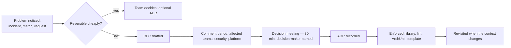
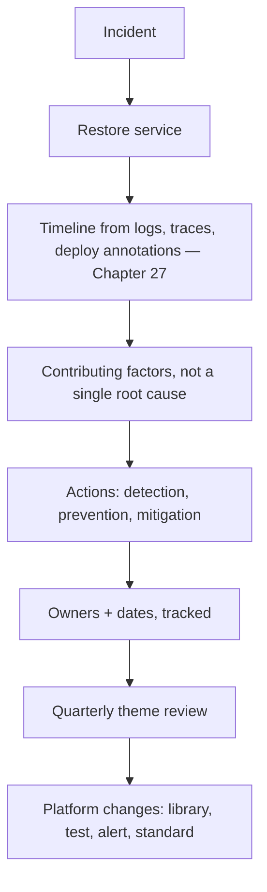
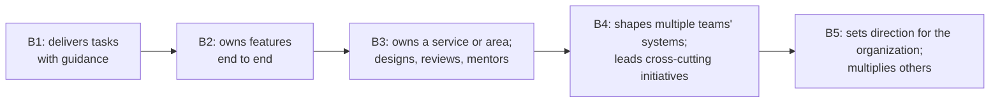
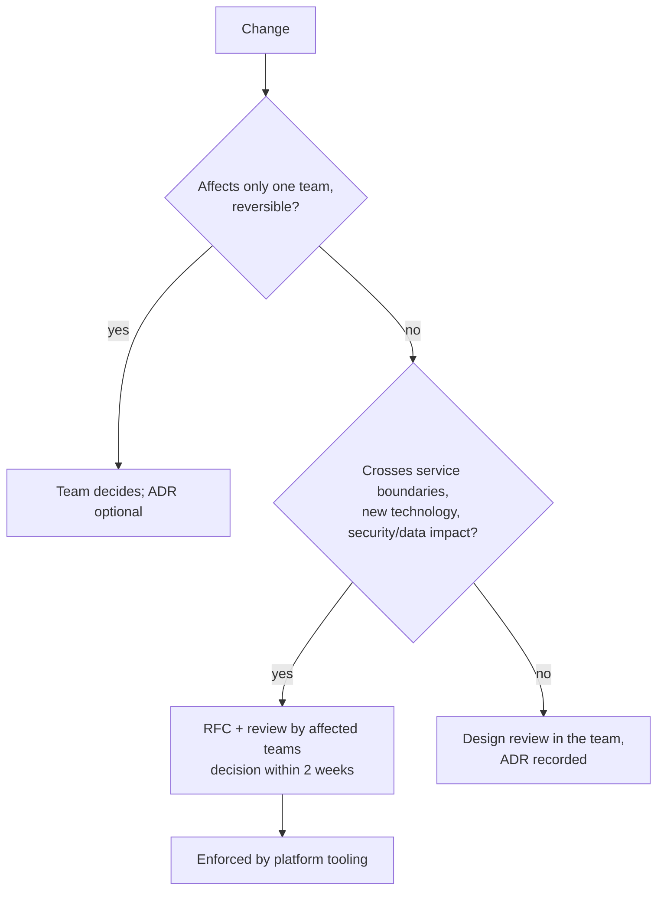

# 43 · Engineering Leadership for Senior Spring Engineers

## 1. Introduction & Why It Matters

At some point in a career — usually between eight and fifteen years — the highest-leverage work stops being the code you write. It becomes the decisions you shape, the standards you set, the incidents you prevent, the engineers you grow and the organization's ability to change safely.

Everything in the previous forty-two chapters depends on this:

- Platform libraries (Chapter 41) exist only if someone argues for them, funds them and keeps them owned.
- SLOs (Chapter 27) mean something only if product and engineering agree on them.
- Upgrade cadence (Chapter 42) survives only if it's budgeted before it's urgent.
- Boundaries (Chapters 35, 37) hold only if review culture enforces them.
- Security (Chapter 39) works only if engineers threat model without being told to.

None of these is a technical problem. Each is a technical decision that needs **alignment, persistence and communication** to happen.

This chapter covers the leadership toolkit for a senior, staff or principal engineer in a Spring-based organization: technical strategy, decision records and RFCs, architecture governance that doesn't become bureaucracy, technical debt as a managed portfolio, code review and mentoring, incident leadership and blameless reviews, measuring delivery with DORA metrics, hiring with this handbook's interview bank, cost awareness, and influencing without authority. In keeping with the handbook, it uses concrete artifacts — templates, scripts, checklists — rather than exhortation.

### Who should read which section

| Band | Focus |
|---|---|
| B1 · 0–2 yrs | Parts 1, 2 — how decisions get made; how to grow |
| B2 · 2–5 yrs | Parts 2, 4, 5 — reviews, ADRs, writing well |
| B3 · 5–8 yrs | Parts 5, 6 — leading projects, incidents, mentoring |
| B4 · 8–12 yrs | Parts 6, 8 — strategy, governance, metrics |
| B5 · 12–15+ yrs | Parts 8, 9 — organizational leverage |

---

## 2. Core Concepts

### 2.1 Where senior leverage comes from

| Activity | Leverage |
|---|---|
| Writing a feature | 1× |
| Reviewing well | Raises the quality of many features |
| A platform library or starter | Every service, every future service |
| A decision record that prevents a bad decision | Avoided cost, rarely visible |
| Growing an engineer to the next band | Compounds for years |
| Setting a standard with enforcement | Durable across team changes |
| Leading an incident well | Faster recovery and lasting fixes |

The shift is from **doing the work** to **making the work go well**. It feels less productive and is usually more valuable.

### 2.2 Technical strategy

A strategy answers three questions in a few pages:

1. **Where are we?** Honest diagnosis — the fleet version dashboard (Chapter 42), incident themes, delivery metrics, cost.
2. **Where do we need to be, and why?** Tied to business outcomes, not technology preferences.
3. **What will we do, and not do?** A small number of bets with explicit trade-offs.

Example for the grocery platform:

| Diagnosis | Direction | Bets | Explicitly not doing |
|---|---|---|---|
| Checkout p99 regressions every sale; 6 synchronous hops | Short synchronous paths, events elsewhere | Outbox everywhere; saga for checkout; latency budgets | Rewriting services in another language |
| Upgrades take a quarter | Continuous upgrades | Platform-first, Renovate, readiness scorecard | Freezing on Boot 3 "for stability" |
| Tenant leak near-miss | Isolation proven by tests | RLS + leak suite in every build | Database-per-tenant for everyone |

### 2.3 Decision-making instruments

| Instrument | Use | Size |
|---|---|---|
| **ADR** (Architecture Decision Record) | Record a decision and its reasons | 1 page |
| **RFC** (Request for Comments) | Propose a significant change and gather input | 2–6 pages |
| Design review | Examine a design before building | 30–60 min |
| Spike | Reduce uncertainty with code | Time-boxed days |
| Standards | Encode decisions that apply broadly | Enforced by tooling |

Decisions reversible in a day don't need an RFC. Decisions that constrain 26 services for years do.

### 2.4 Technical debt as a portfolio

| Type | Example | Response |
|---|---|---|
| **Deliberate, prudent** | "Ship with a polling relay, move to CDC at 10k events/s" | Record in an ADR with a trigger |
| **Accidental** | A god aggregate discovered later | Refactor when touching the area |
| **Environmental** | Unsupported Boot version | Scheduled (Chapter 42) |
| **Reckless** | No tests on payment code | Fix now; it's a risk, not debt |

Debt is managed like a financial portfolio: **named, sized, owned, and paid down according to interest rate** — the debt slowing every change is paid before the debt nobody touches.

### 2.5 Measuring delivery: DORA

| Metric | Measures | Good sign |
|---|---|---|
| **Deployment frequency** | How often you ship | On demand, many per day across the fleet |
| **Lead time for changes** | Commit to production | Hours to a day |
| **Change failure rate** | Deploys causing incidents or rollbacks | Low, and falling |
| **Time to restore service** | Incident to recovery | Under an hour |

These measure **the system**, not individuals. Using them to rank engineers destroys their usefulness within a quarter.

### 2.6 Incidents and learning

| Principle | Practice |
|---|---|
| Restore first, understand second | Rollback by digest (Chapter 29) before root-cause analysis |
| Clear roles | Incident commander, communications, operations — not everyone debugging |
| Blameless review | "What made this possible?" not "who did this?" |
| Actions with owners and dates | Tracked like features |
| Themes over incidents | Quarterly review of recurring causes |

### 2.7 Influence without authority

Staff and principal engineers rarely manage the people whose decisions they shape. Influence comes from:

| Source | How |
|---|---|
| **Credibility** | Being right, visibly, over time — and admitting when you weren't |
| **Clarity** | Writing that makes the decision easy |
| **Data** | Dashboards, incident themes, cost reports |
| **Relationships** | Understanding what each team is trying to achieve |
| **Making the right thing easy** | Platform libraries, templates, tooling |
| **Patience** | Standards adopted gradually beat mandates resisted |

The last two matter most. An engineer who builds the starter that makes the secure path the easy path (Chapter 41) has more influence than any architecture board.

---

## 3. How It Works Internally

### 3.1 How a decision flows



The step organizations skip is **H**: a decision without enforcement is a suggestion, and suggestions erode with the first deadline (Chapters 28, 37).

### 3.2 From incident to systemic fix



A single incident produces local fixes; a **pattern** of incidents produces platform changes. The quarterly theme review is where the second happens.

### 3.3 How engineers grow through the bands



The handbook's band tables map to these expectations: each chapter's B1–B5 questions describe what an engineer at that level should be able to reason about.

---

## 4. Hands-On — Level 1 (Beginner): Artifacts Everyone Uses

### 4.1 An ADR template

```markdown title="docs/adr/0023-outbox-polling-before-cdc.md"
# ADR-0023: Use a polling outbox relay before adopting CDC

- Status: Accepted
- Date: 2026-03-12
- Deciders: Platform team, order/payment tech leads
- Supersedes: —
- Related: Chapter 36, RFC-0011

## Context
Services publish events after committing, losing events during broker outages
(incident INC-2031). We need atomic publish with at-least-once delivery.

## Decision
Every publishing service writes to an `outbox` table in the business transaction.
A polling relay (`SELECT … FOR UPDATE SKIP LOCKED`, 300 ms) publishes to Kafka.

## Alternatives considered
- Debezium CDC — lower latency, but adds Kafka Connect and replication-slot risk
  (WAL growth) that we are not yet staffed to operate.
- Publish after commit with retries — does not solve the dual write.

## Consequences
- + No lost events; simple to operate.
- − ~300 ms added latency; extra load on the primary.
- Revisit when any service exceeds 2,000 events/s or needs < 100 ms latency.   ← the trigger
```

The **revisit trigger** turns a decision into a deliberate, bounded piece of debt rather than an accident waiting to be rediscovered.

### 4.2 A code review checklist

| Area | Question |
|---|---|
| Correctness | Does it do what the ticket says, including edge cases? |
| Tests | Would a test fail if the logic were wrong? Boundary cases? |
| Boundaries | Does it respect module/service ownership? (Chapters 35, 37) |
| Transactions | Remote calls inside transactions? Right propagation? (Chapter 16) |
| Security | Ownership checks, validation, no PII in logs? (Chapters 17, 39) |
| Failure | Timeouts, idempotency, what happens on retry? (Chapters 19, 26) |
| Observability | Would we know if this broke? (Chapter 27) |
| Compatibility | API/event/schema changes additive? (Chapters 14, 20, 23) |
| Operability | Config, flags, runbook impact? |
| Simplicity | Is there a simpler way that meets the need? |

### 4.3 How to give review feedback

| Label | Meaning |
|---|---|
| **blocking:** | Must change before merge (correctness, security, data loss) |
| **suggestion:** | Better, but the author decides |
| **question:** | I don't understand — explain or clarify in code |
| **nit:** | Trivial; ignore if you disagree |
| **praise:** | Something done well — say it |

```text title="Example"
blocking: this calls pricing-service inside @Transactional — a slow pricing call holds
a DB connection for its full duration (Chapter 16). Could we fetch prices before
opening the transaction?

suggestion: an @EntityGraph here would avoid the N+1 on lines (Chapter 13).

praise: the idempotency test for duplicate events is exactly right.
```

Labels remove ambiguity about what matters, and explicit praise makes the critical comments easier to receive.

---

## 5. Hands-On — Level 2 (Intermediate) & Level 3 (Advanced)

### 5.1 Level 2 — An RFC that gets decided

```markdown title="docs/rfc/0014-tenant-isolation-with-rls.md"
# RFC-0014: Enforce tenant isolation with PostgreSQL RLS

Author: … | Reviewers: platform, security, order, catalog | Decision by: 2026-05-20
Decision-maker: Head of Platform Engineering

## Summary (5 lines)
Add row-level security to all tenant-scoped tables as a second enforcement layer
behind Hibernate @TenantId, plus an automated leak suite in every build.

## Problem
Near-miss INC-2207: a native export query bypassed tenant filtering.
Application-level filtering alone depends on every developer remembering.

## Proposal
(what changes, for whom, in what order — Chapter 38)

## Cost
~2 engineer-weeks platform, ~1 day per service; ~1–3% query overhead (measured).

## Risks and mitigations
Pooled connections leaking tenant settings → transaction-local settings + test.

## Alternatives
Database per tenant — rejected for cost at 400+ tenants.

## Rollout
Platform starter → 2 pilot services → remaining services over 6 weeks.

## Open questions
1. …
```

What makes RFCs get decided rather than debated forever:

| Practice | Why |
|---|---|
| A **decision date** and a **named decision-maker** | Prevents indefinite discussion |
| A five-line summary | Most readers read only this |
| Cost and alternatives stated honestly | Reviewers trust a proposal that admits trade-offs |
| Explicit open questions | Focuses comments where they're useful |
| Link to data | Incidents, metrics, measurements |

### 5.2 Level 2 — A technical debt register

```yaml title="platform/debt-register.yaml"
- id: DEBT-031
  title: order-service uses RestTemplate with no read timeout for inventory
  area: order-service
  type: accidental
  interest: high          # slows every change + incident risk (Chapter 19)
  principal: 2 days
  owner: checkout-team
  trigger: next change to inventory integration, or by 2026-06-30
  links: [INC-2144]

- id: DEBT-044
  title: polling outbox relay (ADR-0023)
  type: deliberate
  interest: low
  principal: 3 weeks
  owner: platform
  trigger: any service > 2,000 events/s
```

| Field | Why it matters |
|---|---|
| **Interest** | How much it costs *now* — prioritize by this, not by size |
| **Principal** | Effort to fix — enables "small high-interest items first" |
| **Owner** | Unowned debt is permanent |
| **Trigger** | When it must be paid, decided in advance |

Review the register monthly; 15–20% of each team's capacity on high-interest items is a sustainable rate that keeps the codebase changeable.

### 5.3 Level 2 — Measuring DORA from your pipeline

```python title="scripts/dora.py (sketch)"
# Inputs: deploy events (digest, service, time), commit timestamps, incident records
def lead_time(deploy, commits):
    return deploy.time - min(c.time for c in commits if c.sha in deploy.shas)     # (1)

def change_failure_rate(deploys, incidents):
    failed = {i.caused_by_deploy for i in incidents if i.caused_by_deploy}
    return len(failed) / max(len(deploys), 1)                                       # (2)

def time_to_restore(incidents):
    return median(i.resolved_at - i.detected_at for i in incidents)                 # (3)
```

1. From the earliest commit in the release to production — measures the whole pipeline, including review and queue time.
2. Requires incidents to record the deploy that caused them — a small discipline with a large payoff.
3. Median, not mean; one long incident shouldn't hide steady improvement.

Publish per **service and team** as trends, discussed in retrospectives. Never per engineer.

### 5.4 Level 3 — Leading an incident

```markdown title="runbooks/incident-roles.md"
## Incident commander (IC)
- Declares severity, owns decisions, keeps the timeline
- Does NOT debug — coordinates those who do
- Asks every 15 min: what do we know, what are we trying, what's next?

## Communications lead
- Updates status page and stakeholders on a fixed cadence (every 30 min for SEV-1)
- Shields responders from questions

## Operations lead(s)
- Investigate and mitigate; report findings to the IC

## First actions (SEV-1)
1. Did anything change? (deploy annotations — Chapter 27) → roll back by digest
2. Degrade before fixing: circuit breakers, feature flags, load shedding (Chapter 26)
3. Contain business impact: freeze payouts, disable a feature (Chapter 39)
```

The instinct of a senior engineer is to debug. During a SEV-1, the more valuable contribution is often to **stop debugging and coordinate**: one IC who keeps the team from five parallel theories is worth more than a sixth debugger.

### 5.5 Level 3 — A blameless post-incident review

```markdown title="postmortems/INC-2207.md"
# INC-2207: Tenant export returned rows from another tenant (near-miss)

Severity: SEV-2 (caught in staging) | Duration: n/a | Author: … | Reviewed: 2026-04-18

## Summary
A native SQL export bypassed Hibernate tenant filtering. Caught by a QA engineer
comparing row counts before release.

## Timeline (IST)
- 10:42 export feature merged
- 14:15 QA notices 2× expected rows
- 14:40 feature flag disabled; release held

## Contributing factors
1. Native query outside Hibernate's @TenantId filter (known limitation — Chapter 38).
2. RLS enabled on only 4 of 31 tables.
3. No automated test for native queries across tenants.
4. Review checklist did not mention tenant scoping for native SQL.

## What went well
QA's row-count sanity check. Feature flag allowed instant disable.

## Actions
| Action | Owner | Due |
|---|---|---|
| RLS on all tenant-scoped tables (RFC-0014) | platform | 2026-06-01 |
| Leak suite incl. native queries in every build | platform | 2026-05-15 |
| Review checklist: tenant scoping item | architecture | 2026-04-25 |
| Audit all native queries | each team | 2026-05-01 |
```

Note what isn't there: **no names attached to mistakes**. The factors are systemic — a known limitation without a second layer, a missing test, a checklist gap. Fixing those prevents the next team from making the same mistake; blaming one engineer prevents only honest reporting.

### 5.6 Level 3 — Mentoring with structure

```markdown title="growth-plans/engineer-b2-to-b3.md"
## Current: B2 (owns features end to end)
## Target: B3 (owns a service; designs; mentors) — 9–12 months

| Capability | Evidence today | Next step | Chapter |
|---|---|---|---|
| Design | Implements designs well | Write the design for the refund saga | 36 |
| Operations | Fixes bugs in own code | Be secondary on-call; lead one post-incident review | 27, 43 |
| Performance | — | Run and interpret a profile during the next load test | 34 |
| Review | Reviews peers' PRs | Review a cross-team RFC with written feedback | 43 |
| Mentoring | — | Pair weekly with the new B1 on the cart service | — |

Check-in: fortnightly, 30 min. Evidence collected in a shared doc.
```

The handbook's band tables and interview questions double as a **growth curriculum**: "can reason about the B3 questions in Chapters 16, 26 and 36" is a concrete, discussable target rather than a vague aspiration.

---

## 6. Hands-On — Level 4 (Expert / Production): Organizational Leverage

### 6.1 Lightweight architecture governance



| Principle | Implementation |
|---|---|
| Most decisions stay in teams | Autonomy with clear boundaries |
| Cross-cutting decisions are visible | RFCs in a shared repository |
| Decisions have deadlines | No RFC open longer than two weeks without a decision |
| Standards are enforced by tools, not meetings | Platform starters, ArchUnit, CI gates (Chapters 28, 41) |
| Exceptions are allowed, recorded and time-bound | ADR with a revisit date |

An architecture board that reviews every change becomes the bottleneck it was meant to prevent. The goal is **paved roads** — the easy path is the right path — plus a lightweight process for leaving the road deliberately.

### 6.2 Service scorecards

```yaml title="Generated from the service catalog (Chapter 35) + CI + dashboards"
service: order-service
owner: checkout
tier: 1
scores:
  slos_defined: ✅
  runbook: ✅
  on_call: ✅
  boot_version: 3.5.6 (target 4.0 — wave 3)          # Chapter 42
  platform_bom: 3.4.0 ✅
  deprecations: 0 ✅
  contract_tests: ✅                                    # Chapter 28
  golden_file_tests: ✅
  leak_suite: ✅                                        # Chapter 38
  image_age_days: 6 ✅                                  # Chapter 29
  critical_cves: 0 ✅                                   # Chapter 39
  dora:
    deploys_per_week: 14
    lead_time_p50: 5h
    change_failure_rate: 4%
    time_to_restore_p50: 22m
```

Scorecards turn the handbook's standards into something **visible and comparable**. Teams improve what they can see; leaders find where to help. Used as a map for support, they work. Used as a stick, they get gamed.

### 6.3 Hiring with the interview bank

The B1–B5 questions throughout this handbook (and Appendix A) support structured interviews:

| Stage | Design |
|---|---|
| Screening | 3–4 B1/B2 questions from different chapters; pass/fail |
| Technical depth | One domain (data, messaging, security) to B3/B4 depth, following the candidate's answers |
| System design | A grocery-domain scenario (checkout under partial failure, tenant isolation, a Diwali sale) |
| Code | A small exercise from Appendix B, reviewed together |
| Leadership (B4+) | An RFC to critique; an incident to lead verbally; a disagreement to navigate |

```markdown title="Interview rubric — system design (B4)"
| Dimension | 1 (weak) | 3 (meets) | 5 (strong) |
|---|---|---|---|
| Requirements | Jumps to technology | Clarifies scale, consistency, SLOs | Identifies the business trade-off first |
| Failure | Ignores it | Timeouts, retries, idempotency | Degradation per dependency, reconciliation |
| Data | One database for all | Ownership per service | Consistency model justified per flow |
| Trade-offs | States a choice | Compares two options | Explains when they'd change their mind |
| Communication | Monologue | Structured | Checks understanding, adapts |
```

Structured rubrics, calibrated across interviewers, reduce the variance that makes hiring feel random — and they're fairer to candidates.

### 6.4 Cost as an engineering concern

| Lever | Chapter |
|---|---|
| Right-sized requests, fewer idle pods | 30 |
| Startup time and CDS/AOT enabling faster scale-down | 29 |
| Caching and query fixes before bigger databases | 12, 21, 34 |
| Log volume and retention tiers | 07, 27 |
| Metric cardinality | 27 |
| AI token budgets and model routing | 40 |
| Deleting unused services, topics and environments | 35 |

```text title="A monthly cost review, one page"
Top 5 cost drivers by service           (from cloud billing tags)
Change vs last month, with explanation   ("search +18%: reindex experiment, ends 15th")
Cost per order                           (the business-normalized number)
Top 3 opportunities with estimated saving and owner
```

**Cost per order** (or per active user) is the metric that makes cost discussable with the business: absolute spend rising during growth is fine; cost per order rising is a problem.

### 6.5 Leading a platform-wide change

Taking RFC-0014 (tenant RLS) from idea to done across 26 services:

| Phase | Leadership work |
|---|---|
| Diagnose | Collect the near-miss, the native-query count, the risk in business terms |
| Propose | RFC with cost, alternatives and a measured overhead |
| Align | One-to-one conversations with affected tech leads **before** the RFC review |
| Make it easy | Ship it in the tenancy starter (Chapter 41) with a migration guide |
| Pilot | Two services, publish results |
| Scale | Scorecard column; office hours; pairing on tricky services |
| Enforce | Leak suite required by CI for tier-1 services |
| Close | Retrospective; update standards; celebrate the teams |

The pre-alignment step is the one most engineers skip. A formal review where stakeholders see the proposal for the first time invites defensive objections; the same review after individual conversations is usually a formality.

### 6.6 Writing as a leadership skill

| Principle | Example |
|---|---|
| Lead with the conclusion | "We should adopt RLS. Here's why." — not three pages of background first |
| One idea per paragraph | Reviewers can respond precisely |
| Numbers over adjectives | "p99 2.4 s → 380 ms" not "much faster" |
| State trade-offs honestly | Credibility comes from admitting costs |
| Make the ask explicit | "Decision needed by the 20th from X" |
| Cut ruthlessly | A one-page ADR gets read; a twelve-page one gets skimmed |

Most senior engineering influence is exercised in writing — RFCs, ADRs, reviews, incident summaries, strategy docs. Improving writing is among the highest-return investments at B4 and B5.

---

## 7. Spring Boot 3 vs 4 — Leading the Upgrade

Chapter 42 covered the mechanics; leadership covers everything around them:

| Concern | Leadership action |
|---|---|
| Why now? | Frame in business terms: support window, CVE exposure, performance gains |
| Who pays? | Secure a quarterly allocation rather than a one-off project |
| Who goes first? | Platform team, then a volunteer pilot team with visible support |
| What's the plan? | Waves, freeze windows, scorecard — published and visible |
| How do teams know what to do? | Migration guide, office hours, a Slack channel, pairing |
| How do we know it's working? | Fleet dashboard, regression tracking |
| When is it done? | Old BOM retired, shims removed, retrospective held |

A well-led upgrade programme feels boring to the teams doing it. That's the goal.

---

## 8. Production Playbook

### Best practices

1. **Write decisions down** — ADRs with alternatives, consequences and revisit triggers.
2. **Give RFCs a deadline and a decision-maker.**
3. **Enforce standards with tools**, not meetings.
4. **Manage debt as a portfolio**: interest, principal, owner, trigger.
5. **Review with labels and praise**; distinguish blocking from preference.
6. **Run incidents with roles**; restore first; review blamelessly with tracked actions.
7. **Measure the system with DORA**, never individuals.
8. **Grow engineers deliberately** with evidence-based plans tied to the bands.
9. **Hire with structured rubrics** and calibrated interviewers.
10. **Make the right thing easy** — paved roads beat mandates.

### Anti-patterns

❌ Decisions made in meetings and never recorded.

❌ RFCs open for months.

❌ An architecture board that reviews everything.

❌ Standards nobody enforces.

❌ "Tech debt sprints" instead of continuous paydown.

❌ Blame in post-incident reviews.

❌ DORA metrics used to rank engineers.

❌ The senior engineer debugging during a SEV-1 while nobody coordinates.

❌ Mentoring by osmosis only.

❌ Unstructured interviews decided by gut feel.

### Troubleshooting

| Symptom | Likely cause | Response |
|---|---|---|
| Same incident class recurring | Local fixes only | Quarterly theme review → platform change |
| Decisions relitigated repeatedly | Not recorded | ADRs with context and alternatives |
| Teams bypass standards | Standards are hard to follow | Build the paved road (starter, template) |
| Upgrades always slip | No budget, no cadence | Quarterly allocation; scorecard visibility |
| Review is a bottleneck | Few reviewers, no labels | Spread review; label feedback; smaller PRs |
| Senior engineers burn out | Doing instead of multiplying | Delegate, mentor, build tooling |
| Metrics gamed | Used for evaluation | Use for learning; discuss trends, not targets |
| Good people leave | No growth path visible | Growth plans tied to bands |

### Leadership checklist

- [ ] Technical strategy written, current, and linked to business outcomes
- [ ] ADR and RFC repositories with templates and deadlines
- [ ] Standards enforced by platform libraries and CI
- [ ] Debt register reviewed monthly with owners and triggers
- [ ] Incident roles defined; blameless reviews with tracked actions
- [ ] DORA metrics per service/team, discussed as trends
- [ ] Service scorecards generated from the catalog
- [ ] Growth plans for every engineer, reviewed regularly
- [ ] Structured interview rubrics, calibrated
- [ ] Monthly cost review with cost per order

---

## 9. Interview Questions & Answers

### B1 · 0–2 years

??? question "B1 · What is an ADR and why write one?"
    **Short answer:** A short record of a decision, its context, the alternatives considered and the consequences. It prevents relitigating decisions and lets future engineers understand *why*, not just *what*.

??? question "B1 · How should you respond to critical review feedback?"
    **Short answer:** Assume good intent, ask questions where unclear, fix blocking issues, and discuss preferences openly. Review is about the code, not you.

??? question "B1 · What does "blameless" mean in a post-incident review?"
    **Short answer:** Focusing on the conditions that made the failure possible rather than on who made the mistake — so people report honestly and fixes address systems.

??? question "B1 · How do you grow from B1 to B2?"
    **Short answer:** Take ownership of features end to end — design notes, tests, deployment, monitoring and follow-up — and ask for feedback on the parts you haven't done before.

### B2 · 2–5 years

??? question "B2 · How do you give useful code review feedback?"
    **Short answer:** Prioritize correctness, security and failure handling; label comments as blocking, suggestion, question or nit; explain the reason; offer an alternative; and call out what's done well.

??? question "B2 · When should a decision get an RFC?"
    **Short answer:** When it's hard to reverse, affects multiple teams, introduces new technology, or has security or data implications. Reversible, team-local decisions don't need one.

??? question "B2 · What are the DORA metrics?"
    **Short answer:** Deployment frequency, lead time for changes, change failure rate, and time to restore service — measures of delivery performance for the system, not individuals.

??? question "B2 · How do you handle technical debt in a feature team?"
    **Short answer:** Record it with interest, principal, owner and trigger; pay down high-interest items continuously as part of normal work; and fix reckless debt (missing tests on critical paths) immediately rather than scheduling it.

??? question "B2 · How do you write a design document that gets useful feedback?"
    **Short answer:** Lead with the problem and the proposed decision in a few lines, state the alternatives and trade-offs honestly, list explicit open questions, name the reviewers and a deadline, and keep it short enough to be read in one sitting.

### B3 · 5–8 years

??? question "B3 · How do you lead a SEV-1 incident?"
    **Short answer:** Declare roles (IC, comms, ops), restore first — roll back or degrade — keep a timeline, give updates on a cadence, avoid parallel uncoordinated debugging, and schedule a blameless review with tracked actions afterwards.

??? question "B3 · How do you mentor an engineer effectively?"
    **Short answer:** Agree a target level and concrete capabilities, give stretch assignments with support, collect evidence, give specific feedback regularly, and create opportunities for visible work — not just answer questions when asked.

??? question "B3 · How do you get an RFC decided rather than debated?"
    **Short answer:** A short summary, honest costs and alternatives, data, explicit open questions, a named decision-maker, a deadline, and one-to-one conversations with key stakeholders before the formal review.

??? question "B3 · What makes a good post-incident action item?"
    **Short answer:** Specific, owned, dated, and aimed at detection, prevention or mitigation of the contributing factors — ideally changing a system (a test, an alert, a library default) rather than asking people to be more careful.

### B4 · 8–12 years

??? question "B4 · How do you set technical direction for several teams?"
    **Short answer:** Write a short strategy grounded in an honest diagnosis and business outcomes, make a few explicit bets and say what you won't do, align stakeholders individually, make the direction easy to follow through platform tooling, and measure progress visibly.

??? question "B4 · How do you govern architecture without becoming a bottleneck?"
    **Short answer:** Keep most decisions in teams; use RFCs only for cross-cutting or irreversible changes with deadlines; enforce standards through libraries and CI; allow recorded, time-boxed exceptions.

??? question "B4 · How do you use metrics without them being gamed?"
    **Short answer:** Measure systems, not individuals; discuss trends in retrospectives rather than setting targets; pair each metric with its counter-metric (deploy frequency with change failure rate); and use them to decide where to help.

??? question "B4 · How do you make a case for platform investment?"
    **Short answer:** Quantify the current cost — duplicated effort, incident themes, upgrade duration, security exposure — show the platform's expected reduction, propose a pilot with measurable results, and report back.

### B5 · 12–15+ years

??? question "B5 · What distinguishes a principal engineer's impact?"
    **Short answer:** Multiplying others: setting direction that many teams follow willingly, building leverage (platforms, standards, people), preventing expensive mistakes before they happen, and raising the organization's ability to change safely — impact measured across the organization over years, not in personal output.

??? question "B5 · How do you handle a strong disagreement with another senior leader?"
    **Short answer:** Understand their goals and constraints first, find shared outcomes, bring data, separate reversible from irreversible choices (and experiment on the reversible ones), escalate only with a clearly framed decision, and commit fully once it's made.

??? question "B5 · How do you know your engineering organization is healthy?"
    **Short answer:** Delivery metrics improving, incidents less frequent and shorter, upgrades routine, standards adopted willingly, engineers growing and staying, cost per unit of business value stable or falling, and people raising concerns early without fear.

### Scenario questions

??? example "Scenario · Every team has its own error format; the mobile team is frustrated"
    Diagnosis: no enforced standard, and building one per service was easier than finding a shared one. Response: write the ADR (Chapter 10's problem format), build it into the web starter (Chapter 41) so adopting it is one dependency, pilot with two teams, add a scorecard column and a contract test, then set a date for tier-1 services — making the standard the easy path rather than a mandate.

??? example "Scenario · The same kind of outage happened three times this year"
    Each post-incident review produced local fixes. Response: a theme review across the three, identifying the systemic factor (synchronous calls without timeouts), then a platform change — default timeouts in the client starter, a CI check for clients without them, and a resilience section in the review checklist — followed by verification in a game day.

### Exercise

!!! example "Exercise · Your first 90 days as staff engineer for the checkout domain"
    Plan the first 90 days: what you'll learn, what artifacts you'll produce, which relationships you'll build, and how you'll measure whether you're having impact.

??? success "Solution"
    | Days | Focus | Artifacts |
    |---|---|---|
    | 1–30 | **Listen and learn** | Read ADRs, incidents from the last year, service scorecards; 1:1s with every tech lead and product manager; shadow on-call |
    | 31–60 | **Diagnose and propose** | A two-page diagnosis (checkout p99, synchronous depth, incident themes, upgrade status); one or two RFCs; the debt register for the domain |
    | 61–90 | **Deliver a visible win and set direction** | Ship one high-leverage improvement (e.g. saga state visibility, Chapter 36); a short domain strategy; growth plans with two engineers |

    **Relationships**: tech leads (trust), product (business priorities), SRE/on-call (pain points), security (risk), platform (leverage).

    **Measures of impact at day 90**:
    - A decision that would otherwise have gone badly, improved or prevented (recorded in an ADR).
    - One measurable improvement (p99, change failure rate, incident count, upgrade progress).
    - Teams asking for your input on designs before, not after, building.
    - At least one engineer visibly growing with your support.

    What to avoid: arriving with a rewrite proposal in week two, before understanding why the system is the way it is. The first month's job is to learn which problems are real — and to earn the credibility to fix them.

---

## Key Takeaways

- Senior leverage comes from **decisions, standards, platforms and people**, not personal output.
- **Write decisions down** (ADRs), **decide on deadlines** (RFCs), and **enforce with tools**.
- **Debt is a portfolio** managed by interest rate, with owners and triggers.
- **Incidents are led with roles**, restored first, and reviewed blamelessly with systemic actions.
- **DORA metrics measure the system** — use them to learn and to help, never to rank.
- **Grow engineers deliberately**; the band tables in this handbook are a curriculum.
- **Make the right thing easy**: paved roads beat mandates.
- **Writing is a core leadership skill** — most influence happens in documents.

## Further Reading

- *Staff Engineer* (Will Larson) and *The Staff Engineer's Path* (Tanya Reilly)
- *Accelerate* (Forsgren, Humble, Kim) — DORA research and delivery performance
- Google SRE Book — *Postmortem Culture*, *Managing Incidents*
- Michael Nygard, "Documenting Architecture Decisions" — the original ADR format

---

[:material-arrow-left: 42 Migration & Upgrade Engineering](42-migration-upgrade.md) · [44 Capstone: The Grocery Platform :material-arrow-right:](44-capstone-grocery-marketplace.md)
