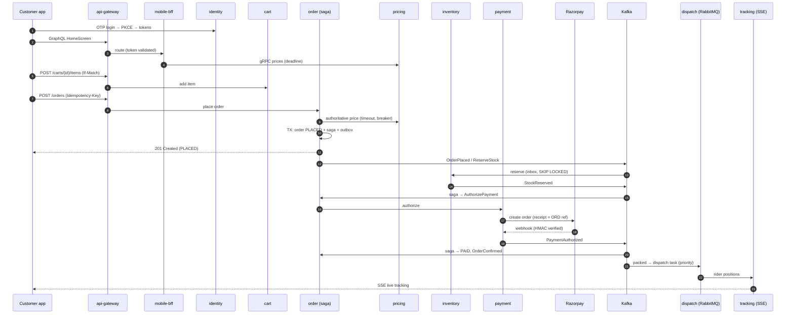
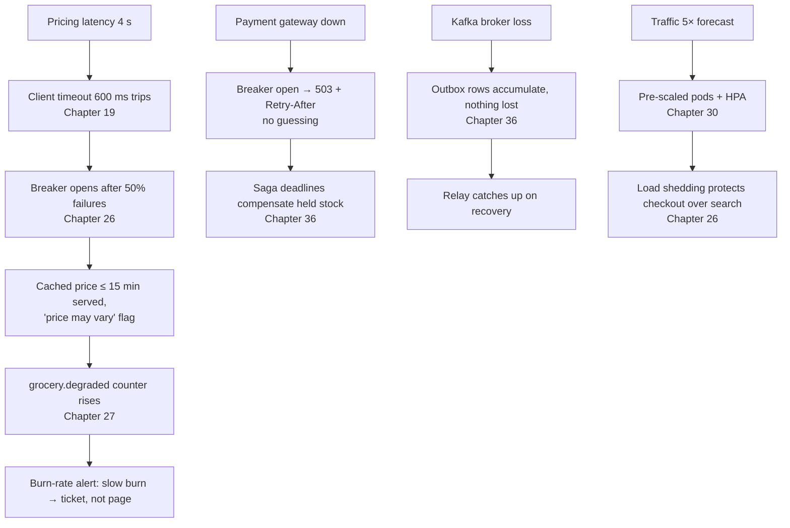
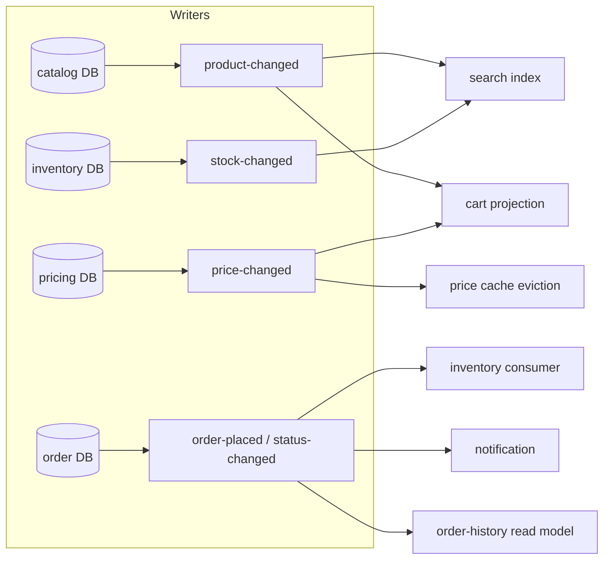

# 44 · Capstone — The Grocery Marketplace

## 1. Introduction & Why It Matters

Forty-three chapters taught one concern at a time: configuration, transactions, Kafka, resilience, tenancy, security. Real systems don't arrive one concern at a time. A single tap on "Place order" in the grocery app touches authentication, validation, pricing, caching, a database transaction, an outbox, a saga, three services over HTTP and Kafka, a payment gateway, observability, and — on a bad evening — circuit breakers and degradation paths.

This capstone does two things:

1. **Assembles the platform.** It walks one order from a customer's phone to a rider's doorstep and back to a seller's settlement, naming at every step which chapter's pattern is doing the work and why. If you understand this walkthrough, you understand how the handbook fits together.
2. **Gives you a project.** A staged build of a scaled-down version of the platform — four services, then eight — with milestones and acceptance criteria for each band (B1–B5). Built honestly, it is the best preparation for senior interviews there is, because every design question has a concrete answer you've implemented and tested.

It closes with a **production readiness review** — the checklist a principal engineer walks through before a platform like this handles a Diwali sale — and a set of system-design interview questions answered from the architecture itself.

### How to use this chapter

| Reader | Path |
|---|---|
| Learning the stack | Read §3's walkthrough, then build milestones M1–M3 |
| Preparing for B3/B4 interviews | Build M1–M6; answer §9 using your own implementation |
| Leading a team | Use §6.4's readiness review against your own system |
| Onboarding engineers | Assign the milestones as a structured onboarding track |

---

## 2. Core Concepts — The Platform at a Glance

### 2.1 Services and ownership

| Capability | Services | Owns | Key chapters |
|---|---|---|---|
| Edge | api-gateway, mobile-bff | Nothing (routing, composition) | 32, 35 |
| Identity | identity-service | Customers' credentials, tokens | 17, 18 |
| Catalog | catalog, search-indexer, catalog-feed | Products, index, feeds | 13, 22, 33 |
| Pricing | pricing-service | Prices, promotions | 21, 32 |
| Purchase | cart, order, payment | Carts, orders, payments | 16, 36, 37 |
| Fulfilment | inventory, delivery, dispatch, tracking | Stock, slots, assignments, positions | 24, 31 |
| Seller | seller-portal (modular monolith), settlement | Sellers, payouts | 33, 37 |
| Platform | notification, reporting | Messages, reports | 23, 25 |

Twenty-six deployables in production; the capstone project builds a representative subset.

### 2.2 Architecture decisions, consolidated

| Decision | Choice | Chapter |
|---|---|---|
| Framework baseline | Spring Boot 3.5 → 4.x, Java 25 | 01, 42 |
| Code structure | Hexagonal for core domains; pragmatic layering elsewhere | 37 |
| Synchronous APIs | REST with problem details; GraphQL BFF; gRPC for pricing | 08–10, 20, 32 |
| Asynchronous | Kafka with outbox + inbox; RabbitMQ for dispatch | 23, 24, 36 |
| Data | PostgreSQL per service; Redis; OpenSearch; pgvector | 12–14, 21, 22, 40 |
| Consistency | Local ACID; sagas across services; reconciliation | 16, 36 |
| Identity | OTP + PKCE for customers; OIDC + passkeys for staff; client credentials between services | 17, 18 |
| Resilience | Timeouts, breakers, bulkheads, degradation per dependency | 19, 26 |
| Concurrency | MVC + virtual threads; WebFlux only for streaming | 25, 31 |
| Observability | Micrometer, OTLP, SLOs with burn-rate alerts | 07, 27 |
| Delivery | Layered signed images, digest promotion, canary on SLOs | 29, 30 |
| Tenancy | Shared schema + RLS; dedicated DBs for large tenants | 38 |
| Platform | Eight starters, one BOM | 41 |

### 2.3 Non-functional targets

| Target | Value |
|---|---|
| Checkout availability | 99.5% / 30 days |
| Checkout latency | p99 < 2 s |
| Product page | p95 < 300 ms |
| Peak load | 3,000 orders/min (Diwali forecast), 5× normal |
| Order events freshness | 99.9% relayed within 60 s |
| Search freshness | Index lag < 2 s p95 |
| Recovery | Rollback < 2 min; RTO 30 min, RPO 5 min for order data |
| Security | No PAN stored; PII field-encrypted; tenant leak suite green |

---

## 3. How It Works — One Order, End to End

### 3.1 The journey



### 3.2 The same journey, chapter by chapter

| Step | What happens | Pattern | Chapter |
|---|---|---|---|
| 1 | OTP login, authorization code with PKCE, rotating refresh token | Custom `AuthenticationProvider`, Spring Authorization Server | 17, 18 |
| 2 | Home screen in one GraphQL query | BFF, `@BatchMapping`, partial failure | 32 |
| 3 | Prices over gRPC with a 600 ms deadline | Deadlines, status mapping | 32 |
| 4 | Add to cart with `If-Match` | Strong ETags, optimistic concurrency | 08, 16 |
| 5 | Validation of pincode and quantity | `@Pincode`, bean validation, problem details | 09, 10 |
| 6 | Place order with an idempotency key | `@Idempotent` aspect | 04 |
| 7 | Authoritative pricing with timeout and breaker | `RestClient`, Resilience4j, cached-price degradation | 19, 21, 26 |
| 8 | One transaction: order + saga + outbox | `@Transactional`, `MANDATORY` outbox | 16, 36 |
| 9 | Response 201 with `Location`, status PLACED | Render from the write result | 08, 36 |
| 10 | Relay publishes, keyed by order ref | Outbox relay, `acks=all`, ordering | 23 |
| 11 | Inventory reserves idempotently | Inbox, `SKIP LOCKED`, conditional updates | 12, 23 |
| 12 | Saga advances with guarded transitions | Orchestration, deadlines, STUCK alert | 36 |
| 13 | Razorpay order with `receipt` as a natural key | Gateway adapter, no retry on capture | 19 |
| 14 | Webhook verified by HMAC over raw bytes, deduped | Webhook security | 18 |
| 15 | Order confirmed; events fan out | Consumer groups, DLT, retry topics | 23 |
| 16 | Dispatch task with priority and delayed retry | RabbitMQ quorum queues, TTL + DLX | 24 |
| 17 | Rider app receives the assignment | WebSocket + STOMP relay | 32 |
| 18 | Customer watches the rider | WebFlux SSE, drop-based backpressure | 31 |
| 19 | Search reflects the new stock | Indexer from events, alias-based index | 22 |
| 20 | Weekly settlement pays the seller | Spring Batch, partitioned, reconciled | 33 |
| 21 | Hourly drift check | Reconciliation in both directions | 36 |

Every row has a test in the chapter it references. That is the point of the architecture: **each concern is solved once, in one place, with evidence**.

### 3.3 The same journey on a bad evening



The system bends in predictable, measured ways. Nothing is lost; nothing is guessed; every degradation is visible.

### 3.4 Data flow and ownership



One writer per dataset; everyone else holds projections rebuilt from events (Chapters 35, 36). Display from projections, decide from the owner.

---

## 4. Level 1 Project — Milestones M1–M2 (B1/B2)

The capstone project builds a scaled-down platform. Each milestone is independently runnable and has acceptance criteria you can verify.

### M1 · Catalog service (one service, done properly)

**Scope**: products and categories, REST API, PostgreSQL, Flyway, validation, problem details.

```text title="Example"
catalog-service/
├── build.gradle.kts              ← BOM, toolchain 25, layered bootJar (Ch 01, 29)
├── src/main/java/in/grocery/catalog/
│   ├── web/ProductController.java           ← Ch 08
│   ├── delegate/ProductDelegate.java
│   ├── service/ProductService.java           ← Ch 16
│   ├── repository/ProductRepository.java     ← Ch 12, 13
│   └── config/…
├── src/main/resources/
│   ├── application.yml, application-prod.yml ← Ch 06
│   └── db/migration/V1__products.sql         ← Ch 14
└── src/test/java/…                            ← Ch 15
```

| Acceptance criterion | Chapter |
|---|---|
| `GET /api/v1/products?category=dairy&page=0&size=20` paginates with a stable envelope | 08, 20 |
| Invalid pincode/SKU returns RFC 9457 problem details with a `code` | 09, 10 |
| Money serialized as strings; golden-file test | 11 |
| Migrations via Flyway only; `ddl-auto=validate` | 14 |
| Slice tests for web and data; one Testcontainers test | 15 |
| JSON logs with request id | 07 |
| `/actuator/health/{liveness,readiness}` on port 9090 | 27, 30 |

### M2 · Cart and pricing, with caching and concurrency

**Scope**: cart-service and pricing-service, HTTP interface between them, Redis cache, ETags.

| Acceptance criterion | Chapter |
|---|---|
| Cart mutations require `If-Match`; stale versions get 412 | 08, 16 |
| Pricing called through an HTTP interface with 600 ms timeout | 19 |
| Prices cached in Redis with tenant-free keys (tenancy comes in M6) and jittered TTL | 21 |
| Cache failures fail open; test with Redis stopped | 21 |
| `Cart` is an aggregate with invariants (max 50 lines, 1–20 per line), unit-tested without Spring | 37 |
| Query-count test on cart reads (no N+1) | 13 |
| `@Idempotent` on the add-to-cart endpoint | 04 |

**Self-check (B2)**: can you explain why the cart shows a cached price but checkout must call pricing?

---

## 5. Level 2–3 Project — Milestones M3–M5 (B3)

### M3 · Orders with outbox and Kafka

**Scope**: order-service writing orders + outbox; inventory-service consuming with an inbox.

```java title="The heart of M3"
@Transactional
public Order place(PlaceOrderCommand command) {
    var lines = pricing.authoritativePrices(command.items(), command.pincode());   // outside? see criterion
    Order order = Order.place(OrderRef.next(), command.customerId(), command.pincode(), lines, fee);
    orders.save(order);
    outbox.append("order", order.ref().value(), "OrderPlaced", OrderPlacedEvent.from(order));
    return order;
}
```

| Acceptance criterion | Chapter |
|---|---|
| Pricing is fetched **before** the transaction opens | 16 |
| Order and outbox row commit atomically; failure test leaves neither | 36 |
| Relay publishes with `acks=all`, keyed by order ref | 23 |
| Inventory consumer is idempotent (duplicate-delivery test) | 23 |
| Poison pill goes to DLT; DLT monitor increments a metric | 23 |
| Event payload golden file | 23 |
| Consumer lag and outbox-pending metrics exposed | 27 |

### M4 · Checkout saga and payments

**Scope**: orchestrated saga in order-service; payment-service with a stubbed gateway (WireMock) and HMAC webhooks.

| Acceptance criterion | Chapter |
|---|---|
| Saga state persisted with deadlines and guarded transitions | 36 |
| Payment failure compensates (releases stock, cancels order) | 36 |
| Duplicate and out-of-order events are ignored, with metrics | 36 |
| Timeout sweeper compensates; STUCK after repeated failures | 36 |
| Webhook verified over raw bytes, constant-time compare, deduped | 18 |
| No automatic retry on payment capture | 19, 26 |
| Chaos test: slow gateway → checkout returns 503 within 3 s | 26, 28 |

### M5 · Security and observability, end to end

**Scope**: identity-service (OTP + JWT), resource servers everywhere, SLOs and tracing.

| Acceptance criterion | Chapter |
|---|---|
| OTP login with rate limiting on request and verification | 17, 22 |
| Services validate issuer, audience, expiry; ownership checks on orders | 17, 18 |
| Service-to-service calls use client credentials | 18 |
| Access-matrix test covering anonymous, customer, other customer, ops | 17, 39 |
| One trace spans app → gateway → order → pricing → Kafka → inventory | 27 |
| Checkout SLO with multi-window burn-rate alert rules | 27 |
| PII redacted from logs; test asserts no mobile numbers in log output | 07, 39 |

**Self-check (B3)**: draw the saga state machine from memory and explain what happens if `PaymentAuthorized` arrives after the deadline compensated the saga.

---

## 6. Level 4 Project — Milestones M6–M8 (B4/B5) and the Readiness Review

### M6 · Multi-tenancy

| Acceptance criterion | Chapter |
|---|---|
| Tenant from the token; client headers stripped at the gateway | 35, 38 |
| `@TenantId` on entities **and** forced RLS on tables | 38 |
| Tenant propagated through async, Kafka and outbound HTTP | 38 |
| Tenant-aware cache key generator by default | 38 |
| Reflective leak suite over every repository, in CI | 38 |
| Per-tenant rate limits at the gateway | 35, 38 |

### M7 · Production delivery

| Acceptance criterion | Chapter |
|---|---|
| Layered, non-root, signed images with SBOM; deploy by digest | 29 |
| Helm library chart with probes, preStop, PDB, spread | 30 |
| Pod-deletion test under load produces zero errors | 30 |
| Canary with automated SLO analysis | 30 |
| Load test at 1.5× forecast (open model) meets thresholds | 34 |
| Startup, image-size and p95 budgets tracked nightly | 29, 34 |

### M8 · Platform extraction and leadership artifacts

| Acceptance criterion | Chapter |
|---|---|
| Web, security, observability and messaging concerns moved into starters with back-off tests | 41 |
| One BOM for all services; N-1 compatibility documented | 41, 42 |
| ADRs for the ten decisions in §2.2 | 43 |
| Service catalog entries with owners, SLOs and runbooks | 35, 43 |
| A post-incident review for a game-day failure you injected | 43 |
| An upgrade plan to the next Boot version with a readiness scorecard | 42 |

### 6.1 The platform starter set you'll end with

```kotlin title="Every capstone service's build file after M8"
dependencies {
    implementation(platform("in.grocery:grocery-platform-bom:1.0.0"))
    implementation("in.grocery:grocery-platform-web-spring-boot-starter")
    implementation("in.grocery:grocery-platform-security-spring-boot-starter")
    implementation("in.grocery:grocery-platform-observability-spring-boot-starter")
    implementation("in.grocery:grocery-platform-messaging-spring-boot-starter")
    implementation("in.grocery:grocery-platform-tenancy-spring-boot-starter")
    testImplementation("in.grocery:grocery-platform-test-starter")
}
```

When a new service needs only this, plus its own domain code, the platform is doing its job.

### 6.2 Local environment

```yaml title="compose.yaml (development — Chapter 05/28)"
services:
  postgres:   { image: postgres:17-alpine, environment: { POSTGRES_PASSWORD: dev }, ports: ["5432:5432"] }
  redis:      { image: redis:7-alpine, ports: ["6379:6379"] }
  kafka:      { image: apache/kafka:3.9.0, ports: ["9092:9092"] }
  rabbitmq:   { image: rabbitmq:4-management, ports: ["5672:5672", "15672:15672"] }
  opensearch: { image: opensearchproject/opensearch:2, environment: { discovery.type: single-node, DISABLE_SECURITY_PLUGIN: "true" } }
  otel:       { image: otel/opentelemetry-collector-contrib, ports: ["4318:4318"] }
```

Each service runs alone against this plus WireMock stubs for its peers (Chapter 28). Needing to run all eight to work on one is a signal about coupling, not a workflow.

### 6.3 Game-day script for the capstone

| Injected failure | Expected behaviour | Verified by |
|---|---|---|
| Pricing latency 5 s | Cached prices, degraded counter, no checkout failures | Toxiproxy + k6 |
| Payment gateway 503 | 503 + Retry-After; sagas compensate after deadline | WireMock + saga dashboard |
| Kafka broker stopped 5 min | Outbox pending rises then drains; no lost events | Reconciliation job |
| Redis stopped | Requests succeed from the database; cache errors metered | Chaos test |
| Delete pods under load | Zero 5xx | k6 + pod deletion loop |
| Poison message | DLT, alert, replay after fix | DLT tooling |
| Tenant context missing in a job | Job fails closed; no cross-tenant writes | Leak suite |

Write a blameless post-incident review for at least one of these (M8) — it's the exercise that turns a working system into an operable one.

### 6.4 Production readiness review

The checklist a principal engineer walks through before a sale. Each line links to the chapter that explains it.

| Area | Question | ✓ |
|---|---|---|
| **Ownership** | Every service has an owner, on-call, SLOs and a runbook? (35, 43) | |
| **Capacity** | Capacity model current for forecast × 1.5; DB connections and partitions within budget? (12, 23, 30, 34) | |
| **Load** | Full-journey open-model load test passed; soak and spike run? (34) | |
| **Resilience** | Every dependency has timeout, breaker, bulkhead and a documented degradation? (19, 26) | |
| **Data** | Outbox everywhere; consumers idempotent; reconciliation running? (23, 36) | |
| **Consistency** | Sagas have deadlines and STUCK alerts? (36) | |
| **Security** | Access matrix and leak suite green; no PAN; PII encrypted; secrets rotated? (17, 38, 39) | |
| **Observability** | Burn-rate alerts with runbooks; business metrics alerted; dashboards annotated? (27) | |
| **Delivery** | Images signed and scanned; canary with SLO analysis; rollback digest recorded? (29, 30) | |
| **Operations** | Pod-deletion and zone-drain game days passed; freeze window declared? (30) | |
| **Scaling** | Pre-scaling scheduled; HPA limits within budgets? (30) | |
| **Batch** | Settlement and reconciliation jobs have missed-run alerts? (33) | |
| **AI features** | Flags tested off; token budgets and fallbacks verified? (40) | |
| **Upgrades** | No service on an unsupported version; no pending critical CVEs? (39, 42) | |
| **People** | Incident roles assigned for the sale window; comms plan ready? (43) | |

A "no" is not a failure — it's a decision to make explicitly: fix it, accept the risk in writing, or reduce scope (disable a feature for the sale).

---

## 7. Spring Boot 3 vs 4 — The Capstone Upgrade

Build the capstone on Boot 3.5 first, then upgrade it to Boot 4 as a final exercise using Chapter 42's programme:

| Step | Capstone task |
|---|---|
| 1 | Fix all deprecations on 3.5 |
| 2 | Upgrade the platform starters and BOM (M8) first |
| 3 | Pilot on catalog-service with OpenRewrite + properties migrator |
| 4 | Verify golden files, access matrix, contract tests and performance |
| 5 | Upgrade cart and pricing; then order and payment with cross-version payload tests |
| 6 | Version cache namespaces for the rollout |
| 7 | Remove shims; record an ADR and a short retrospective |

Appendix E consolidates the version differences across every chapter.

---

## 8. Production Playbook — What the Capstone Teaches

### The ten ideas that recur in every chapter

1. **Boundaries decide everything** — services, modules, aggregates, tenants (35, 37, 38).
2. **Every wait has a timeout**, and every timeout fits a budget (19, 26, 34).
3. **At-least-once plus idempotency** is the only exactly-once (04, 23, 36).
4. **Never dual-write** — the outbox (36).
5. **Display from projections, decide from the owner** (35, 36).
6. **Degrade deliberately**, never guess money or permissions (26, 40).
7. **Enforce with tools**, not goodwill — ArchUnit, leak suites, contract gates, starters (28, 38, 41).
8. **Measure what users feel** — SLOs, burn rates, business metrics (27).
9. **Ship small, reversibly** — digests, canaries, expand/contract, cadence (14, 29, 30, 42).
10. **Write it down** — ADRs, runbooks, post-incident reviews (43).

### Anti-patterns the capstone deliberately avoids

❌ A shared database between services.
❌ Publishing events without an outbox.
❌ Consumers that assume exactly-once delivery.
❌ Remote calls inside transactions.
❌ LLMs or clients deciding prices.
❌ Liveness probes checking dependencies.
❌ Unbounded queues, caches or result sets.
❌ Tenant filtering in application code only.
❌ Big-bang upgrades.
❌ Standards without enforcement.

### Capstone completion checklist

- [ ] M1–M2 complete with all acceptance criteria (B2 level)
- [ ] M3–M5 complete; saga explained from memory (B3 level)
- [ ] M6–M7 complete; game days run; load test passed (B4 level)
- [ ] M8 complete; starters extracted; ADRs and a post-incident review written (B5 level)
- [ ] Readiness review answered for your implementation
- [ ] Boot 4 upgrade executed with the Chapter 42 process

---

## 9. Interview Questions & Answers — System Design from the Capstone

These questions are best answered by pointing at what you built.

??? question "B3 · Design checkout for an online grocery platform."
    **Short answer:** Customer-facing request writes the order, saga state and outbox in one transaction and returns 201 PLACED; an orchestrated saga reserves stock and authorizes payment via events with deadlines, guarded transitions and compensations; consumers are idempotent; payment webhooks are HMAC-verified; the UI shows progress via polling or SSE; reconciliation catches drift. Pricing is authoritative and fetched before the transaction, with a cached-price degradation. (Chapters 16, 19, 23, 26, 36.)

??? question "B3 · How do you keep search in sync with the catalog?"
    **Short answer:** Catalog writes go through the outbox; an indexer consumes product and stock events, loads projections from the source of truth, bulk-indexes into an alias-backed index, tracks index lag, and supports zero-downtime reindex with guard rails; search degrades to category browse if the cluster fails. (Chapters 22, 23, 36.)

??? question "B4 · The platform must handle 5× traffic for Diwali. What's your plan?"
    **Short answer:** Forecast per service from production ratios; breakpoint tests per pod; a written capacity model for pods, connections, partitions and cache; full-journey open-model load tests at 1.5× forecast with profiling between runs; soak and spike tests; game days for dependency failures; pre-scaling; load shedding priorities; a deploy freeze; incident roles staffed. (Chapters 26, 30, 34, 43.)

??? question "B4 · How do you offer the platform to other grocery chains?"
    **Short answer:** Shared-schema multi-tenancy with the tenant from the token, `@TenantId` plus forced RLS, propagation through async and messaging, tenant-aware cache keys, a reflective leak suite in CI, per-tenant quotas, dedicated databases or cells for large tenants, and catalog-driven export and deletion. (Chapters 35, 38, 39.)

??? question "B4 · A seller's payout went to the wrong account. Walk through response and prevention."
    **Short answer:** Freeze payouts, contain via re-authentication and revoked sessions, investigate with the audit log, notify per contract and regulation; prevent with re-authentication and OTP to the registered contact for bank changes, a 24-hour payout hold, notifications to old and new contacts, field-level encryption, and anomaly detection. (Chapters 33, 39, 43.)

??? question "B5 · You inherit a platform where every release needs four services deployed in order. What do you do?"
    **Short answer:** Diagnose the coupling (shared database, shared domain library, unversioned APIs, synchronous chains); write a short strategy; split schemas with grants; replace the shared model with platform starters plus per-client DTOs; version APIs additively with consumer-driven contracts and a deploy gate; move non-critical work to events; measure progress with DORA and a scorecard; lead it through RFCs, pilots and paved roads rather than mandates. (Chapters 20, 28, 35, 41, 43.)

??? question "B5 · Where would you — and wouldn't you — use AI in this platform?"
    **Short answer:** Use it to explain, summarize, draft and route: a support assistant with read-only, session-scoped tools and human handoff; catalog enrichment with validation and human review; review summaries cached by content version. Don't use it to decide prices, refunds, permissions, stock or fraud outcomes, or anywhere in the checkout critical path. (Chapter 40.)

### The final exercise

!!! example "Exercise · Present your capstone"
    Prepare a 20-minute architecture presentation of your capstone for a panel: the business problem, the service map and ownership, three key decisions with their ADRs, the checkout flow including its failure modes, one game-day result and what you changed afterwards, your SLOs and how you'd know they were at risk, and what you'd do next with another quarter.

??? success "What a strong presentation includes"
    - **Starts with the business**, not the technology: customers, sellers, the sale-day peak, the cost of a failed checkout.
    - **One diagram per idea**: service map, checkout sequence, saga states, degradation paths.
    - **Decisions with trade-offs**: "we chose polling over CDC because…, and we'll revisit when…".
    - **Evidence**: load-test numbers, a trace screenshot, the leak suite, the game-day timeline.
    - **Honesty about gaps**: "reconciliation is hourly; for payouts I'd make it continuous next".
    - **A clear next step** tied to risk or value, not to novelty.

    The panel is evaluating judgement more than implementation. A candidate who can say *why* each piece exists, *what fails* when it's missing and *how they'd know* is demonstrating exactly what the B4/B5 bands describe.

---

## Key Takeaways

- A single "Place order" tap exercises nearly every chapter of this handbook — and each concern is solved **once**, in one place, with a test.
- The platform **bends predictably** under failure: timeouts, breakers, degradation, outbox, sagas and reconciliation mean nothing is lost and nothing is guessed.
- The capstone milestones map directly to the bands: **M1–M2 (B2), M3–M5 (B3), M6–M7 (B4), M8 (B5)**.
- The **readiness review** is the principal engineer's pre-sale checklist; a "no" is a decision to make explicitly.
- The ten recurring ideas — boundaries, timeouts, idempotency, outbox, projections, deliberate degradation, enforcement, user-facing measurement, reversible delivery and written decisions — are the handbook in one list.

## Further Reading

- Every chapter of this handbook, in the order the checkout journey touches them (§3.2)
- Appendix A — the full interview bank by band, plus system design and rapid fire
- Appendix B — coding exercises that complement the milestones
- Appendix E — Boot 3.5 vs 4.x matrix for the final upgrade exercise
- Appendix F — troubleshooting playbook for the game days

---

[:material-arrow-left: 43 Engineering Leadership](43-engineering-leadership.md) · [Appendices :material-arrow-right:](../appendices/index.md)
