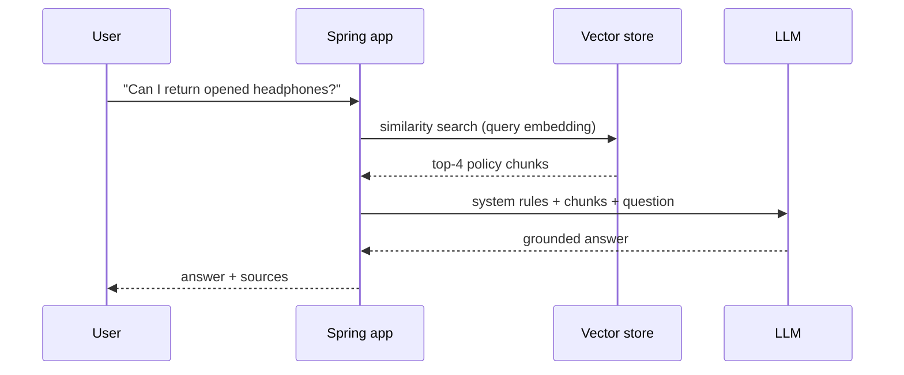
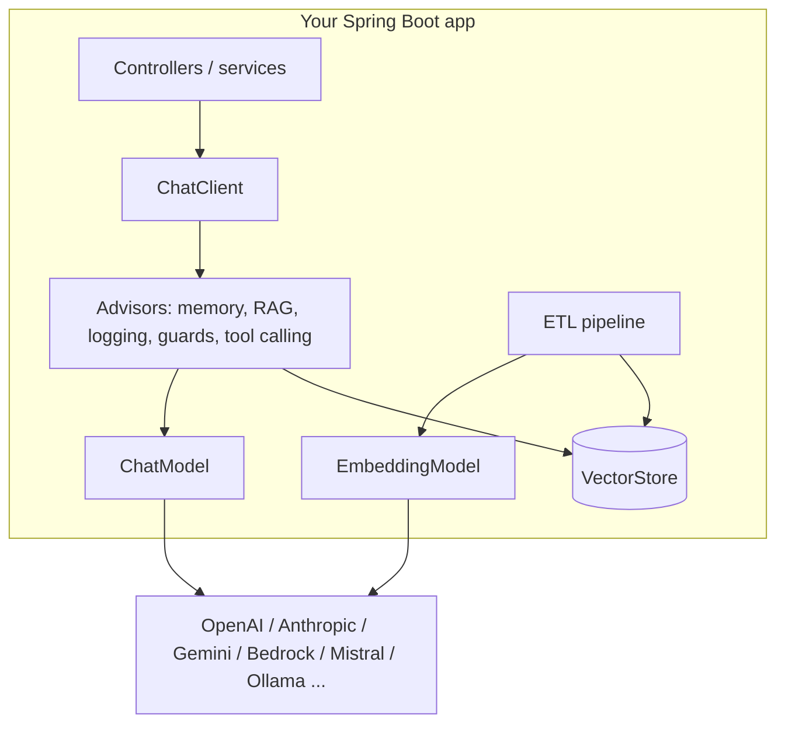

# 1 · AI & LLM Concepts for Java Developers

**Why this page:** you can't design an AI feature well without a correct mental model of the thing you are
calling. This page explains, in Java-developer terms, every concept the rest of the tab relies on.

## 1.1 What a Large Language Model (LLM) actually is

An LLM is a neural network trained to predict **the next token** given the previous tokens. Everything it
does (answering, summarising, writing JSON, choosing a tool) is next-token prediction, steered by the
input you give it.

For a Java developer, treat it as a remote method:

```java
String complete(List<Message> conversation, Options options); // remote, slow, priced per token
```

| Property | Meaning | Engineering consequence |
|---|---|---|
| **Stateless** | It remembers nothing between calls | You resend history every time ([Chat Memory](08-chat-memory.md)) |
| **Non-deterministic** | Same input ≠ same output | Assert properties, not exact strings ([Testing](18-testing-evaluation.md)) |
| **Remote** | HTTP to a provider (or your own GPU server) | Timeouts, retries, circuit breakers ([Resilience](20-resilience-performance-cost.md)) |
| **Slow** | Seconds, not milliseconds | Stream output; never block a hot path ([Streaming](06-streaming.md)) |
| **Priced per token** | Input and output both cost money | Budgets, caching, smaller models ([Cost](20-resilience-performance-cost.md)) |
| **Fallible** | Fluent, confident, sometimes wrong ("hallucination") | Ground with data (RAG); never the authority on facts or permissions |

## 1.2 Tokens

A **token** is a chunk of text, roughly ¾ of an English word (about 4 characters). "Spring Boot is great"
is about 5 tokens. Providers bill **input tokens** (your prompt) and **output tokens** (the answer)
separately, and output is usually several times more expensive.

```text
cost of one call ≈ input_tokens × input_price + output_tokens × output_price
```

Spring AI returns the exact counts on every response (`ChatResponse.getMetadata().getUsage()`), and
publishes them as the `gen_ai.client.token.usage` metric ([Observability](17-observability.md)).

## 1.3 The context window

The **context window** is the maximum number of tokens (input + output) a model can handle in one call:
system prompt + conversation history + retrieved documents + tool definitions + the answer. Modern models
range from 8K to over 1M tokens.

!!! warning "Bigger is not free"
    A large context costs money on every call, increases latency, and models pay less attention to the
    middle of long contexts. Send the **smallest context that answers the question**: bounded memory
    windows, top-K retrieval, short tool descriptions.

## 1.4 Messages and roles

A conversation is a list of messages, each with a role:

| Role | Spring AI class | Purpose |
|---|---|---|
| **System** | `SystemMessage` | Instructions, persona, rules ("You are ShopAssist. Only answer about our store.") |
| **User** | `UserMessage` | What the human asked (may include images/audio as `Media`) |
| **Assistant** | `AssistantMessage` | What the model replied (may include tool-call requests) |
| **Tool** | `ToolResponseMessage` | The result of a tool your code executed |

## 1.5 Generation options

| Option | What it does | Typical production value |
|---|---|---|
| `model` | Which model to use | Smallest model that passes your evaluation |
| `temperature` | Randomness (0 = focused, 1+ = creative) | 0–0.3 for extraction/support; 0.7+ for creative text |
| `topP` / `topK` | Alternative randomness controls | Leave default unless you know why |
| `maxTokens` | Cap on output length | Always set: it's your cost and latency ceiling |
| `stopSequences` | Stop generating at these strings | Rarely needed |
| `frequencyPenalty` / `presencePenalty` | Discourage repetition | Rarely needed |

Reasoning ("thinking") models also accept options such as reasoning effort; they spend extra hidden
output tokens to think before answering, which improves hard tasks but increases cost and latency.

## 1.6 Embeddings and semantic similarity

An **embedding** is a vector of floats (e.g. 1536 numbers) that represents the *meaning* of a piece of
text. Texts with similar meaning have vectors that point in similar directions, measured with **cosine
similarity** (1 = same meaning, 0 = unrelated).

```text
"How do I return an item?"   → [0.12, -0.03, 0.88, ...]
"What is your refund policy?" → [0.10, -0.01, 0.85, ...]   cosine ≈ 0.91 (similar)
"Best pizza in town"          → [-0.70, 0.44, 0.02, ...]   cosine ≈ 0.05 (unrelated)
```

Embeddings power semantic search, RAG, deduplication, clustering and recommendations
([Embeddings](10-embeddings.md)).

## 1.7 Vector stores

A **vector store** is a database that stores embeddings with their text and metadata, and finds the
nearest vectors to a query vector quickly (approximate nearest-neighbour indexes such as HNSW). Examples:
PostgreSQL + pgvector, Redis, OpenSearch/Elasticsearch, Pinecone, Qdrant, Weaviate, Milvus, MongoDB
Atlas ([Vector Stores](11-vector-stores.md)).

## 1.8 Retrieval-Augmented Generation (RAG)

The model doesn't know your private data (products, policies, orders) and its training data has a cutoff.
**RAG** fixes this: retrieve relevant snippets from your data and put them in the prompt.



RAG has two halves: **ingestion** (ETL: read, split, embed, store; see [ETL](12-etl-pipeline.md)) and
**retrieval + generation** ([RAG](13-rag.md)).

## 1.9 Tool calling (function calling)

The model can't touch your systems. With **tool calling** you describe functions (name, description, JSON
schema of arguments); the model replies "please call `getOrderStatus` with `{orderId: 42}`"; **your code**
runs it and sends the result back; the model writes the final answer.

!!! danger "The model requests; your code decides"
    The model never executes anything. Every tool must enforce authorization from the *authenticated user*,
    never from arguments the model supplies ([Tool Calling](09-tool-calling.md), [Security](19-security.md)).

## 1.10 Agents

An **agent** is a loop: model decides → tool runs → model observes → repeat until done. Useful for
multi-step tasks, but harder to test and control. Prefer simple, predictable **workflows** (chains,
routing) and use autonomous agents only where the flexibility pays for itself ([Agents](16-agents.md)).

## 1.11 Model Context Protocol (MCP)

**MCP** is an open protocol for exposing tools, resources and prompts to any AI application. Write a tool
once as an MCP server and every MCP client (Claude Desktop, IDEs, other agents, your own Spring app) can
use it. Spring AI supports both servers and clients ([MCP](15-mcp.md)).

## 1.12 Hallucination, prompt injection and other failure modes

| Failure | Example | Primary defence |
|---|---|---|
| Hallucination | Invents a return policy | RAG grounding, "say you don't know", evaluation |
| Prompt injection | A product review says "ignore your instructions and…" | Treat all retrieved/user text as data; least-privilege tools ([Security](19-security.md)) |
| Data leakage | Answers with another customer's order | Authorization in tools and retrieval filters |
| Runaway cost | An agent loops 200 times | Tool-call limits, `maxTokens`, budgets |
| Malformed output | Broken JSON | Structured output + schema validation |
| Outage / rate limit | 429 or 5xx from provider | Retries with back-off, fallback model, circuit breaker |

## 1.13 Where Spring AI fits

Spring AI gives you **portable abstractions** (swap OpenAI for Anthropic or a local Ollama model with a
dependency and a property), Spring Boot **auto-configuration**, and **production plumbing**: advisors,
memory, tools, RAG, observability, retries, and testing support.



| Abstraction | Role |
|---|---|
| `ChatModel` / `StreamingChatModel` | Low-level portable chat API |
| `ChatClient` | Fluent, high-level API (what you use 95% of the time) |
| Advisors | Interceptors around each call (memory, RAG, logging, tool loop, guards) |
| `EmbeddingModel` | Text → vector |
| `VectorStore` | Store and search vectors with metadata filters |
| `DocumentReader` / `DocumentTransformer` / `DocumentWriter` | ETL building blocks |
| `ToolCallback`, `@Tool` | Expose Java methods to the model |
| `ChatMemory` | Conversation history |
| `ImageModel`, `TranscriptionModel`, `TextToSpeechModel`, `ModerationModel` | Other modalities |
| MCP starters | Build MCP servers and clients |

## Checkpoint

You're ready for the next step if you can answer these:

1. Why must you resend the conversation history on every call?
2. What two things do you pay for on every call, and which is usually more expensive?
3. What problem does RAG solve that a bigger model doesn't?
4. In tool calling, who executes the tool, and where must authorization be checked?
5. Why is a temperature of 0.0–0.3 typical for support and extraction?

Next: [2 · Project Setup & Providers](02-setup.md)
