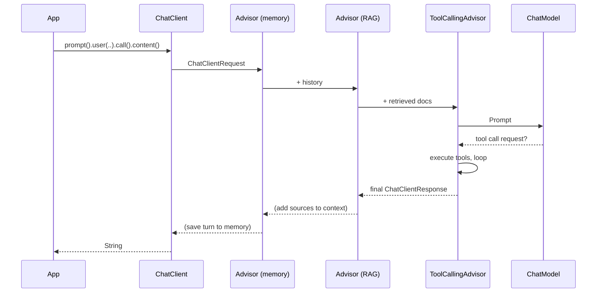

# 3 · ChatClient Deep Dive

**Why:** `ChatClient` is the API you'll use for almost everything: prompts, options, advisors, tools,
structured output, streaming. Learn it properly once.

## 3.1 `ChatModel` vs `ChatClient`

| | `ChatModel` | `ChatClient` |
|---|---|---|
| Level | Low-level, provider-portable | High-level, fluent (like `RestClient` vs raw HTTP) |
| Input | `Prompt` (messages + options) | Fluent spec: `.system()`, `.user()`, `.advisors()`, `.tools()` |
| Output | `ChatResponse` | `String`, typed entity, `ChatResponse`, `Flux` |
| Advisors (memory, RAG, tool loop) | ❌ | ✅ |
| Tool-calling loop | ❌ in 2.0 (returns tool-call requests to you) | ✅ via the auto-registered `ToolCallingAdvisor` |
| Use when | Writing a framework/advisor, or full manual control | Application code: almost always |

```java
// ChatModel: you assemble everything yourself
ChatResponse r = chatModel.call(new Prompt(
        List.of(new SystemMessage("Be concise."), new UserMessage("Hi")),
        OpenAiChatOptions.builder().model("gpt-4o-mini").temperature(0.2).build()));
String text = r.getResult().getOutput().getText();

// ChatClient: the same call, fluent
String text2 = chatClient.prompt().system("Be concise.").user("Hi").call().content();
```

## 3.2 Creating a ChatClient

```java
// 1. From the auto-configured builder (preferred)
@Service
class AssistantService {
    private final ChatClient chat;

    AssistantService(ChatClient.Builder builder) {
        this.chat = builder
                .defaultSystem("You are ShopAssist. Answer only questions about the store.")
                .defaultOptions(ChatOptions.builder().temperature(0.2).maxTokens(600))
                .defaultAdvisors(new SimpleLoggerAdvisor())
                .build();
    }
}

// 2. From a specific model
ChatClient c = ChatClient.create(chatModel);
ChatClient c2 = ChatClient.builder(chatModel).defaultSystem("...").build();

// 3. Derive a variant from an existing client (keeps its defaults)
ChatClient creative = chat.mutate()
        .defaultOptions(ChatOptions.builder().temperature(0.9))
        .build();
```

!!! tip "Scope"
    The auto-configured `ChatClient.Builder` is a **prototype** bean: each injection gets a fresh builder,
    so services can customise independently. The built `ChatClient` is immutable and thread-safe; build it
    once and reuse it.

## 3.3 Builder defaults (applied to every request)

| Method | Purpose |
|---|---|
| `defaultSystem(String / Resource / Consumer<PromptSystemSpec>)` | System prompt, optionally templated |
| `defaultUser(...)` | Default user text (rarely used) |
| `defaultOptions(ChatOptions.Builder)` | Model, temperature, max tokens, provider-specific options |
| `defaultAdvisors(...)` | Memory, RAG, logging, guards |
| `defaultTools(Object...)` | `@Tool` objects, `ToolCallback`s, providers |
| `defaultToolCallbacks(...)` | Explicit `ToolCallback`s / `ToolCallbackProvider`s |
| `defaultToolContext(Map)` | Context passed to every tool invocation |
| `defaultTemplateRenderer(TemplateRenderer)` | Custom template syntax |

## 3.4 The request spec

```java
String answer = chat.prompt()                                   // start a request
        .system(s -> s.text("Today is {date}. Currency is {currency}.")
                      .param("date", LocalDate.now())
                      .param("currency", "USD"))
        .user(u -> u.text("Recommend a {category} under {budget}")
                    .param("category", "headphone")
                    .param("budget", "$100"))
        .options(OpenAiChatOptions.builder().temperature(0.3).maxCompletionTokens(400))
        .advisors(a -> a.param(ChatMemory.CONVERSATION_ID, "conv-123"))
        .call()
        .content();
```

| Method | Notes |
|---|---|
| `prompt()` / `prompt(String)` / `prompt(Prompt)` | Start empty, with user text, or from a prepared `Prompt` |
| `system(...)`, `user(...)` | Text, `Resource` (template files) or a consumer with `param(...)`/`media(...)` |
| `messages(Message...)` | Insert explicit history messages |
| `options(B extends ChatOptions.Builder)` | **2.0: takes a builder.** Merged over the defaults for this request |
| `advisors(...)` | Add advisors, or pass parameters to advisors via `a.param(k, v)` |
| `tools(...)`, `toolCallbacks(...)`, `toolContext(Map)` | Per-request tools (they **replace** default tools for this request) |
| `templateRenderer(...)` | Per-request template syntax |
| `call()` / `stream()` | Execute synchronously / reactively |

## 3.5 Response types with `call()`

```java
var spec = chat.prompt().user("Describe our return policy").call();
```

| Method | Returns | Use when |
|---|---|---|
| `content()` | `String` | You just need the text |
| `entity(Class<T>)` / `entity(ParameterizedTypeReference<T>)` | `T` | Structured output ([page 5](05-structured-output.md)) |
| `chatResponse()` | `ChatResponse` | You need token usage, finish reason, model id, metadata |
| `responseEntity(Class<T>)` | `ResponseEntity<ChatResponse, T>` | Typed entity **and** metadata together |
| `chatClientResponse()` | `ChatClientResponse` | You need the advisor context too (e.g. retrieved RAG documents) |

!!! warning "Call exactly one terminal method"
    Each terminal method executes the request. Calling `content()` and then `chatResponse()` on the same
    spec makes **two** model calls. Call `chatResponse()` (or `responseEntity`) once and read everything
    from it.

## 3.6 Reading metadata and token usage

```java
ChatResponse response = chat.prompt().user(question).call().chatResponse();

String text           = response.getResult().getOutput().getText();
String finishReason   = response.getResult().getMetadata().getFinishReason(); // "STOP", "LENGTH", "TOOL_CALLS"...
Usage usage           = response.getMetadata().getUsage();
Integer promptTokens  = usage.getPromptTokens();
Integer outputTokens  = usage.getCompletionTokens();
Long cachedTokens     = usage.getCacheReadInputTokens();   // when the provider reports prompt caching
String model          = response.getMetadata().getModel();
```

`finishReason = LENGTH` means the answer was cut off by `maxTokens`. Log it and alert on its rate.

## 3.7 Multiple ChatClients

Different use cases need different defaults. Create one client per purpose, not one god-client:

```java
@Configuration
class AiClients {

    @Bean
    ChatClient supportClient(ChatClient.Builder b) {
        return b.defaultSystem(new ClassPathResource("prompts/support-system.st"))
                .defaultOptions(ChatOptions.builder().temperature(0.1).maxTokens(500))
                .build();
    }

    @Bean
    ChatClient copywriterClient(ChatClient.Builder b) {
        return b.defaultSystem("You write short, friendly product descriptions.")
                .defaultOptions(ChatOptions.builder().temperature(0.8).maxTokens(300))
                .build();
    }
}
```

For different **providers** in the same app see [Setup → several providers](02-setup.md#26-step-5-several-providers-in-one-app).

## 3.8 Portable vs provider-specific options

`ChatOptions.builder()` covers portable options (`model`, `temperature`, `maxTokens`, `topP`, `topK`,
`stopSequences`, `frequencyPenalty`, `presencePenalty`). Provider builders add more:

```java
// OpenAI-specific
.options(OpenAiChatOptions.builder()
        .model("gpt-4o-mini")
        .reasoningEffort("low")        // reasoning models
        .parallelToolCalls(false)
        .user("customer-123")          // abuse monitoring id (use a pseudonymous id)
        .serviceTier("auto"))

// Anthropic-specific: thinking budgets, prompt caching, service tier ... via AnthropicChatOptions
```

Using provider-specific options ties that code to the provider. Keep them in configuration where possible
(`spring.ai.openai.chat.*`) and keep code portable.

## 3.9 Calling from a REST controller

```java
record AskRequest(@NotBlank @Size(max = 2000) String question) {}
record AskResponse(String answer, int promptTokens, int completionTokens) {}

@RestController
@RequestMapping("/api/assistant")
class AssistantController {
    private final ChatClient chat;

    AssistantController(ChatClient supportClient) { this.chat = supportClient; }

    @PostMapping("/ask")
    AskResponse ask(@Valid @RequestBody AskRequest req) {
        ChatResponse r = chat.prompt().user(req.question()).call().chatResponse();
        var u = r.getMetadata().getUsage();
        return new AskResponse(r.getResult().getOutput().getText(),
                u.getPromptTokens(), u.getCompletionTokens());
    }
}
```

Production points:

- **Validate and bound user input** (`@Size`): input length is cost.
- Run on **virtual threads** (`spring.threads.virtual.enabled=true`) so blocking model calls don't exhaust
  the Tomcat thread pool during multi-second waits.
- Map provider failures (`NonTransientAiException`, `TransientAiException`) to `ProblemDetail` responses in a
  `@RestControllerAdvice`.

```java
@RestControllerAdvice
class AiErrorHandler {
    @ExceptionHandler(TransientAiException.class)
    ProblemDetail transientFailure(TransientAiException e) {
        var pd = ProblemDetail.forStatusAndDetail(HttpStatus.SERVICE_UNAVAILABLE,
                "The assistant is temporarily unavailable. Please retry.");
        pd.setProperty("retryable", true);
        return pd;
    }

    @ExceptionHandler(NonTransientAiException.class)
    ProblemDetail permanentFailure(NonTransientAiException e) {
        return ProblemDetail.forStatusAndDetail(HttpStatus.BAD_GATEWAY, "The assistant could not process this request.");
    }
}
```

## 3.10 Under the hood



Each call becomes a `ChatClientRequest` (prompt + a mutable context map) that flows through the ordered
advisor chain down to the `ChatModel`, and the `ChatClientResponse` flows back up. Advisors are covered in
[page 7](07-advisors.md).

## Common mistakes

| Mistake | Fix |
|---|---|
| `new`-ing a `ChatClient` per request | Build once in the constructor or as a bean |
| Calling `.content()` then `.chatResponse()` | One terminal call; read everything from `ChatResponse` |
| Passing `ChatOptions` objects to `.options()` (1.x style) | Pass a **builder** in 2.0 |
| Per-request `.tools(...)` expecting defaults to stay | Request tools override default tools for that request |
| No `maxTokens` | Always cap output |
| Platform threads + long model calls | Enable virtual threads or use streaming |

## Checkpoint

- [ ] You can explain when to use `ChatModel` instead of `ChatClient`
- [ ] You have two clients with different defaults
- [ ] Your endpoint returns token usage and handles AI exceptions as `ProblemDetail`

Next: [4 · Prompts, Messages & Templates](04-prompts.md)
