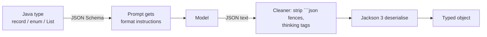
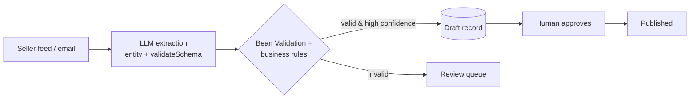

# 5 · Structured Output

**Why:** your code can't safely parse prose. Whenever an answer feeds a program (a classifier, an
extractor, a form filler, a UI card), ask for **typed output** and validate it.

## 5.1 How it works



By default Spring AI generates a JSON Schema from your type and appends format instructions to the prompt.
Optionally, it can send the schema to the provider as an **API-level constraint** (native structured
output), and/or **validate and retry** on schema violations.

## 5.2 Step 1: a record

```java
record ProductInfo(
        String name,
        String brand,
        @JsonPropertyDescription("Price in minor units (cents). Null if not stated.") Long priceCents,
        List<String> features,
        Category category) {}

enum Category { ELECTRONICS, CLOTHING, HOME, SPORTS, OTHER }

ProductInfo info = chat.prompt()
        .system("Extract product information from the seller's text. Do not invent missing values.")
        .user(sellerText)
        .options(ChatOptions.builder().temperature(0.0))
        .call()
        .entity(ProductInfo.class);
```

Tips for the type:

- Use **records** and **enums**: enums constrain the model to valid values.
- Add `@JsonPropertyDescription` to explain non-obvious fields; descriptions go into the schema.
- Use `@JsonProperty(required = true)` for required fields.
- Money as integer minor units (`Long priceCents`), never `double`.
- Allow `null` for "not stated" instead of forcing the model to invent a value.

## 5.3 Generic types: lists and maps

```java
// List of records
List<ProductInfo> products = chat.prompt()
        .user("Extract every product mentioned: " + text)
        .call()
        .entity(new ParameterizedTypeReference<List<ProductInfo>>() {});

// Map
Map<String, Object> attrs = chat.prompt()
        .user("Return the attributes of this product as a JSON object: " + text)
        .call()
        .entity(new ParameterizedTypeReference<Map<String, Object>>() {});

// List of strings with the dedicated converter
List<String> tags = chat.prompt()
        .user(u -> u.text("Suggest 5 search tags for {product}").param("product", "trail running shoes"))
        .call()
        .entity(new ListOutputConverter());
```

!!! tip "Wrap lists in a record"
    `record ProductList(List<ProductInfo> items) {}` is more robust than a bare top-level array: some
    providers' native structured output modes reject top-level arrays (OpenAI does).

## 5.4 Entity + metadata together

```java
ResponseEntity<ChatResponse, ProductInfo> result = chat.prompt()
        .user(sellerText)
        .call()
        .responseEntity(ProductInfo.class);

ProductInfo info = result.entity();
Usage usage = result.response().getMetadata().getUsage();
```

## 5.5 Native (provider-enforced) structured output

Providers such as OpenAI, Anthropic, Gemini and Ollama can **enforce** a JSON schema server-side, which
removes most malformed-JSON failures. Enable it per call:

```java
ProductInfo info = chat.prompt()
        .user(sellerText)
        .call()
        .entity(ProductInfo.class, spec -> spec.useProviderStructuredOutput());
```

or for a whole client via an advisor parameter:

```java
ChatClient extractor = builder
        .defaultAdvisors(AdvisorParams.ENABLE_NATIVE_STRUCTURED_OUTPUT)
        .build();
```

It is **off by default** because support varies: reasoning models on Ollama may return plain text, and
OpenAI's structured outputs reject top-level arrays. Test it with your model.

## 5.6 Schema validation with automatic retry

Even with good prompts, models occasionally return invalid JSON. `validateSchema()` validates the response
against the schema and, on failure, retries with the validation error fed back to the model (up to 3
attempts by default; not supported for streaming):

```java
ProductInfo info = chat.prompt()
        .user(sellerText)
        .call()
        .entity(ProductInfo.class, spec -> spec.useProviderStructuredOutput().validateSchema());
```

For full control (custom attempts, order), register the advisor yourself:

```java
var validation = StructuredOutputValidationAdvisor.builder()
        .outputType(ProductInfo.class)
        .maxRepeatAttempts(2)
        .build();

ProductInfo info = chat.prompt().advisors(validation).user(sellerText).call().entity(ProductInfo.class);
```

## 5.7 Low level: `BeanOutputConverter`

Useful with `ChatModel` directly, or to inspect the generated schema:

```java
var converter = new BeanOutputConverter<>(ProductInfo.class);

String format = converter.getFormat();           // the instructions appended to the prompt
String schema = converter.getJsonSchema();       // the JSON Schema

Prompt prompt = new PromptTemplate("""
        Extract product information from: {text}
        {format}
        """).create(Map.of("text", sellerText, "format", format));

ProductInfo info = converter.convert(chatModel.call(prompt).getResult().getOutput().getText());
```

`BeanOutputConverter` applies `ResponseTextCleaner`s (Markdown code-fence remover, thinking-tag remover,
whitespace) before parsing, so reasoning models that emit `<think>…</think>` still parse.

## 5.8 Validate the *meaning*, not just the shape

A schema-valid object can still be wrong. Always apply business validation after parsing:

```java
record ExtractedRefund(@NotBlank String orderId, @PositiveOrZero long amountCents, @NotNull RefundReason reason) {}

ExtractedRefund r = chat.prompt().user(email).call().entity(ExtractedRefund.class);

Set<ConstraintViolation<ExtractedRefund>> violations = validator.validate(r);
if (!violations.isEmpty()) {
    throw new UnprocessableExtractionException(violations);
}
// and NEVER trust the amount: look up the order and compute the refundable amount yourself
```

!!! danger "Structured ≠ authoritative"
    Extracted values are **suggestions**. Verify ids exist, amounts match your records, and the user is
    allowed to act on them before doing anything with side effects.

## 5.9 Production pattern: extraction with human review



Add a `confidence` field or a separate check, store drafts, and require approval for anything customer-facing.

## Common mistakes

| Mistake | Fix |
|---|---|
| Parsing `content()` with regex | `entity(...)` |
| `double` prices | `long` minor units |
| Required fields the text may not contain | Make them nullable; let the model say "unknown" |
| High temperature for extraction | 0.0–0.2 |
| Top-level `List<T>` with native structured output on OpenAI | Wrap in a record |
| Trusting extracted ids/amounts | Re-validate against your database |

## Checkpoint

- [ ] You extract a record with an enum field at temperature 0
- [ ] You've tried `useProviderStructuredOutput()` and `validateSchema()` with your model
- [ ] Extracted objects go through Bean Validation before use

Next: [6 · Streaming Responses](06-streaming.md)
