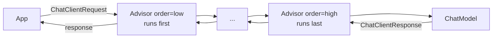

# 7 · Advisors

**Why:** advisors are Spring AI's interceptors, the AOP of AI calls. Memory, RAG, logging, the tool loop,
validation and guardrails are all advisors. Once you can write one, you can add any cross-cutting behaviour
(PII redaction, budgets, auditing) without touching business code.

## 7.1 The chain



- A request flows through advisors in **ascending `getOrder()`** (lowest first); the response flows back in
  reverse, exactly like a servlet filter chain.
- Each advisor can modify the request, short-circuit (return without calling the chain), or modify the response.
- `ChatClientRequest` = `Prompt` + a mutable **context map** shared by all advisors for this call.

## 7.2 Built-in advisors (2.0)

| Advisor | Module | Default order | Purpose |
|---|---|---|---|
| `MessageChatMemoryAdvisor` | `spring-ai-client-chat` | `HIGHEST_PRECEDENCE + 200` | Adds history as messages; saves the new turn ([page 8](08-chat-memory.md)) |
| `VectorStoreChatMemoryAdvisor` | `spring-ai-vector-store-advisor` | `HIGHEST_PRECEDENCE + 200` | Retrieves *relevant* past messages from a vector store |
| `ToolCallingAdvisor` | `spring-ai-client-chat` | `HIGHEST_PRECEDENCE + 300` | Runs the tool-calling loop; **auto-registered** ([page 9](09-tool-calling.md)) |
| `QuestionAnswerAdvisor` | `spring-ai-vector-store-advisor` | `0` | Simple RAG ([page 13](13-rag.md)) |
| `RetrievalAugmentationAdvisor` | `spring-ai-rag` | `0` | Modular RAG |
| `StructuredOutputValidationAdvisor` | `spring-ai-client-chat` | — | Validate JSON against schema and retry ([page 5](05-structured-output.md)) |
| `SafeGuardAdvisor` | `spring-ai-client-chat` | `0` | Blocks requests containing sensitive words |
| `SimpleLoggerAdvisor` | `spring-ai-client-chat` | `0` | Logs request/response at DEBUG |
| `SemanticCacheAdvisor` | `spring-ai-redis-semantic-cache` | `HIGHEST_PRECEDENCE + 200` | Returns cached answers for semantically similar questions ([page 20](20-resilience-performance-cost.md)) |
| `ToolSearchToolCallingAdvisor` | `spring-ai-tool-search-advisor` | — | Lets the model *search* a large tool catalog instead of receiving all tools |

`ToolCallAdvisor` (from early 2.0 milestones) is deprecated in favour of `ToolCallingAdvisor`.

## 7.3 Using advisors

```java
ChatClient chat = builder
        .defaultAdvisors(
                MessageChatMemoryAdvisor.builder(chatMemory).build(),
                QuestionAnswerAdvisor.builder(vectorStore).build(),
                new SimpleLoggerAdvisor())
        .build();

// pass per-request parameters to advisors
chat.prompt()
    .user(question)
    .advisors(a -> a.param(ChatMemory.CONVERSATION_ID, conversationId)
                    .param(QuestionAnswerAdvisor.FILTER_EXPRESSION, "tenant == 'acme'"))
    .call().content();
```

To see what's sent to the model, enable the logger:

```yaml
logging.level.org.springframework.ai.chat.client.advisor: DEBUG
```

!!! warning "Logging prompts in production"
    Prompts contain customer data. Keep `SimpleLoggerAdvisor` at DEBUG in dev only, or give it custom
    `requestToString`/`responseToString` functions that redact.

## 7.4 Ordering matters

Typical order for a support assistant:

| Order | Advisor | Why here |
|---|---|---|
| very low | Input guard (PII redaction, blocklist) | Clean input before it's stored or sent anywhere |
| `+200` | Chat memory | Add history; store the final answer after everything else ran |
| `+300` | Tool calling (auto) | The loop wraps everything below it |
| `0` | RAG | Retrieve context for the final prompt |
| high | Logger / output guard | See exactly what goes to the model |

Since lower runs first, an advisor with order `0` runs *inside* the tool-calling loop and memory advisors
(their orders are `HIGHEST_PRECEDENCE + n`, i.e. large negative numbers). Use `Ordered.HIGHEST_PRECEDENCE`
for things that must run first and `Ordered.LOWEST_PRECEDENCE` for things that must be closest to the model.

## 7.5 Writing an advisor: `BaseAdvisor` (before/after)

`BaseAdvisor` implements both `CallAdvisor` and `StreamAdvisor`; you write `before` and `after`.

Example: redact emails and card numbers from user input before anything else sees it.

```java
public final class PiiRedactionAdvisor implements BaseAdvisor {

    private static final Pattern EMAIL = Pattern.compile("[\\w.+-]+@[\\w-]+\\.[\\w.]+");
    private static final Pattern CARD  = Pattern.compile("\\b(?:\\d[ -]?){13,19}\\b");

    @Override
    public ChatClientRequest before(ChatClientRequest request, AdvisorChain chain) {
        Prompt redacted = request.prompt().augmentUserMessage(user ->
                user.mutate().text(redact(user.getText())).build());
        return request.mutate().prompt(redacted).build();
    }

    @Override
    public ChatClientResponse after(ChatClientResponse response, AdvisorChain chain) {
        return response;
    }

    @Override
    public int getOrder() {
        return Ordered.HIGHEST_PRECEDENCE;     // before memory stores anything
    }

    private static String redact(String text) {
        String t = EMAIL.matcher(text).replaceAll("[EMAIL]");
        return CARD.matcher(t).replaceAll("[CARD]");
    }
}
```

## 7.6 Writing an advisor: `CallAdvisor` (around)

Use `CallAdvisor` (and `StreamAdvisor`) when you need around-advice: timing, short-circuiting, retries.

Example: a per-user daily **token budget guard**.

```java
public final class TokenBudgetAdvisor implements CallAdvisor {

    public static final String USER_ID = "budget_user_id";
    private final TokenBudgetService budgets;

    public TokenBudgetAdvisor(TokenBudgetService budgets) { this.budgets = budgets; }

    @Override
    public ChatClientResponse adviseCall(ChatClientRequest request, CallAdvisorChain chain) {
        String userId = (String) request.context().get(USER_ID);

        if (userId != null && budgets.isExhausted(userId)) {          // short-circuit: no model call
            var msg = new AssistantMessage("You've reached today's assistant limit. Please try again tomorrow.");
            var response = ChatResponse.builder().generations(List.of(new Generation(msg))).build();
            return ChatClientResponse.builder().chatResponse(response).context(request.context()).build();
        }

        ChatClientResponse response = chain.nextCall(request);          // proceed

        var usage = response.chatResponse() != null ? response.chatResponse().getMetadata().getUsage() : null;
        if (userId != null && usage != null && usage.getTotalTokens() != null) {
            budgets.record(userId, usage.getTotalTokens());
        }
        return response;
    }

    @Override public String getName()  { return "TokenBudgetAdvisor"; }
    @Override public int getOrder()    { return Ordered.HIGHEST_PRECEDENCE + 100; }
}
```

```java
chat.prompt()
    .user(question)
    .advisors(a -> a.param(TokenBudgetAdvisor.USER_ID, currentUser.id()))
    .call().content();
```

For streaming, implement `StreamAdvisor.adviseStream(request, chain)` and call `chain.nextStream(request)`,
operating on the `Flux` (e.g. `doOnNext` to sum usage).

## 7.7 Sharing data between advisors and the caller

The context map travels with the request and is returned in `ChatClientResponse.context()`. RAG advisors
put retrieved documents there, which is how you show citations:

```java
ChatClientResponse r = chat.prompt().user(q).call().chatClientResponse();
List<Document> sources = (List<Document>) r.context().get(QuestionAnswerAdvisor.RETRIEVED_DOCUMENTS);
```

## 7.8 `SafeGuardAdvisor`

A simple blocklist guard: if the request contains a sensitive word, it returns a canned response without
calling the model.

```java
new SafeGuardAdvisor(List.of("password", "ssn", "credit card number"));
```

It is substring matching, so treat it as a first line of defence only. Real guardrails are covered in
[Security & Guardrails](19-security.md).

## 7.9 Testing an advisor

Advisors are plain Java: unit-test them with a stub chain or a mocked `ChatModel`:

```java
@Test
void redactsEmailBeforeModelSeesIt() {
    ChatModel model = mock(ChatModel.class);
    when(model.call(any(Prompt.class))).thenReturn(
            new ChatResponse(List.of(new Generation(new AssistantMessage("ok")))));

    ChatClient client = ChatClient.builder(model).defaultAdvisors(new PiiRedactionAdvisor()).build();
    client.prompt().user("mail me at jane@example.com").call().content();

    ArgumentCaptor<Prompt> captor = ArgumentCaptor.forClass(Prompt.class);
    verify(model).call(captor.capture());
    assertThat(captor.getValue().getUserMessage().getText()).contains("[EMAIL]").doesNotContain("jane@");
}
```

## Common mistakes

| Mistake | Fix |
|---|---|
| Not knowing the order | Lower runs first; set `getOrder()` deliberately |
| Mutating `Prompt` in place | Build a new request with `request.mutate()` |
| Implementing only `CallAdvisor` | Also implement `StreamAdvisor` if the client streams (or use `BaseAdvisor`) |
| Logging raw prompts in prod | Redact or keep at DEBUG in dev only |
| Business logic in advisors | Advisors are for cross-cutting concerns |

## Checkpoint

- [ ] You can draw the request/response flow through three advisors
- [ ] You wrote a `BaseAdvisor` and a `CallAdvisor` with a unit test
- [ ] You can read retrieved documents from the response context

Next: [8 · Chat Memory](08-chat-memory.md)
