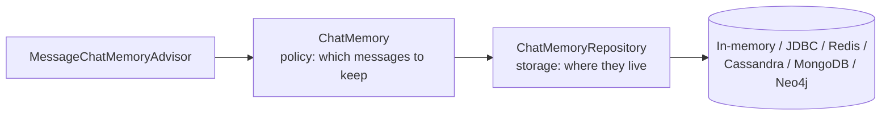

# 8 · Chat Memory

**Why:** models are stateless. "How much is *it*?" only makes sense if the previous turns are sent again.
Chat memory stores turns per conversation and replays a **bounded** window of them on each call.

## 8.1 The pieces



| Type | Responsibility | Implementations |
|---|---|---|
| `ChatMemory` | Policy: `add`, `get`, `clear` per conversation id | `MessageWindowChatMemory` (keeps the last N messages, default 20) |
| `ChatMemoryRepository` | Storage: `saveAll`, `findByConversationId`, `findConversationIds`, `deleteByConversationId` | `InMemoryChatMemoryRepository`, `JdbcChatMemoryRepository`, Redis, Cassandra, MongoDB, Neo4j |
| Memory advisor | Plugs memory into `ChatClient` | `MessageChatMemoryAdvisor`, `VectorStoreChatMemoryAdvisor` |

The model starters auto-configure a `ChatMemory` bean: a `MessageWindowChatMemory` over an
`InMemoryChatMemoryRepository`, unless you define your own repository or memory bean.

## 8.2 Step 1: in-memory (development)

```java
@Service
class ConversationalAssistant {
    private final ChatClient chat;

    ConversationalAssistant(ChatClient.Builder builder, ChatMemory chatMemory) {
        this.chat = builder
                .defaultSystem("You are ShopAssist.")
                .defaultAdvisors(MessageChatMemoryAdvisor.builder(chatMemory).build())
                .build();
    }

    String chat(String conversationId, String message) {
        return chat.prompt()
                .user(message)
                .advisors(a -> a.param(ChatMemory.CONVERSATION_ID, conversationId))
                .call()
                .content();
    }
}
```

```text
chat("c-1", "Do you sell USB-C cables?")  → "Yes, 1 m and 2 m."
chat("c-1", "How much is the longer one?") → "The 2 m cable is $12."   (history replayed)
chat("c-2", "How much is the longer one?") → "Which product do you mean?" (different conversation)
```

!!! danger "Always pass a conversation id"
    In 2.0 the memory advisors **fail with `IllegalArgumentException: conversationId cannot be null`** when
    `ChatMemory.CONVERSATION_ID` is missing. (Some 1.x releases silently used a shared `"default"`
    conversation, so every user saw each other's history.) Make the id a mandatory parameter of your
    service API, and never hard-code a constant id.

## 8.3 Step 2: persistent memory with JDBC (production)

In-memory history disappears on restart and isn't shared between pods. Use a repository:

```xml
<dependency>
  <groupId>org.springframework.ai</groupId>
  <artifactId>spring-ai-starter-model-chat-memory-repository-jdbc</artifactId>
</dependency>
```

```yaml
spring:
  ai:
    chat:
      memory:
        repository:
          jdbc:
            initialize-schema: never     # manage the table with Flyway/Liquibase in prod
```

The auto-configured `JdbcChatMemoryRepository` is picked up by the `ChatMemory` bean automatically.
Dialects exist for PostgreSQL, MySQL/MariaDB, SQL Server, Oracle, H2, HSQLDB and SQLite. The PostgreSQL
schema shipped in the jar:

```sql
-- V12__spring_ai_chat_memory.sql  (copy into your Flyway migrations)
CREATE TABLE IF NOT EXISTS SPRING_AI_CHAT_MEMORY (
    conversation_id VARCHAR(36) NOT NULL,
    content TEXT NOT NULL,
    type VARCHAR(10) NOT NULL CHECK (type IN ('USER', 'ASSISTANT', 'SYSTEM', 'TOOL')),
    "timestamp" TIMESTAMP NOT NULL,
    sequence_id BIGINT NOT NULL
);
CREATE INDEX IF NOT EXISTS SPRING_AI_CHAT_MEMORY_CONVERSATION_ID_TIMESTAMP_IDX
    ON SPRING_AI_CHAT_MEMORY(conversation_id, "timestamp");
CREATE INDEX IF NOT EXISTS SPRING_AI_CHAT_MEMORY_CONVERSATION_ID_SEQUENCE_ID_IDX
    ON SPRING_AI_CHAT_MEMORY(conversation_id, sequence_id);
```

Note `conversation_id` is `VARCHAR(36)`: a UUID fits; longer composite ids don't.

Explicit configuration (window size, custom repository):

```java
@Bean
ChatMemory chatMemory(JdbcChatMemoryRepository repository) {
    return MessageWindowChatMemory.builder()
            .chatMemoryRepository(repository)
            .maxMessages(12)          // tune: more history = more tokens on every call
            .build();
}
```

Other stores use the same pattern with their starter:
`spring-ai-starter-model-chat-memory-repository-redis`, `-cassandra`, `-mongodb`, `-neo4j`.

## 8.4 Conversation ids, users and tenants

A conversation id must be **unguessable and owned**. Never accept an arbitrary id from the client without
checking ownership, or one user can read another's history.

```java
@PostMapping("/conversations")
ConversationDto start(@AuthenticationPrincipal Jwt jwt) {
    var conv = conversations.save(new Conversation(UUID.randomUUID(), jwt.getSubject(), Instant.now()));
    return new ConversationDto(conv.id());
}

@PostMapping("/conversations/{id}/messages")
String send(@PathVariable UUID id, @RequestBody @Valid MessageRequest req, @AuthenticationPrincipal Jwt jwt) {
    conversations.requireOwnedBy(id, jwt.getSubject());             // 404 if not the owner
    return assistant.chat(id.toString(), req.text());
}
```

Keep your own `conversation` table (owner, tenant, created, title) and use its UUID as the memory key.

## 8.5 How many messages? Window vs tokens vs summary

| Strategy | How | Trade-off |
|---|---|---|
| **Message window** (built-in) | Keep the last N messages | Simple; long messages can still blow the context |
| Token window | Custom `ChatMemory` that trims by estimated tokens (`JTokkitTokenCountEstimator`) | Predictable cost |
| **Summarise old turns** | Periodically replace old messages with an LLM-written summary | Long conversations; extra call |
| **Semantic recall** | `VectorStoreChatMemoryAdvisor`: retrieve only past messages relevant to the new question | Very long histories; retrieval can miss context |

`MessageWindowChatMemory` always keeps system messages and evicts the oldest others when over the limit.

## 8.6 `VectorStoreChatMemoryAdvisor`

Stores each message as a vector document and retrieves the top-K most relevant past messages:

```java
VectorStoreChatMemoryAdvisor.builder(vectorStore)
        .defaultTopK(6)
        .build();
```

Good for assistants with weeks of history ("what did I say about my size last month?"). Make sure the
vector store filters by conversation id, which the advisor does using the conversation id parameter.

## 8.7 Memory and tools

Tool calls and tool results are part of the conversation. With `ToolCallingAdvisor` (2.0) the intermediate
tool messages of a turn are handled inside the loop. Keep tool results **small** (return the fields the
model needs, not whole entities), because whatever ends up in memory is resent on every future call.

## 8.8 Privacy, retention and GDPR

Conversation history is personal data:

- **Redact before storing**: put a PII-redaction advisor *before* the memory advisor ([Advisors](07-advisors.md#75-writing-an-advisor-baseadvisor-beforeafter)).
- **Retention**: delete conversations after N days with a scheduled job:

```java
@Scheduled(cron = "0 30 3 * * *")
void purgeOldConversations() {
    conversations.findIdsOlderThan(Instant.now().minus(Duration.ofDays(30)))
            .forEach(id -> chatMemoryRepository.deleteByConversationId(id.toString()));
}
```

- **Right to erasure**: delete all of a user's conversations on request.
- **Encrypt at rest** (database encryption) and restrict who can query the table.

## 8.9 Memory vs history

*Memory* is what the model sees. *History* is what the UI shows. They differ (the window is trimmed, PII is
redacted, summaries replace old turns). If the UI needs full transcripts, store them separately in your own
table rather than reading them back from `ChatMemory`.

## Common mistakes

| Mistake | Fix |
|---|---|
| No conversation id | Make it mandatory; never rely on the default |
| Client-chosen ids without ownership checks | Server-generated UUID + owner check |
| In-memory repository in production | JDBC/Redis repository |
| Huge windows | 10–20 messages; summarise beyond that |
| Letting Spring AI create tables in prod | `initialize-schema: never` + Flyway |
| Keeping history forever | Retention job + erasure endpoint |

## Checkpoint

- [ ] Two conversations don't see each other's history
- [ ] History survives an application restart (JDBC)
- [ ] Conversation ids are checked for ownership
- [ ] A retention job deletes old conversations

Next: [9 · Tool Calling](09-tool-calling.md)
