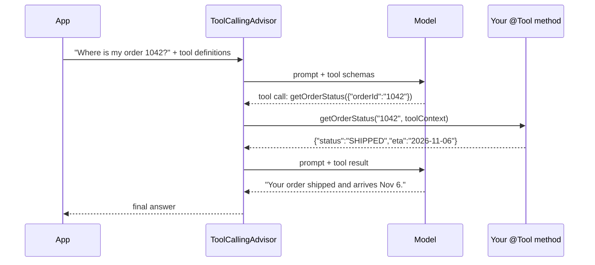

# 9 · Tool Calling

**Why:** tools connect the model to your systems: look up an order, check stock, create a ticket. They are
also the biggest security risk in an AI feature, because a model that can call tools can be talked into
calling them.

## 9.1 How tool calling works



In **2.0** the loop runs in `ToolCallingAdvisor`, which `ChatClient` **auto-registers** (order
`HIGHEST_PRECEDENCE + 300`). Because the loop is part of the advisor chain, advisors placed after it see
every intermediate model call. If you call a `ChatModel` directly, you get the tool-call request back and
must execute it yourself ([9.10](#910-user-controlled-tool-execution)).

## 9.2 Step 1: a `@Tool` method

```java
@Component
class StoreTools {

    private final ProductCatalog catalog;

    StoreTools(ProductCatalog catalog) { this.catalog = catalog; }

    @Tool(description = "Check whether a product is in stock and its current price. Use for availability or price questions.")
    StockInfo checkStock(@ToolParam(description = "Product SKU, e.g. TR-2-BLK-42") String sku) {
        return catalog.stockFor(sku)
                .map(p -> new StockInfo(p.sku(), p.available(), p.priceCents(), p.currency()))
                .orElse(new StockInfo(sku, false, null, null));
    }

    record StockInfo(String sku, boolean inStock, Long priceCents, String currency) {}
}
```

```java
String answer = chat.prompt()
        .user("Is TR-2-BLK-42 in stock?")
        .tools(storeTools)               // per request
        .call()
        .content();

// or for every request of this client
ChatClient chat = builder.defaultTools(storeTools).build();
```

`@Tool` attributes: `name` (defaults to the method name), `description`, `returnDirect`, `resultConverter`.
`@ToolParam` attributes: `description`, `required` (default `true`).

!!! tip "Descriptions are prompts"
    The model chooses tools from their **name and description** alone. Say what the tool does, when to
    use it, and what the arguments look like. Vague descriptions cause wrong or missing tool calls.

## 9.3 Step 2: pass server-side context with `ToolContext`

The model must never supply *who the user is*. Pass identity and tenant through `ToolContext`, which goes
to your method but **is never sent to the model**:

```java
@Component
class OrderTools {

    private final OrderService orders;

    OrderTools(OrderService orders) { this.orders = orders; }

    @Tool(description = "Get the status of one of the current customer's orders by order number.")
    OrderStatusView getOrderStatus(@ToolParam(description = "Order number, digits only") String orderId,
                                   ToolContext toolContext) {
        String customerId = (String) toolContext.getContext().get("customerId");
        return orders.findForCustomer(orderId, customerId)          // authorization: owner only
                .map(o -> new OrderStatusView(o.id(), o.status().name(), o.estimatedDelivery()))
                .orElseThrow(() -> new OrderNotFoundException(orderId)); // same error whether missing or not owned
    }

    record OrderStatusView(String orderId, String status, LocalDate estimatedDelivery) {}
}
```

```java
chat.prompt()
    .user(question)
    .tools(orderTools)
    .toolContext(Map.of("customerId", currentUser.id(), "tenantId", currentUser.tenantId()))
    .call().content();
```

A `ToolContext` parameter is excluded from the JSON schema automatically.

!!! danger "Authorization lives in the tool"
    Treat tool arguments exactly like an HTTP request body from an untrusted client. Validate them, scope
    every query to the authenticated user from `ToolContext` (or `SecurityContextHolder`), and return the
    same "not found" for "doesn't exist" and "not yours".

## 9.4 Step 3: tools with side effects

Read-only tools are low risk. For tools that change state (cancel an order, issue a refund):

1. **Prefer proposing over acting.** The tool creates a *pending action*; the user confirms in the UI; your
   normal, authorized endpoint performs it.
2. Enforce business rules in the domain service, not in the prompt.
3. Make them idempotent (an idempotency key derived from conversation + action).
4. Audit every call: user, tool, arguments, result.

```java
@Tool(description = "Prepare a cancellation request for one of the customer's orders. Does NOT cancel; the customer must confirm.")
PendingAction requestCancellation(String orderId, ToolContext ctx) {
    String customerId = (String) ctx.getContext().get("customerId");
    return pendingActions.proposeCancellation(orderId, customerId);   // returns an id the UI shows as "Confirm?"
}
```

## 9.5 `returnDirect`: skip the second model call

When the tool result *is* the answer (e.g. a formatted receipt), return it straight to the caller:

```java
@Tool(description = "Return the customer's last invoice as a formatted text block", returnDirect = true)
String lastInvoice(ToolContext ctx) { ... }
```

This saves a model round trip and guarantees the text isn't altered.

## 9.6 Programmatic tools: `FunctionToolCallback`

For tools defined at runtime, or wrapping existing functions:

```java
record WeatherRequest(String city) {}
record WeatherResponse(double tempC, String condition) {}

ToolCallback weather = FunctionToolCallback
        .builder("currentWeather", (WeatherRequest req) -> weatherClient.current(req.city()))
        .description("Current weather for a city, used for delivery-delay questions")
        .inputType(WeatherRequest.class)
        .build();

chat.prompt().user("Will rain delay delivery in Leeds today?").toolCallbacks(weather).call().content();
```

Other ways to build callbacks:

```java
ToolCallback[] fromObjects = ToolCallbacks.from(storeTools, orderTools);       // all @Tool methods
ToolCallbackProvider provider = MethodToolCallbackProvider.builder().toolObjects(storeTools).build();
```

`tools(...)` accepts any mix of `@Tool` objects, `ToolCallback`s, `ToolCallbackProvider`s, arrays and
collections.

!!! note "Name-based resolution is off by default"
    1.x let you reference tools by Spring bean name. In 2.0, register callbacks explicitly. Resolving a tool
    the request did not attach (via `ToolCallbackResolver`) is disabled by default since 2.0.1
    (`spring.ai.tools.resolution.fallback.enabled=false`), so a model cannot call a tool you didn't give it.

## 9.7 Errors inside tools

By default an exception thrown by a tool is converted into an error message that is sent back to the model,
which can then apologise or try another approach. To propagate exceptions to your code instead:

```yaml
spring.ai.tools.throw-exception-on-error: true
```

Or define your own `ToolExecutionExceptionProcessor` bean to decide per exception type. Don't leak stack
traces or internal details into the error text that goes to the model.

## 9.8 Limits: stop runaway loops

A confused model can call tools again and again. 2.0 enforces limits per turn (defaults: **40 calls per
tool, 150 total**, then throw). Tighten them:

```yaml
spring:
  ai:
    tools:
      limits:
        max-total-tool-calls: 10
        max-calls-per-tool-default: 3
        max-calls-per-tool:
          searchProducts: 5
        excluded-tools: [currentTime]
        on-limit-exceeded: return_error_response    # or: throw (default)
```

`return_error_response` tells the model the limit was reached so it can answer with what it has; `throw`
raises `ToolCallLimitExceededException`.

## 9.9 Customising the tool-calling advisor

```yaml
spring:
  ai:
    chat:
      client:
        tool-calling:
          enabled: true            # auto-register ToolCallingAdvisor (default)
          advisor-order: -2147483348
```

Disable auto-registration for one request (to handle tools yourself):

```java
chat.prompt().advisors(AdvisorParams.toolCallingAdvisorAutoRegister(false)) ...
```

## 9.10 User-controlled tool execution

Sometimes you must intervene between the model's request and execution: human approval, custom auditing,
or running tools in another service. Use `ChatModel` with a `ToolCallingManager`:

```java
ToolCallingManager manager = ToolCallingManager.builder().build();

ChatOptions options = ToolCallingChatOptions.builder()
        .toolCallbacks(ToolCallbacks.from(orderTools))
        .toolContext(Map.of("customerId", customerId))
        .build();

Prompt prompt = new Prompt(List.of(new UserMessage(question)), options);
ChatResponse response = chatModel.call(prompt);

while (response.hasToolCalls()) {
    // inspect: response.getResult().getOutput().getToolCalls()  → approve / audit / reject here
    ToolExecutionResult result = manager.executeToolCalls(prompt, response);
    prompt = new Prompt(result.conversationHistory(), options);
    response = chatModel.call(prompt);
}
String answer = response.getResult().getOutput().getText();
```

## 9.11 Many tools: tool search

Sending 80 tool definitions on every call costs tokens and confuses the model. `ToolSearchToolCallingAdvisor`
(`spring-ai-starter-tool-search-advisor`) indexes your tools and gives the model a single *search* tool; the
model searches by natural language and only the matching tools are injected. Indexes are cached per
conversation and rebuilt when the tool set changes. Alternatively, choose tools per request yourself (route
by intent, then attach only the relevant tool objects).

## 9.12 Tool design checklist

| Do | Don't |
|---|---|
| Small, single-purpose tools with clear names | One `doAnything(String json)` tool |
| Return compact DTOs with only the needed fields | Return JPA entities or whole documents |
| Scope by the authenticated user from `ToolContext` | Accept `customerId` as a tool argument |
| Validate arguments (format, ranges) | Trust model-generated ids |
| Idempotent, audited side effects; confirm before acting | Irreversible actions directly from the model |
| Time-limited (client timeouts) | Tools that can hang the request |

## 9.13 Observability

Each tool execution emits a `spring.ai.tool` observation tagged with the tool name
(`spring.ai.tool.definition.name`); tool arguments and results are only included when `spring.ai.tools.observations.include-content=true`
(off by default, because they contain data). See [Observability](17-observability.md).

## 9.14 Testing tools

Test tools as ordinary Spring beans (they are). Then test **selection**: does the model call the right tool
with the right arguments? Use a recording `ToolCallback` wrapper or assert on observations, and run these as
evaluation tests ([Testing & Evaluation](18-testing-evaluation.md)).

```java
@Test
void doesNotReturnOtherCustomersOrders() {
    var ctx = new ToolContext(Map.of("customerId", "alice"));
    assertThatThrownBy(() -> orderTools.getOrderStatus("order-of-bob", ctx))
            .isInstanceOf(OrderNotFoundException.class);
}
```

## Common mistakes

| Mistake | Fix |
|---|---|
| Identity as a tool argument | `ToolContext` / security context |
| Vague descriptions | Describe purpose, when to use, argument format |
| Tools that mutate without confirmation | Propose → confirm → execute through normal endpoints |
| Default 40/150 limits on a chat endpoint | Lower `spring.ai.tools.limits.*` |
| Huge tool results | Return compact DTOs |
| Per-request `.tools()` expecting defaults too | Request tools replace defaults; pass both |

## Checkpoint

- [ ] A read-only tool answers stock questions
- [ ] An order tool uses `ToolContext` and refuses other customers' orders (test proves it)
- [ ] Tool-call limits are configured
- [ ] Side-effecting actions require user confirmation

Next: [10 · Embeddings](10-embeddings.md)
