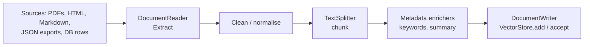

# 12 · ETL: Ingesting Documents

**Why:** RAG quality is decided at ingestion time. Bad chunks (too big, too small, split mid-table, full of
boilerplate, missing metadata) produce bad answers no prompt can fix.

## 12.1 The pipeline



Spring AI's ETL interfaces are plain `java.util.function` types:

| Interface | Type | Examples |
|---|---|---|
| `DocumentReader` | `Supplier<List<Document>>` | `TextReader`, `JsonReader`, `PagePdfDocumentReader`, `ParagraphPdfDocumentReader`, `TikaDocumentReader`, `MarkdownDocumentReader`, `JsoupDocumentReader` |
| `DocumentTransformer` | `Function<List<Document>, List<Document>>` | `TokenTextSplitter`, `KeywordMetadataEnricher`, `SummaryMetadataEnricher`, `ContentFormatTransformer` |
| `DocumentWriter` | `Consumer<List<Document>>` | Every `VectorStore`, `FileDocumentWriter` |

So the whole pipeline can be one line: `vectorStore.accept(splitter.apply(reader.get()))`.

## 12.2 Readers

```java
// Plain text / Markdown-ish text
List<Document> docs = new TextReader(new ClassPathResource("policies/returns.txt")).get();

// JSON: one Document per array element, using only the chosen fields as content
List<Document> products = new JsonReader(new ClassPathResource("products.json"),
        "name", "description", "features").get();

// PDF: one Document per page (or per N pages)
var pdf = new PagePdfDocumentReader(new FileSystemResource("manuals/trail-runner-2.pdf"),
        PdfDocumentReaderConfig.builder()
                .withPageTopMargin(0)
                .withPageExtractedTextFormatter(ExtractedTextFormatter.builder()
                        .withNumberOfTopTextLinesToDelete(1)      // strip running headers
                        .build())
                .withPagesPerDocument(1)
                .build());
List<Document> pages = pdf.get();

// PDF with a table of contents: one Document per paragraph/section
List<Document> sections = new ParagraphPdfDocumentReader(new FileSystemResource("handbook.pdf")).get();

// Anything else (DOCX, PPTX, HTML, ...) through Apache Tika
List<Document> word = new TikaDocumentReader(new FileSystemResource("faq.docx")).get();
```

| Reader | Artifact |
|---|---|
| `TextReader`, `JsonReader` | `spring-ai-commons` (included) |
| `PagePdfDocumentReader`, `ParagraphPdfDocumentReader` | `spring-ai-pdf-document-reader` |
| `TikaDocumentReader` | `spring-ai-tika-document-reader` |
| `MarkdownDocumentReader` | `spring-ai-markdown-document-reader` |
| `JsoupDocumentReader` (HTML) | `spring-ai-jsoup-document-reader` |

Readers add metadata such as file name and page number. Add your own before splitting:

```java
docs.forEach(d -> d.getMetadata().putAll(Map.of(
        "source", "returns-policy", "tenant", "acme", "lang", "en", "docVersion", 7)));
```

## 12.3 Splitting (chunking)

```java
TokenTextSplitter splitter = TokenTextSplitter.builder()
        .withChunkSize(500)              // target tokens per chunk (default 800)
        .withMinChunkSizeChars(300)      // try to break at a sentence boundary after this (default 350)
        .withMinChunkLengthToEmbed(10)   // drop tiny fragments (default 5)
        .withMaxNumChunks(10000)
        .withKeepSeparator(true)
        .build();

List<Document> chunks = splitter.apply(docs);
```

Chunk metadata is inherited from the parent document.

| Chunk size | Effect |
|---|---|
| Too small (< 100 tokens) | Loses context; answers become fragmentary |
| Too large (> 1500 tokens) | Diluted embeddings, fewer chunks fit, higher cost |
| **300–800 tokens** | Good default for prose; tune with evaluation |

Structure-aware chunking beats fixed sizes: split Markdown by headings, PDFs by paragraph (TOC), FAQs by
question, and product data **one product per document**. Write a custom `TextSplitter` /
`DocumentTransformer` when your content has structure.

## 12.4 Enrichment

```java
// LLM-generated keywords stored in metadata ("excerpt_keywords")
KeywordMetadataEnricher keywords = KeywordMetadataEnricher.builder(chatModel).keywordCount(5).build();

// LLM-generated summaries of the current / previous / next chunk
SummaryMetadataEnricher summaries = new SummaryMetadataEnricher(chatModel,
        List.of(SummaryMetadataEnricher.SummaryType.PREVIOUS,
                SummaryMetadataEnricher.SummaryType.CURRENT,
                SummaryMetadataEnricher.SummaryType.NEXT));
```

Enrichers call the model **per chunk**: great for quality, expensive for large corpora. Use a cheap
model and run them only on new or changed documents.

`ContentFormatTransformer` controls how metadata is formatted into the content sent for embedding or
inference (`MetadataMode.EMBED` / `INFERENCE` / `ALL` / `NONE`).

## 12.5 Writing

```java
vectorStore.add(chunks);       // embeds in token-aware batches, then stores
```

## 12.6 Idempotent re-indexing

Production ingestion runs repeatedly. Make it safe to re-run:

```java
@Service
class PolicyIngestionService {

    private final VectorStore vectorStore;
    private final IngestionLedger ledger;                  // your table: source → content hash, version
    private final TokenTextSplitter splitter = TokenTextSplitter.builder().withChunkSize(500).build();

    PolicyIngestionService(VectorStore vectorStore, IngestionLedger ledger) {
        this.vectorStore = vectorStore;
        this.ledger = ledger;
    }

    @Transactional
    public void ingest(String sourceId, Resource resource, String tenant) throws IOException {
        String hash = DigestUtils.md5DigestAsHex(resource.getInputStream());
        if (ledger.isUnchanged(sourceId, hash)) {
            return;                                           // nothing to do: no embedding cost
        }

        List<Document> docs = new TikaDocumentReader(resource).get();
        List<Document> chunks = splitter.apply(docs);

        List<Document> withIds = new ArrayList<>();
        for (int i = 0; i < chunks.size(); i++) {
            Document c = chunks.get(i);
            Map<String, Object> md = new HashMap<>(c.getMetadata());
            md.putAll(Map.of("source", sourceId, "tenant", tenant, "chunk", i, "hash", hash));
            String id = UUID.nameUUIDFromBytes((sourceId + "#" + i).getBytes(StandardCharsets.UTF_8)).toString();
            withIds.add(Document.builder().id(id).text(c.getText()).metadata(md).build());
        }

        vectorStore.delete("source == '" + sourceId + "' && tenant == '" + tenant + "'");  // remove old chunks
        vectorStore.add(withIds);
        ledger.record(sourceId, hash, withIds.size());
    }
}
```

Key points:

1. **Content hash**: skip unchanged sources (saves embedding cost).
2. **Delete old chunks of the source** before adding new ones (the new version may have fewer chunks).
3. **Deterministic ids** from source + chunk index.
4. **Ledger table**: what was ingested, when, with which embedding model and chunking settings.

!!! warning "Filter strings and injection"
    Build filter strings only from trusted, validated values (ids you generated), or use
    `FilterExpressionBuilder`, which avoids string concatenation.

## 12.7 Running ingestion in production

| Trigger | Implementation |
|---|---|
| Nightly full sync | `@Scheduled` job + ledger (skips unchanged) |
| On change | Consume `ProductUpdated` / `DocumentPublished` events (Kafka, SQS) and re-ingest one source |
| Admin upload | Endpoint stores the file in S3 and enqueues an ingestion job; never ingest synchronously in the request |
| Large backfills | Spring Batch job with chunked steps and restartability |

Run ingestion in a **separate worker** (or at least a separate thread pool) so embedding bursts don't slow
down user traffic, and rate-limit embedding calls to stay within provider quotas.

## 12.8 Re-embedding everything (model or chunking change)

1. Create a new table/index (`vector_store_v2`).
2. Backfill it with the new model/chunker (batch job).
3. Run the [evaluation suite](18-testing-evaluation.md) against v2.
4. Switch the retriever bean (feature flag), keep v1 for rollback.
5. Drop v1 after a safe period.

## 12.9 Data quality checklist

- [ ] Boilerplate removed (headers, footers, navigation, cookie banners)
- [ ] Tables kept intact or converted to text rows ("Size 42: EU 42, UK 8, US 9")
- [ ] Each chunk understandable on its own (section title prepended if needed)
- [ ] Metadata for filtering: tenant, language, source, version, visibility
- [ ] Draft/unpublished content excluded
- [ ] PII removed from documents that don't need it

## Common mistakes

| Mistake | Fix |
|---|---|
| Ingesting synchronously in an HTTP request | Background job / queue |
| Re-embedding unchanged files every night | Content-hash ledger |
| Appending new chunks without deleting old ones | Delete by `source` first |
| One giant chunk per PDF | Page/paragraph readers + splitter |
| Enrichers on every chunk of a huge corpus with a big model | Cheap model, only changed docs |

## Checkpoint

- [ ] A PDF and a JSON file are ingested with tenant/source metadata
- [ ] Re-running ingestion on unchanged files makes zero embedding calls
- [ ] Changing a file replaces its chunks without duplicates

Next: [13 · Retrieval-Augmented Generation](13-rag.md)
