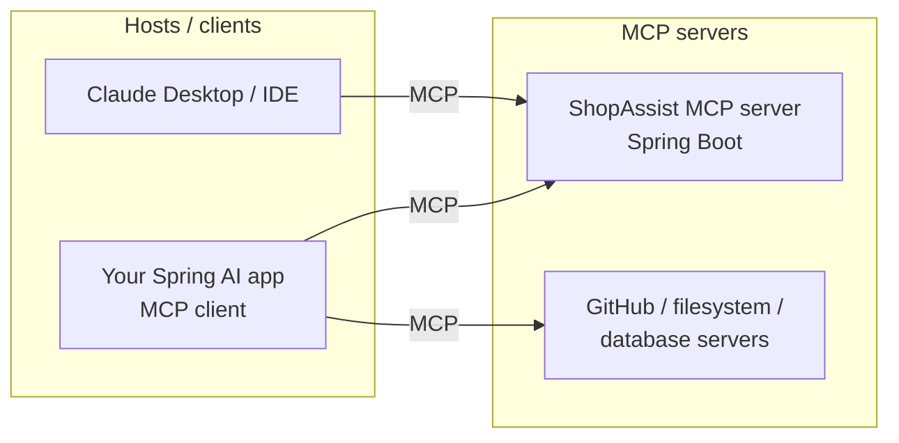

# 15 · Model Context Protocol (MCP)

**Why:** without a standard, every AI app needs custom glue for every tool. MCP is an open protocol, an
"HTTP for AI tools": you expose tools, resources and prompts **once** as an MCP server, and any MCP client
can use them (Claude Desktop, IDE assistants, agent frameworks, your own Spring AI apps).

## 15.1 Concepts



| MCP feature | What it is | Spring AI annotation |
|---|---|---|
| **Tools** | Functions the model can call | `@McpTool`, `@McpToolParam` (or plain `@Tool` beans) |
| **Resources** | Read-only data addressed by URI (files, records) | `@McpResource` |
| **Prompts** | Reusable prompt templates with arguments | `@McpPrompt`, `@McpArg` |
| **Completions** | Argument auto-completion | `@McpComplete` |
| Logging, progress | Server → client notifications | `@McpLogging`, `@McpProgress` |
| **Sampling** | Server asks the *client's* model to generate text | `@McpSampling` |
| **Elicitation** | Server asks the *user* for more input | `@McpElicitation` |

Transports:

| Transport | Use | Spring property |
|---|---|---|
| **STDIO** | Local process launched by the client (desktop tools) | `spring.ai.mcp.server.stdio=true` |
| **Streamable HTTP** (default) | Remote servers; the current standard | `spring.ai.mcp.server.protocol=STREAMABLE` |
| **Stateless** Streamable HTTP | Horizontally scaled servers without session affinity | `protocol=STATELESS` |
| SSE | Legacy HTTP transport | `protocol=SSE` |

## 15.2 Step 1: build an MCP server

```xml
<dependency>
  <groupId>org.springframework.ai</groupId>
  <artifactId>spring-ai-starter-mcp-server-webmvc</artifactId>   <!-- or -webflux, or spring-ai-starter-mcp-server for STDIO -->
</dependency>
```

```yaml
spring:
  ai:
    mcp:
      server:
        name: shopassist-mcp
        version: 1.2.0
        instructions: "Tools for searching the Acme Store catalog and checking order status."
        type: SYNC                       # SYNC or ASYNC
        protocol: STREAMABLE             # STREAMABLE (default) | STATELESS | SSE
        request-timeout: 20s
        streamable-http:
          mcp-endpoint: /mcp             # default
```

```java
@Component
class CatalogMcpTools {

    private final ProductCatalog catalog;

    CatalogMcpTools(ProductCatalog catalog) { this.catalog = catalog; }

    @McpTool(name = "search_products",
             description = "Search the Acme Store catalog by free text. Returns up to 10 products.",
             annotations = @McpTool.McpAnnotations(readOnlyHint = true, destructiveHint = false, idempotentHint = true))
    List<ProductSummary> searchProducts(
            @McpToolParam(description = "Search text, e.g. 'waterproof running shoes'") String query,
            @McpToolParam(description = "Maximum price in cents", required = false) Long maxPriceCents) {
        return catalog.search(query, maxPriceCents, 10);
    }

    @McpResource(uri = "catalog://categories", name = "categories",
                 description = "The list of product categories", mimeType = "application/json")
    String categories() {
        return catalog.categoriesAsJson();
    }

    @McpPrompt(name = "compare_products", description = "Compare two products for a customer")
    McpSchema.GetPromptResult compare(@McpArg(name = "skuA", required = true) String skuA,
                                      @McpArg(name = "skuB", required = true) String skuB) {
        return new McpSchema.GetPromptResult("Compare products",
                List.of(new McpSchema.PromptMessage(McpSchema.Role.USER,
                        new McpSchema.TextContent("Compare " + skuA + " and " + skuB
                                + " for price, weight and waterproofing. Use the search_products tool."))));
    }

    record ProductSummary(String sku, String name, long priceCents, boolean inStock) {}
}
```

Annotated beans are discovered automatically (annotation scanning is on by default). Existing Spring AI
`@Tool` methods can also be exposed: register them as a `ToolCallbackProvider` bean and the server converts
them into MCP tools.

```java
@Bean
ToolCallbackProvider storeToolsForMcp(StoreTools storeTools) {
    return MethodToolCallbackProvider.builder().toolObjects(storeTools).build();
}
```

`@McpTool` annotations (`readOnlyHint`, `destructiveHint` (default **true**), `idempotentHint`,
`openWorldHint`) tell clients how risky a tool is; clients may ask the user for confirmation before
destructive tools. Set them honestly.

### Accessing the request context

Add an `McpSyncRequestContext` (or `McpAsyncRequestContext`) parameter to log to the client, report progress,
or ask the client for sampling/elicitation:

```java
@McpTool(name = "reindex_catalog", description = "Re-index the catalog (admin only)",
         annotations = @McpTool.McpAnnotations(destructiveHint = false, idempotentHint = true))
String reindex(McpSyncRequestContext context) {
    context.info("Starting re-index");
    // ...
    return "done";
}
```

## 15.3 Step 2: test the server

1. Run the app and connect with the **MCP Inspector** (`npx @modelcontextprotocol/inspector`) to
   `http://localhost:8080/mcp`; list tools, call them, read resources.
2. Write an integration test that starts the server and uses an MCP client (below) against it.

## 15.4 Step 3: secure the server

A remote MCP server is an API: protect it like one.

- **OAuth 2**: MCP's authorization spec uses OAuth 2.1. Make the server an OAuth2 resource server (Spring
  Security `oauth2ResourceServer().jwt()`) and protect `/mcp`.
- **Authorize per tool** using the authenticated principal (`@PreAuthorize` on the tool's service method).
- **Never trust arguments** (same rules as [Tool Calling](09-tool-calling.md#93-step-2-pass-server-side-context-with-toolcontext)).
- Rate-limit, audit every call, and keep destructive tools out of public servers.
- Validate `Origin` headers and bind local servers to `localhost` (DNS-rebinding protection).

```java
@Bean
SecurityFilterChain mcpSecurity(HttpSecurity http) throws Exception {
    return http
            .securityMatcher("/mcp/**")
            .authorizeHttpRequests(a -> a.anyRequest().hasAuthority("SCOPE_mcp.tools"))
            .oauth2ResourceServer(o -> o.jwt(Customizer.withDefaults()))
            .csrf(c -> c.disable())
            .build();
}
```

## 15.5 Step 4: use MCP servers from a Spring AI client

```xml
<dependency>
  <groupId>org.springframework.ai</groupId>
  <artifactId>spring-ai-starter-mcp-client</artifactId>   <!-- or spring-ai-starter-mcp-client-webflux -->
</dependency>
```

```yaml
spring:
  ai:
    mcp:
      client:
        name: shopassist-agent
        type: SYNC
        request-timeout: 30s
        streamable-http:
          connections:
            catalog:
              url: https://catalog-mcp.internal.example.com
              endpoint: /mcp
        stdio:
          connections:
            filesystem:
              command: npx
              args: ["-y", "@modelcontextprotocol/server-filesystem", "/srv/shared-docs"]
```

The client auto-configuration exposes the remote tools as a `ToolCallbackProvider`
(`SyncMcpToolCallbackProvider`), which you hand to a `ChatClient`:

```java
@Bean
ChatClient agentClient(ChatClient.Builder builder, ToolCallbackProvider mcpTools) {
    return builder
            .defaultSystem("You help staff answer catalog questions using the available tools.")
            .defaultToolCallbacks(mcpTools)
            .build();
}
```

Tool names from different servers are prefixed to avoid collisions (customisable with a
`McpToolNamePrefixGenerator` bean). Filter which remote tools are exposed with a `McpToolFilter` bean,
and don't hand every tool of every server to every client.

You can also inject `List<McpSyncClient>` to call servers directly (list tools, read resources, get prompts)
and customise clients with `McpClientCustomizer` (e.g. to add auth headers to the HTTP transport).

## 15.6 MCP vs plain tool calling

| | Plain `@Tool` in your app | MCP server |
|---|---|---|
| Consumers | Only this app | Any MCP client |
| Deployment | In-process | Separate service (or STDIO process) |
| Latency | Method call | Network hop |
| Use when | Tools are specific to one app | Tools are shared across apps/agents/teams, or exposed to desktop/IDE assistants |

## 15.7 Production checklist

- [ ] Streamable HTTP (or stateless for horizontal scaling) behind TLS
- [ ] OAuth2-protected endpoint; per-tool authorization
- [ ] Honest tool annotations (`readOnlyHint`, `destructiveHint`)
- [ ] Small, well-described tools with bounded result sizes
- [ ] Timeouts on both server (`request-timeout`) and client
- [ ] Observability: tool call counts, latency, errors per tool
- [ ] Version the server (`spring.ai.mcp.server.version`) and evolve tools backward-compatibly

## Common mistakes

| Mistake | Fix |
|---|---|
| Public MCP endpoint without auth | OAuth2 resource server |
| Exposing every internal tool | Curate; filter on the client side too |
| `destructiveHint` left at default for read-only tools | Mark read-only tools explicitly |
| Returning huge payloads | Paginate; summarise; cap results |
| Session-based protocol behind a load balancer without affinity | `STATELESS` protocol |

## Checkpoint

- [ ] An MCP server exposes one tool, one resource and one prompt, verified with MCP Inspector
- [ ] A Spring AI client uses the server's tools through `ChatClient`
- [ ] The server endpoint requires a JWT

Next: [16 · Agents & Agentic Workflows](16-agents.md)
