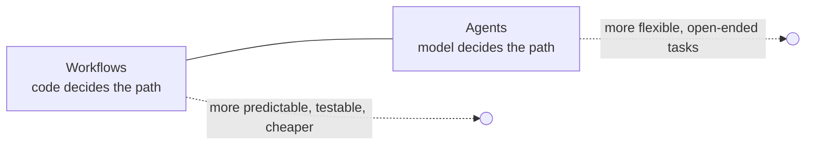

# 16 · Agents & Agentic Workflows

**Why:** some tasks need several steps: classify, look things up, draft, check, revise. You can build
them as **workflows** (your code controls the steps) or **agents** (the model decides the steps in a loop).
Workflows are predictable and cheap; agents are flexible and harder to control. Start with workflows.



All patterns below use only `ChatClient`, structured output and tools: no extra framework needed.

## 16.1 Pattern 1: Chain (sequential steps)

Each step's output feeds the next. Good for fixed pipelines.

```java
@Service
class ProductCopyChain {
    private final ChatClient chat;

    ProductCopyChain(ChatClient.Builder b) { this.chat = b.defaultOptions(ChatOptions.builder().temperature(0.3)).build(); }

    String run(String rawSupplierText) {
        ProductInfo facts = chat.prompt()
                .user("Extract product facts. Don't invent values:\n" + rawSupplierText)
                .call().entity(ProductInfo.class);                                  // step 1: extract

        String draft = chat.prompt()
                .user(u -> u.text("Write a 60-word product description from these facts: {facts}")
                            .param("facts", facts))
                .call().content();                                                   // step 2: write

        return chat.prompt()
                .user("Fix grammar and remove any claim not supported by these facts.\nFacts: "
                        + facts + "\nText: " + draft)
                .call().content();                                                   // step 3: check
    }
}
```

Add **gates** between steps (validation, rule checks) and stop early when one fails.

## 16.2 Pattern 2: Routing

Classify the input, then send it to a specialised prompt/model/toolset.

```java
enum Route { ORDER_STATUS, RETURNS, PRODUCT_QUESTION, HUMAN }
record RouteDecision(Route route, String reason) {}

@Service
class SupportRouter {
    private final ChatClient classifier;       // small, cheap model, temperature 0
    private final Map<Route, ChatClient> handlers;

    SupportRouter(ChatClient fastClient, ChatClient ordersClient, ChatClient returnsClient, ChatClient catalogClient) {
        this.classifier = fastClient;
        this.handlers = Map.of(Route.ORDER_STATUS, ordersClient,
                               Route.RETURNS, returnsClient,
                               Route.PRODUCT_QUESTION, catalogClient);
    }

    String handle(String message) {
        RouteDecision d = classifier.prompt()
                .system("Route customer messages. Use HUMAN for complaints, legal threats or anything unclear.")
                .user(message)
                .call().entity(RouteDecision.class);

        if (d.route() == Route.HUMAN) return escalateToAgent(message);
        return handlers.get(d.route()).prompt().user(message).call().content();
    }
}
```

Routing lets you give each route **only the tools it needs** (least privilege) and use cheap models for
easy routes.

## 16.3 Pattern 3: Parallelisation

Independent subtasks run concurrently; with virtual threads that's plain Java:

```java
List<String> reviews = loadReviews(sku);

try (var executor = Executors.newVirtualThreadPerTaskExecutor()) {
    List<Future<ReviewSummary>> futures = Lists.partition(reviews, 50).stream()
            .map(batch -> executor.submit(() -> chat.prompt()
                    .user("Summarise pros and cons in these reviews:\n" + String.join("\n---\n", batch))
                    .call().entity(ReviewSummary.class)))
            .toList();

    List<ReviewSummary> partials = new ArrayList<>();
    for (Future<ReviewSummary> f : futures) partials.add(f.get(60, TimeUnit.SECONDS));

    ReviewSummary combined = chat.prompt()
            .user("Merge these partial summaries into one: " + partials)
            .call().entity(ReviewSummary.class);
}
```

Variants: **sectioning** (split work) and **voting** (ask N times, take the majority, for high-stakes
classification). Respect provider rate limits: bound concurrency with a semaphore.

## 16.4 Pattern 4: Orchestrator–workers

An orchestrator model plans subtasks dynamically; workers execute them; results are combined.

```java
record Plan(List<Task> tasks) {}
record Task(String type, String instructions) {}

Plan plan = orchestrator.prompt()
        .system("Break the request into at most 5 tasks of type RESEARCH, WRITE or CHECK.")
        .user(request)
        .call().entity(Plan.class);

List<String> results = plan.tasks().stream()
        .limit(5)                                                 // hard cap regardless of the model
        .map(t -> workers.get(t.type()).prompt().user(t.instructions()).call().content())
        .toList();

String answer = orchestrator.prompt().user("Combine into a final answer: " + results).call().content();
```

## 16.5 Pattern 5: Evaluator–optimizer

One call generates, another critiques against criteria, loop until accepted or a max number of rounds.

```java
record Critique(boolean acceptable, List<String> problems) {}

String draft = writer.prompt().user(task).call().content();
for (int round = 0; round < 3; round++) {
    Critique c = reviewer.prompt()
            .system("Check: factual vs the given facts, tone friendly, under 80 words, no prices.")
            .user("Facts: " + facts + "\nDraft: " + draft)
            .call().entity(Critique.class);
    if (c.acceptable()) break;
    draft = writer.prompt().user("Revise to fix: " + c.problems() + "\nDraft: " + draft).call().content();
}
```

## 16.6 Pattern 6: The autonomous agent (tool loop)

Give the model a goal and tools; it decides which to call until done. In Spring AI that's simply a
`ChatClient` with tools, because `ToolCallingAdvisor` runs the loop:

```java
ChatClient agent = builder
        .defaultSystem("""
                You are a support agent for Acme Store. Resolve the customer's issue using the tools.
                Plan briefly, then act. Never promise refunds; use requestRefundReview for that.
                Stop and hand off to a human if you cannot resolve the issue in a few steps.
                """)
        .defaultTools(orderTools, shippingTools, refundTools, handoffTools)
        .defaultAdvisors(MessageChatMemoryAdvisor.builder(chatMemory).build())
        .build();
```

Guardrails that make an agent production-safe:

| Guardrail | How |
|---|---|
| Step limit | `spring.ai.tools.limits.max-total-tool-calls` + per-tool limits |
| Token/cost budget | Budget advisor ([Advisors](07-advisors.md#76-writing-an-advisor-calladvisor-around)) |
| Least-privilege tools | Only the tools needed for this agent; read-only by default |
| Confirmation for side effects | Tools *propose*; humans or rules *approve* ([Tool Calling](09-tool-calling.md#94-step-3-tools-with-side-effects)) |
| Escape hatch | A `handoffToHuman` tool and instructions to use it |
| Timeouts | Overall deadline on the request |
| Full trace | Observations for every model and tool call ([Observability](17-observability.md)) |

## 16.7 Human in the loop

For actions that matter, pause the workflow and resume after a human decision:

```mermaid
sequenceDiagram
  participant C as Customer
  participant A as Agent
  participant Q as Approval queue
  participant H as Human agent
  C->>A: "My parcel arrived broken"
  A->>A: getOrder, checkDeliveryPhotos
  A->>Q: proposeRefund(order, amount, evidence)
  A-->>C: "I've sent this for review; you'll hear back within 2 hours."
  H->>Q: approve
  Q->>C: refund issued (normal domain service)
```

Store pending actions in your database, with all context the reviewer needs; never keep the "paused agent"
only in memory.

## 16.8 Multi-agent systems

Several specialised agents (each with its own prompt, tools and model) coordinated by a router or
orchestrator, or by exposing agents to each other as tools or via MCP. Use only when single-agent + routing
is genuinely not enough: each extra agent multiplies cost, latency and failure modes.

## 16.9 Testing agents

- Unit-test each step and tool deterministically (mock `ChatModel`).
- Evaluate end-to-end on a scenario dataset: expected tools called, forbidden tools not called, final answer
  criteria (LLM judge), step count and token usage under limits.
- Replay real (anonymised) conversations as regression tests.

See [Testing & Evaluation](18-testing-evaluation.md).

## Choosing a pattern

| Task | Pattern |
|---|---|
| Fixed sequence (extract → write → check) | Chain |
| Different request types need different handling | Routing |
| Many independent items | Parallelisation |
| Subtasks unknown until you see the input | Orchestrator–workers |
| Output quality matters and criteria are clear | Evaluator–optimizer |
| Open-ended problem-solving with tools | Agent (with guardrails) |

## Common mistakes

| Mistake | Fix |
|---|---|
| Building an agent for a fixed workflow | Chain/routing |
| Unlimited loops | Tool-call limits, max rounds, deadlines |
| One agent with every tool | Route; least privilege |
| No human escape hatch | Handoff tool + instructions |
| Agent state only in memory | Persist pending actions |

## Checkpoint

- [ ] A router sends messages to specialised clients with different tools
- [ ] An evaluator–optimizer loop has a hard max of rounds
- [ ] Your agent has step limits, a budget and a handoff tool

Next: [17 · Observability](17-observability.md)
