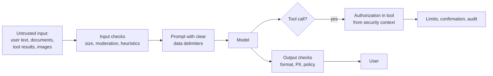

# 19 · Security & Guardrails

**Why:** an LLM feature adds a new kind of input (natural language that can carry instructions), a new
kind of output (generated text and tool calls), and often new access paths to your data. Secure it like any
other API, plus a few AI-specific controls.

## 19.1 OWASP Top 10 for LLM applications (2025) mapped to Spring AI

| # | Risk | What it looks like | Controls in a Spring AI app |
|---|---|---|---|
| LLM01 | **Prompt injection** | "Ignore your rules and…" in user text, a document, a web page, an image | Separate instructions from data; least-privilege tools; authorization in tools; output checks |
| LLM02 | Sensitive information disclosure | Answers include other customers' data, secrets, system prompt details | Tenant/ACL filters; no secrets in prompts; PII redaction advisor; output filtering |
| LLM03 | Supply chain | Compromised model, plugin, MCP server or dataset | Pin model versions; vet MCP servers; dependency scanning; SBOM |
| LLM04 | Data and model poisoning | Malicious content ingested into your RAG store | Ingest only trusted sources; review user-generated content; provenance metadata |
| LLM05 | Improper output handling | Model output rendered as HTML/SQL/shell → XSS/injection | Treat output as untrusted: escape, validate, never `eval` |
| LLM06 | Excessive agency | Model can refund, delete, email without checks | Read-only tools by default; confirmation; limits; audit |
| LLM07 | System prompt leakage | Users extract your prompt and its embedded secrets/rules | Never put secrets or authorization rules in prompts |
| LLM08 | Vector and embedding weaknesses | Cross-tenant retrieval; embedding inversion | Mandatory metadata filters; separate indexes for sensitive tenants |
| LLM09 | Misinformation | Confident wrong answers | RAG grounding, "I don't know", citations, evaluation |
| LLM10 | Unbounded consumption | Huge inputs, loops, denial of wallet | Input size limits, `maxTokens`, rate limits, budgets, tool-call limits |

## 19.2 Prompt injection: defence in depth

There is **no complete fix** for prompt injection. Design so that a successful injection can't do damage.



1. **Least privilege**: the assistant can only do what the *current user* could do through your normal
   API, and preferably less. This makes injection mostly harmless.
2. **Authorization in tools and retrieval**: identity from `ToolContext`/`SecurityContext`, never from model
   arguments ([Tool Calling](09-tool-calling.md)).
3. **Separate data from instructions**: delimit documents and tool results (`<context>…</context>`) and say
   in the system prompt that their content is data.
4. **Confirm side effects** with the user through your own UI and endpoints.
5. **Input screening**: size limits, moderation, and simple heuristics (block or flag "ignore previous
   instructions", hidden Unicode, very long inputs). Optionally a small classifier model as a guard.
6. **Output screening**: check outputs before acting or displaying (format, PII, links to unknown domains).
7. **Monitor**: count guard hits, investigate spikes.

A simple input guard advisor:

```java
public final class InjectionHeuristicsAdvisor implements BaseAdvisor {
    private static final List<Pattern> SUSPICIOUS = List.of(
            Pattern.compile("(?i)ignore (all|any|the)? ?(previous|prior|above) (instructions|rules)"),
            Pattern.compile("(?i)you are now|act as (the )?system|developer mode"),
            Pattern.compile("[\\u200B-\\u200F\\u202A-\\u202E\\u2066-\\u2069]"));   // hidden/bidi characters

    private final MeterRegistry meters;

    public InjectionHeuristicsAdvisor(MeterRegistry meters) { this.meters = meters; }

    @Override
    public ChatClientRequest before(ChatClientRequest request, AdvisorChain chain) {
        String text = request.prompt().getUserMessage().getText();
        if (text != null && SUSPICIOUS.stream().anyMatch(p -> p.matcher(text).find())) {
            meters.counter("shopassist.ai.guard", "type", "injection_heuristic").increment();
            // choose a policy: block, strip, or continue but flag for review
        }
        return request;
    }

    @Override public ChatClientResponse after(ChatClientResponse r, AdvisorChain c) { return r; }
    @Override public int getOrder() { return Ordered.HIGHEST_PRECEDENCE + 10; }
}
```

Heuristics catch only lazy attacks; the structural controls (1–4) are what actually protect you.

## 19.3 Sensitive data (PII) protection

| Stage | Control |
|---|---|
| Before the model | Redact PII the model doesn't need ([PII advisor](07-advisors.md#75-writing-an-advisor-baseadvisor-beforeafter)); send pseudonymous ids, not names/emails |
| Provider | Enterprise terms (no training on your data), regional endpoints / data residency, zero-retention options where offered |
| Storage | Redact before chat memory; encrypt at rest; retention limits ([Chat Memory](08-chat-memory.md#88-privacy-retention-and-gdpr)) |
| Observability | Prompt/completion logging off by default ([Observability](17-observability.md#173-logging-prompt-and-completion-content-carefully)) |
| Sensitive workloads | Self-hosted models (Ollama/vLLM) inside your network |

## 19.4 Secrets

- Never put API keys, connection strings or internal URLs in prompts; assume the system prompt will leak.
- Provider keys in a secret manager; per-environment keys; spend limits on the provider side.
- MCP client connections that need credentials: inject via `McpClientCustomizer`, from secrets.

## 19.5 Output handling

```java
// Rendering model output in a web page: treat it like user input
String safeHtml = HtmlUtils.htmlEscape(answer);              // or render Markdown with a sanitizer

// Model output used in a query: never concatenate
List<Product> products = productRepository.search(filters.category(), filters.maxPriceCents()); // typed, parameterised
```

- Structured output + Bean Validation for anything your code consumes.
- Allow-list URLs the assistant may link to.
- Never execute generated code, SQL or shell commands outside a sandbox with no access to production.

## 19.6 Abuse and unbounded consumption

```java
record AskRequest(@NotBlank @Size(max = 2000) String question) {}   // input size limit
```

```yaml
spring.ai.openai.chat.max-completion-tokens: 800                  # output limit
spring.ai.tools.limits.max-total-tool-calls: 10                   # loop limit
```

Plus: per-user rate limits (Bucket4j / API gateway), daily token budgets per user/tenant
([budget advisor](07-advisors.md#76-writing-an-advisor-calladvisor-around)), authentication on every AI
endpoint, CAPTCHA or similar for anonymous chat, and provider-side spend alerts.

## 19.7 Securing the AI endpoints themselves

```java
@Bean
SecurityFilterChain api(HttpSecurity http) throws Exception {
    return http
            .authorizeHttpRequests(a -> a
                    .requestMatchers("/api/assistant/**").hasRole("CUSTOMER")
                    .requestMatchers("/api/admin/ai/**").hasRole("AI_ADMIN")       // ingestion, prompt admin
                    .anyRequest().authenticated())
            .oauth2ResourceServer(o -> o.jwt(Customizer.withDefaults()))
            .build();
}
```

Ingestion endpoints are especially sensitive: whoever can add documents can influence answers (poisoning).

## 19.8 Governance

| Practice | Why |
|---|---|
| Inventory of AI features, models, providers, data sent | Know your exposure |
| Data-processing agreements with providers | Legal basis for sending personal data |
| Disclosure ("You're chatting with an AI assistant") | Transparency, and regulation in some regions (e.g. EU AI Act) |
| Human escalation path | Customers must be able to reach a person |
| Red-team exercises before launch | Find injection/leak paths early |
| Incident process for AI failures | Wrong answers can be incidents too |

## Security checklist

- [ ] The assistant can't do anything the user couldn't do via the normal API
- [ ] Tools and retrieval enforce authorization from the security context
- [ ] Side-effecting tools require user confirmation
- [ ] No secrets or authorization logic in prompts
- [ ] Input size, output tokens, tool calls, rate and budget all limited
- [ ] PII redacted before memory and logs; retention configured
- [ ] Model output escaped/validated before rendering or use
- [ ] Injection and cross-tenant cases in the evaluation dataset

Next: [20 · Resilience, Performance & Cost](20-resilience-performance-cost.md)
