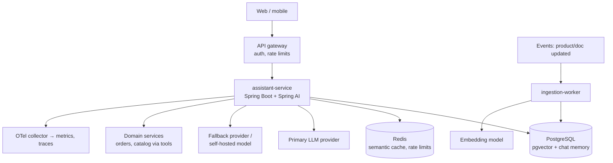

# 21 · Production Deployment

**Why:** shipping an AI feature means shipping configuration (models, prompts, keys), infrastructure
(vector store, maybe GPUs), and a change process for things that alter behaviour without a code change.

## 21.1 Reference architecture



Keep **ingestion** in a separate worker from **serving**, so embedding bursts can't hurt chat latency.

## 21.2 Configuration per environment

```yaml
# application.yml (shared defaults)
spring:
  threads.virtual.enabled: true
  ai:
    retry: { max-attempts: 3, backoff: { initial-interval: 1s, multiplier: 2, max-interval: 8s } }
    tools.limits: { max-total-tool-calls: 10, max-calls-per-tool-default: 3 }
    chat.observations: { log-prompt: false, log-completion: false }

---
spring.config.activate.on-profile: dev
spring.ai:
  model.chat: ollama
  model.embedding: ollama
  ollama.chat.model: llama3.1

---
spring.config.activate.on-profile: prod
spring.ai:
  model.chat: openai
  model.embedding: openai
  openai:
    api-key: ${OPENAI_API_KEY}
    chat: { model: ${AI_CHAT_MODEL:gpt-4o-mini}, temperature: 0.2, max-completion-tokens: 800 }
    embedding.model: text-embedding-3-small
  vectorstore.pgvector: { initialize-schema: false, dimensions: 1536 }
  chat.memory.repository.jdbc.initialize-schema: never
```

Model names in configuration (environment variables), not code, so you can roll back a model change
without a deploy.

## 21.3 Secrets on Kubernetes

```yaml
apiVersion: v1
kind: Secret
metadata: { name: assistant-ai-keys }
type: Opaque
stringData:
  OPENAI_API_KEY: "<from your secret manager via External Secrets Operator>"
---
apiVersion: apps/v1
kind: Deployment
metadata: { name: assistant-service }
spec:
  replicas: 3
  template:
    spec:
      containers:
        - name: app
          image: registry.example.com/assistant-service:1.8.3
          envFrom: [{ secretRef: { name: assistant-ai-keys } }]
          env:
            - { name: SPRING_PROFILES_ACTIVE, value: prod }
            - { name: AI_CHAT_MODEL, value: gpt-4o-mini }
          resources:
            requests: { cpu: 500m, memory: 1Gi }
            limits:   { memory: 1Gi }
          readinessProbe: { httpGet: { path: /actuator/health/readiness, port: 8080 } }
          livenessProbe:  { httpGet: { path: /actuator/health/liveness, port: 8080 } }
```

Use External Secrets Operator / Vault / cloud secret managers rather than committing Secret manifests.

!!! tip "Health checks must not call the model"
    Don't make readiness depend on the LLM provider. A provider blip would take all pods out of service,
    when you could have served fallbacks. Monitor provider health with metrics and alerts instead.

## 21.4 Network egress

- Allow-list provider endpoints on your egress proxy/firewall.
- Use private connectivity where available (e.g. Bedrock or Azure endpoints inside your cloud network).
- Long-lived streaming responses need load balancer / ingress idle timeouts above your longest stream
  (e.g. 120 s) and disabled response buffering for SSE.

```yaml
# NGINX ingress annotations for SSE
nginx.ingress.kubernetes.io/proxy-read-timeout: "120"
nginx.ingress.kubernetes.io/proxy-buffering: "off"
```

## 21.5 Self-hosted models

| Option | Use |
|---|---|
| Ollama | Simple; dev and moderate production loads |
| vLLM / TGI / other OpenAI-compatible servers | High-throughput GPU serving; use the OpenAI starter with `base-url` |
| Cloud-managed (Bedrock, Vertex AI, Azure/Foundry) | Provider models with private networking and enterprise terms |

```yaml
spring.ai.openai:
  base-url: http://vllm.ai-serving.svc.cluster.local:8000
  api-key: unused-but-required
  chat.model: meta-llama/Llama-3.1-8B-Instruct
```

Self-hosting trades per-token cost for GPU cost and operational work (capacity, upgrades, autoscaling on
GPU metrics). It pays off for high-volume, simpler tasks or strict data-residency requirements.

## 21.6 Database migrations

Manage AI tables with Flyway like everything else: pgvector extension and vector table
([Vector Stores](11-vector-stores.md#112-step-1-pgvector-recommended-default)), chat memory table
([Chat Memory](08-chat-memory.md#83-step-2-persistent-memory-with-jdbc-production)), your conversation,
feedback, ingestion-ledger and pending-action tables. Set Spring AI's `initialize-schema` to off in prod.

## 21.7 Releasing behaviour changes safely

Prompts, models, retrieval settings and tools change behaviour. Treat each as a release:

1. Change in a PR → evaluation suite runs ([Testing & Evaluation](18-testing-evaluation.md)).
2. Deploy behind a **feature flag** or to a percentage of traffic.
3. Compare metrics between variants: quality (👍/👎, "I don't know", escalations), latency, cost.
4. Promote or roll back by flipping the flag/config.

```java
ChatClient client = flags.isEnabled("assistant.prompt.v4", user) ? supportClientV4 : supportClientV3;
```

## 21.8 Model lifecycle

- Pin **exact model versions** in production where providers offer dated snapshots.
- Track provider deprecation notices; schedule upgrades.
- Before switching: run evaluations, compare cost/latency, roll out gradually.
- Embedding model changes need full re-indexing ([ETL](12-etl-pipeline.md#128-re-embedding-everything-model-or-chunking-change)).

## 21.9 Operational runbook (excerpt)

| Situation | Action |
|---|---|
| Provider outage | Circuit breaker → fallback model; status banner; check provider status page |
| Cost spike | Check tokens per request (memory/context growth?), traffic source, tool loops; lower limits; block abusive users |
| Quality complaints after a deploy | Compare evaluation scores and feedback by prompt version; roll back flag |
| Wrong answer reported | Find the trace via response id; inspect retrieved docs and tool calls; fix data or prompt; add the case to the dataset |
| Data leak suspected | Disable feature flag; preserve logs; review tool authorization and filters; incident process |
| 429s | Reduce concurrency; spread across keys/regions; request higher quota |

## 21.10 Go-live checklist

**Functionality**
- [ ] Evaluation dataset passes thresholds (quality, refusal, injection, cross-tenant)
- [ ] "I don't know" and human-handoff paths work

**Security**
- [ ] Authentication on all AI endpoints; per-user rate limits and budgets
- [ ] Tools/retrieval authorize from the security context; side effects need confirmation
- [ ] PII redaction; retention jobs; prompt logging off
- [ ] Keys in a secret manager; provider spend limits set

**Reliability**
- [ ] Timeouts, tuned retries, circuit breaker + fallback, overall deadline
- [ ] Readiness doesn't depend on the provider
- [ ] Ingress timeouts and buffering configured for streaming

**Operations**
- [ ] Dashboards: latency, tokens, cost, errors, tool calls, feedback
- [ ] Alerts: provider errors, cost spike, token explosion, tool-limit hits
- [ ] Runbook and on-call ownership
- [ ] Model versions pinned; feature flag for quick rollback

**Compliance**
- [ ] Data processing agreements; data residency checked
- [ ] Users told they're talking to an AI; feedback and escalation available

Next: [22 · Capstone: ShopAssist End to End](22-capstone.md)
