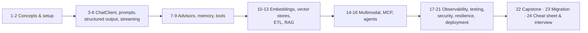

# Spring AI in Production: Step by Step

This tab is a complete, step-by-step guide to building **production** AI features with **Spring AI 2.0** on
**Spring Boot 4**. It starts from "what is a token" and ends with MCP servers, agents, evaluation in CI,
observability dashboards, cost control and a deployment checklist.

Every page uses the same **generic running example**, *ShopAssist*: an online store that adds an AI
assistant. The assistant answers questions about products and policies (RAG), looks up a customer's orders
(tool calling, with authorization), remembers the conversation (chat memory), extracts structured data from
free text (structured output), and is exposed to other AI clients through MCP. The domain is deliberately
ordinary, so the patterns carry over to any business.

!!! info "Verified against the real code"
    The class names, builder methods and configuration properties on these pages were checked against the
    **Spring AI 2.0.2** source jars on Maven Central (the latest stable release at the time of writing;
    2.1 is in milestones). Spring AI 2.0 **requires Spring Boot 4.x** (Spring Framework 7, Jakarta EE 11,
    Jackson 3) and Java 17+ (Java 21+ recommended). If you are on Boot 3.x, use Spring AI 1.0.x/1.1.x and
    read [Migration 1.x → 2.0](23-migration-1x-to-2.md) for the differences.

## How to read this tab

Work through the steps in order the first time. Each page has the same shape: **why**, **concepts**,
**step-by-step code**, **production notes**, **common mistakes**, and a **checkpoint** so you know you are
ready to move on.

## Contents

| Step | Page | You will learn |
|---|---|---|
| 1 | [AI & LLM Concepts for Java Developers](01-concepts.md) | Tokens, context windows, temperature, embeddings, RAG, tools, agents, MCP, hallucinations |
| 2 | [Project Setup & Providers](02-setup.md) | BOM, starters, OpenAI / Anthropic / Ollama / Bedrock / Gemini, properties, API keys, first call |
| 3 | [ChatClient Deep Dive](03-chat-client.md) | Fluent API, defaults, options, `call()` vs `stream()`, responses, usage, multiple clients, `ChatModel` |
| 4 | [Prompts, Messages & Templates](04-prompts.md) | Roles, `PromptTemplate`, template files, prompt engineering techniques, prompt versioning |
| 5 | [Structured Output](05-structured-output.md) | `entity()`, converters, generics, native structured output, schema validation and retry |
| 6 | [Streaming Responses](06-streaming.md) | `Flux`, Server-Sent Events in MVC & WebFlux, cancellation, aggregating usage |
| 7 | [Advisors](07-advisors.md) | The advisor chain, ordering, built-in advisors, writing your own (PII redaction, budget guard) |
| 8 | [Chat Memory](08-chat-memory.md) | `ChatMemory`, window memory, JDBC/Redis/Mongo repositories, conversation ids, retention |
| 9 | [Tool Calling](09-tool-calling.md) | `@Tool`, `ToolContext`, function callbacks, limits, `ToolCallingAdvisor`, authorization, tool search |
| 10 | [Embeddings](10-embeddings.md) | `EmbeddingModel`, dimensions, batching, similarity, cost |
| 11 | [Vector Stores](11-vector-stores.md) | `VectorStore` API, PGvector, `SearchRequest`, metadata filters, other stores |
| 12 | [ETL: Ingesting Documents](12-etl-pipeline.md) | Readers (PDF, Tika, JSON, text), splitters, enrichers, idempotent re-indexing |
| 13 | [Retrieval-Augmented Generation](13-rag.md) | `QuestionAnswerAdvisor`, modular RAG, query rewriting, multi-query, tenant filters, citations |
| 14 | [Multimodality: Images, Audio, Moderation](14-multimodal.md) | Image input, image generation, transcription, text-to-speech, moderation |
| 15 | [Model Context Protocol (MCP)](15-mcp.md) | MCP servers with `@McpTool`, MCP clients, transports, security |
| 16 | [Agents & Agentic Workflows](16-agents.md) | Chain, routing, parallel, orchestrator-workers, evaluator-optimizer, human in the loop |
| 17 | [Observability](17-observability.md) | Micrometer observations, `gen_ai.*` metrics, tracing, logging prompts safely, cost dashboards |
| 18 | [Testing & Evaluation](18-testing-evaluation.md) | Unit tests without a model, Testcontainers + Ollama, evaluators, golden datasets, CI gates |
| 19 | [Security & Guardrails](19-security.md) | OWASP LLM Top 10, prompt injection, PII, tool authorization, output handling |
| 20 | [Resilience, Performance & Cost](20-resilience-performance-cost.md) | Retries, timeouts, circuit breakers, fallback models, semantic cache, prompt caching, token budgets |
| 21 | [Production Deployment](21-production-deployment.md) | Configuration per environment, secrets, Kubernetes, self-hosted models, rollout, governance |
| 22 | [Capstone: ShopAssist End to End](22-capstone.md) | Every piece assembled into one service, with a production checklist |
| 23 | [Migration 1.x → 2.0](23-migration-1x-to-2.md) | What changed in 2.0 and how to upgrade |
| 24 | [Cheat Sheet & Interview Questions](24-cheat-sheet-interview.md) | Properties, APIs and 40+ interview questions with answers |

## The one rule that runs through every page

> A language model is a **stateless, non-deterministic, remote, slow, expensive function from text to text
> that is sometimes confidently wrong.**

Every production technique in this tab follows from that sentence:

| Property | What you do about it | Page |
|---|---|---|
| Stateless | Send history explicitly; bound it | [Chat Memory](08-chat-memory.md) |
| Non-deterministic | Test properties, not strings; evaluate | [Testing & Evaluation](18-testing-evaluation.md) |
| Remote | Timeouts, retries, circuit breakers, fallbacks | [Resilience](20-resilience-performance-cost.md) |
| Slow | Stream; keep it off latency-critical paths | [Streaming](06-streaming.md) |
| Expensive | Token budgets, caching, model routing | [Resilience, Performance & Cost](20-resilience-performance-cost.md) |
| Confidently wrong | Ground with RAG; never let it decide money, permissions or facts | [RAG](13-rag.md), [Security](19-security.md) |

## Relationship to Chapter 40

[Chapter 40 · Spring AI](../part-3-enterprise/40-spring-ai.md) in Part 3 is the architectural overview grounded in the
grocery marketplace. This tab is the hands-on, API-level manual: read Chapter 40 for *where* AI belongs in
an enterprise system, and this tab for *how* to build each piece correctly.
